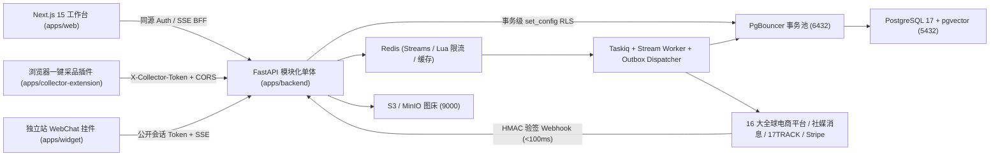

# ai-native-erp

面向工贸一体企业的多租户 **B2B + B2C 跨境电商全渠道 AI 工作台与轻量 ERP**。  
打通「**多源选品采集 → 统一图床与 AI 改写 → 多规格多平台实时刊登 → 全平台订单/WMS 防超卖实时同步 → 业财净毛利/ROAS 核算与 1688 自动补货 → 聚合客服与 AI 数字员工**」完整闭环；B2B 询盘/PI 报价与 B2C 零售/售后共用同一套收件箱、商品主档 SKU、库存台账与业财底座。

旗舰演示租户预设为 **Quanzhou Smart LED Lighting Factory**（`hybrid_factory_b2b_b2c`）。

---

## 目录

- [系统架构总览](#系统架构总览)
- [核心业务能力全景](#核心业务能力全景)
- [支持平台与外部集成清单](#支持平台与外部集成清单)
- [仓库结构、后端域模块与前端路由](#仓库结构后端域模块与前端路由)
- [架构与安全护栏](#架构与安全护栏)
- [快速开始](#快速开始)
  - [1. 全容器化 Docker 一键部署](#1-全容器化-docker-一键部署)
  - [2. 本地源码全栈开发](#2-本地源码全栈开发)
  - [3. 纯前端 Mock 开发模式](#3-纯前端-mock-开发模式)
  - [4. 加载多源浏览器一键采品插件](#4-加载多源浏览器一键采品插件)
- [数据库迁移演进（0001 → 0019）](#数据库迁移演进0001--0019)
- [测试、OpenAPI 契约与 CI Gate 门禁](#测试openapi-契约与-ci-gate-门禁)
- [工程文档、研究报告与合规材料](#工程文档研究报告与合规材料)

---

## 系统架构总览



### 核心技术栈

| 层级 | 技术选型 |
| :--- | :--- |
| **后端 API 与异步内核** | Python 3.12+ (`uv`)、FastAPI `>=0.115.6`、Pydantic `>=2.10`、SQLAlchemy `>=2.0.36` (`asyncpg`)、Alembic `>=1.14`、Taskiq `>=0.11` + `taskiq-redis`、`structlog` |
| **数据库、缓存与对象存储** | PostgreSQL 17 + `pgvector`（`FORCE ROW LEVEL SECURITY`）、PgBouncer 事务连接池、Redis、S3/MinIO 兼容对象存储（RustFS） |
| **前端工作台与独立挂件** | Next.js 15（App Router）、React 19、Tailwind CSS 4、TanStack Query 5、`@hey-api/openapi-ts`、Vitest 3、Playwright、Vite（IIFE Widget `< 35 KiB` gzip） |
| **浏览器采集扩展** | Chrome Manifest V3 纯 ES 模块（零构建依赖），支持 `node --test` 原生单元测试 |

---

## 核心业务能力全景

### 1. 多源选品采集、统一图床与多平台多规格刊登
- **多源采品与浏览器插件（Phase 4）**：支持「工作台粘贴 1688/URL/中文文案」及「[浏览器一键采品插件](apps/collector-extension/)」直采 **1688（含 `window.__INIT_DATA` 规格/阶梯价/原图后缀清洗与 DOM 回退）、淘宝/天猫、拼多多、Alibaba 国际站与通用 OpenGraph / JSON-LD 页面**。
- **采集授权码鉴权（`0017`）**：在 `/catalog?tab=sourcing` 生成租户级 `erp_col_` 采集授权码（明文仅展示一次，库内存 SHA-256 哈希，支持一键吊销与 `last_used_at` 审计）；插件通过 `POST /api/v1/catalog/sourcing/collect-from-extension` 直送多规格草稿，并发起受 `begin_nested()` 隔离的 SSRF 安全外链转存。
- **AI 改写与 Decimal 阶梯定价**：确定性生成英文 SEO 标题、5 条海外卖点、目标 USD 零售价、3 档 B2B MOQ 阶梯价及规范化 SKU。
- **LLM 多语种 / 分平台 AI 智能改写（`POST /catalog/sourcing/drafts/{id}/ai-rewrite`）**：按 **12 语种 × 16 平台**的文案规则集（`SUPPORTED_REWRITE_LANGUAGES` + `PLATFORM_COPY_GUIDELINES`，如 Shopee 默认泰语、Lazada 马来语、Ozon 俄语、Mercado Libre 西语）一次产出整册本地化刊登文案；调用经 `BYOK` 模型路由并由 `Wallet` 按量计费扣减 credits，标题/价格等数字一律走**零幻觉价格校验**；未配置任何 Provider 时**诚实降级**到确定性引擎并回传 `rewrite_mode="deterministic_fallback"`（零 credits 消耗，绝不伪装成 LLM 产出）。
- **强类目属性配置**：`PATCH /catalog/sourcing/drafts/{id}` 可写入每平台 `marketplace_category_attrs`（如 Amazon 的 `browse_node` / Lazada 的 `category_id`），刊登时由分发器**直透**到各平台商品创建接口，避免因类目属性缺失被平台驳回。
- **全球电商渠道接入（`0018`）**：`/settings/channels` 渠道应用市场扩到 **22 张卡片**（即时消息 6 + 订单同步 16），Shopee（含全托管 / 轻出海）、Lazada（含全托管）、Temu（全托管 / 半托管 / 本土）、SHEIN（自营 / 半托管）、AliExpress（自运营 / 托管）、Ozon（FBS / FBO）、Walmart（自发货 / WFS）与 Mercado Libre（自发货 / 全托管）各自按履约模式一键接入；Partner Key / App Secret / Access Token 全部信封加密托管，提交后表单不再回显任何密钥。
- **统一图床与多规格实店刊登（Phase 1）**：支持本地 PNG/JPEG 上传或外链转存至 MinIO/S3；草稿支持任意 `options_spec` + `variants_spec` 矩阵一键入主档并同步推送至 **16 大全球电商 / 外贸平台**，写回真实 `platform_sku_mappings`（如 Shopify `gid://shopify/Product/...`、`ProductVariant` 与 `InventoryItem`）。

### 2. 多平台订单、WMS 与实时库存防超卖同步（Phase 2）
- **实时同步 Outbox（`0015`）**：WMS 中 5 类库存台账变更（采购入库、盘点调整、订单预占、释放预占、发货扣减）均在同一数据库事务内写入 `inventory_sync_jobs`（带 `pending` 映射部分唯一索引防重复入队）。
- **防超卖可售量公式**：按渠道映射实时计算：
  `sellable_qty = floor(max(0, net_available - safety_stock) / bundle_multiplier)`。
- **Worker 排空 + 定时对账 + 死信退避**：Outbox Worker 每 2 秒异步排空并每 30 分钟执行全租户对账；失败自动按 `30s -> 120s -> 600s -> dead_letter`（最多 3 次）退避重试；`/wms` 提供「一键同步全平台库存」、逐条状态明细与失败「重试推送」操作。
- **17TRACK 物流追踪**：固定 `cacheLevel=0` 拉取最新物流轨迹并关联订单状态机。

### 3. 业财一体、全平台经营分析与 1688 智能补货闭环（Phase 3）
- **业财精算内核**：B2B PI/订单与 B2C 订单统一落账，支持 AR 应收收款、AP 应付账款、多币种汇率与 **CVP 净贡献毛利快照**（全部 `Decimal` `ROUND_HALF_UP` + PostgreSQL `NUMERIC`）。
- **16 渠道销量 / 净毛利 / ROAS 分析（`0016`）**：所有 16 个电商适配器均把退货金额（`refunded_amount`）与平台佣金（`platform_commission_base`）归一化写入订单元数据；`/dashboard` 与 `/finance` 均内嵌 `7D / 30D / 90D` 全渠道 GMV、退款率、佣金、广告投放、净贡献毛利与 ROAS 分布看板。
- **SKU 动销预警 & 1688 一键补货**：按 30 天日均销量与当前可用库存自动计算可售天数（`days_of_cover`）和缺货风险等级，回链至选品草稿的 **1688 原采购链接**，在 `/wms` 一键生成附带 1688 货源 URL 的采购草稿/PO。
- **AI 经营助手与 Copilot 确定性查数（`0019`）**：新增 PG17 `security_invoker` 视图 `vw_tenant_channel_sales_analytics`（继承 `orders` / `order_profit_snapshots` / `channel_daily_metrics` / `channel_accounts` 的 `FORCE RLS` 策略），按租户 + 平台 + 店铺 + 日期统一汇总 GMV、退款率、平台佣金、广告费、净贡献毛利与 ROAS；AI 经营助手/Copilot 通过确定性 SQL 工具 `get_live_channel_sales_analytics` 取数，`ToolGroundedNumericGuard` 校验每个数字都能溯源到工具调用（`source_tool_call_id`），Copilot 经营分析面板直接渲染同一份确定性结果——**所有经营数字零静态 RAG、零模型臆造**。

### 4. 全渠道聚合收件箱与客户身份图谱
- **多通道实时收件箱（SSE）**：B2B 询盘邮件、WhatsApp Cloud / Coexistence、Facebook Messenger、Instagram DM、Telegram、独立站 WebChat 与 Made-in-China 询盘统一归一到客户主档案与同一会话视图。
- **合规消息外发护栏**：Redis Lua 分布式双令牌桶限流、24h 会话窗口校验、`STOP` 关键词零延迟退订阻断。
- **12 大跨境电商平台买家站内私信 IM 双向收发闭环（`0019`）**：Shopee、Lazada、Temu、SHEIN、AliExpress、Ozon、Walmart、Mercado Libre、TikTok Shop、eBay、Amazon SP-API 与 Alibaba 国际站统一接入 `POST /api/v1/webhooks/im/{platform}`（原始报文 HMAC 验签、`ON CONFLICT DO NOTHING` 落 `raw_webhook_events`、`<100ms` 返回 `HTTP 200`、`STOP` 关键词触发退订抑制），由 Worker **无竞争消费**（9 个平台复用 `COMMERCE_TRACKING_CHANNELS` 的 `stream:webhooks:{channel}`，eBay / Amazon / Alibaba 由 ingress worker 独占，绝不出现第二个 consumer group 抢跑重复消费）；会话统一进 `/inbox` 收件箱（`marketplace_buyer_id` 身份并入客户主档案），支持 AI 客服提案与自动回复，出站回复按平台**签名发送**直连买家站内私信。

### 5. AI 引擎、数字员工与可控自动化
- **零幻觉确定性工具（`ErpToolRegistry`）**：实时报价、MOQ、库存、订单和物流查询全部强制走确定性 SQL 工具并校验 `source_tool_call_id`；严格 RAG 检索（pgvector + HNSW，严格按 `tenant_id` 过滤）无可靠依据时主动拒答。
- **BYOK 多模型路由与 L0/L1/L2 治理**：支持 OpenAI / Anthropic / DeepSeek / Gemini BYOK 加密托管与语义缓存；L0 辅助起草、L1 生成提案待人工审批执行、L2 仅在策略授权边界内自动执行，完整关联计量与 Stripe 计费。

### 6. CRM、供应链、合规获客与社媒矩阵
- **CRM & 任务中心**：线索、客户、商机看板、跟进记录与任务提醒全打通。
- **Growth 合规获客**：外部潜在客户线索合规采集、清洗富化与营销触达活动。
- **Social 社媒矩阵**：多社媒文案 AI 生成、排期发布与跨平台成交归因分析。

---

## 支持平台与外部集成清单

| 类别 | 已实现适配器 / 集成 | 核心能力 |
| :--- | :--- | :--- |
| **16 大全球电商 / 外贸平台** | Shopify (`shopify`)、TikTok Shop (`tiktok_shop`)、Amazon SP-API (`amazon_sp`)、eBay (`ebay`)、Alibaba 国际站 (`alibaba_email`)、WooCommerce (`woocommerce`)、SHOPLINE (`shopline`)、Shoplazza (`shoplazza`)、Shopee (`shopee`，含全托管 / 轻出海)、Lazada (`lazada`，含全托管)、Temu (`temu`，全托管 / 半托管 / 本土)、SHEIN (`shein`，自营 / 半托管)、AliExpress (`aliexpress`，自运营 / 托管)、Ozon (`ozon`，FBS / FBO)、Walmart (`walmart`，自发货 / WFS)、Mercado Libre (`mercado_libre`，自发货 / 全托管) | 多规格商品刊登、平台 SKU 映射、库存 `push_inventory_level` 同步、订单同步（含退款与佣金归一化）、OAuth/凭据加密托管、各平台履约模式（全托管 / 半托管 / FBS / FBO / WFS）登记；其中 12 个跨境电商平台另含**买家站内私信 IM 双向收发**（`/api/v1/webhooks/im/{platform}` 入站验签 + 签名出站发送） |
| **选品源站（插件 + 服务端）** | 1688（`1688`）、淘宝/天猫（`taobao`）、拼多多（`pdd`）、Alibaba 国际站（`alibaba`）、通用商品页（`url`） | `__INIT_DATA` / JSON-LD / OpenGraph / DOM 结构化抓取、图床转存 |
| **即时通讯与询盘** | WhatsApp Cloud / Coexistence、Facebook Messenger、Instagram DM、Telegram Bot、IMAP/SMTP & Resend 邮件、Made-in-China 邮件、独立站 WebChat、12 大跨境电商买家站内私信 IM | Webhook 验签接入、Redis Streams 异步消费、多模态消息与实时 SSE 推送、买家 IM 签名出站发送 |
| **物流、支付与大模型** | 17TRACK（`cacheLevel=0`）、Stripe、OpenAI / Anthropic / DeepSeek / Gemini | 实时轨迹 Webhook、SaaS 订阅计量扣费、AI 多模型 BYOK 路由 |

---

## 仓库结构、后端域模块与前端路由

### 仓库顶层目录

| 路径 | 职责 |
| :--- | :--- |
| [`apps/backend`](apps/backend/) | FastAPI 模块化单体、Taskiq 后台任务、20 个 Alembic 迁移脚本、种子脚本与 PG17 集成测试 |
| [`apps/web`](apps/web/) | Next.js 15 工作台（26 个页面路由 + Auth/SSE BFF）、生成式 OpenAPI TypeScript SDK 与 Vitest 单测 |
| [`apps/widget`](apps/widget/) | Vite 打包独立站 WebChat IIFE 挂件（`< 35 KiB` gzip）及 Shopify Theme App Extension Embed Block |
| [`apps/collector-extension`](apps/collector-extension/) | Chrome Manifest V3 多源商品采集扩展（1688/淘宝/拼多多/Alibaba/通用页）与 `node:test` 单测 |
| [`contracts`](contracts/) | FastAPI 自动导出的 OpenAPI 3.1 契约规范 [`openapi.json`](contracts/openapi.json) |
| [`infra`](infra/) | Docker Compose 编排（开发/生产）、Dockerfile、PgBouncer、`importlinter.ini` 架构边界规则 |
| [`tests/e2e`](tests/e2e/) | Playwright Chromium 端到端测试（Mock 门禁与 Live 联调入口） |
| [`docs/deployment`](docs/deployment/) | [全容器化 Docker 部署与安全上线手册](docs/deployment/docker-deployment.md) |
| [`docs/research`](docs/research/) | 竞品拆解（Nova / 妙手 ERP 等）、多平台 API、消息矩阵与架构选型研究 |
| [`docs/compliance`](docs/compliance/) | Meta / Shopify / TikTok / Amazon Day-1 送审准备材料与演示知识库 |
| [`docs/superpowers`](docs/superpowers/) | 系统架构总规格、Master Plan 共享契约与分阶段实施计划 |

### 后端模块化单体布局（`apps/backend/src/erp_core/`）

跨模块依赖严格受 [`infra/importlinter.ini`](infra/importlinter.ini) 的 8 条合约约束（例如：`catalog` 禁止依赖 `orders`/`finance`/`ai_engine`；核心域禁止反向导入 `ai_engine`）：

- `shared`：配置、数据库会话（`tenant_session` / `system_session`）、AES-256-GCM 信封加密、`Decimal` 工具与异常模型
- `tenancy` & `identity`：租户/成员/RBAC、JWT/Cookie 认证、不可变 `audit_events` 审计日志
- `channels`：消息通道网关（WhatsApp/Meta/Telegram/Email/WebChat）、Webhook 原始落库与 Redis Streams、`ecommerce/` 16 平台适配器、刊登与库存同步分发器
- `catalog`：SPU/SKU 主档、多规格矩阵、`platform_sku_mappings`、MinIO/S3 图床服务、1688 选品与 `erp_col_` 采集授权码服务
- `orders` & `supply_chain`：B2B/B2C 统一订单、17TRACK 物流、供应商、采购订单（PO）、WMS 仓库库存台账与 Outbox 入队
- `finance` & `billing`：AR/AP 收付款、CVP 净贡献毛利快照、16 渠道销量/毛利/ROAS 分析、Stripe 计量与套餐配额
- `crm`：线索池、客户管理、商机看板与跟进记录
- `ai_engine`：pgvector 租户隔离 RAG 检索与入库、BYOK 模型路由、`ErpToolRegistry`、L0/L1/L2 提案生成器与沙盒执行、数字员工工作台
- `growth` & `social`：合规线索采集/富化与营销活动、社媒排期发布与跨渠道成交归因

### 前端工作台路由索引（`apps/web/src/app/`）

| 业务分组 | 页面路由 |
| :--- | :--- |
| **认证与总览** | `/login`（登录）、`/dashboard`（经营总览 + 全平台分析）、`/tasks`（任务提醒）、`/onboarding`（企业入驻配置） |
| **全渠道沟通与 CRM** | `/inbox`（聚合收件箱 + AI 提案卡片）、`/b2b/quotes`（B2B 快速报价 / PI）、`/crm/leads`、`/crm/customers`、`/crm/opportunities`、`/crm/followups` |
| **商品、选品与履约** | `/catalog`（主档 SKU 库 & `?tab=sourcing` 1688 采集/授权码/图床/多平台刊登）、`/orders`（订单与 17TRACK 物流）、`/wms`（WMS 台账、全平台库存同步与 1688 一键补货）、`/supply-chain/suppliers`、`/supply-chain/purchase-orders` |
| **财务、增长与社媒** | `/finance`（AR/AP 核销与渠道毛利分析）、`/analytics`（经营分析视图）、`/growth/campaigns`、`/growth/collect`、`/social` |
| **AI 与渠道设置** | `/ai/capabilities`、`/ai/employees`、`/ai/proposals`、`/ai/studio`、`/settings/channels`（16 电商 + 消息通道 OAuth/密钥接入手册） |

---

## 架构与安全护栏

1. **多租户 fail-closed RLS 隔离**：所有租户表均开启 PostgreSQL 17 `ENABLE ROW LEVEL SECURITY` + `FORCE ROW LEVEL SECURITY` 与 `RESTRICTIVE` 租户策略；业务请求一律使用非超级用户 `app_runtime` 经 PgBouncer 事务连接池调用 `SELECT set_config('app.current_tenant_id', :tid, true)`，缺少租户上下文时数据库层直接拒绝访问。登录与 `X-Collector-Token` 等前置查询均通过极窄的 `SECURITY DEFINER` 函数执行。
2. **信封加密（AES-256-GCM）**：`EnvelopeCryptoService` 使用每租户独立 DEK + 绑定 `AAD = "{tenant_id}:{account_id}:{cred_type}"` 的 AES-256-GCM 加密托管全部店铺 OAuth Token、IMAP/SMTP 口令及用户 BYOK 模型密钥。
3. **金融与汇率精度**：所有金额、成本、税费、佣金、退款与 CVP 净利润均强制使用 Python `decimal.Decimal`（`ROUND_HALF_UP`）与 PostgreSQL `NUMERIC`，严禁 IEEE-754 `float` 参与计算。
4. **Webhook 零丢失与安全外链**：外部 Webhook 先验签并 `ON CONFLICT DO NOTHING` 落入 `raw_webhook_events` 再推 Redis Streams，确保 `<100ms` 响应 `HTTP 200`；服务端采品及图片转存均带私有网段 / DNS 重绑定 SSRF 防护。
5. **前后端职责与角色脱敏**：Next.js BFF 严禁导入 ORM/数据库驱动或直写 SQL（ESLint 门禁强校验）；成本价（`cost_price_base`）与敏感凭据依据 RBAC 角色对普通客服（`agent`）等角色自动脱敏。

---

## 快速开始

### 1. 全容器化 Docker 一键部署

使用 [`infra/docker-compose.prod.yml`](infra/docker-compose.prod.yml) 一键拉起全套生产拓扑（PG17/pgvector、PgBouncer、Redis、MinIO/RustFS、一次性 `migrate`/`seed`、`backend`、`worker`、`web`、`widget`；全部非 root 运行、基础设施端口默认只绑 `127.0.0.1`）：

```bash
cp .env.prod.example .env.prod   # 按文件注释使用 openssl rand 填入强随机密钥
docker compose -p ai-native-erp-prod -f infra/docker-compose.prod.yml --env-file .env.prod \
  --profile demo-seed up -d --build
```

- 打开工作台：<http://localhost:3000/login>（后端健康检查：<http://127.0.0.1:8000/healthz>）
- 演示账号（仅限本地演示）：租户 `quanzhou-led-factory` · 邮箱 `owner@quanzhou-led.example.com` · 密码 `FactoryPass2026!`（另有 `admin`/`manager`/`agent`/`finance` 同域演示账号）
- 更新代码后滚动重建与迁移：

```bash
docker compose -p ai-native-erp-prod -f infra/docker-compose.prod.yml --env-file .env.prod build backend worker web
docker compose -p ai-native-erp-prod -f infra/docker-compose.prod.yml --env-file .env.prod run --rm --no-deps migrate
docker compose -p ai-native-erp-prod -f infra/docker-compose.prod.yml --env-file .env.prod up -d --no-deps backend worker web
```

更多细节（Cloudflare Tunnel 公网回调接入、AI Key 配置、云主机安全清单与故障排查）见[全容器化 Docker 部署手册](docs/deployment/docker-deployment.md)。

### 2. 本地源码全栈开发

环境要求：Python 3.12+ & `uv`、Node.js 22+ & `pnpm` 9、Docker Compose v2。

```bash
test -f .env || cp .env.example .env
set -a; . ./.env; set +a
uv sync
pnpm install --frozen-lockfile
docker compose -f infra/docker-compose.yml up -d --wait
uv run --directory apps/backend alembic upgrade head
uv run python apps/backend/scripts/seed_hybrid_factory.py
```

在独立终端从仓库根目录启动对应进程：

| 进程 | 启动命令 | 端口 / 职责 |
| :--- | :--- | :--- |
| FastAPI | `uv run uvicorn erp_core.api_main:app --host 127.0.0.1 --port 8000` | `http://localhost:8000`（`/healthz`、`/readyz`） |
| Taskiq Worker | `uv run taskiq worker erp_core.worker_main:broker` | 执行定时任务、刊登、库存同步与 AI 异步作业 |
| Webhook Stream Worker | `uv run python -m erp_core.worker_main` | 消费 Redis Streams 原始 Webhook 事件 |
| Next.js | `NEXT_PUBLIC_USE_MOCK_API=false pnpm --filter web dev` | `http://localhost:3000`（`BFF_BACKEND_URL` 默认 `http://localhost:8000`） |
| WebChat Widget | `pnpm --filter widget dev` | Vite 开发服务端口 `3001` |

### 3. 纯前端 Mock 开发模式

无需启动数据库与后端服务即可调试全部 UI 交互：

```bash
pnpm install --frozen-lockfile
NEXT_PUBLIC_USE_MOCK_API=true pnpm --filter web dev
```

> 运行 Playwright `mock` E2E 测试前请先停止该开发服务，由 Playwright 自动拉起并接管 `3000` 端口。

### 4. 加载多源浏览器一键采品插件

详情参考[浏览器采集插件使用说明](apps/collector-extension/README.md)：

1. 在 Chrome / Edge / Ego Lite 打开 `chrome://extensions`，打开右上角 **开发者模式（Developer mode）**；
2. 点击 **加载已解压的扩展程序（Load unpacked）**，选中本仓库下的 [`apps/collector-extension`](apps/collector-extension/) 目录；
3. 登录 ERP 进入 `/catalog?tab=sourcing`，在 **「浏览器一键采集插件授权码」** 卡片生成一条 `erp_col_...` 授权码并粘贴到插件弹窗（本地默认 API 地址 `http://localhost:8000`）；
4. 打开 1688、淘宝/天猫、拼多多或 Alibaba 国际站商品详情页，点击插件图标即可一键抓取主图、多规格变体与采购价并直接跳回选品箱。

---

## 数据库迁移演进（0001 → 0019）

| 迁移版本（共 21 个脚本） | 覆盖能力 |
| :--- | :--- |
| `0001` | 多租户基座、RBAC 成员、`FORCE RLS` 策略、不可变审计日志分区与认证辅助函数 |
| `0002` – `0003c` | 全渠道账号与加密凭据、聚合收件箱、Webhook 原始事件表、17TRACK 与渠道路由解析、双模 ERP 与 CVP |
| `0004` – `0011` | pgvector RAG 知识库与 AI 提案/计量计费、CRM、供应链、Growth 获客、Social 社媒矩阵、多仓库 WMS 台账 |
| `0012` – `0013` | AI 自动回复草稿、1688 选品草稿表、AP 应付台账、财务与幂等性安全加固 |
| `0014` | **Phase 1**：`product_media_assets` 统一图床、草稿/变体 `options_spec` & `variants_spec`、`platform_sku_mappings` 实店刊登字段 |
| `0015` | **Phase 2**：`inventory_sync_jobs` 多平台库存实时同步 Outbox（防重待处理索引 + `dead_letter` 状态机） |
| `0016` | **Phase 3**：`channel_daily_metrics`（按平台/店铺/SKU/日期统计曝光、点击、广告花费与独立访客，支撑 ROAS 核算） |
| `0017` | **Phase 4**：`collector_api_tokens` 作用域采集授权码表与 `resolve_collector_token` 窄哈希查找函数 |
| `0018_marketplace_channels` | **全球电商扩容**：把 SHEIN / AliExpress / Ozon 纳入 `channel_routing_directory`、`channel_accounts`、`conversations`、`messages` 与 `raw_webhook_events` 的渠道白名单，并重建 `resolve_tenant_by_channel_external_id` / `accept_raw_webhook_event` / `register_channel_routing` 三个 `SECURITY DEFINER` 函数的编译期白名单（`17track` 物流伪通道保持放行） |
| `0019_analytics_im_sourcing` | **AI 改写 / 经营分析 / 买家 IM**：`ck_customer_identities_type` 接纳第 11 种身份 `marketplace_buyer_id`；`sourcing_drafts` 新增 `localized_copies`（分语种刊登文案册）与 `marketplace_category_attrs`（分平台类目属性）；新建 `security_invoker` 视图 `vw_tenant_channel_sales_analytics`，把电商 / 社媒 / 邮件与 `channel_account_id IS NULL` 的直销 B2B 订单统一到「日 × 渠道」粒度的 GMV / 退款 / COGS / 佣金 / 广告费 / 净贡献毛利 / ROAS（视图自身不绕过 `app_runtime` 的 `FORCE RLS`） |

---

## 测试、OpenAPI 契约与 CI Gate 门禁

GitHub Actions 工作流 [`.github/workflows/ci.yml`](.github/workflows/ci.yml) 对 PR/主干强制并行运行以下 3 个检查任务，与本地完全一致：

### `backend-and-contracts`（后端静态检查、边界、PG17 实库测试与 OpenAPI 契约）

```bash
uv run ruff check apps/backend
uv run mypy apps/backend/src
uv run lint-imports --config infra/importlinter.ini
uv run pytest -v
uv run python apps/backend/scripts/export_openapi.py
git diff --exit-code contracts/openapi.json
```

### `frontend-and-widget`（Widget 包体积、OpenAPI TS SDK 同步、前端静态/单测/构建）

```bash
pnpm install --frozen-lockfile
pnpm --filter widget build
# 严格校验 Widget 产物 gzip < 35 KiB (35,840 bytes)
(set -o pipefail
 bytes=$(gzip -c apps/widget/dist/livechat-widget.iife.js | wc -c) || exit 1
 printf 'Widget gzip: %d bytes\n' "$bytes"
 test "$bytes" -lt 35840)

pnpm --filter web openapi-ts
git diff --exit-code apps/web/src/lib/api-client/

pnpm --filter web lint       # 禁止 Next.js 引入数据库驱动 / ORM
pnpm --filter web typecheck
pnpm --filter web test       # Vitest 54 suites (459 tests)
pnpm --filter web build
```

### 浏览器采集扩展与 Playwright Chromium E2E

```bash
# 多源浏览器插件解析器单元测试
node --test apps/collector-extension/tests/parsers.test.mjs

# Chromium E2E（首次需安装：pnpm --filter e2e exec playwright install chromium）
E2E_MODE=mock pnpm --filter e2e test   # CI 默认：自动以 Mock BFF 模式在 3000 端口运行
E2E_MODE=live pnpm --filter e2e test   # 真实联调：需提前启动关闭 Mock 的前后端并配好环境
```

---

## 工程文档、研究报告与合规材料

- **架构与实施计划**：
  - [系统架构总规格](docs/superpowers/specs/2026-11-18-omnichannel-erp-deep-research-and-architecture.md)
  - [Master Plan 与共享契约索引](docs/superpowers/plans/2026-11-19-00-phase1-2-master-plan-index.md)
  - [全容器化 Docker 部署与安全上线手册](docs/deployment/docker-deployment.md)
- **行业与架构研究**：
  - [Nova 与竞品拆解](docs/research/01-nova-teardown-and-competitors.md)
  - [全球电商与 B2B 平台 API 研究](docs/research/02-ecommerce-and-b2b-platforms.md)
  - [消息与社媒通道矩阵研究](docs/research/03-messaging-and-social-channels.md)
  - [合规获客与线索富化研究](docs/research/04-compliant-lead-generation.md)
  - [AI-Native SaaS 与 ERP 架构选型](docs/research/05-saas-ai-and-erp-architecture.md)
  - [开源工贸 ERP 与妙手 ERP 对标分析](docs/research/2026-11-21-ai-native-erp-oss-and-miaoshou-benchmark.md)
- **平台合规送审准备材料（[docs/compliance](docs/compliance/)）**：
  - [Meta Tech Provider 与 Embedded Signup](docs/compliance/01-meta-tech-provider-submission.md)
  - [Shopify Protected Customer Data Level 2 与 GDPR](docs/compliance/02-shopify-pcd-level2-and-gdpr.md)
  - [TikTok Shop DSPR 与 Amazon SP-API DPP](docs/compliance/03-tiktok-dspr-and-amazon-dpp.md)
  - [Hybrid Factory 演示知识库种子包](docs/compliance/04-hybrid-factory-kb-seed-pack.md)
