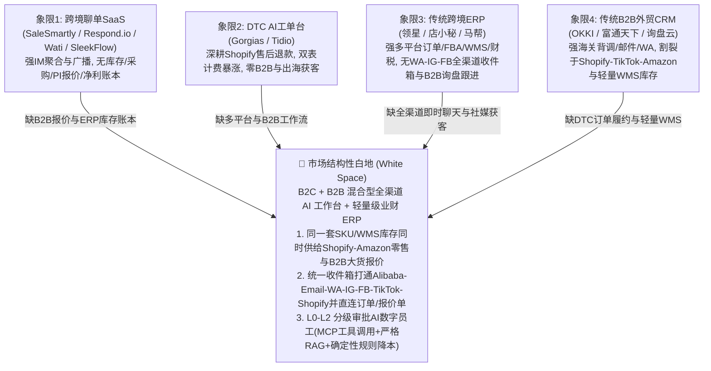

# Nova ERP 深度逆向拆解与 2025–2026 跨境全渠道 AI 工作台竞品全景研究

> **报告范围**：基于 Nova ERP 实机运行截图（4 张核心界面：`localhost:8000/inbox`、`AI 员工管理`、`社媒营销中心`、`localhost:8000/collect_ext`）的像素级逆向工程，结合 2025–2026 年四大象限 12 款核心竞品的一手官网定价、集成文档与真实用户反馈调研，提炼面向「B2C + B2B 混合型跨境卖家」的产品白地（White Space）与架构护城河建议。

---

## 第一部分（Part A）：Nova ERP 深度逆向拆解

### A.1 系统概览与真实技术画像

从 4 张截图顶部浏览器地址栏及全局 Chrome 栏可直接观测到系统的真实运行形态：

1. **本地原型 / 前后端分离架构特征**：截图 1 与截图 4 的 URL 分别为 `http://localhost:8000/inbox` 与 `http://localhost:8000/collect_ext`，浏览器书签栏同时出现 `NOVA`、`Ai`、`外贸推广参考网站`、`社媒`、`平台网站`、`工具网站`、`客户网站`、`阿里1688首页`、`Alibaba.com`、`Google 趋势` 与 `翻译`，表明该系统由跨境一线从业者/独立团队（账号身份：`Jerry · Founder`，定位显示 `31°C 泉州`，系统时间 `2026/9/21 11:22:26`）在本地 8000 端口开发运行。
2. **本地文件型 / 轻量数据底座信号**：顶部导航栏右侧明确显示 **`159 个数据文件`**，结合右下方 Nova AI 助手的 **`仅检索模式`** 与低至 `\$0.0452` 的日 LLM 成本，高度指向一个基于本地文件库（JSON / SQLite / Markdown RAG 文档）与规则引擎混合驱动的原型级 ERP/CRM 工作台，而非重型多租户云 ERP。
3. **来源标注**：画面底部带有抖音水印 `抖音号: laicanhuang`，反映其处于对外演示/内容获客或开源/商业化验证期。

---

### A.2 完整导航树与 32+ 侧边栏模块重构（含跨屏滚动全量盘点）

初步的简略认知往往只看到 Nova 的「聚合沟通」与「AI 员工」，但拼合 4 张截图在不同滚动深度下的左侧导航栏，可以还原出横跨 **9 大一级业务域 + 1 组动态历史区** 的完整 **32+ 侧边栏主模块**（若计入 `最近访问` 快捷区共 34 项；若计入社媒营销 10 个子页签与获客采集 12 个独立工具页，总计超过 50 个功能子页面）：

| 一级分组 | 确认可见模块清单（按截图自上而下顺序） | 核心业务定位 | 证据截图 |
| :--- | :--- | :--- | :--- |
| **全局顶部栏** | `搜索功能模块...`（侧栏检索）、`搜索客户、订单、邮件... (Ctrl+K)`（全局检索）、`中/EN` 切换、`159 个数据文件`、`31°C 泉州`、`+` 快捷新建、消息通知、`设置`、`Jerry · Founder` | 全局命令面板、多语言切换与本地数据挂载状态 | 截图 1 / 4 |
| **最近访问** | 动态展示最近打开模块（截图 1 为 `聚合沟通`；截图 4 为 `获客采集`、`聚合沟通`） | 高频工作流快捷入口 | 截图 1 / 4 |
| **首页** | `首页` | 全局经营驾驶舱 | 截图 1 / 4 |
| **业务核心**（9 项） | `线索池`、`获客采集`、`客户管理`、`商机看板`、`快速报价`、`跟进记录`、`邮件系统`、`聚合沟通`、`统计分析` | **典型 B2B 外贸 CRM 全链路**：从公海线索采集入池、建档、跟进、商机推进到快速报价（PI/Quotation）与邮件/IM 协同 | 截图 1 / 4 |
| **交易执行**（4 项） | `订单管理`、`产品库`、`供应链`、`采购订单` | B2B/B2C 统一的订单履约与上游供应链采购管理（衔接 1688/工厂采购） | 截图 1 / 4 |
| **物流管理**（3 项已确认） | `物流中心`、*（截图 1 与 3 之间存在少量滚动盲区）*、`WMS入库`、`WMS库存` | 头程/尾程物流与轻量 WMS 仓库收货及库存台账 | 截图 1 / 2 / 3 |
| **财务中心**（3 项） | `财务账单`、`CVP测算`、`财税合规` | 应收应付账单、**本量利（Cost-Volume-Profit）盈亏平衡测算**与跨境财税申报监控 | 截图 2 / 3 |
| **B2C板块**（3 项） | `B2C产品`、`B2C订单`、`平台同步` | **独立的 DTC/电商板块**：区别于 B2B 询盘报价流程，专门承接 B2C SKU、电商平台订单与多平台库存/商品同步 | 截图 2 / 3 |
| **系统工具**（5 项） | `任务提醒`、`营销战役`、`数据同步`、`设置`、`系统使用教程` | 跨角色任务调度、EDM/社媒战役编排、数据同步与系统配置 | 截图 2 / 3 |
| **AI 赋能**（2 项） | `AI 员工`、`AI 素材工作台` | 13 名数字员工与 L0–L2 权限矩阵配置、AI 文案/视觉素材生产 | 截图 2 / 3 |
| **获客工具**（2 项已确认） | `社媒营销`、`社媒舆情` | 20 平台国内外社媒矩阵发布与社媒舆情监听（底层可能还有更多未滚动露出的项） | 截图 2 / 3 |

> **关键发现（纠正早期简化认知）**：Nova 并非单纯的「AI 客服聊天工具」，也不仅是「B2B 询盘 CRM」。它在同一套侧边栏中显式并列了 **B2B 链路**（`线索池 → 获客采集 → 客户管理 → 商机看板 → 快速报价 → 跟进记录`）、**B2C 链路**（`B2C产品 → B2C订单 → 平台同步`）、**供应链与仓储**（`供应链 → 采购订单 → WMS入库 → WMS库存`）以及 **经营财务**（`财务账单 → CVP测算 → 财税合规`），试图用一套轻量化骨架同时覆盖「外贸工厂/工贸一体（B2B）」与「独立站/平台零售（B2C）」双轨业务。

---

### A.3 逐屏精细化拆解与隐蔽缺陷审计

#### 1. 聚合沟通（`localhost:8000/inbox` — 截图 1）

这是整个系统最成熟、交互密度最高的核心工作台，采用经典 **四栏式架构（通道轨 + 会话列表 + 聊天主窗 + 右侧客户档案/AI 助手抽屉）**：

- **最左侧通道导航轨（8 个通道 + 设置）**：
  - `全部`、`企业邮箱`、`WhatsApp`、`Facebook`、`Shopify`、`Alibaba`（当前高亮激活）、`Telegram`、`TikTok`、底部通道设置齿轮。
  - **关键业务信号**：将 `Alibaba`（B2B 询盘）、`企业邮箱`（B2B 邮件）、`Shopify`（DTC 独立站）与 `WhatsApp / Facebook / Telegram / TikTok`（IM 与社媒）置于同一收件箱，证明其设计目标就是打破「外贸业务员用邮箱/阿里后台 + DTC 客服用 Helpdesk」的割裂。
- **左中会话列表栏**：
  - 顶部账号切换下拉框显示 `账号 2210327639007`（即当前挂载的阿里国际站子账号/旺铺 ID），配刷新、新窗口打开、批量选择、搜索按钮。
  - 状态筛选条：`全部`、`未读`、`待回复`、`需人工`（用黄色感叹号标识 AI 无法自动处理或触发人工接管规则的会话）。
  - 辅助筛选操作条：包含归档/筛选、`标签`、`发起临时沟通` 等快捷操作。
  - 会话卡片信息密度高：红色置顶图钉、买家头像首字母、姓名 + **国旗与国家 ISO 代码**（如 `sean sc 🇺🇸 US`、`Timothy Ayimbisa 🇬🇭 GH`、`Champagne Jackson 🇺🇸 US`、`LaSondra Richardson 🇺🇸 US`、`Lou-Vair Pharaoh 🇺🇸 US`）、相对时间（`3天前`）、消息摘要、底部渠道账号来源 `2210327639007 文本`。
- **中部对话主窗**：
  - 顶部买家上下文栏：显示买家姓名、国旗、`US` 及 **`当地时间 10:22 PM`**（跨时区防打扰关键提示）；右侧包含搜索、导出、快捷翻译/提示、展开/收起右侧 CRM 详情抽屉按钮。
  - 消息流支持语种识别标签（`[EN]`）、单条消息下方的 **`👁️ 显示中文译文`** 折叠按钮与 **`🌐 翻译`** 按钮，以及悬停动作条（`引用`、`回复`、`⚡`、`转发` 等）。
  - **AI 辅助动作栏（输入框上方）**：`AI客服`、`AI润色`、`信息总结`、`AI建议`、`快捷短语`。
  - **双向实时翻译输入区**：输入框提示 `输入消息 (开启实时翻译后，输入中文自动显示英文)`，底部提供勾选框 `⚡ 实时翻译 译成 英文 ▼`，直接解决了国内中小外贸业务员与客服的外语实时回复门槛。
- **右下角悬浮 `Nova AI 助手` 抽屉（极其丰富的 Agent 控制台）**：
  - 顶栏显示绿色状态胶囊 **`LLM 已接入`**，以及记录/菜单、知识/云端、通知（红点）、清空、更多、关闭图标；右下角常驻紫色机器人 FAB 悬浮球，角标 **`6`**（对应 6 条待审核建档提案）。
  - **内部实时播报流（按 AI 员工角色聚合，每张卡片右侧带绿色 `呼叫` 按钮）**：
    - `待处理 0 件，总额 $0.00` / `⚠️ 1 条报价已过期`（上方裁剪卡片，应为报价/跟单相关员工）
    - `雷迅 (物流出运专员)`：`0 件待发货`
    - `苏野 (获客专员)`：`共 7664 条线索，今日新增 4380 条`
    - `林暖 (B2C贴心客服)`：`0 个 B2C 订单，待发货 0 个，库存预警 1 条` / `B2C 沉睡：待跟进 0 个`
    - `韩清 (财务助理-CPA级)`：
      - `待处理 0 件，总额 $0.00`
      - **`月度利润目标 ¥[object Object]，已完成 ¥0`** —— **显著前端渲染 Bug**：后端返回的利润目标 JSON 对象未被解构字段，直接被 JavaScript `toString()` 隐式转换为 `[object Object]`。
      - **`tax.filing.overdue=0, tax.filing.due_soon=0`** 与 **`payroll.health.month=2026-09... payroll.health.prev_month=2026-08...`** —— **后端内部监控键值/未国际化字段直接裸露**在面向终端用户的 UI 卡片中，说明该模块仍处于快速原型开发期。
  - **快捷技能/工具胶囊区（3 行共 12 个功能入口）**：
    - 第 1 行：`AI 日报`、`技能`、`记忆`、`团队`
    - 第 2 行：`任务`、`今日名单`、`今日日报`、*（第 4 枚图标及文字受压缩略模糊，疑似归档/巡检类快捷项）*
    - 第 3 行：`MBA`、`能力`、`主动经营`（高亮绿底）、`待审`（红底 + 角标 **`6`**）
  - **运行模式切换与严格 RAG 开关**：
    - 模式下拉框：`Global Magic (无人值守开)`
    - 右侧勾选框：**`仅检索模式`** —— 极有价值的工程细节：允许运营人员一键强制 AI 仅基于已有知识库/数据文件（`159 个数据文件`）进行检索回答，抑制通用大模型自由发挥导致的报价/参数幻觉。
  - 底部提问输入框：`问我客户 / 产品 / 订单 / 跟进... (Enter 发送)`，配备附件 `+`、安全防护、记忆/深度、魔法润色、语音输入及绿色发送键。

---

#### 2. AI 员工管理（截图 2）

该页面展示了 Nova ERP 最具野心的产品叙事：**将企业组织架构映射为 13 个拟人化 AI Agent**，并引入分级人机协同治理机制。

- **顶部 5 张全局指标卡**：
  - `员工总数`: `13`
  - `启用中`: `13`
  - `近7天动作`: `19632`
  - `今日LLM成本(USD)`: `0.0452`（附带 `用量与单价` 弹窗入口）
  - 运行等级胶囊：**`L3 无人值守`** · `全接管·自动跑任务 63 个 · 09-21 11:19`

- **13 名具名 AI 员工全清单（逐一核验数据）**：

| 序号 | 姓名与角色 | 职责描述（界面原文截断） | 工具数 | 近7天动作 | 任务数 |
| :---: | :--- | :--- | :---: | :---: | :---: |
| 1 | **陈帆（B2B外贸业务员）** | B2B 对接员（外贸业务员）：客户全生... | 49 | 2608 | 172 |
| 2 | **程守（B端跟单专员）** | B 端订单全流程跟单：下单确认、生产... | 33 | 58 | 68 |
| 3 | **雷迅（物流出运专员）** | 出运与物流：货代沟通、运费询价、订... | 22 | 56 | 68 |
| 4 | **苏野（获客专员）** | 线索采集与培育：新线索简报、清洗、... | 30 | 17 | 59 |
| 5 | **林暖（B2C贴心客服）** | B2C 对接员（贴心客服）：B2C 订单/评... | 31 | 28 | 68 |
| 6 | **韩清（财务助理-CPA级）** | 全链路财税管理（CPA级）：复式记账与... | 71 | 83 | 114 |
| 7 | **钱谨（资金出纳员）** | 资金收付核对、银行对账（流水导入/匹... | 43 | 0 | 68 |
| 8 | **石稳（供应链专员）** | 供应商、PO 采购单、询价议价、交期与... | 48 | 44 | 70 |
| 9 | **安柔（客服专员）** | 客户消息回复：统一收件箱会话 | 29 | 14 | 68 |
| 10 | **卓见（经营分析员）** | 经营分析：漏斗、利润、目标达成、趋... | 46 | 29 | 68 |
| 11 | **陆析（邮件营销员）** | 营销文案与自动化流：欢迎/复购/唤醒邮... | 57 | 28 | 68 |
| 12 | **白影（文案美工）** | 文案与视觉：商品文案、listing、广告文... | 50 | 28 | 68 |
| 13 | **夏野（社媒运营专员）** | 国内外社媒矩阵运营：平台知识、内容... | 50 | 31 | 68 |

- **底部 4 张待办/拦截状态卡 & L0–L2 分工矩阵**：
  - 状态卡：`AI 技能动作 (近7天 817)` | `自动报价草稿 (待确认发送): 0 条 / \$0` | `报价单 (订单 0 待确认): 1 条 / \$48` | `建档提案待审核 (AI 只提案，点击审核): 6`
  - **AI 分工矩阵 · 哪些活 AI 已替你干、哪些在等你拍板**：
    - **`L2 全接管 · AI 自动干`**（绿色）：自动跑任务 `63` · 技能动作 `817/7天` · 范围：`B2C补录·标签·摘要·预警`
    - **`L1 待确认 · AI 提案人审`**（黄色）：`建档提案 6` · `报价草稿 0` · `跟进建议 5`
    - **`L0 人工把关 · AI 不碰`**（红色）：`发送报价/邮件` · `财务收付确认` · `合同·谈判·客诉终审`
  - 底部警示横幅：`⚠️ 建档提案 6 条待人工审核，未进入客户档案 (AI 只提案，人工确认)`。

- **深度工程与数据矛盾审计（Critical Contradictions）**：
  1. **三套口径严重冲突的「动作计数」**：顶部总览写 **`19632`**（近 7 天动作），13 名 AI 员工卡片动作数逐一相加仅 **`3,024`**（`2608+58+56+17+28+83+0+44+14+29+28+28+31`），而下方统计卡与 L2 矩阵写 **`817`**（`近7天 817`）。三组数据相差 **24 倍**，极可能是不同统计表（全部定时轮询事件 vs 员工工具调用日志 vs AI 技能级执行日志）未做口径对齐，或混合了种子测试数据。
  2. **自治等级命名自相矛盾**：顶部右侧写 **`L3 无人值守`**，抽屉里写 **`Global Magic (无人值守开)`**，但底部治理矩阵却只定义到 **`L2 全接管` / `L1 待确认` / `L0 人工把关`**，没有清晰的 L3 定义（或者 L3 仅是开关别名，容易让用户误以为高风险动作也已无人值守）。
  3. **任务模板高度同质化与极低 LLM 成本**：13 名员工中有 9 名的任务数完全一致（均为 **`68`**），说明底层挂载了同一套全局定时检查任务模板；同时 `今日LLM成本(USD)` 为 **`\$0.0452`**，结合高动作次数，证明绝大多数「自动跑任务」实际上是确定性规则脚本或本地状态检查，而非高频调用外部大模型。

---

#### 3. 社媒营销中心（截图 3）

- **顶部运营漏斗**：`内容排期 0`、`已发布 0`、`待发布 0`、`社媒线索 0`、`社媒客户 0`、`平台矩阵 20（国内+海外）`——全部内容与线索数据均为 `0`，说明该模块目前处于平台知识库已内置、但真实社媒 OAuth/发布通道尚未规模化跑通的早期阶段。
- **10 个功能子页签**：`发布中心`、`舆情监听`、`账号`、`素材库`、`贴文编辑器`、`平台矩阵`（当前选中）、`AI 文案工坊`、`获客链路`、`数据看板`、`通道状态`。
- **平台矩阵知识卡片（`国内 7 + 海外 13 · 每个平台含受众/获客玩法/最佳实践`）**：
  - 卡片支持 `全部` / `🇨🇳 国内` / `🌐 海外` 筛选及关键词检索。
  - 首屏完整露出 7 个国内平台 + 1 个海外平台（`Instagram`）：
    - **已连接（可一键发布）**：`小红书`、`快手`、`B站`、`微信视频号`（4 个国内平台显示已连接）。
    - **未授权（带紫色 `去授权` 按钮）**：`抖音`、`微博`、`微信公众号`、`Instagram`（及后续滚动区的其余 12 个海外平台）。
  - **方法论内嵌价值**：每张卡片都内置结构化 **受众画像 + 获客链路 + 实操最佳实践**（例如 B 站强调「灯带选购指南/安装教程/参数对比、软植入为王」，Instagram 强调「Reels 安装前后对比 + 10–15 个 Hashtag 分层策略 `#ledstrip #homedecor`」），将垂直行业（如 LED 照明/家居）的社媒打法直接沉淀为 AI 文案工坊的 Prompt 上下文。

---

#### 4. 海外精准线索采集（`localhost:8000/collect_ext` — 截图 4）

该页以独立弹窗/子视图方式运行在主界面之上（底层背景可见任务管理表格与 `海外地图采集`、`+ 新增任务` 按钮），其架构设计极其务实且「诚实」：

- **顶部风险与技术栈披露横幅（直接暴露底层实现）**：
  > `⚠️ 采集模式可选：自动模式（有Key用Places API/无Key用Overpass API，均为页面内所见即所得抓取）或可视化采集（Playwright弹窗模拟人工）；WA/FB批量私信存在账号封禁风险，请谨慎使用。`
  - 这句话几乎完整揭示了其获客爬虫栈：**Google Places API**（合规付费 Key 模式）+ **OpenStreetMap Overpass API**（零成本免 Key 兜底）+ **Playwright**（可视化有头浏览器模拟人工深度抓取页面电话/邮箱/官网）；同时坦承 WA/FB 批量触达采用非官方协议/模拟方式，存在封号风险。
- **内置 12 个获客子工具（分为 4 组）**：
  1. 地图采集：`Google Maps LBS采集`、`批量多国采集`
  2. `FACEBOOK采集工具箱`：`FB主页采集`、`FB群组采集`、`FB视频采集`、`点赞用户采集`、`评论用户采集`
  3. `WHATSAPP工具`：`WA号码批量校验`、`WA消息任务调度`、`FB私信调度任务`
  4. `基础设置`：`清洗规则管理`、`采集模块全局配置`
- **任务配置与零 AI 清洗能力**：
  - `处理模式` 当前选中 **`纯规则模式 (零AI)`**（体现极强的成本控制意识：先用确定性规则清洗线索，避免在 7,000+ 条脏数据上浪费 LLM Token）。
  - 演示任务配置：`搜索关键词` 为 `led strip supplier`、`led lighting wholesale`，`目标城市/区域` 为 `Dubai`，`最大入库条数 150`，`最低评分 0`，可选开关 `必须包含电话号码`。
- **数据结果与 `同步到ERP` 闭环**：
  - 顶部指标：`线索总数 371`、`已清洗线索 371`、`待清洗线索 0`、`采集任务 254`、`运行中 0`。
  - 右侧基于 **Leaflet + Esri/Maxar 卫星底图** 呈现全球线索地理分布点簇（北美、欧洲、中东、东南亚、澳洲）。
  - 底部 `实时线索 (清洗后)` 列表展示结构化字段：`联系人`、`公司`、`等级（A 级蓝标）`、`评分`、`电话`、`邮箱`、`网站（访问外链）`、`WhatsApp（绿色勾选代表号码已校验存在 WA 账号！）`、`城市`，演示数据包括 `Pico Wholesale Electric & Lighting Supplies Inc.`、`Inlighting Italian distributor LED lighting`、`Mitra Glodok LED Supplier` 等真实 LED 批发商记录，并支持一键 `导出CSV`、`同步到ERP`、`全部同步`。

---

## 第二部分（Part B）：2025–2026 四大象限竞品一手深度调研

> **说明**：所有价格与功能均核验自各厂商 2025–2026 年官方定价页、官方集成文档及第三方独立审计/用户评价平台（G2 / Trustpilot / Shopify App Store / 知乎）。凡官网不公开明码标价的国内企业级/定制化产品，均明确标注「官网未公开标准定价（按模块/账号定制报价）」，绝不臆造价格。

---

### 象限一：跨境全渠道聊天 SaaS（Cross-border Omnichannel Chat SaaS）

#### 1. SaleSmartly

- **目标客群与核心定位**：面向中国出海商家、独立站（Shopify/Shoplazza/Shopline 等）及跨境私域营销团队的高性价比全渠道 AI 客服与 SCRM 平台，宣称服务全球 `300,000+` 客户（[官网定价页](https://www.salesmartly.com/en/pricing)）。
- **2025–2026 定价层级与计量维度**（来源：[SaleSmartly Pricing](https://www.salesmartly.com/en/pricing)、[套餐选择文档](https://help-en.salesmartly.com/docs/the-right-salesmartly-package)）：
  - **计量维度**：按 **成员坐席（Member）+ 官方社媒通道数（Official Channel）+ 云托管设备数（Hosted Device，用于挂载个人号 WA/TG/TikTok/LINE/Zalo）+ 月度 AI 助手点数/AI 成员消息额度** 计费，**Pro/Max 版不限月度活跃联系人（MACs）**。
  - **Free（\$0/月）**：2 名成员、1 个官方通道、1 台云托管设备、每月 100 个活跃联系人限制、10,000 免费 AI 助手点数/月、200 条 AI 成员消息/月。
  - **Pro（月付 \$15.90/月；年付折合 \$12.72/月，年总价 \$152.64）**：基础含 2 成员与可扩展通道/云设备（官方支持按需加购席位与通道），**不限月活跃联系人**，每月 100,000 AI 助手点数、2,000 条 AI 成员消息，解锁营销群发、渠道分流链接与去品牌标识。
  - **Max（月付 \$199.00/月；年付折合 \$159.20/月）**：面向成熟团队，每月 1,000,000 AI 助手点数、5,000 条 AI 成员消息，解锁聊天记录导出、**Open API 接口**与 **Webhook 通知**。
  - **Custom（定制报价）**：大企业定制席位与通道、专属客户经理。
  - **官方增购项**：AI 助手点数低至 `\$0.375 / 10,000 点`；邮件代发（EDM）低至 `\$2 / 1,000 封`；AI 成员消息额度低至 `\$0.7 / 100 条`。
- **支持通道与 API 生态**（来源：[SaleSmartly llms.txt 官方规格](https://www.salesmartly.com/llms.txt)、[帮助中心](https://help-en.salesmartly.com/docs/the-right-salesmartly-package)）：
  - **官方通道**：Website Chat Plugin（原生适配 Shopify、Shoplazza、Shopline、Shopyy、Shoptop、UEESHOP、BigCommerce、WordPress 等 18+ 建站系统）、WhatsApp Business API（Meta Business Partner）、Messenger 与评论、Instagram 私信与评论、TikTok Business Account、Telegram Bot、LINE OA、Email（Gmail/Outlook/阿里/腾讯/网易企业邮等 12 种）、YouTube、VKontakte、Slack、微信客服、企业微信。
  - **云托管个人号（Hosted Device）**：WhatsApp App（含协议号）、Telegram App、TikTok App、LINE App、Zalo App（面向需要低成本个人号私域运营的中国卖家）。
  - **AI 与开发生态**：开放集成 ChatGPT、DeepSeek、OpenAI Assistants、Coze、Dify、GPTBots、HelpLook（[AI 工具文档](https://www.salesmartly.com/llms.txt)）；提供 134 语种实时翻译（支持 Google/DeepL/阿里/腾讯/有道/火山/AWS 等翻译引擎 BYOK）；Max 版开放 REST API（Apifox 文档）与 Webhook。
- **核心优势 vs 结构性短板**：
  - **优势**：价格极具破坏力（Pro 年付仅 `\$12.72/月` 且不限 MACs）；同时支持「Meta 官方 API + 个人号云托管」满足中国跨境团队的复杂号池需求；实时翻译与 Coze/Dify 接入对中小出海团队极友好。
  - **短板**：[G2 用户评价](https://www.g2.com/products/salesmartly/reviews) 指出初期配置学习曲线较陡；**缺乏真正的 B2B 交易与 ERP 后端**——没有多币种正式报价单/PI 工作流、没有采购/WMS 库存/头程物流与单品净利润账本，也无法像 Gorgias 那样直接在收件箱内执行 Shopify 退款/改单等深度交易写操作；且依赖云托管个人号存在平台风控封号隐患。

---

#### 2. Respond.io

- **目标客群与核心定位**：面向中大型 B2C 销售与客服团队（零售、教育、医美、汽车等）的 **全渠道 AI 对话式 CRM（Omnichannel AI Conversation Platform）**，强调官方通道合规性、WhatsApp Calling 与企业级工作流自动化（[Respond.io 官网定价页](https://respond.io/pricing)）。
- **2025–2026 定价层级与计量维度**（来源：[Respond.io Pricing](https://respond.io/pricing)）：
  - **计量维度**：核心按 **月活跃联系人（Monthly Active Contacts, MACs）+ 超额席位 + AI Credits** 计量；**Meta WhatsApp 费用按官方原价透传（No markup）**（[WhatsApp 集成页](https://respond.io/integrations)）。无永久免费版，仅提供 7 天 Growth 试用。
  - **Starter（年付 \$79/月，\$948/年；月付 \$99/月）**：含 5 个用户席位（加购 `\$12/席位/月`）、不限 MACs、5,000 AI Credits，包含团队收件箱、AI Prompt/AI Assist、基础报表，**但明确不含 AI Agents、Workflows 自动化与群发（Broadcasts）**。
  - **Growth（年付 \$159/月，\$1,908/年；月付 \$199/月）**：含 10 席位（加购 `\$20/席位/月`）、起步 **1,000 MACs**（超额按 `\$12 / 100 MACs` 按需计费）、起步 10,000 AI Credits（超额 `\$15 / 1,000 Credits`，硬顶 200%），解锁 **AI Agents、Workflows、Broadcasts、Zapier/Make/n8n 与 Developer API**。
  - **Advanced（年付 \$279/月，\$3,348/年；月付 \$349/月）**：含 10 席位（加购 `\$24/席位/月`）、起步 1,000 MACs（超额 `\$15 / 100 MACs`）、起步 20,000 AI Credits，解锁 **AI Voice Agents 语音通话、多工作区（Multiple Workspaces）、SSO、Webhook 与 HTTP Requests 工作流节点、号码/邮箱脱敏**。
  - **Enterprise（Custom 定制报价）**：无限席位、更高 API 速率限制与专属工作区。
- **支持通道与 API 生态**（来源：[Respond.io Integrations](https://respond.io/integrations)）：
  - **消息与语音通道**：WhatsApp Business Platform、WhatsApp Business Calling API、VoIP Calls、TikTok Business Messaging（Beta）、TikTok Messaging Ads、Instagram、Facebook Messenger & Calls、Telegram、LINE、Viber、WeChat OA、SMS（Twilio/MessageBird/Vonage）、Email（Gmail/Outlook 365/Yahoo/IMAP/SMTP）、WebChat、Custom Channel API。
  - **CRM 与自动化生态**：原生同步 HubSpot、Salesforce、Pipedrive、Google Calendar/Calendly/Cal.com；支持 **MCP Server**、n8n、Zapier、Make、HTTP Request / Webhooks；电商侧仅提供 Shopify/WooCommerce/Magento 网页插件与基础集成。
- **核心优势 vs 结构性短板**：
  - **优势**：Meta 官方 BSP 零加价透传；支持 WhatsApp 语音通话与 AI 语音质检/摘要；Workflows + HTTP Request + MCP Server 让技术团队能灵活对接外部系统；G2 评分高达 `4.8/5`（500+ 评价）。
  - **短板**：1）**MAC 计费惩戒增长**：任何营销活动带来大量买家咨询都会按 `\$12–\$15/100 MACs` 推高账单，[多篇独立测算](https://www.getmacha.com/blog/respond-io-pricing-explained) 与 [Trustpilot 吐槽](https://setsmart.io/blog/respond-io-review) 指出小团队升级 Growth 后实际月费迅速突破 `\$200–\$400+`；2）**无原生商品/订单/ERP 内核**：无法原生成交建单、管 SKU 库存或发 B2B 报价单，对 Shopify 也缺乏如 Gorgias 般的原生订单退款写操作，所有商业动作都必须外接 HubSpot/Salesforce 或自写 HTTP Webhook；3）上手与 Workflows 编排学习门槛较高。

---

#### 3. Wati（WhatsApp Team Inbox）

- **目标客群与核心定位**：专注于 **WhatsApp Business API 为核心** 的中小企业客服与营销自动化 SaaS（兼顾 Instagram/Messenger/TikTok/RCS），主攻印度、东南亚、拉美与中东电商/教育/服务业（[Wati Pricing](https://www.wati.io/pricing/)）。
- **2025–2026 定价层级与计量维度**（来源：[Wati Pricing](https://www.wati.io/pricing/)、[Wati Pricing Comparison](https://www.wati.io/pricing-comparison/)、[US/Global 报价核验](https://www.getmacha.com/blog/wati-pricing-explained)）：
  - **显著的地区分级定价（Geo-Pricing）**：Wati 对不同国家访客显示差异化 USD 价格（美国/中东价约亚洲/印尼/印度价的 1.5–2 倍）：
    - **Growth**：亚洲/印尼官网价 **`\$39/月`（年付）**；美国/中东价 **`\$59/月`（年付） / `\$69/月`（月付）**。含 **3 个席位（不可额外加购席位）**、15,000 条群发/月、1,000 次免费自动化触发、2,000 Wati AI Credits/月（或 US 版 250 AI Co-pilot Credits）、1 个 Astra AI Agent（部分区域作为付费加购）、2 个 Commerce/CRM 集成、10,000 次 API 调用（无 Webhook）。
    - **Pro**：亚洲/印尼官网价 **`\$79/月`（年付）**；美国/中东价 **`\$119/月`（年付） / `\$149/月`（月付）**。含 **5 席位**（加购 **`\$24/席位/月`**，部分 US 档报 `\$39/席位/月`）、无限群发、2,000 自动化触发、5 个集成（含 HubSpot）、200,000 API 调用（有限 Webhook）、5,000 AI Credits。
    - **Business**：亚洲/印尼官网价 **`\$199/月`（年付）**；美国/中东价 **`\$279/月`（年付） / `\$349/月`（月付）**（US 页面现多转 Custom 报价）。含 **5 席位**（加购 **`\$59–\$89/席位/月`**）、多 WhatsApp 号码与轮询分配（Round-Robin）、5,000 自动化触发、无限集成（含 Salesforce）、2,000 万 API 调用（完整 Webhook）、20,000 AI Credits 及 Voice AI 能力。
  - **独立增购与消息加价**：Shopify 集成需额外加购 **`\$4.99/月`**（`\$4.9/月`）；额外 WhatsApp 号码 **`\$29/月/号`**；Wati AI Credits 增购 **`\$20/月`起**；Automation triggers 增购 **`\$25/月`起**；独立 Astra AI Agent 在美区按 `\$99/月`（Pro）与 `\$399/月`（Business）单卖。
- **支持通道与 API 生态**（来源：[Wati Integrations](https://www.wati.io/integrations/)、[Wati Comparison](https://www.wati.io/pricing-comparison/)）：
  - **消息通道**：WhatsApp Business API（含 WhatsApp Calling）、RCS、Instagram、Facebook Messenger、TikTok、Webchat、SMS（仅 Business）。**不支持企业邮箱（Email）或阿里国际站等 B2B 平台消息**。
  - **集成生态**：Shopify（弃单挽回、目录同步、下单通知）、WooCommerce、HubSpot、Salesforce、Zoho、Klaviyo、Google Sheets、Zapier、Pabbly Connect、Stripe/Razorpay/PayPal 支付链接。
- **核心优势 vs 结构性短板**：
  - **优势**：WhatsApp API 模板审批、广播速度（20–80 mps）、Click-to-WhatsApp Ads（CTWA）归因与 Shopify 弃单挽回模板极其成熟，G2/Capterra 评分均为 `4.6/5`（[eesel.ai 汇总](https://www.eesel.ai/blog/wati-pricing)）。
  - **短板**：1）**不透明的消息加价（Rate Card Markup）**：多家 2026 独立审计指出 Wati 并非按 Meta 原价透传，而是通过自家 Rate Card 加价（US 营销消息 `\$0.04` vs Meta `\$0.025` 加价 60%，Utility 消息加价高达 80%；印度市场常见高出 15–20%）（[Macha 实测](https://www.getmacha.com/blog/wati-pricing-explained)、[Ominiflow 分析](https://ominiflow.com/blog/wati-pricing-india-2026)）；2）**Growth 锁死 3 席位且加人极贵**：第 4 名员工必须直接升 Pro 并加席位费；3）**Trustpilot 口碑撕裂（`2.9–3.0/5`）**：用户高频抱怨取消订阅流程困难、降级后仍被扣费、客服工单响应慢（[Trustpilot Wati](https://www.trustpilot.com/review/wati.io)）；4）**非全渠道真闭环**：缺失邮件收发、缺失传统电商 ERP 履约与 B2B 报价单能力。

---

#### 4. SleekFlow

- **目标客群与核心定位**：总部源于香港/新加坡的 AI 驱动全渠道社交电商工作台（AgentFlow），服务 7,000+ 亚太及全球零售、美妆、教育与服务型品牌（[SleekFlow Pricing](https://sleekflow.io/en-us/pricing)）。
- **2025–2026 定价层级与计量维度**（来源：[SleekFlow Official Pricing](https://sleekflow.io/en-us/pricing)）：
  - **计费逻辑**：采用 **基础订阅 + 月活跃联系人（MACs，仅双向交互计数，单向群发未回复不计入）+ 高级 AI Credits + 通道托管费** 模式。2026 年官方新版价格体系大幅调整如下（均为年付折算月价）：
  - **Essential（`US\$49/月`，年付 `US\$588/年`）**：含 **3 个席位**（加购 `\$15/席位`）、5 个通道、500 MACs、AI 收件箱副驾驶（AI Co-pilot，不含自主 AI Agent 与群发），部分国家/地区灰度开放。
  - **Pro（`US\$109/月`，年付 `US\$1,308/年`）**：含 **10 个席位**（加购 `\$25/席位`）、10 个通道、起步 **500 MACs**（超额自动按 `\$20 / 100 MACs` 计费）、**基础 FAQ AI Agent 回复无限次**、每月 **3,000 高级 AI Credits**（约 100–200 次多步/带图/算价/Shopify 动作回复，增购 `\$20 / 5,000 Credits`）、Flow Builder、Broadcast、Shopify/Google Sheets/Zapier/Make 集成与 API。
  - **Premium（`US\$279/月`，年付 `US\$3,348/年`）**：含 **10 个席位**、10 个通道、起步 **1,000 MACs**、**15,000 高级 AI Credits/月**（约 500–1,000 次高级回复）、AI Agent 调用外部 API 与 Shopify 动作、5 个 Agent Procedures、RBAC 权限、Webhook/HTTP 请求、HubSpot/Zoho/Meta CAPI/TikTok Instant Forms 集成、多工作区与 60 天 1v1 上线实施（单买 `\$999`）。
  - **Enterprise（Custom）**：Salesforce（含 Marketing Cloud）、PII 脱敏、SSO、对话导出、驻场/前线工程师（Forward-deployed Engineers）。
  - **通道额外费用**：WhatsApp Business API 号码托管 **`US\$15/月/号`**，按 SleekFlow 自家 Rate Card 另计消息费；VoIP 与 SMS 号码托管 `US\$1/月`；**CX Intelligence 分析模块** 需另购，**`US\$99/月` 起**。
- **支持通道与 API 生态**（来源：[SleekFlow Pricing](https://sleekflow.io/en-us/pricing)）：
  - 全套餐包含 WhatsApp、Outlook、Gmail、VoIP 通话、SMS、Instagram、TikTok、Facebook Messenger、WeChat、Telegram、LINE、Viber（受各套餐总通道上限 5/10 限制）；支持 Stripe 聊天内收款链接、Custom Catalog 与 Custom Objects。
- **核心优势 vs 结构性短板**：
  - **优势**：创新的「**基础 FAQ AI 回复免费无限 + 复杂操作/算价/调 API 消耗高级 Credits**」分层计费，比单纯按条计费更抗大促波动；AgentFlow Procedures（SOP 强制执行步骤）与 Stripe 聊天内支付对咨询式成交很实用；Trustpilot 评分达 `4.5/5`（[Trustpilot SleekFlow](https://www.trustpilot.com/review/sleekflow.io)）。
  - **短板**：1）**入场与扩容成本陡峭**：500 MACs 起步极小，超额 `\$20/100 MACs` 甚至高于 Respond.io（`\$12–15/100 MACs`），加上 `\$15/月` 号码托管与不透明的 WhatsApp Rate Card，真实 TCO 居高不下；2）**部分新/旧用户反馈 Flow Builder 复杂**，从旧版自动化迁移后新建联系人/流程耗时增加（[Trustpilot 评论](https://www.trustpilot.com/review/sleekflow.io)）；3）同样**缺乏后端库存、采购、BOM、头程物流与 B2B 正式报价单/发票财务体系**。

---

### 象限二：DTC AI 客服工单台（DTC AI Helpdesk）

#### 5. Gorgias

- **目标客群与核心定位**：深度绑定 **Shopify / Shopify Plus** 生态的 DTC 电商专属客服工单系统（宣称服务 `17,000+` 电商品牌及 40% 的 Shopify 头部品牌），核心卖点是在工单侧边栏直接完成订单退款、改址、补发与订阅管理（[Gorgias Pricing](https://www.gorgias.com/pricing)）。
- **2025–2026 定价层级与计量维度**（来源：[Gorgias Official Pricing](https://www.gorgias.com/pricing)）：
  - **独特计量方式**：**不按坐席数收费**（Basic 及以上均含 **500 个坐席**，Starter 含 3 席位），而是 **按月工单量（Tickets/month）+ AI Agent 自动解决交互数（Automated Interactions）双表计费**！
  - **Helpdesk 纯工单层（不含 AI Agent，月付 / 年付折算）**：
    - **Starter**：`\$10/月`（仅月付，50 工单/月，超额 `\$0.40/工单`）
    - **Basic**：`\$60/月` 月付 / `\$50/月` 年付（`\$600/年`，300 工单/月，超额 `\$40/100 工单`）
    - **Pro**：`\$360/月` 月付 / `\$300/月` 年付（`\$3,600/年`，2,000 工单/月，超额 `\$36/100 工单`）
    - **Advanced**：`\$900/月` 月付 / `\$750/月` 年付（`\$9,000/年`，5,000 工单/月，超额 `\$36/100 工单`）
  - **Helpdesk + AI Agent 捆绑套餐（官网默认主推）**：
    - **Starter + AI**：`\$40/月`（仅月付，50 工单 + 30 AI 交互）
    - **Basic + AI**：`\$77/月` 年付（`\$924/年`；月付 `\$90/月`，300 工单 + 30 AI 交互）
    - **Pro + AI**：`\$471/月` 年付（`\$5,652/年`；月付 `\$550/月`，2,000 工单 + 190 AI 交互）
    - **Advanced + AI**：`\$1,227/月` 年付（`\$14,724/年`；月付 `\$1,430/月`，5,000 工单 + 530 AI 交互）
    - **超出 AI 额度单价**：每多 1 次自动化解决高达 **`\$1.50/次`**（套餐内折合 `\$0.85–\$1.00/次`），且 Voice 与 SMS 为额外按量加购项。
- **支持通道与 API 生态**（来源：[Gorgias Integrations](https://www.gorgias.com/integrations)、[Gorgias Pricing](https://www.gorgias.com/pricing)）：
  - **电商与后端生态**：150+ 应用集成，覆盖 Shopify / Shopify Plus（最深）、WooCommerce、BigCommerce、Magento；通过 **ChannelReply** 插件对接 Amazon、eBay、Walmart、Etsy；通过 **TikTok Shop App** 对接 TikTok Shop；集成 Loop Returns、AfterShip、Recharge、Klaviyo、Attentive、Postscript、ShipMonk 等，API 限速 `2 req/s`（Enterprise `4 req/s`）。
- **核心优势 vs 结构性短板**：
  - **优势**：不限坐席数让大促临时扩招客服零边际席位成本；Shopify 订单内嵌动作（取消、退款、改地址、Recharge 订阅暂停、发折扣码）与 3 天归因营收看板在纯 DTC 售后领域几乎无敌。
  - **短板**：1）**备受诟病的「一单双计费（Double Billing）」陷阱**：据 [Macha 2026 拆解](https://www.getmacha.com/blog/is-gorgias-worth-it) 与 [Hellorep 分析](https://www.hellorep.ai/blog/gorgias-ai-agent-alternatives)，当 AI Agent 独立解决一个工单时，**同时消耗 1 个 Helpdesk 工单额度 + 1 个 `\$0.90–\$1.50` 的 AI 交互费**。如果一个 Pro 商家让 AI 解决 50%（1,000 单），账单会从 `\$471/月` 暴涨至 `\$1,686/月`；Trustpilot 评分因此跌至 **`2.1/5`**（152 评价，高频吐槽黑五大促账单暴雷与取消摩擦）；2）**AI Agent 实质锁定 Shopify**：多方文档实测证实 Gorgias 原生 AI Agent 的订单动作仅支持 Shopify，非 Shopify（WooCommerce/BigCommerce/Magento）或亚马逊/B2B 客户几乎无法享受自动动作能力（[YourGPT 测评](https://yourgpt.ai/blog/comparison/gorgias-ai-agent-review)）；3）**重售后轻获客、无 B2B/ERP 属性**：无法主动出海找线索，也无国内 1688 采购、WMS 仓储与进销存财务逻辑。

---

#### 6. Tidio

- **目标客群与核心定位**：面向中小独立站（Shopify、WordPress、WooCommerce 等）的轻量级在线聊天 + 规则自动化（Flows）+ **Lyro AI Agent** 组合工单平台（[Tidio Pricing](https://www.tidio.com/pricing/)）。
- **2025–2026 定价层级与计量维度**（来源：[Tidio Official Pricing](https://www.tidio.com/pricing/)）：
  - **极度拆分的「三轨计量模型」**：把「人工处理对话（Billable Conversations）」、「Lyro AI 对话」和「Flows 触达访客数」拆成三个独立收费池！
  - **Customer Service（人工对话池，Free/Starter/Growth 上限均为 10 席位且不可加购）**：
    - **Free（`\$0/月`）**：50 人工对话/月、10 席位、100 Flows 访客/月、**终身一次性（One-off）50 次 Lyro AI 对话（用完不再月度刷新）**。
    - **Starter（年付 `\$24.17/月`，月付 `\$29/月`）**：100 人工对话/月、实时访客列表、营业时间设置。
    - **Growth（年付 `\$49.17/月` 起至 `\$290.83/月`，月付 `\$59`–`\$349/月`）**：按 250 至 2,000 人工对话阶梯计价，解锁权限、自动分配、宏命令（Macros）、Shopify 原生动作。
    - **Plus（`\$300/月` 起 + 用量）**：突破 10 席位限制、多项目、OpenAPI、自定义品牌。
    - **Premium（销售定制报价）**：起步 3,000+ Lyro 对话，承诺 50% AI 解决率或按解决付费（Pay-per-resolution）。
  - **Lyro AI Agent 独立加购池**：年付 `\$32.50/月`（月付 `\$39/月`）起，含 50 次 AI 对话，阶梯升至 1,000 次对话（年付 `\$583.33/月` / 月付 `\$700/月`）。可作为独立产品通过 `Lyro Connect` 接入 Zendesk/Salesforce（仅 Plus+）。
  - **Flows 主动营销自动化池**：年付 `\$24.17/月`（月付 `\$29/月`）起（2,000 访客），阶梯至 100,000 访客（年付 `\$249.17/月` / 月付 `\$299/月`）。去 Tidio 水印另收 **`\$16.67/月`（月付 `\$20/月`）**。
- **支持通道与 API 生态**（来源：[Tidio Integrations](https://www.tidio.com/integrations/)、[Tidio Pricing](https://www.tidio.com/pricing/)）：
  - 支持 Live Chat（网页插件）、Email、Facebook Messenger、Instagram、WhatsApp；整合 Shopify、WordPress、Magento、HubSpot、Salesforce、Zendesk、Zapier、AWS Bedrock/Lambda 等；OpenAPI 仅限 Plus 及以上版本。
- **核心优势 vs 结构性短板**：
  - **优势**：开箱极快，访客实时浏览轨迹（Live Typing Preview + Viewed Pages History）非常适合网页售前导购；G2 `4.6/5`（1,959 条评价）、Capterra `4.7/5`（590 条评价）。
  - **短板**：1）**「三表叠加」导致真实成本不可预测**：G2 上出现频率最高的负面标签就是「Expensive / Too Expensive」（[YourGPT 评价统计](https://yourgpt.ai/blog/comparison/tidio-review)）——一个中等流量站点叠加 Growth（500 对话）+ Lyro（200 对话）+ Flows + 去水印后轻松超过 `\$200–\$450/月`；且若 Lyro 先回复再转人工，**同一通会话会同时消耗 Lyro 配额和人工 Billable 配额**（[Helply 规则分析](https://helply.com/blog/tidio-pricing)）；2）**10 席位悬崖**：超过 10 人强制跃升至 `\$300/月 + 用量` 的 Plus 版；3）缺乏 TikTok/Telegram/Alibaba 等多跨境通道与任何后端 ERP/WMS/B2B 报价能力。

---

### 象限三：跨境电商 ERP（Cross-border E-commerce ERP）

#### 7. 领星 ERP（Lingxing）

- **目标客群与核心定位**：中国亚马逊精细化运营与多平台跨境电商 ERP 市占率第一的头部 SaaS（艾瑞咨询 2025 报告数据，宣称服务 `700,000+` 跨境企业，安克创新、巨星科技等大卖采用）（[领星官网](https://www.lingxing.com)）。
- **2025–2026 定价层级与计量维度**（来源：[领星官方定价问答页](https://www.lingxing.com/price)、[Shopify App Store](https://apps.shopify.com/asinking)）：
  - **官网标准定价策略**：**官网未公开标准付费价格表（按月订单量阶梯定制报价）**，但明确披露免费阈值：**注册即可接入全系统功能，每月订单量 ≤ 5,000 单支持长期免费使用**；超过 5,000 单后按「年付单量套餐（1 万至 30 万+ 档位）」由销售顾问报价，支持 60 天无理由退款。
  - **公开参考锚点**：其 Shopify App Store 国际/巴西区页面曾列出年度单量参考档（Basic 12 万单约 `R\$8,398/年`、Big 30 万单约 `R\$16,802/年`、Enterprise 50 万单约 `R\$25,206/年`）（[Shopify App Store 领星](https://apps.shopify.com/asinking)）；行业调研显示国内中小卖家年费常见区间在 4,000–15,000+ 元/年（[数跨境盘点](https://www.shukuajing.com/blog/5406.html)）。
- **平台对接、AI 与 API 生态**（来源：[领星 2026 年 4 月更新](https://www.lingxing.com/help/article/Update270)、[9 月更新](https://www.lingxing.com/help/article/Update275)、[10 月更新](https://www.lingxing.com/help/article/Update276)）：
  - **支持平台（40+）**：深度覆盖 Amazon（SPN/TSPN/AVP/MCF 多重认证）、TikTok Shop（含 GMV Max 广告与达人邀约私信）、Temu（全托管/半托管/本土/Y2）、SHEIN、Walmart（含加拿大/墨西哥/WFS）、AliExpress、eBay、Wayfair、Cdiscount、Shopee、Coupang、Lazada、Mercado Libre、Shopify、OZON、Rakuten、SHOPLAZZA、SHOPLINE 等；**2026 年 9 月 V3.9.1 版本新增支持「阿里国际站订单履约」同步**（但仅限订单履约侧，非 B2B 询盘 CRM）。
  - **AI 演进（2026 关键升级）**：2026 年 4 月上线 **领星 MCP（Model Context Protocol）**，7–10 月迭代 **AI 数据分析（自然语言问答）、AI 品类基准洞察、MCP 调整亚马逊广告与获取补货建议、MCP 接入审批流（操作动作需人工审批才执行）、AI 助手定时自动化任务**。
  - **供应链与仓储**：对接 300+–500+ 海外仓与数百家头程/自发货物流商，支持 1688 一键采购、委外加工、FBA/AWD 卫星仓智能补货、PDA 扫码与 9810 报关核销。
- **核心优势 vs 结构性短板**：
  - **优势**：亚马逊多站点精细化广告管理、FBA/AWD 补货算法、业财一体（头程分摊、批次成本、多平台结算利润）以及 2026 年率先落地的「MCP + 审批流」在传统跨境 ERP 中遥遥领先。
  - **短板**：1）**客服模块本质是「电商站内信/邮件工单工具」，而非全渠道营销收件箱**——从 [领星售后邮件文档](https://www.lingxing.com/help/article/Aftersalesmail) 可见，其客服聚焦亚马逊 `@amazon.xx` 站内信（每 20 分钟同步一次）、QA、A-to-Z/Chargeback 索赔与售后工单，**原生不支持 WhatsApp、Facebook Messenger、Instagram、Telegram、TikTok 个人私信等社媒私域聚合聊天**，也没有外贸线索采集与多轮私域培育；2）**多平台非标场景体验参差**：独立站 Shopify App Store 仅 1 条 1 星差评（抱怨不支持按行拆分履约且英文支持不足），知乎部分用户吐槽其财务分摊规则在多业务混杂时逻辑复杂、上手需磨合（[知乎领星讨论](https://www.zhihu.com/question/515386307)）；3）**缺失 B2B 长周期 CRM**（无海关/LBS 获客、无线索公海、无 B2B 样品/阶梯报价/PI 谈判流程）。

---

#### 8. 店小秘 ERP（Dianxiaomi）

- **目标客群与核心定位**：面向中国广大铺货型、多平台中小卖家与中大型店群的「免费+增值（Freemium）」全链路跨境 ERP，宣称服务 `180 万+` 跨境卖家、日处理订单 `1,100 万+`（[店小秘官网](https://www.dianxiaomi.com)、[2026 双11 套餐对比](https://www.dianxiaomi.com/blog/article/736)）。
- **2025–2026 定价层级与计量维度**（来源：[店小秘免费版对比](https://www.dianxiaomi.com/blog/article/455)、[2026 官方 VIP 套餐对比](https://www.dianxiaomi.com/blog/article/736)）：
  - **计量维度**：按 **单平台可授权店铺数 + 子账号数 + 订单数据存储天数 + 库存推送 SKU 上限 + AI 秘豆（按量兑换高阶 AI 工具）** 阶梯收费，**核心采集、刊登与基础打单永久免费**。
  - **免费版（`0 元/年`）**：多数平台限 1 店铺/平台（速卖通/Alibaba 除外，Shopee/Lazada 限 5 店铺）、3 子账号、订单存储 120 天、日搬家 20 条；Shopee/店匠/Coupang/Mercado/Shein/noon 刊登功能需 VIP。
  - **VIP1**：`198 元/月` 或 **`2,016 元/年`**（10 店铺/平台、10 子账号、360 天存储、库存推送 1 万 SKU 年费版）。
  - **VIP2**：**`6,000 元/年`**（30 店铺/平台、30 子账号、1,080 天存储、库存推送 2 万 SKU）。
  - **VIP3**：**`9,888 元/年`**（100 店铺/平台、200 子账号、无限期存储、库存推送 5 万 SKU）。
  - **VIP4 / 至尊 VIP**：**`19,800 元/年`**（200 店铺/平台、200 子账号、无限期存储、库存推送 10 万 SKU）。
  - **AI 增值计费（秘豆）**：2026 年接入 DeepSeek 推理/基础模型、豆包、千问，上线 AI 五点描述、图生 1080p 商品视频（约 `200 秘豆/条 ≈ 0.2 元/秒`）、AI 白底/套图、专利检索等，通过充值 VIP 赠送或单独购买秘豆包兑换（[AI 视频上线公告](https://www.dianxiaomi.com/blog/article/743)）。
- **支持平台、客服与生态**：
  - 对接 **70+ 跨境电商平台**（Amazon、Temu 全/半/本土、TikTok Shop 含直播竞拍、SHEIN、速卖通、Shopee、Lazada、Mercado Libre、Coupang、eMAG、noon、Shopify、Shoplazza、Alibaba 等）与 **1,700+ 物流商**。
  - 客服模块主要提供基于 **物流状态与平台规则的模板自动回复**（如 Wish/eBay/Shopify 发货提醒、滞留安抚、黑名单防白嫖）与平台站内信通知（[店小秘智能客服文档](https://www.dianxiaomi.com/blog/article/356)）。
- **核心优势 vs 结构性短板**：
  - **优势**：性价比天花板（免费版即可完成采集→刊登→打单→发货），平台覆盖广度（含中东 noon、东欧 eMAG 等小众平台）与铺货/托管模式跟进极快（如 2026 年第一时间适配 TikTok 拍卖模式与 Temu 半托）。
  - **短板**：1）**几乎没有真正的「全渠道实时会话与 AI 客服」**：客服功能停留在 eBay/Wish/Amazon 站内信和订单物流节点触发的模板群发，**不支持 WhatsApp、IG、FB Messenger、TikTok 私信等即时社交通道的统一对话与上下文记忆**；2）**数据留存与非标定制受限**：免费版和低级 VIP 的订单存储仅 120–360 天，标准化程度极高、不支持企业复杂自定义审批流（[跨平台对比分析](https://www.sohu.com/a/1006775131_122712728)）；3）**零 B2B CRM/外贸获客基因**：完全不涉及海外买家背调、B2B 报价单、商机阶段或社媒矩阵获客。

---

#### 9. 马帮 ERP（Mabang）

- **目标客群与核心定位**：面向成长型及中大型多平台卖家、东南亚卖家与品牌出海企业（如泡泡玛特、林氏木业、宇树科技、完美日记等）的 **「ERP + WMS + TMS + 供应链 SCM」重履约全流程系统**，宣称覆盖 `400,000+` 用户（[马帮官网](https://www.mabangerp.com)）。
- **2025–2026 定价层级与计量维度**（来源：[马帮官网价格标准](https://www.mabangerp.com/main_jg.htm)、[行业价格实测汇总](https://www.shukuajing.com/blog/5406.html)）：
  - **官网报价方式**：**官网虽公开版本梯度与订单量上限，但未公开标准人民币价格（需联系销售定制报价）**；其官网展示：**马帮 ERP** 分 5 档（`基础版 3万单`、`白银版 6万单`、`黄金版 20万单`、`钻石版 60万单`、`至尊版 160万单`）；**马帮集团版** 分 5 档（`16万单` 至 `350万单`，含 200–800 店铺）；**马帮 WMS** 分 4 档（`入门版 20万单/2仓`、`基础版 60万单/4仓`、`标准版 120万单/6仓`、`豪华版 250万单/8仓`，仓库加购包明确标价 **`2,000 元/个`**）。
  - **行业公开历史/渠道参考价**：综合第三方选型报告（[数跨境 2026 盘点](https://www.shukuajing.com/blog/5406.html)、[知乎评测](https://zhuanlan.zhihu.com/p/2058964947338638120)），马帮 ERP 8 档历史/公开口径大约跨度在 **`6,000 元/年至 15 万元/年`**（早期基础版约 3,800–8,000 元/年，全套含 WMS 仓储通常 18,000–20,000+ 元/年起）。
- **支持平台、AI 与生态**（来源：[马帮官网](https://www.mabangerp.com)、[2026 知乎实测](https://zhuanlan.zhihu.com/p/2053473324202717759)）：
  - 对接 **170+ 电商平台**、**1,700+ 物流渠道**、**800+ 海外仓**及跨境分销（平台/分销/供应商三方流转），提供开放平台 OpenAPI（`gwapi.mabangerp.com`）。
  - 2026 年内置 AI 选品「八爷」、GPT Listing 生成、DeepSeek 客服辅助与阿里翻译；拉美/东南亚（巴西 NF-e 自动开票、美客多半托管）及自研仓配（PDA 无纸化拣货、14 种发货模式）能力极强。
- **核心优势 vs 结构性短板**：
  - **优势**：在 **自建仓 WMS、多平台多仓库存防超卖、供应链采购周转与东南亚/拉美本地化履约** 方面底蕴深厚，适合多平台 SKU 复杂且自带仓库的中大卖家。
  - **短板**：1）**模块拆分加价明显且实施较重**：基础 ERP 不含独立 WMS/高级财务，逐项加购推高预算，且上线配置与团队培训通常需 **1–2 周**（[选型成本分析](https://www.shukuajing.com/blog/5406.html)）；2）**客服依然局限于「平台店铺后台消息」**：所谓客服管理仅聚合电商平台站内信/订单消息与基础自动回复，**不具备 WhatsApp/IG/FB/Email 跨端统一身份图谱与 B2B 主动营销/社媒获客能力**；3）无 B2B 商机管道与 AI 员工级自治执行矩阵。

---

### 象限四：B2B 外贸 CRM（B2B Foreign Trade CRM）

#### 10. 阿里小满（OKKI）

- **目标客群与核心定位**：阿里巴巴国际站全资子公司（2020 年战略收购），中国外贸 B2B SaaS 市占率第一（艾瑞咨询 2025 报告），定位 **「每个外贸人的 AI 队友 / 外贸生意智能工作台」**，核心服务制造出口企业、工贸一体与多业务员外贸公司（[OKKI 官网](https://www.xiaoman.cn)、[OKKI CRM 产品页](https://www.xiaoman.cn/products/crm.html)）。
- **2025–2026 定价层级与计量维度**（来源：[OKKI 官网](https://www.xiaoman.cn)、[选型说明](https://zhuanlan.zhihu.com/p/673361761)）：
  - **官网未公开标准定价（按产品矩阵模块 + 坐席账号数定制报价）**：官网仅提供「立即体验 / 怎么收费」咨询入口，未发布公开标准价目表。历史上产品线分为 OKKI Lite / Smart / Pro 等版本，起步客单价处于**万元人民币/年级别**，显著低于传统十万级本地部署软件（[36氪专访档案](https://www.xiaoman.cn/news/338.html)）。
- **三大产品线、AI 能力与通道生态**（来源：[OKKI CRM 页面](https://www.xiaoman.cn/products/crm.html)、[产品导航指南](https://www.xiaoman.cn/article/1079.html)、[API 公开档案](https://github.com/api-evangelist/xiaoman)）：
  - **产品矩阵**：`OKKI AiReach`（主动获客智能体：基于 1 亿+ 全球企业库、海关数据、社媒做潜客推荐、AI 背调与开发信筹备）、`OKKI CRM`（核心客户/联系人/商机阶段/邮件追踪/报价/单证管理）、`OKKI Shops`（B2B 外贸独立站建站与询盘表单承接）及 `OKKI Go`。
  - **AI 5 大核心技能（2025–2026 升级）**：1）7×24 小时承接 **阿里国际站 TM、WhatsApp 升级版、企业邮件** 等多渠道询盘并过滤低质询盘、自动背调建档；2）读取沟通与订单历史生成可审核的 **报价草稿** 与 PI；3）商机推进与卡点预警；4）私海沉睡客户自动扫描与多轮唤醒；5）`AI 数据助理`（自然语言查数）、`AI 沟通质检` 与 `AI 团队分析`。
  - **开放性**：存在公开企业/联系人/邮件/产品 API，并与阿里巴巴国际站深度单向/双向打通（询盘、TM 聊天、信保订单一键同步）。
- **核心优势 vs 结构性短板**：
  - **优势**：与 **阿里国际站** 的生态打通无出其右；AI 背调、防撞单、邮件追踪与离职交接极度契合传统 B2B 外贸管理痛点；全国本地化服务商网络（如各地阿里服务商兼任实施）支撑强。
  - **短板**：1）**「阿里生态中心主义」与重 B2B 轻 DTC 割裂**：对不做阿里国际站的独立品牌、以及 **Shopify / TikTok Shop / Amazon / Temu / SHEIN 等 B2C/DTC 平台缺乏原生订单与多仓库存级同步**（[阿里服务商分析亦指出纯非平台/非 B2B 团队价值受限](https://www.sohu.com/a/1082714615_122827261)）；2）**缺乏真 ERP 级供应链与 WMS/多币种利润核算**：聚焦在「前端获客 + CRM 谈单」，对工厂/工贸一体卖家极其关心的 **SKU BOM、1688 采购、WMS 出入库、FBA/海外仓库存协同及 B2C+B2B 合并利润（CVP/单品净利）** 覆盖很浅；3）社交矩阵缺少 Instagram/TikTok/YouTube/小红书等现代短视频内容种草与评论区营销闭环。

---

#### 11. 富通天下（Joinf）

- **目标客群与核心定位**：深耕中国传统外贸数字化领域 24 年的老牌一体化工贸软件巨头（2002 年创立，服务 `60,000+` 外贸企业），定位 **「私域独立站 + 营销获客 + 外贸 CRM + 外贸 ERP（含 PaaS）」全流程云平台**（[富通天下官网](https://www.joinf.com)）。
- **2025–2026 定价层级与计量维度**（来源：[富通天下官网](https://www.joinf.com)、[第三方选型说明](https://zhuanlan.zhihu.com/p/673362161)）：
  - **官网未公开标准定价（按云平台/CRM/PaaS ERP 模块与账号数定制报价）**：官网不公布固定标价；历史第三方披露 SaaS 基础切入版本最低约千余元起，而完整版 CRM + ERP + 独立站 + 海关大数据套餐通常在 **数万元至十万元级/年**。
- **全链路能力、AI Agent 与通道生态**（来源：[富通天下官网](https://www.joinf.com)、[富通天下 AI Agent 页面](https://www.joinf.com/aiAgent.html)）：
  - **获客与营销**：集成 **3 亿+ 商业数据、8 亿+ 搜索数据、30 亿+ 海关数据、30 亿+ 社交数据**；自研 `外贸私域独立站`（DIY 魔法编辑器）+ `布谷鸟智投`（与谷歌中国联合研发 Google Ads 智投）+ `WhatsApp 官方 API`（宣称单日可发 1–10 万条防封号）+ `AI GEO`（生成式引擎优化）。
  - **AI Agent 体系（2026）**：推出 **三大 Agent 角色（AI 机器人、AI 数字人、AI 协管人）**，涵盖 AI 写信/润色、AI 自动建档、AI 一键生成询价单/报价单（AI 建单）、独立站 24h 多语种数字人接待、AI 质检与 AI 客情处理（抓取订单/物流/质检生成补偿或供应商扣分报告）。
  - **后端外贸 ERP**：覆盖产品、报价、订单、生产采购、出运、报关、核销、结汇全链路，支持 **PaaS 版低代码定制**。
- **核心优势 vs 结构性短板**：
  - **优势**：国内少有的把 **传统外贸 ERP（报关/结汇/生产采购/出运）** 与 **外贸私域 CRM/独立站** 做成原生一体化的厂商，非常适合重度依赖大宗一般贸易、需要严格审单/报关/结汇的中大型传统外贸公司与工贸工厂。
  - **短板**：1）**明确排斥公域 B2B 与现代 DTC 平台生态**：其官网明确宣称其私域 CRM **「不与任何 B2B 平台打通」**（[富通官网首页](https://www.joinf.com)），同时 **完全缺失 Shopify、Amazon、TikTok Shop、Temu 等 B2C 跨境电商订单与仓储对接能力**，无法服务当前主流的「B2B 批发 + DTC 独立站/平台零售」双栖卖家；2）**老牌软件界面与移动体验负担**：虽然上线了诸多 AI 概念，但其传统 ERP/CRM 流程较重、界面老旧，iOS App Store 仅 `2.4/5` 评分（[App Store 富通天下云平台](https://apps.apple.com/us/app/%E5%AF%8C%E9%80%9A%E5%A4%A9%E4%B8%8B%E4%BA%91%E5%B9%B3%E5%8F%B0/id1616108476)）；3）多模块打包购买导致中小企业实施和采购门槛较高。

---

#### 12. 询盘云（LeadsCloud）与 迈富时 / 珍岛集团（Marketingforce）辨析

> **企业主体澄清**：经核验，`询盘云（LeadsCloud，leadscloud.com / 北京询盘云科技）` 与 `迈富时（Marketingforce / 珍岛集团，marketingforce.com，港股 02556.HK）` 为 **两家独立运营的不同公司**（两者不存在并购关系，但在「AI + 外贸获客与 Marketing CRM」赛道同台竞争；前者垂直深耕外贸私域全触点 CRM，后者是综合型企业级 AI Agent 与 T 云出海营销巨头）。本节以 **询盘云（LeadsCloud）** 为核心分析对象，并附注 **迈富时（Marketingforce）T 云外贸版** 生态特征。

- **目标客群与核心定位**：
  - **询盘云（LeadsCloud）**：国内最早定义「**外贸全触点 Marketing CRM**」的垂直 SaaS 服务商（2017 年成立，服务超 1 万家外贸 B2B 企业，代表客户包括万泰电子、福龙马、IGET Vape 等），核心解决「市场投放与后端销售割裂、WhatsApp/社媒飞单」痛点（[询盘云官网](https://www.leadscloud.com)、[SinoFacts 档案](https://sinofacts.com/companies/leadscloud-com)）。
  - **迈富时 / 珍岛集团（Marketingforce）**：港股上市的 AI 应用平台巨头（服务 21 万+ 企业），在出海线提供 `T云外贸版`、`外贸 GEO 智能助手`、`AI 外贸获客专家 Eva / 视频专家 Nora` 及 `AI 原生 CRM / 珍客 SCRM`（[迈富时官网](https://www.marketingforce.com)）。
- **2025–2026 定价层级与计量维度**（来源：[询盘云官网](https://www.leadscloud.com)、[询盘云企微收费公示](https://www.facebook.com/LeadsCloud2019/posts/%E8%AF%A2%E7%9B%98%E4%BA%91crm%E7%B3%BB%E7%BB%9F%E5%85%A8%E6%96%B0%E5%8D%87%E7%BA%A7%E4%BC%81%E4%B8%9A%E5%BE%AE%E4%BF%A1%E5%8A%9F%E8%83%BD%E6%AD%A3%E5%BC%8F%E4%B8%8A%E7%BA%BF%E6%88%91%E4%BB%AC%E5%BE%88%E9%AB%98%E5%85%B4%E5%9C%B0%E9%80%9A%E7%9F%A5%E6%82%A8%E8%AF%A2%E7%9B%98%E4%BA%91crm%E7%B3%BB%E7%BB%9F%E5%B7%B2%E7%BB%8F%E5%85%A8%E6%96%B0%E5%8D%87%E7%BA%A7%E6%96%B0%E5%A2%9E%E4%BA%86%E4%BC%81%E4%B8%9A%E5%BE%AE%E4%BF%A1%E7%AE%A1%E7%90%86%E5%8A%9F%E8%83%BD%E8%BF%99%E4%B8%80%E5%8A%9F%E8%83%BD%E7%9A%84%E5%8A%A0%E5%85%A5%E5%B0%86%E8%BF%9B%E4%B8%80%E6%AD%A5%E6%8F%90%E5%8D%87%E6%88%91%E4%BB%AC%E7%94%A8%E6%88%B7%E5%9C%A8%E5%AE%A2%E6%88%B7%E5%85%B3%E7%B3%BB%E7%AE%A1%E7%90%86/667786772032274)）：
  - **官网未公开标准定价（按账号坐席 + 营销/建站/SEO 套餐定制报价）**：询盘云官网及迈富时官网均无公开价目表。其中询盘云公开披露过的单模块增购参考为：**企业微信打通功能 `600 元/账号/年`**（免去企微官方会话存档费）；市场综合报价因叠加建站/RAG SEO/CRM 坐席，通常在 **数千元至数万元/年**。
- **支持通道、AI 与生态（2026 迭代动向）**（来源：[询盘云 2026 产品升级月报](https://www.leadscloud.com/category/foreign-trade-community/chanpinshengji)、[询盘云官网](https://www.leadscloud.com)）：
  - **全触点客户旅程时间轴**：打通 **WhatsApp（含虚拟号自动分配、群聊、在线状态、手机端同步防删防封防飞单）、企业微信、官网在线聊天（实时查看访客正在输入内容与浏览轨迹）、Facebook（免翻墙多主页运营/Leads 表单/Messenger/评论）、Instagram、企业邮箱、阿里国际站导入**，以及独立站订单侧连接（Shopify & Magento）。
  - **广告数据闭环（核心差异化）**：将 CRM 内高意向/成交线索价值自动回传给 **Google Ads（2026.6 升级价值回传）** 与 **Facebook 受众优化**，反哺投放 ROI。
  - **AI 能力与 2026 迭代**：`企业 GPT / DeepSeek` 辅助写信与即时聊天、独立站 `RAG SEO`（降 AI 痕白帽 SEO 内容生成）；2026 年 4–6 月重点上线了 **报价转订单、订单模块、订单 OpenAPI 与 ERP 对接**（迈富时则侧重企业级 `AI-Agentforce` 智能体中台与 `T云全球版` SEO/短视频矩阵分发）。
- **核心优势 vs 结构性短板**：
  - **优势**：把 **「广告引流归因 + 社媒私域沟通（尤其 WhatsApp/企微/FB 免翻墙） + B2B CRM 客户旅程时间轴」** 打通得最彻底，防员工离职带走 WhatsApp/企微客户能力极强。
  - **短板**：1）**订单与供应链能力依然是轻量外挂**：虽然 2026 年补齐了「报价转订单」与 OpenAPI 对接 ERP，但 **自身不具备采购管理、1688 协同、WMS 入库出库、FBA/多平台库存同步及 CVP/单品净利核算**，真做货盘履约必须再买一套 ERP；2）**欠缺现代电商平台支持**：几乎不覆盖 Amazon、TikTok Shop、Temu、SHEIN 等货架/内容电商平台订单与广告管理；3）**系统较重且对小微/快消团队门槛高**：多触点配置复杂、价格偏中高端（1–3 人 SOHO 或纯 B2C 铺货/精品卖家极少采用），且在 AI 层面主要是 Copilot 辅写与 SEO 生产，缺乏如 L0–L2 分级审批的可控 AI 自治员工体系。

---

### 竞品四大象限横向对比总表（2025–2026）

| 象限 | 产品 | 公开起售价 / 定价模式 | 核心计量维度 | 全渠道 IM（WA/IG/FB/TT/Email） | B2B 获客+报价+商机 | B2C 平台（Amazon/TT/Temu/Shopify） | 进销存 / WMS / 财务利润 | AI 分级自治执行（L0–L2） |
| :--- | :--- | :--- | :--- | :--- | :--- | :--- | :--- | :--- |
| **聊单 SaaS** | **SaleSmartly** | Free `\$0`；Pro `\$12.72–15.90/月`；Max `\$159.2–199/月` | 成员 + 通道 + 云设备 + AI 点数（Pro+ 不限 MAC） | 极强（14+ 通道，含云托管个人号） | 极弱（仅标签/表单，无正式报价/PI） | 仅建站聊天插件（18+ 独立站） | 无 | 无（通用 Chatbot + 外部 Agent 接入） |
| **聊单 SaaS** | **Respond.io** | Starter `\$79/月`；Growth `\$159/月`；Adv `\$279/月`（年付） | **MACs（\$12–15/100）** + 坐席 + AI Credits（Meta 零加价） | 极强（含 WA Calling 与 AI Voice） | 弱（需接 HubSpot / Salesforce） | 弱（无平台店铺后台深度写操作） | 无 | 中（Workflows + AI Agent，无 ERP 审批流） |
| **聊单 SaaS** | **Wati** | Growth `\$39–59/月`；Pro `\$79–119/月`；Biz `\$199–279/月`（年付） | 坐席上限 + **Wati Rate Card 加价** + AI Credits | 中（重 WA/IG/FB/TT/RCS，**缺 Email**） | 无 | 仅 Shopify（`+\$4.99/月`）与 WooCommerce | 无 | 弱（Astra AI 独立加购，无业务审批） |
| **聊单 SaaS** | **SleekFlow** | Essential `\$49/月`；Pro `\$109/月`；Premium `\$279/月`（年付） | **MACs（\$20/100）** + 高级 AI Credits + 号码托管 `\$15` | 强（全套餐 12 通道，限 5/10 个） | 弱（Lifecycle 看板 + Stripe 链接） | 仅 Shopify 动作/购物车（无 Amazon/TT Shop） | 无 | 中（基础免费+高级 Credits，有 Procedures） |
| **DTC 工单** | **Gorgias** | Basic `\$50–77/月`；Pro `\$300–471/月`；Adv `\$750–1,227/月` | **工单数 + AI 自动解决（双计费 `\$0.9–1.5/次`）**；500 席位 | 中（Email/Chat/SMS/WA/Voice/IG/FB） | 无（纯 DTC 售后工单逻辑） | 极强（**AI Agent 深度锁定 Shopify**） | 无 | 弱–中（Shopify 退款改单自动，无 B2B 审批） |
| **DTC 工单** | **Tidio** | Free `\$0`；Starter `\$24.17/月`；Growth `\$49.17+/月` | **三表叠加**：人工对话 + Lyro AI + Flows 访客（10 席顶） | 弱–中（Webchat/Email/IG/FB/WA，无 TT/TG） | 仅基础 Quote 表单 | 中（Shopify 动作，无货架电商） | 无 | 弱（Lyro 主要做 FAQ 与商品推荐） |
| **跨境 ERP** | **领星 ERP** | 月 ≤ 5,000 单**免费**；付费版**官网未公开标准定价（按单量年付定制）** | 月订单量阶梯 | 极弱（仅 Amazon 站内信/邮件，**无 WA/社媒 IM**） | 极弱（2026.9 仅新增阿里国际站订单履约） | 极强（40+ 跨境平台，Amazon 最深） | 极强（FBA/AWD/WMS/业财一体） | 中（2026 上线 **MCP + 人工审批流**，偏运营广告） |
| **跨境 ERP** | **店小秘 ERP** | Free `\$0`；VIP1 `2,016`–VIP4 `19,800 元/年` | 单平台店铺数 + 子账号 + 存储天数 + 秘豆 | 极弱（仅站内信/物流节点自动模板，**无实时 IM**） | 无 | 极强（70+ 平台，铺货与托管跟进极快） | 强（采购/库存/打单/基础利润） | 弱（AI 仅用于 Listing/图生视频） |
| **跨境 ERP** | **马帮 ERP** | **官网未公开标准定价（按版本单量+模块定制）**；WMS 仓加购 `2,000 元/个` | 订单量 + 店铺 + WMS/供应链独立模块 | 极弱（多店铺站内信，无 WA/IG/FB 聚合） | 极弱（偏跨境分销，无外贸 CRM） | 极强（170+ 平台 + 1,700+ 物流 + 800+ 海外仓） | 极强（重型 WMS/TMS/供应链周转） | 弱（DeepSeek 辅助客服与 GPT Listing） |
| **B2B CRM** | **阿里小满 OKKI** | **官网未公开标准定价（按模块/账号定制报价）** | 产品线模块 + 业务员坐席数 | 中（阿里 TM + WA 升级版 + 邮件，**缺 TT/IG 评论与个人号矩阵**） | 极强（1 亿+ 背调、防撞单、PI、AiReach） | 极弱（几乎无 DTC 平台与多仓 ERP 对接） | 弱（仅基础订单/单证，无 WMS/CVP） | 中（AI 接询盘/背调/报价草稿，无 ERP 执行） |
| **B2B CRM** | **富通天下** | **官网未公开标准定价（按版本模块/账号定制报价）** | 模块（建站/数据/CRM/PaaS ERP）+ 坐席 | 中（邮件 + WA 官方 API，**明确不打通 B2B 平台**） | 极强（海量海关数据 + 独立站 + 外贸报价/单证） | 无（不对接 Amazon/Shopify/TikTok Shop） | 强于一般贸易（报关/结汇/生产，**无 B2C WMS**） | 中（AI 建单/数字人，重流程固化） |
| **B2B CRM** | **询盘云 LeadsCloud** | **官网未公开标准定价（按坐席/建站SEO定制）**；企微 `600 元/账号/年` | 坐席 + 营销建站/SEO 模块 + 企微存档 | 强（WA/企微/FB 免翻墙/IG/官网/邮件） | 强（全触点时间轴 + 广告价值回传 + 报价转单） | 极弱（仅连 Shopify/Magento 订单，无平台电商） | 极弱（无 WMS/采购/供应链/利润核算） | 弱（企业 GPT/RAG SEO，无自治数字员工） |

---

## 第三部分（Part C）：市场白地（White Space）与可防御护城河战略综合

### C.1 四大象限共同暴露的结构性断层（Market White Space）

通过 Nova ERP 的产品实验与上述 12 款主流竞品的一手拆解，可以清晰识别出跨境数字化市场存在一个 **价值巨大但无人真正闭环的交叉盲区**：

具体而言，当下大量中国出海企业已经演变为 **「混合型跨境卖家（Hybrid Sellers）」**——典型画像包括：**工贸一体工厂转型品牌出海（既在阿里国际站/Google 接 B2B OEM 大货询盘，又在 Shopify/Amazon/TikTok Shop 卖 DTC 现货）**、以及 **DTC 品牌拓展海外线下批发/经销商网络（B2B Wholesale + B2C Retail 共享同一套供应链与海内外仓）**。这类卖家在 2025–2026 年被迫购买 3–4 套互相割裂的系统（例如：`阿里小满/询盘云` 管 B2B + `SaleSmartly/Gorgias` 管 WA/Shopify 聊天 + `领星/店小秘` 管多平台打单库存 + `Excel` 算两套业务的合并利润与 CVP），不仅每年软件支出叠高，更致命的是 **AI 无法在割裂的数据孤岛上真正干活**。

---

### C.2 对标 Nova ERP 原型的「取其精华、去其糟粕」与护城河设计

Nova ERP 的 4 张实机截图证明了一个极具启发性的方向（**“一个工作台把 LBS/社媒获客 → 全渠道聚合沟通 → B2B 报价/B2C 同步 → 供应链/WMS → CVP 财务算账串成单栈”**），同时也暴露了早期原型如果直接照搬会踩的工程与合规深坑。

#### 1. 必须吸收并工程化落地的 5 大高价值设计（What to Adopt）

1. **「收件箱即交易入口」的 B2B + B2C 双模聚合架构**：
   - 将 **B2B 通道**（`Alibaba`、`企业邮箱`、`WhatsApp`）与 **B2C 通道**（`Shopify`、`TikTok`、`Facebook/Instagram`）纳入同一左侧通道轨；在聊天窗旁不仅展示客户基本信息，更要展示 **买家当地实时时间**、历史 B2C 订单 + B2B 历史报价/样品记录、以及 **实时可售库存与阶梯起订价（MOQ/Tiered Price）**。
   - **双向实时翻译（输入中文自动显示目标外语预览）** + **严格知识库检索开关（`仅检索模式`）** 是防止 AI 在报价、材质认证、交期上产生幻觉的刚需护栏。
2. **「L0 / L1 / L2」分级权限与人工拍板（Human-in-the-Loop）AI 员工范式**：
   - 摒弃「要么全人工、要么盲目全自动」的二元对立，建立清晰的确定性边界：
     - **L2 自动执行**：打标签、语言翻译、会话摘要、物流异常预警、B2C 订单补录、线索去重清洗；
     - **L1 AI 提案、人工点审（待审队列）**：新客建档提案、B2B 报价单草稿（PI Draft）、沉睡客户唤醒跟进建议；
     - **L0 严格人工把关**：正式报价/合同发送、银行收付款核销、大额退款与客诉终审。
3. **「纯规则前置 + 按需大模型（Rule-First, LLM-Second）」成本控制模型**：
   - 借鉴 Nova 在线索清洗中采用 `纯规则模式 (零AI)`、日常巡检采用确定性任务以把单日 LLM 成本压低至极低水平（类似 SleekFlow 的「基础逻辑零消耗、复杂推理才耗额度」），彻底避开 Gorgias/Tidio 式「高自动化=账单反噬客户」的商业悖论。
4. **合规透明的数据源降级与反封号机制**：
   - 海外地图潜客采集明确区分 **Google Places API（企业自有 Key）** 与 **Overpass API（OSM 开源合规底图兜底）**，并与产品内 **WhatsApp 官方 Cloud API（Meta 原价透传，零加价）** 打通，在引导页透明提示非官方通道的封号风险。
5. **共享底层 SKU / 库存 / CVP 财务账本**：
   - B2B 报价单与 B2C 店铺共用一套 `产品库` 与 `WMS 库存`，同一批海外仓/本地仓现货既能被 Shopify/Amazon 自动扣减，也能被 B2B 业务员在聊天窗口锁定配货，并通过 `CVP测算`（本量利模型）统一计算广告获客成本后的真实净利。

#### 2. 必须坚决避开与重构的 4 大原型陷阱（What to Reject & Fix）

1. **杜绝数据口径分裂与内部状态裸泄**：
   - 绝对不能出现 Nova 中「`19632` vs `3,024` vs `817`」三套动作总数打架、以及 `[object Object]`、`tax.filing.overdue=0` 裸露在对话流中的工程瑕疵；所有 AI Employee 动作必须依托单一事件账本（Event Ledger / Audit Log），确保 **任务、工具调用、Token 消耗、审批状态** 四维数据严格一致，并对齐顶部状态标签（不要把 L2 标成 `L3 无人值守`）。
2. **告别「本地文件原型」与脆弱的爬虫重资产**：
   - `159 个数据文件` 与 `Playwright 弹窗模拟` 仅适合单机演示；商业化多租户产品必须构建在 **关系型事务数据库（订单/库存/财务强一致性）+ 向量检索库（Tenant-isolated RAG）+ 异步任务队列** 上。针对社媒矩阵与 WA 触达，优先走 **Meta Cloud API / TikTok Business API / Google Business Messages / 阿里国际站 OpenAPI** 等官方接口，将灰度 Playwright 采集剥离为可选外部连接器或合规数据源（Places/商业数据库 API），避免主产品陷入平台法务与大面积封号危机。
3. **不做「大而空的 20 平台假大空壳子」**：
   - Nova 社媒中心一口气列出 20 个平台却全部为 `0` 排期/`0` 线索，说明过度分散精力在「知识卡片展示」而未跑通实际闭环。新产品在冷启动期应聚焦跨境卖家转化率最高的 **「WhatsApp + Email + Instagram/FB + Shopify/TikTok Shop/Alibaba」6 大核心触点**，先做到「消息→建档→报价/查单→库存扣减→归因算账」100% 真实跑通，再横向扩平台。
4. **打破「按联系人 / 按 AI 解决惩罚卖家增长」的定价死结**：
   - 面对 Respond.io/SleekFlow 的 MAC 焦虑、Wati 的 WhatsApp 消息加价、Gorgias 的双表计费以及 Tidio 的三池拆分，**可防御的商业模式与产品护城河** 应当是：**「透明的 SaaS 基础订阅（包含合理席位与无限基础联系人数） + Meta 官方消息原价透传 + BYOK/透明成本级 AI 算力池 + 跨 B2B/B2C 共享业财数据库」**。当客户的业务数据（SKU 成本、历史报价、聊天上下文、WMS 库存与财务流水）全部沉淀在同一个工作台时，迁移成本与 AI 精准度将同步指数级上升，从而形成聊单 SaaS 追不上、传统 ERP 看不懂、老牌外贸 CRM 接不上的结构性护城河。
