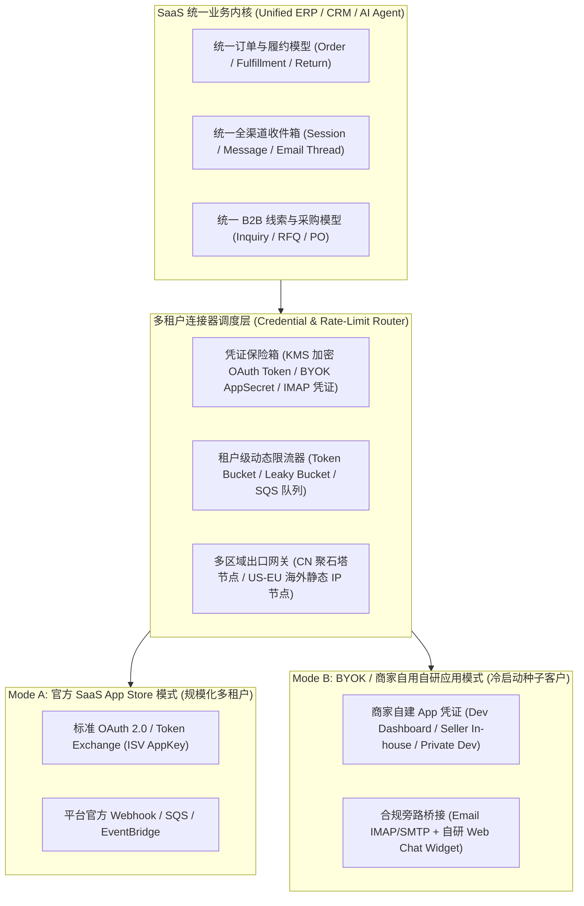

# 全球主流电商与 B2B 外贸平台开放接口技术调研报告（2025–2026）

> **调研基准说明**：本文档面向**多租户 B2C + B2B 混合型跨境 ERP / CRM / AI 智能客服 SaaS 平台**，基于 2025–2026 年各平台官方开发者文档与规则公告，逐一核验**认证与入驻模式、核心交易 API 与 Webhook、站内买卖家消息（客服）API、SaaS ISV 安全审计与 PII 合规壁垒**四大维度，所有未公开或仅限白名单/自研的接口均明确标注实际边界，确保工程架构与上线排期零幻觉。

---

## 目录

1. [核心发现与对前期方案的关键纠偏](#1-核心发现与对前期方案的关键纠偏)
2. [独立站体系（4 平台）](#2-独立站体系4-平台)
   - [2.1 Shopify](#21-shopify)
   - [2.2 WooCommerce](#22-woocommerce)
   - [2.3 SHOPLINE](#23-shopline)
   - [2.4 Shoplazza（店匠）](#24-shoplazza店匠)
3. [短视频与新兴跨境平台（2 平台）](#3-短视频与新兴跨境平台2-平台)
   - [3.1 TikTok Shop](#31-tiktok-shop)
   - [3.2 Temu](#32-temu)
4. [欧美主流货架电商（3 平台）](#4-欧美主流货架电商3-平台)
   - [4.1 Amazon（SP-API）](#41-amazonsp-api)
   - [4.2 eBay](#42-ebay)
   - [4.3 Walmart Marketplace](#43-walmart-marketplace)
5. [东南亚与拉美主流电商（3 平台）](#5-东南亚与拉美主流电商3-平台)
   - [5.1 Shopee](#51-shopee)
   - [5.2 Lazada](#52-lazada)
   - [5.3 Mercado Libre（美客多）](#53-mercado-libre美客多)
6. [B2B 外贸与供应链平台（3 平台）](#6-b2b-外贸与供应链平台3-平台)
   - [6.1 Alibaba.com（阿里国际站 / ICBU）](#61-alibabacom阿里国际站--icbu)
   - [6.2 Made-in-China（中国制造网）](#62-made-in-china中国制造网)
   - [6.3 1688 跨境与供应链平台](#63-1688-跨境与供应链平台)
7. [15 平台全景量化对比矩阵](#7-15-平台全景量化对比矩阵)
8. [批判性复盘与 P0 / P1 / P2 分阶段上线路线图](#8-批判性复盘与-p0--p1--p2-分阶段上线路线图)
9. [BYOK 与官方 SaaS App Store 双连接器架构设计及合规边界](#9-byok-与官方-saas-app-store-双连接器架构设计及合规边界)

---

## 1. 核心发现与对前期方案的关键纠偏

经过对 5 大类、15 个平台官方文档的交叉验证，当前（2025–2026）跨境电商与 B2B 开放生态呈现五个与常识或早期认知截然不同的硬约束：

1. **TikTok Shop 并非“无客服 API”，而是“有官方 CS API 但极高规模门槛”**：[TikTok Shop Customer Service API](https://partner.tiktokshop.com/docv2/page/customer-service-api-overview) 提供了完整的会话列表、消息收发、图片上传、`NEW_CONVERSATION` / `NEW_MESSAGE` Webhook 及 2026 年新增的 `Search Sessions` / `End Session` 等接口；但它属于 **Custom/Restricted API**，第三方 ISV 必须满足 **1,000+ 授权卖家** 或 **日均 100 万次 API 调用量**，且必须预先完成订单/履约/售后集成并提交线上聊天窗口录屏才可获批（仅自研商家 `TikTok Shop Seller` 类别可特批）。前期 PDF 若将其视为“零门槛默认自带聊天 API”或“完全没有客服 API”均不准确。
2. **东南亚即时通讯 API 正在全面收紧**：[Shopee FAQ #56（2026-11-16 更新）](https://open.shopee.com/faq/56)明确公告**自 2024 年 11 月 18 日起已关闭个人第三方及第三方合作平台（ISV）新建 `Customer Service` 应用申请**，且 Shopee 的 `ERP System` 应用类型被明确禁止订阅 `Webchat Push (Code:10)`（[Shopee Push Mechanism 指南](https://open.shopee.com/developer-guide/18)）；Lazada 虽保留 `ERP IM Chat`，但需通过 DataMoat 2 周内限期安全审查与穿透测试（[Lazada Security Review Overview](https://open.lazada.com/apps/doc/doc?nodeId=26149&docId=118077)）。
3. **欧美主流货架平台（Amazon / Walmart / eBay）不支持通用实时 IM 聊天**：Amazon SP-API 的 `Messaging API v1` 与 2026 年 10 月发布的 `Messaging Automations API v2026-04-20`（[Amazon SP-API Models](https://developer-docs.amazon.com/sp-api/docs/sp-api-models)）仅支持**按订单维度触发合规模板消息出站**，没有读取买家回复的 Inbox API（买家回信通过加密中继邮箱流转）；Walmart 平台本身无公开买家聊天 API，仅在 Seller Center 提供邮件中继及 `48 小时响应率（SRR）`报表接口（[Walmart SRR API](https://developer.walmart.com/us-marketplace/docs/retrieve-seller-response-rate-summary)）；仅有 eBay 通过传统 XML Trading API（`GetMemberMessages` / `AddMemberMessageAAQToPartner`）提供 90 天订单内消息读写（[eBay AddMemberMessageAAQToPartner](https://developer.ebay.com/devzone/xml/docs/reference/ebay/AddMemberMessageAAQToPartner.html)）。
4. **独立站体系天然无官方 Inbox API，且 Shopify 正在收紧认证与协议**：Shopify 明确要求自 2025 年 4 月起新公开应用必须完全基于 **GraphQL Admin API**（[Shopify Order REST 弃用声明](https://shopify.dev/docs/api/admin-rest/latest/resources/order)），自 2026 年 1 月起停用店铺后台创建旧版 Custom App（[Shopify Developer Community](https://community.shopify.dev/t/unable-to-generate-shopify-oauth-admin-api-access-token/28300/2)）；同时 Shopify Inbox（原 Ping）、WooCommerce、SHOPLINE、Shoplazza 均不提供公开的多租户站内聊天收发 API，独立站场景的客服必须通过 **自研 Web Chat Widget + 邮箱/工单桥接** 解决。
5. **B2B 外贸平台存在极强的云托管、保证金与自营 CRM 护城河**：阿里国际站（ICBU）与 1688 针对多租户 ISV 强制要求入驻**聚石塔（阿里云）**并缴纳类目保证金（国际站“软件服务”类目保证金为 **5 万元人民币**，且要求公司注册满 1 年、员工不少于 10 人，见 [外贸服务市场保证金标准](https://fuwu.alibaba.com/fwsc/44f1eaff.html) 与 [工具类接入流程](https://fuwu.alibaba.com/fwsc/gjjr_rules.html)）；ICBU 的 IM/TM 接口（`OKKI&TM` 类目）深度绑定阿里收购的“小满 OKKI”；而**中国制造网**根本不提供公开自助 Open Platform，必须通过询盘提醒邮件解析 + 企业邮箱 SMTP/IMAP 桥接实现 P0 覆盖。

---

## 2. 独立站体系（4 平台）

### 2.1 Shopify

- **官方主站与文档**：[Shopify Developer Docs](https://shopify.dev/docs/apps/build/authentication-authorization) | [API 限流说明](https://shopify.dev/docs/api/usage/limits) | [受保护客户数据规范](https://shopify.dev/docs/apps/launch/protected-customer-data)
- **1. 认证与 SaaS 入驻模式**：
  - **Public App（多租户 SaaS 标准路径）**：注册 Shopify Partner 账号（免费，无入驻保证金，但通过 Shopify App Store 收费需遵守平台分成政策）。采用 **Token Exchange（嵌入式应用校验 Session/ID Token 后换取 Access Token）** 或标准 **OAuth 2.0 Authorization Code Grant**，请求头通过 `X-Shopify-Access-Token` 鉴权（[About app authentication](https://shopify.dev/docs/apps/build/authentication-authorization)、[CLI App Auth](https://shopify.dev/docs/apps/build/authentication-authorization/cli-app-authentication)）。
  - **Custom App（2026 年 1 月重大变更）**：自 **2026 年 1 月 1 日**起，商家无法再直接在 Shopify 店铺后台创建永久静态 Token 的旧版 Custom App，必须统一在 **Dev Dashboard** 创建应用并通过 `grant_type=client_credentials` 获取有效期为 **24 小时** 的 Token（仅限同组织下的自有店铺，[Shopify Dev Community 官方回复](https://community.shopify.dev/t/unable-to-generate-shopify-oauth-admin-api-access-token/28300/2)）。此外，使用公共分发的 Client Credentials 需配合签名客户端断言。
- **2. 核心交易接口、Webhook 与限流体系**：
  - **协议强制迁移**：REST Admin API 自 2024 年 10 月 1 日起进入 Legacy 状态；**自 2025 年 4 月 1 日起，所有提交至 App Store 的新 Public App 必须完全基于 GraphQL Admin API 构建**（[REST Order 弃用公告](https://shopify.dev/docs/api/admin-rest/latest/resources/order)）。
  - **核心对象与接口**：
    - 订单：`order` / `orders` 查询（默认仅可读取最近 **60 天** 订单，读取全量历史订单需单独申请 `read_all_orders` 豁免权限，见 [Order GraphQL Object](https://shopify.dev/docs/api/admin-graphql/latest/objects/Order) 与 [Access Scopes](https://shopify.dev/docs/api/usage/access-scopes)）。
    - 商品与库存：GraphQL `Product` / `ProductVariant` / `InventoryLevel`（当店铺商品变体达到 50 万个以上时，非 Plus 店铺每日新建变体上限为 10,000 个，见 [Shopify API Limits](https://shopify.dev/docs/api/usage/limits)）。
    - 履约与退款：`FulfillmentOrder`、`fulfillmentCreate`、`refundCreate`、`returnCreate`。
    - **原生 B2B 批发能力（Shopify Plus 专属）**：GraphQL Admin API 提供 `Company`、`CompanyLocation`、`CompanyContact`、`Catalog`、`PriceList`、`BuyerExperienceConfiguration` 及基于 `companyLocationId` 的 `orderCreate` / `draftOrderCreate`（[Apps and B2B](https://shopify.dev/docs/apps/build/b2b)、[Company Object](https://shopify.dev/docs/api/admin-graphql/latest/objects/Company)、[CompanyLocation Object](https://shopify.dev/docs/api/admin-graphql/latest/objects/companyLocation)）。
  - **Webhook 与异步批量**：支持 HTTPS、`Google Cloud Pub/Sub` 和 `Amazon EventBridge` 推送；HTTPS 投递通过 `X-Shopify-Hmac-SHA256`（或新事件规范的 `Shopify-Hmac-Sha256`）对原始请求体做 Base64 HMAC-SHA256 验签，并用 `Shopify-Webhook-Id` 做幂等（[Verify webhook deliveries](https://shopify.dev/docs/apps/build/webhooks/verify-deliveries)）。大批量历史数据拉取推荐 GraphQL Bulk Operations，避免消耗常规配额。
  - **限流机制**：按「App × Store」隔离计算 GraphQL Query Cost（漏桶积分制）：Standard 计划 **100 points/s**、Advanced **200 points/s**、Shopify Plus **1,000 points/s**、Commerce Components **2,000 points/s**；超限返回 HTTP `429 Too Many Requests`（[Shopify API Limits](https://shopify.dev/docs/api/usage/limits)）。
- **3. 站内买卖家消息 / 客服 API 能力与限制**：
  - **无公开站内聊天读写 API**：Shopify 官方客服工具 **Shopify Inbox**（原 Ping / Shopify Chat）并未开放公开的多租户收发消息 API（仅历史上存在极少数内部/旧版回调设置，开发者社区明确确认其 API 不面向公众开放，[Shopify Community 讨论](https://community.shopify.dev/t/unable-to-configure-ping-message-callback-in-app-deployment/23556)）。
  - **工程替代方案**：SaaS 需通过 **Theme App Extension** 在独立站前端注入自研 Web Chat Widget（实现即时聊天+导购），或对接店铺客服邮箱/工单系统，配合 GraphQL Admin API 实时拉取买家订单、物流与 B2B 客户档案完成上下文关联。
- **4. SaaS ISV 审核、安全审计与 PII 合规壁垒**：
  - **App Store 审核**：Public App（含 Unlisted 模式）上架需通过自动化检查（含 OAuth、Webhook HMAC 验签、GDPR 强制 Webhook `customers/data_request`、`customers/redact`、`shop/redact`）及人工功能审核（[Submit app for review](https://shopify.dev/docs/apps/launch/app-store-review/submit-app-for-review)、[Pass app review](https://shopify.dev/docs/apps/launch/app-store-review/pass-app-review)）。注意官方审核队列受高峰期影响不承诺固定天数，通常为数天至 2–3 周。
  - **Protected Customer Data（PCD）分级审查**：访问订单/客户即触发 Level 1；访问 `name`、`address`、`phone`、`email` 任一字段即触发 **Level 2 审查**，需在 Partner Dashboard 提交数据加密、最小化、留存与删数合规证明（若未获批，GraphQL 会直接屏蔽相应字段并返回权限错误，见 [Protected Customer Data](https://shopify.dev/docs/apps/launch/protected-customer-data)）。Custom App 默认拥有 Level 1/2，但 **Shopify Partner Program Agreement 严禁 ISV 在自有 Partner Dashboard 为不同商家重复创建多个 Custom App 来规避 Public App 审核**（[Shopify Community 官方警示](https://community.shopify.dev/t/unlisted-shopify-app-review-required-before-installation/33101)）。

---

### 2.2 WooCommerce

- **官方主站与文档**：[WooCommerce REST API v3](https://developer.woocommerce.com/docs/apis/rest-api/v3) | [Authentication Guide](https://developer.woocommerce.com/docs/apis/rest-api/authentication) | [Order Fulfillments](https://developer.woocommerce.com/docs/apis/rest-api/v3/order-fulfillments) | [Order Notes](https://developer.woocommerce.com/docs/apis/rest-api/v3/order-notes) | [Webhooks](https://developer.woocommerce.com/docs/apis/rest-api/v1/webhooks)
- **1. 认证与 SaaS 入驻模式**：
  - **去中心化零门槛入驻**：WooCommerce 为开源 WordPress 插件，无官方中心化 ISV 审核或保证金。
  - **双授权方式**：
    1. **SaaS 一键授权页（REST API Auth Endpoint）**：引导商家跳转至 `{store_url}/wc-auth/v1/authorize`（携带 `app_name`、`scope=read_write`、`user_id`、`return_url`、`callback_url`），商家点击授权后，WordPress 主动向 `callback_url` POST 下发 `consumer_key`（`ck_...`）和 `consumer_secret`（`cs_...`）（[WooCommerce Authentication](https://developer.woocommerce.com/docs/apis/rest-api/authentication)）。
    2. **HTTPS Basic Auth / HTTP OAuth 1.0a**：HTTPS 下支持直接用 Consumer Key/Secret 做 HTTP Basic Auth（部分主机 FastCGI 会剥离 Authorization 头时可回退为 query 参数或 OAuth 1.0a one-legged 签名，[WooCommerce REST API Overview](https://developer.woocommerce.com/docs/apis/rest-api)、[v3 OAuth 1.0a Spec](https://woocommerce.github.io/woocommerce-rest-api-docs/v3)）。
- **2. 核心交易接口、Webhook 与限流体系**：
  - **核心接口（`/wp-json/wc/v3/`）**：完整覆盖 Orders（含批量 `/orders/batch`）、Products & Variations、Customers、Refunds（`/orders/{id}/refunds`）、Fulfillments（`/orders/{id}/fulfillments` 支持 `_tracking_number`、`_shipment_provider`、`_tracking_url` 元数据写回，[Order Fulfillments](https://developer.woocommerce.com/docs/apis/rest-api/v3/order-fulfillments)）及 Tax / Shipping Zones。注意 WordPress/WooCommerce 生态普遍存在大量第三方插件（如 Shipment Tracking、B2B Wholesale Suite），字段可能以 `meta_data` 扩展形式存在，SaaS 需具备自定义元数据映射器。
  - **Webhook**：支持通过 `POST /wp-json/wc/v3/webhooks` 动态订阅 `order.created`、`order.updated`、`product.updated` 等主题，请求头携带 `X-WC-Webhook-Signature`（HMAC-SHA256）、`X-WC-Webhook-Source` 与 `X-WC-Webhook-Delivery-ID`（[Webhooks Docs](https://developer.woocommerce.com/docs/apis/rest-api/v1/webhooks)）。但需注意低配虚拟主机的 WP-Cron 队列可能延迟或因超时被商家禁掉，**必须配置增量轮询兜底（`modified_after` / `after`）**。
  - **限流机制**：**无平台级统一 API 限流**，完全取决于商家自身 WordPress 托管服务器性能（PHP-FPM Worker 数、MySQL 连接数）及前置 CDN/WAF（如 Cloudflare）。高并发写入需主动做每站点并发控制（建议单站点并发 ≤ 2–4）与批量接口聚合。
- **3. 站内买卖家消息 / 客服 API 能力与限制**：
  - **无原生即时聊天（IM）API**：WooCommerce 核心不包含买卖家实时聊天系统。
  - **订单上下文邮件备注通道**：提供 `POST /wp-json/wc/v3/orders/{id}/notes` 接口，设置 `"customer_note": true` 时会向买家发送订单通知邮件并记录在订单详情中（[Order Notes API](https://developer.woocommerce.com/docs/apis/rest-api/v3/order-notes)）。但买家回信直接进入商家邮箱而非 WooCommerce REST API。因此，即时客服需通过 **WordPress 插件 / 前端 JS Chat Widget + 邮箱工单解析** 实现。
- **4. SaaS ISV 审核、安全审计与 PII 合规壁垒**：
  - **无官方审核壁垒**：只要商家端支持 HTTPS（推荐启用 HPOS 高性能订单存储且关闭防火墙拦截 `wp-json`），即可分钟级接入生产数据。唯一常见工程阻断是部分安全插件（Wordfence、iThemes）或 Cloudflare Bot Fight Mode 拦截非浏览器 User-Agent 请求。

---

### 2.3 SHOPLINE

- **官方主站与文档**：[SHOPLINE Developer Docs](https://developer.shopline.com/docs/apps/overview) | [REST Admin API Overview](https://developer.shopline.com/docs/apps/api-instructions-for-use/rest-admin-api/overview) | [Rate Limiting](https://developer.shopline.com/docs/apps/api-instructions-for-use/rest-admin-api/flow-control) | [API Release Notes](https://developer.shopline.com/docs/apps/api-instructions-for-use/api-release-notes/api-release-notes) | [App Review Standards](https://developer.shopline.com/docs/apps/application-management/shopline-app-review-standards)
- **1. 认证与 SaaS 入驻模式**：
  - **入驻模式**：在 SHOPLINE Partner Portal 注册开发者账号（无公开入驻保证金要求）。支持 **Private App**（在商家后台直接生成，Access Token 有效期 **3 年**，刷新后旧 Token 保留 5 分钟宽限期，[REST Overview](https://developer.shopline.com/docs/apps/api-instructions-for-use/rest-admin-api/overview)）、**Custom App** 与 **Public App**（后两者均使用标准 **OAuth 2.0** 授权并按 `read_products`、`write_orders` 等精细 Scope 授权）。
  - **注意版本化**：同时维护 8 个滚动季度版本（如 `v20251201`、`v20260301`、`v20260901`），每季度发布一个新版本（[API Versioning Guide](https://developer.shopline.com/docs/apps/api-instructions-for-use/api-versioning-guide)）。
- **2. 核心交易接口、Webhook 与限流体系**：
  - **双协议架构**：同时提供 REST Admin API（单次响应上限 8 MB）与 GraphQL Admin API（单端点 `/graphql.json`，全局 ID 格式 `gid://shopline/{object}/{id}`，[GraphQL Admin API](https://developer.shopline.com/docs/apps/api-instructions-for-use/graph-ql-admin-api/overview)），并支持 Headless Storefront API。
  - **核心业务覆盖**：订单、商品/SKU、库存、履约跟踪、退换货（2025 年 12 月新增 `cancelled` 退货单状态，支持取消退货后二次申请），以及 **2025–2026 强化的 B2B 能力**（支持通过 Admin REST API 及 Order/Draft Order Webhook 读取 B2B 订单关联的 **Purchase Order Number** 与 **B2B Company Location Catalog 货币代码**，见 [API Release Notes](https://developer.shopline.com/docs/apps/api-instructions-for-use/api-release-notes/api-release-notes)）。
  - **Webhook**：通过 `POST /subscribe-to-a-webhook`（`v20240601` 起需走 API 订阅，[Subscribe to a Webhook](https://developer.shopline.com/docs/admin-rest-api/webhook/subscribe-to-a-webhook)），支持 `orders/create`、`orders/edited`、交易支付与争议事件等；请求头含 `X-Shopline-Hmac-Sha256`、`X-Shopline-Webhook-Id`、`X-Shopline-Topic`。官方明确提醒 Webhook 不保证 100% 必达，需结合 `updated_after` 定时补偿拉取（[Webhook Overview](https://developer.shopline.com/docs/apps/api-instructions-for-use/webhooks/overview)）。
  - **限流机制**：按「App × Store」隔离采用漏桶算法：标准版 REST Admin API 漏出速率 **4 QPS**、最大突发桶容量 **40 请求**；企业版（Enterprise）店铺支持**无限频（Unlimited）**；GraphQL 按 Cost Point 计费；Storefront API 按 IP 限流（1 秒窗口）。超限返回 HTTP `429`（[SHOPLINE API Rate Limit](https://developer.shopline.com/docs/apps/api-instructions-for-use/shopline-api-rate-limit)、[Flow Control](https://developer.shopline.com/docs/apps/api-instructions-for-use/rest-admin-api/flow-control)）。
- **3. 站内买卖家消息 / 客服 API 能力与限制**：
  - **无公开站内买卖家聊天 API**：在 SHOPLINE Developer Portal 的 Admin REST API、GraphQL Admin API 及 Webhook 参考中，均未开放买家聊天会话或实时消息收发接口。与 Shopify 类似，客服场景需依托独立站前端 App Extension / Web Widget + 邮件系统承接，再联动 Admin API 查询订单与 B2B 采购单上下文。
- **4. SaaS ISV 审核、安全审计与 PII 合规壁垒**：
  - **App Store 审核标准与周期**：提交 Public App 后，官方审核团队（工作日 GMT+8 10:00–18:00）通常在 **7 个工作日内** 完成审核（[SHOPLINE App Review Standards](https://developer.shopline.com/docs/apps/application-management/shopline-app-review-standards)）。
  - **合规强制项**：不论商家所在地，所有上架 App Store 的应用**强制遵守 GDPR 并接入强制数据合规 Webhook**（缺少或未正确响应直接拒审）；禁止借贷类金融应用；必须提供可跳转的隐私政策、FAQ 与完整 OAuth 2.0 流程（不可直接跳转商家登录页）。另有 **90 天无 API 调用自动下架** 的活跃度监控机制。

---

### 2.4 Shoplazza（店匠）

- **官方主站与文档**：[Shoplazza Developer Docs](https://www.shoplazza.dev/docs/app/getting-started) | [REST API Overview](https://www.shoplazza.dev/docs/app/building-blocks/rest-api) | [Rate Limits](https://www.shoplazza.dev/docs/app/building-blocks/rest-api/rate-limits) | [Webhooks Overview](https://www.shoplazza.dev/docs/app/building-blocks/webhooks/overview) | [App Review Process](https://www.shoplazza.dev/docs/app/publish-and-operate/review-process)
- **1. 认证与 SaaS 入驻模式**：
  - **入驻与授权**：在 Shoplazza Partner 后台注册后可创建 **Public App**（面向多商户上架 Shoplazza App Store，OAuth 2.0 授权换取 `Access-Token`）、**Private App** 或 **Payment App**（[Getting Started](https://www.shoplazza.dev/docs/app/getting-started)）。OAuth 回调查询参数需使用与 Webhook 不同的算法做 HMAC 校验（OAuth 对排序后的 Query String 签 Hex，Webhook 对原始 Body 签 Base64）。
  - **版本节奏**：每 6 个月发布一个大版本（如 `2025-06`、`2026-01`、`2026-07`、`2027-01`），其中 `2026-07` 起开放约 360+ 个公开 Admin REST 端点（[REST API Overview](https://www.shoplazza.dev/docs/app/building-blocks/rest-api)）。
- **2. 核心交易接口、Webhook 与限流体系**：
  - **核心接口（`/openapi/{version}/...`）**：涵盖商品（79 个 CLI/API 域命令映射）、订单（38 个）、客户、折扣与履约；例如履约写回通过 `POST /openapi/2026-01/orders/{id}/fulfillments` 提交 `tracking_number` 与 `tracking_company`，并支持 `complete` / `cancel` 分步状态流转（[Fulfill Orders](https://www.shoplazza.dev/docs/app/use-cases/orders-and-fulfillment/fulfill-orders)）。请求头使用 `Access-Token: {token}`。
  - **Webhook**：支持通过 API 动态注册主题（如 `orders/create`、`orders/paid`、`products/create`），投递请求头包含 `X-Shoplazza-Topic`、`X-Shoplazza-Hmac-Sha256`、`X-Shoplazza-Shop-Domain`、`X-Shoplazza-Deduplication-ID`（同一事件重试保持去重 ID 不变，方便幂等处理，见 [Webhooks Overview](https://www.shoplazza.dev/docs/app/building-blocks/webhooks/overview)）。
  - **限流机制（双维度漏桶）**：Shoplazza 同时考核两个漏桶（任一满即返回 `429` + `Retry-After` 秒数），并在响应头返回 `X-Shoplazza-Shop-Api-Call-Limit: 32/40`（[Rate Limits](https://www.shoplazza.dev/docs/app/building-blocks/rest-api/rate-limits)）：
    - **App × Store 维度**：桶容量 **40 请求**，漏出速率 **2 QPS**。
    - **Store 全局维度**（跨所有 App 共享）：桶容量 **80 请求**，漏出速率 **20 QPS**。
- **3. 站内买卖家消息 / 客服 API 能力与限制**：
  - **无公开站内买家聊天 / Inbox API**：OpenAPI 仅覆盖交易、商品、客户、折扣、主题与结账扩展，没有内置的买卖家聊天或工单收发端点。客服交互必须通过 Theme Extension（Web Chat Widget）或外部邮件工单桥接完成，通过 Webhook / OpenAPI 读取订单物流状态辅助 AI 回复。
- **4. SaaS ISV 审核、安全审计与 PII 合规壁垒**：
  - **App Store 审核**：提交应用后经历 **Review Stage** 与 **Conversation Stage**（状态流转：`Draft` → `Submitted` → `In Review` → `Live`），无需外部第三方渗透测试报告或巨额保证金，若未按拒审意见修改直接重复提交可能被临时暂停提交资格（[App Review Process](https://www.shoplazza.dev/docs/app/publish-and-operate/review-process)）。

---

## 3. 短视频与新兴跨境平台（2 平台）

### 3.1 TikTok Shop

- **官方主站与文档**：[TikTok Shop Partner Center (TTSPC)](https://partner.tiktokshop.com/docv2/page/seller-api-overview) | [Customer Service API Overview](https://partner.tiktokshop.com/docv2/page/customer-service-api-overview) | [App Review Process](https://partner.tiktokshop.com/docv2/page/app-review-process) | [US Data Security Review](https://partner.tiktokshop.com/docv2/page/us-data-security-review) | [Rate Limits](https://partner.tiktokshop.com/docv2/page/rate-limits) | [Webhooks Overview](https://partner.tiktokshop.com/docv2/page/tts-webhooks-overview)
- **1. 认证与 SaaS 入驻模式**：
  - **ISV 入驻与分类**：在 TTSPC 注册服务商（TSP/ISV）账号并选择业务类目（如 ERP/OMS、Connector、Customer Service 等，注意应用创建后类别不可更改，见 [Register as a Service Partner](https://partner.tiktokshop.com/docv2/page/64f19887dc7f3e028d381064)）。若商家自研自用，则注册为 `"TikTok Shop Seller"` 类目。无固定保证金，但需提交企业营业执照与合规材料。
  - **应用分发与授权**：支持 **Public App**（上架 TTS App & Service Store）与 **Custom App**（私有授权链接分发）。采用 OAuth 2.0 授权流程，API 请求通过公共参数 `app_key`、`timestamp`、`sign`（HMAC-SHA256）、`shop_cipher` 及请求头 `x-tts-access-token` 鉴权（[Steps to Get Service Authorization](https://partner.tiktokshop.com/docv2/page/64f198a9dc7f3e028d38171a)、[Webhooks Configuration](https://partner.tiktokshop.com/docv2/page/tts-webhooks-overview)）。
  - **印尼市场历史整合**：原 Tokopedia Open API 已于 2025 年 9 月 30 日终止，全面迁移至 TikTok Shop Partner Center（[API Changelog](https://partner.tiktokshop.com/docv2/page/1nj6l9ok)）。
- **2. 核心交易接口、Webhook 与限流体系**：
  - **核心交易接口（202309 / 202507 / 202607 等版本）**：
    - **Orders**：`POST /order/202309/orders/search`、`GET /order/202309/orders` / `GET /order/202507/orders`（2026 年 7 月起新增 `product_listing_type=TEMPORARY_LISTING` 临时商品标识）。
    - **Products & Inventory**：商品创建/编辑、类目属性校验、多仓库存同步。
    - **Fulfillment & Customs**：面单/包裹拆分与发货回写；2026 年 7 月新增日本清关申报接口 `POST /fulfillment/202607/orders/customs_info/query` 与 `submit`（[2026 API Updates](https://partner.tiktokshop.com/docv2/page/1nj6l9ok)）。
    - **Returns & Refunds**：退货退款与换货模型接口。
  - **Webhook 机制**：支持通过 `PUT /event/202309/webhooks` 按店铺订阅事件，覆盖 `ORDER_STATUS_CHANGE`、`RECIPIENT_ADDRESS_UPDATE`、`PACKAGE_UPDATE`、`CANCELLATION_STATUS_CHANGE`、`RETURN_STATUS_CHANGE`、`REVERSE_STATUS_UPDATE`、`SELLER_DEAUTHORIZATION`、`UPCOMING_AUTHORIZATION_EXPIRATION`（过期前 30 天首次推送并在过期前每日 00:00 提醒）、`NEW_CONVERSATION`、`NEW_MESSAGE` 等。请求头 `Authorization` 为 `HMAC-SHA256(app_key + raw_body, app_secret)` 的十六进制小写摘要（无 Bearer 前缀），并用 `tts_notification_id` 幂等去重（[TTS Webhooks Overview](https://partner.tiktokshop.com/docv2/page/tts-webhooks-overview)）。
  - **动态限流机制**：按「App ID × Authorized Shop」隔离实施动态 QPS 配额；官方建议初始调度基线为：重写入/复杂分析 **0.2–1 QPS**、标准写入 **1–3 QPS**、标准读取 **3–10 QPS**、轻量读取/批量 **5–20 QPS**；超限触发 HTTP `429` 或业务错误码 `36009002`（[TikTok Shop Rate Limits](https://partner.tiktokshop.com/docv2/page/rate-limits)）。
- **3. 站内买卖家消息 / 客服 API 能力与限制（关键纠偏）**：
  - **完整原生双向 Chat API 确实存在，但受到最严格的准入限制**：[Customer Service API Overview](https://partner.tiktokshop.com/docv2/page/customer-service-api-overview) 提供了完备的双向实时客服接口，包括 `GET Get Conversations`、`GET Get Conversation Messages`、`POST Create Conversation`、`POST Upload Image for Buyer Messages`、`POST Mark Buyer Messages as Read`、`GET/PUT Agent Settings`、`GET Get Customer Service Performance`（202407），以及 2026 年新增的 `GET Get Conversation (202601)`、`POST Search Sessions (202602)`、`POST End Session (202605)`、`POST Send Message (202606)` 和实时推送 Webhook（`NEW_CONVERSATION`、`NEW_MESSAGE`）。支持文本（≤ 2000 字符）、图片（≤ 10 MB）、视频（≤ 100 MB）、表情、商品卡、订单卡、物流卡、退换货卡、优惠券卡，**不支持 FAQ 卡片、超链接、普通附件及 `return_refund_status_card`**，也不支持客服绩效个人明细与智能工具透传。
  - **会话窗口与触发规则**：
    - 买家无回复 **6 小时** 后会话自动关闭；客服需在 **7 天** 内响应否则因未响应自动关闭（平台 SLA 考核 **24 小时响应率 ≥ 80%**、解决率 ≥ 65%、满意度 ≥ 75%）。
    - **商家主动发起新会话（Create Conversation）必须满足三者之一**：① 过去 **30 天内** 曾有历史对话；② 买家过去 **60 天内** 在本店下过订单；③ 买家在该店有退货或退款记录。
    - 用 `buyer_user_id`（而非内部 `im_user_id`）打通 Order API 订单历史。
  - **极高的 SaaS ISV 准入门槛（核心阻断）**：
    1. **商业规模门槛**：第三方 ISV 必须达到 **1,000 个以上授权卖家**，**或者** 任意 API 达到 **日均 100 万次调用量**，才可申请开通 Customer Service API 权限（**唯一例外**：自有开发团队的商家在 `TikTok Shop Seller` 自研应用类别下可申请特批）。
    2. **功能前置门槛**：申请时必须已经拥有**线上真实运行的内嵌聊天界面**（需提交未裁剪全屏截图 + 30–90 秒真实收发消息录屏），且必须**已集成订单、履约与售后退换货核心能力**并在同一客服界面展示关联上下文，否则直接拒审。
    3. **官方邮件桥梁兜底**：TikTok Shop 允许卖家在后台配置将买家消息转发至邮箱（如 Salesforce / Zendesk / Gorgias 等 Email-to-Case 工作流），直接回复邮件即可把内容回传给 TikTok 买家端。
- **4. SaaS ISV 审核、安全审计与 PII 合规壁垒**：
  - **全套审核周期**：Public App 需经历注册审核（约 5 个工作日）→ ARD 设计审核（3–5 个工作日）→ 应用功能审核（7–10 个工作日，需提供≥ 10 秒 MP4/MOV 演示视频与可登录测试账号，见 [App Review Requirements](https://partner.tiktokshop.com/docv2/page/app-review-requirements)）→ 多市场语言列表审核（7–10 个工作日）→ **Data Security and Privacy Review（DSPR）合规安全评估（约 2 周，含法律合规可达 3+ 周）** → 若涉及美国本地/跨境卖家，还需完成 **US Data Security Questionnaire（提交后 10–12 个工作日）**（[US Data Security Review](https://partner.tiktokshop.com/docv2/page/us-data-security-review)）→ 若为 Connector 类目针对 US/UK 卖家还触发 **Beta 测试（2–4 周，测试期间 Public App 限 10 店铺/市场，Custom App 限 25 店铺）**。
  - **Custom App 25 店铺天花板**：Custom App 在未触发 Connector 或达到 **25 个卖家授权**前可快速私有上线，一旦授权达 25 家或属于 Connector 类目即强制触发应用审核甚至升级为 Public App（[App Review Process](https://partner.tiktokshop.com/docv2/page/app-review-process)）。

---

### 3.2 Temu

- **官方主站与文档**：[TEMU Partner Platform](https://partner.temu.com) | [Seller Authorization Guide](https://partner.temu.com/documentation?menu_code=38e79b35d2cb463d85619c1c786dd303) | [Authorize & Callback](https://partner.temu.com/documentation?menu_code=fb16b05f7a904765aac4af3a24b87d4a) | [Webhook Integration Guide](https://partner.temu.com/documentation?menu_code=38e79b35d2cb463d85619c1c786dd303&sub_menu_code=c4684d731f944e96b117dd8203724da2)
- **1. 认证与 SaaS 入驻模式**：
  - **分区独立生态**：Temu 将开发者平台按合规主体拆分为 **US（`partner-us.temu.com` / API 网关 `openapi-b-us.temu.com`）、EU（`partner-eu.temu.com`）、GLOBAL（`partner.temu.com`）**。
  - **入驻与强地域/IP 约束**：面向**半托管（Semi-Managed）**及**本土对本土（Local-to-Local）**卖家开放。开发者需填写企业资料及严格的安全合规问卷——**合规第 5 项要求申报服务器出口固定 IP 白名单，且明确不接受中国大陆云厂商服务器节点，服务器必须部署在店铺所属区域（如美国店铺需部署美国节点，欧洲店铺需部署欧洲节点）**，后续修改 IP 需重新提审。
  - **授权流程**：本地卖家支持新版 **In-app Callback URL 授权**（引导至 `/open-platform/client-manage/authorization?appKey=...&redirect_uri=...` 换取 `code`，再调用 `bg.open.accesstoken.create` 换取 `access_token` 与 `mall_id`）；中国大陆/香港注册的跨境卖家部分站点仍采用 Seller Center 手动生成/复制 Token 授权模式（[Seller Authorization Guide](https://partner.temu.com/documentation?menu_code=38e79b35d2cb463d85619c1c786dd303)）。所有请求携带 `type`、`app_key`、`access_token`、`timestamp`（10 位 Unix 秒，允许 ±300 秒误差）、`sign`。
- **2. 核心交易接口、Webhook 与限流体系**：
  - **核心接口（RPC 风格 `type=bg.*` / `temu.*`）**：
    - **Product & Price**：商品发布 V3、类目属性、批量调价（`bg.local.goods.priceorder.change.sku.price`）、库存更新。
    - **Order & PII 解密**：`bg.order.list.get`、`bg.order.detail.get`、`bg.order.amount.query`（敏感权限接口，需单独申请）；**买家收货地址需通过专用敏感接口 `bg.order.decryptshippinginfo.get` 申请权限后解密获取**，未授权将缺少地址字段（[bg.order.decryptshippinginfo.get](https://partner.temu.com/documentation?menu_code=fb16b05f7a904765aac4af3a24b87d4a&sub_menu_code=001b8d067220423c9da40c8c3b4010be)）。
    - **Fulfillment & Buy-Shipping**：`bg.logistics.warehouse.list.get`、`bg.logistics.shippingservices.get`、`bg.logistics.shipment.create`（线上买单/叫号，2026 年持续新增多模式运输标签与承运商支持）、`bg.logistics.shipment.document.get`（打印面单）、`bg.logistics.shipment.confirm`（自发货回传）、半托管协同仓履约及 `Y2_advance_sale` 预售订单标签处理（[bg.logistics.shipment.create](https://partner-us.temu.com/documentation?menu_code=fb16b05f7a904765aac4af3a24b87d4a&sub_menu_code=1eadab72ed8041318604b163dd75cdac)）。
    - **Return/Refund & Ads**：支持退换货/取消订单管理及 `temu.searchrec.ad.create` 广告投放。
  - **Webhook 机制**：支持通过 `bg.tmc.message.update` 接口订阅最多 20 个事件码（如 `bg_order_status_change_event`、`bg_trade_logistics_address_changed`），推送请求头含 `x-tm-app-key`、`x-tm-event-code`、`x-tm-timestamp`、`x-tm-signature`（HMAC-SHA256），Body 中的 `eventData` 需使用 `AES/CBC/PKCS5Padding` 解密（[Webhook Integration Guide](https://partner.temu.com/documentation?menu_code=38e79b35d2cb463d85619c1c786dd303&sub_menu_code=c4684d731f944e96b117dd8203724da2)）。
  - **限流机制**：接口按「MallId」或「AppKey」维度单独限流，公开文档显示大量营销与订单查询接口为 **20 次/秒（MallId）**，部分批量改价接口为 **50 次/秒（AppKey）**（[Temu Rate Limiting 示例](https://partner.temu.com/documentation?menu_code=fb16b05f7a904765aac4af3a24b87d4a&sub_menu_code=08f3f87d05a24bac882732141e0d9672)、[批量调价限流](https://partner.temu.com/documentation?menu_code=fb16b05f7a904765aac4af3a24b87d4a&sub_menu_code=dbf95d09e514491f8685013824cecc76)），超限触发如 `110020007`（1 秒内请求过多）错误码。
- **3. 站内买卖家消息 / 客服 API 能力与限制**：
  - **无公开买卖家即时聊天（Customer Service / Chat）API**：经核查 Temu Partner Platform 官方文档目录（`Authorization`、`Product`、`Price`、`Order`、`Order Cancellation`、`Fulfillment`、`Return and Refund`、`Promotion`、`Webhook`、`Ads`、`Compliance`），当前并未向第三方 ISV 或半托管卖家开放买家-卖家站内实时聊天 API（注：`bg.tmc.message.update` 是 Temu 消息中心 Webhook 订阅接口，并非买卖家客服聊天接口）。买家的售前售后咨询仍在 Temu 卖家中心后台处理，外部 SaaS 仅能通过 Order / Return-Refund 接口同步退换货工单状态。
- **4. SaaS ISV 审核、安全审计与 PII 合规壁垒**：
  - **多区域隔离与强数据合规**：需通过各区域 Partner Platform 注册、应用合规与数据安全问卷审核（遵守 WhaleCo《Data Security Policy for Service Providers》），加之**禁止中国大陆服务器 IP 访问**以及敏感订单金额/收货地址（`bg.order.decryptshippinginfo.get`）权限需单独提审，对 SaaS 多区域代理网关（US/EU 节点部署）提出硬性基础设施要求。

---

## 4. 欧美主流货架电商（3 平台）

### 4.1 Amazon（SP-API）

- **官方主站与文档**：[SP-API Onboarding](https://developer-docs.amazon.com/sp-api/docs/onboarding-overview) | [Register as Public Developer](https://developer-docs.amazon.com/sp-api/docs/register-as-a-public-developer) | [Restricted Data Token (RDT)](https://developer-docs.amazon.com/sp-api/docs/authorization-with-the-restricted-data-token) | [Messaging API v1](https://developer-docs.amazon.com/sp-api/docs/messaging-api) | [SP-API Models](https://developer-docs.amazon.com/sp-api/docs/sp-api-models) | [Security & Compliance Overview](https://developer-docs.amazon.com/sp-api/docs/security-compliance-overview) | [DPP 2025.11 更新公告](https://developer-docs.amazon.com/sp-api/changelog/updates-to-the-data-protection-policy-and-acceptable-use-policy)
- **1. 认证与 SaaS 入驻模式**：
  - **开发者体系**：分 **Public Developer**（服务多卖家，必须在 Amazon Selling Partner Appstore 上架审核）与 **Private Developer**（仅限本企业关联卖家账号自用，无需上架 Appstore）（[Onboarding Overview](https://developer-docs.amazon.com/sp-api/docs/onboarding-overview)）。无报名费或保证金，但需具备真实企业主体与 Solution Provider Portal 账号。
  - **双层鉴权（LWA + RDT）**：使用 Login with Amazon (LWA) OAuth 2.0 获取 `access_token` 与 `refresh_token`，并在 HTTP Header `x-amz-access-token` 中传递。**若调用含买家 PII 的受限接口（如订单收货地址、买家姓名邮箱、税务开票），必须先以 LWA Token 调用 Tokens API 的 `createRestrictedDataToken` 换取短时效的 Restricted Data Token (RDT)**，再以 RDT 替换 `x-amz-access-token` 发起请求（[Authorization with RDT](https://developer-docs.amazon.com/sp-api/docs/authorization-with-the-restricted-data-token)）。（注：SP-API 已取消早年强制 AWS SigV4 签名，但仍保留严格的角色权限体系）。
- **2. 核心交易接口、Webhook 与限流体系**：
  - **核心交易接口**：
    - **Orders**：传统 Orders API v0（`getOrders`、`getOrder`、`getOrderBuyerInfo`、`getOrderItems`）以及 **2026 年 1 月新推出的 Orders API v2026-01-01**（将原有 10 个订单读取接口精简为 `getOrder` 与 `searchOrders`，单次返回完整订单与商品项以显著缓解限流，见 [SP-API Release Notes](https://developer-docs.amazon.com/sp-api/docs/sp-api-release-notes)）。
    - **Catalog, Inventory & Fulfillment**：Catalog Items API、Listings Items API v2021-08-01、FBA Inventory API、Fulfillment Inbound/Outbound API、Merchant Fulfillment API / Shipping API v2、Feeds API（异步批量商品与库存写回）及 Reports API（大批量对账与结算数据）。
  - **异步通知机制（Notifications API）**：不使用普通第三方 Webhook 回调，而是原生推送至 **Amazon SQS** 或 **Amazon EventBridge**；例如卖家自配送订单变更已全面淘汰旧事件，统一订阅 `ORDER_CHANGE` 通知（[Subscribe to MFN Notifications](https://developer-docs.amazon.com/sp-api/docs/subscribe-to-mfn-notifications)）。
  - **限流机制（漏桶 + 动态用量计划）**：按「Seller × Application」及具体 Operation 实施严格速率/突发限制。例如经典 `getOrders` 默认仅 **0.0167 req/s（每分钟 1 次），Burst 20**；`getOrder` / `getOrderBuyerInfo` / `getOrderItems` 为 **0.5 req/s，Burst 30**（[getOrders Reference](https://developer-docs.amazon.com/sp-api/reference/getorders)、[getOrderBuyerInfo Reference](https://developer-docs.amazon.com/sp-api/reference/getorderbuyerinfo)）；响应头 `x-amzn-RateLimit-Limit` 会动态下发当前卖家配额。
- **3. 站内买卖家消息 / 客服 API 能力与限制**：
  - **极度受限的单向订单上下文发信（无公开 Inbox 读取 API）**：
    - Amazon **不提供**通过 SP-API 读取买家主动发来站内信（Buyer-Seller Messaging Inbox）的接口。所有买家入站消息仅能通过 Seller Central 后台或绑定至卖家账户的加密中继邮件系统（`@marketplace.amazon.com`）接收与回复。
    - **SP-API 出站能力**：仅可申请 `Buyer Communication` 与 `Buyer Solicitation` 角色：
      1. **Messaging API v1**：需先调用 `getMessagingActionsForOrder`（限流 1 req/s，Burst 5）查询当前订单允许发送的受限模板类型（如 `createConfirmOrderDetails`、`createConfirmDeliveryDetails`、`sendInvoice` 等），若有附件需先通过 Uploads API 上传至 S3，随后由 Amazon 系统以中继邮件形式发给买家（[Messaging API Use Case](https://developer-docs.amazon.com/sp-api/docs/messaging-api-v1-use-case-guide)）。
      2. **Solicitations API v1**：通过 `createProductReviewAndSellerFeedbackSolicitation` 发送官方标准化索评请求（不可自定义营销文案）。
      3. **Messaging Automations API v2026-04-20（2026 年 10 月上线）**：允许管理卖家在平台内配置的自动化买家回复规则（如物流、退货、商品常见问题触发器），但仍属规则配置而非自由读取任意会话的实时 IM（[SP-API Models](https://developer-docs.amazon.com/sp-api/docs/sp-api-models)、[SP-API Roles](https://developer-docs.amazon.com/sp-api/docs/roles-in-the-selling-partner-api)）。
- **4. SaaS ISV 审核、安全审计与 PII 合规壁垒（全行业最高壁垒之一）**：
  - **开发者注册与审核周期**：申请 Public Developer 且含 **Restricted Roles（如 `Direct-to-Consumer Shipping`、`Tax Invoicing`、`Professional Services` 访问 PII）** 必须通过两阶段审查：① 企业实名与商业背景核验（Developer Profile ≤ 500 词原创说明）；② **Data Security Assessment（数据安全评估）**，审核团队通过 Seller Central Case Log 提问且**必须在 5 天内回复，超时自动关闭 Case**（[Register as a Public Developer](https://developer-docs.amazon.com/sp-api/docs/register-as-a-public-developer)）。实际审核周期通常为 **4–12 周（私有应用约 2–4 周）**。
  - **2025 年 11 月新版 DPP 强制安全标准**：[2025-11-25 生效的 Data Protection Policy 更新](https://developer-docs.amazon.com/sp-api/changelog/updates-to-the-data-protection-policy-and-acceptable-use-policy)与[安全合规总览](https://developer-docs.amazon.com/sp-api/docs/security-compliance-overview)明确规定：
    - 买家 PII **最长留存 30 天**，且**非 PII 数据留存不得超过 18 个月**（除非法律另有强制要求）；最低日志留存 **12 个月**；异地容灾加密备份。
    - 漏洞管理：每 **30 天** 执行一次漏洞扫描、每 **365 天** 执行一次渗透测试；**严重漏洞（Critical）必须在 7 天内修复，高危漏洞（High）必须在 30 天内修复**。
    - 必须指定随时可用的 **Incident Management Point of Contact (IMPOC)**，并接受 Amazon 及其指定第三方审计机构的安全审查（未整改或审计失败将直接吊销生产 Access）。

---

### 4.2 eBay

- **官方主站与文档**：[eBay Authorization](https://developer.ebay.com/develop/guides/sell/authorization) | [OAuth Tokens](https://developer.ebay.com/api-docs/static/oauth-tokens.html) | [Inventory API](https://developer.ebay.com/develop/api/sell/inventory_api) | [Notification API](https://developer.ebay.com/develop/api/sell/notification_api) | [API Call Limits](https://developer.ebay.com/develop/apis/api-call-limits) | [Application Growth Check](https://developer.ebay.com/grow/application-growth-check) | [Member Communications Guide](https://developer.ebay.com/api-docs/user-guides/static/trading-user-guide/member-communications-exchanging.html)
- **1. 认证与 SaaS 入驻模式**：
  - **开放入驻**：免费注册 eBay Developers Program 账号即可获取 Sandbox 与 Production Keyset（App ID / Cert ID / Dev ID），默认即可开启测试与中小规模生产调用，无强制保证金。
  - **OAuth 2.0 授权**：RESTful API 与 Traditional XML API 现均统一支持 OAuth 2.0 Authorization Code Grant（User Access Token 短期有效，**Refresh Token 有效期为 18 个月**，过期需引导用户重新授权；兼容旧版 Auth'n'Auth Token 亦逐步向 OAuth 收敛，见 [OAuth Tokens](https://developer.ebay.com/api-docs/static/oauth-tokens.html)）。注意 OAuth 令牌端点本身也有 24 小时调用上限。
- **2. 核心交易接口、Webhook 与限流体系**：
  - **新旧并存的 API 架构**：
    - **RESTful Sell APIs**：`Fulfillment API`（`getOrders`、`getOrder`、`createShippingFulfillment` 回传物流单号、`issueRefund`、`payment_dispute` 争议处理）、`Inventory API`（SKU 库存/价格批量管理）、`Logistics API`、`Post-Order API`（取消/退货/Case 管理）、`Finances API`（结算资金流）。
    - **Traditional Trading XML API**：部分复杂站内刊登属性或站内信能力仍依赖 XML Trading API。
  - **Webhook（Notification API）**：通过 `/commerce/notification/v1` 订阅主题（如 `ITEM_MARKED_SHIPPED`、订单确认、刊登变更、账户删除 `MARKETPLACE_ACCOUNT_DELETION` 合规通知），通过 HTTPS POST 推送并使用 `X-EBAY-SIGNATURE`（ECC 椭圆曲线公钥签名）验签，失败默认重试 3 次（[Notification API](https://developer.ebay.com/develop/api/sell/notification_api)、[Notification Topics](https://developer.ebay.com/develop/api/buy/notification_events)）。
  - **限流机制（按 API 维度日配额）**：默认基础限额（无需额外审批即可使用）：`Inventory API` **200 万次/天**、`Feed API` **10 万次/天**、`Account API` **2.5 万次/天**、`Finances API` **1.5 万次/天**、`Notification API` **1 万次/天**、`Trading API`（含消息接口）仅 **5,000 次/天**（[API Call Limits](https://developer.ebay.com/develop/apis/api-call-limits)）。
- **3. 站内买卖家消息 / 客服 API 能力与限制**：
  - **支持双向问答与订单后消息，但仅存于 Traditional Trading XML API**：
    - **售前公开/私密问答（Ask Seller a Question, ASQ）**：通过 `GetMemberMessages` 拉取买家针对商品的提问，使用 `AddMemberMessageRTQ` 回复（可选 `DisplayToPublic` 公开展示在商品详情页，无需已有订单关系，见 [GetMemberMessages](https://developer.ebay.com/devzone/xml/docs/reference/ebay/GetMemberMessages.html)、[Exchange Messages](https://developer.ebay.com/api-docs/user-guides/static/trading-user-guide/member-communications-exchanging.html)）。
    - **订单交易双方消息**：使用 `AddMemberMessageAAQToPartner` 向订单买家发送站内信（**限制窗口：仅限订单行创建后 90 天内**），同时可通过 `GetMyMessages` 管理卖家 My eBay 收件箱（[AddMemberMessageAAQToPartner](https://developer.ebay.com/devzone/xml/docs/reference/ebay/AddMemberMessageAAQToPartner.html)）。
    - **严格短时限流与兼容性要求**：`AddMemberMessageAAQToPartner` 存在硬性短时流控——**单个卖家每 60 秒最多调用 75 次，超限直接封锁 100 秒且不可申诉提额**（也不支持 Sandbox 测试）；此外，自 **2025 年 9 月 26 日**起 `RecipientID` / `SenderID` 同时兼容用户名与 Public User ID（[AddMemberMessageAAQToPartner Spec](https://developer.ebay.com/devzone/xml/docs/reference/ebay/AddMemberMessageAAQToPartner.html)）。由于 Traditional Trading API 默认限额仅 **5,000 次/天**，多租户 SaaS 必须申请提额。
- **4. SaaS ISV 审核、安全审计与 PII 合规壁垒**：
  - **Application Growth Check（AGC）免费提额审查**：当调用量超出默认限额（尤其是 5,000 次/天的 Trading API 与消息接口）或调用受限生产 API 时，必须提交免费的 **Application Growth Check**。官方会审核应用可用性、API 合规性（如禁止抓取公共数据构建跨卖家统计指标、禁止 iFrame 嵌套 eBay 页面、必须妥善处理错误与强制订阅买家账户注销通知 `MARKETPLACE_ACCOUNT_DELETION`），审核通过即可解锁企业级日配额（通常耗时 **1–3 周**，见 [Application Growth Check](https://developer.ebay.com/grow/application-growth-check)、[Request AGC](https://developer.ebay.com/api-docs/static/gs_request-an-application-growth.html)）。

---

### 4.3 Walmart Marketplace

- **官方主站与文档**：[Walmart US Marketplace Portal](https://developer.walmart.com/us-marketplace) | [Solution Provider Onboarding](https://developer.walmart.com/us-marketplace/docs/get-started-as-a-solution-provider) | [Publish on Walmart App Store](https://developer.walmart.com/global-marketplace/docs/register-and-publish-on-the-walmart-app-store) | [API Scopes](https://developer.walmart.com/global-marketplace/docs/api-scopes-for-walmart-marketplace-1) | [Rate Limiting](https://developer.walmart.com/us-marketplace/docs/rate-limiting) | [What's New 2026](https://developer.walmart.com/us-marketplace/lang-es/page/whats-new)
- **1. 认证与 SaaS 入驻模式**：
  - **Solution Provider 邀请制入驻**：第三方 SaaS 不能自助直接开通生产多租户权限，必须先提交申请表 → Walmart Partnerships 团队审核并通过商务咨询 → 获邀注册 **Solution Provider Center** 获取 Dynamic Sandbox 凭证 → 开发并提交 **Walmart App Store** 技术+营销审核（含功能 Demo 演示）→ 审核通过后上线（官方预计整个审批与上架周期为 **3–5 周**，[Solution Provider Onboarding](https://developer.walmart.com/us-marketplace/docs/get-started-as-a-solution-provider)）。
  - **2026 年 OAuth 2.0 强制迁移（关键时间线）**：Walmart 已于 **2026 年 7 月 30 日** 停止 Solution Provider 创建新的 **Delegated Access** 密钥，现有旧密钥将于 **2027 年 4 月 30 日** 彻底失效。所有新老 SaaS 必须全面迁移至 **OAuth 2.0**（商家在 Seller Center App Store 点击 Connect 授权，Access Token 通过 `WM_SEC.ACCESS_TOKEN` 传递且有效期仅 **15 分钟**，需定时用 `expires_in` 刷新，[Introduction to Marketplace APIs](https://developer.walmart.com/us-marketplace/docs/introduction-to-marketplace-apis)、[US Marketplace Notice](https://developer.walmart.com/us-marketplace)）。
- **2. 核心交易接口、Webhook 与限流体系**：
  - **核心接口（按 OAuth Scope 精细拆分，[API Scopes](https://developer.walmart.com/global-marketplace/docs/api-scopes-for-walmart-marketplace-1)）**：
    - `Items`（`/items`、`Feeds` 批量商品创建与维护）
    - `Inventory`（`/inventory`、`/inventories` 按 Ship Node 同步库存）
    - `Orders` & `Shipping`（订单拉取、确认、2026 年 11 月新增 Multibox 多箱发货支持、Ship With Walmart 买单贴标、WFS 多渠道履约）
    - `Returns` & `Disputes`（退货、退款与订单争议处理）
    - `Pricing & Promotions` / `Reports`（2026 年 9 月上线 Report Scheduler APIs）
  - **Webhook（2026 年显著增强）**：2026 年 2 月 11 日正式发布 **`ORDER_UPDATES` Webhook**，统一推送订单创建、履约与取消子事件；2026 年 9 月增加 Walmart Multichannel Solutions (MCS) 订单/发货/退货 Webhook；另有 `REPORT_STATUS`、Performance Alarms 与 Buy Box（2026 年 10 月扩展至 CA/MX/CL）通知，极大降低了高频轮询成本（[US What's New](https://developer.walmart.com/us-marketplace/lang-es/page/whats-new)、[Global What's New](https://developer.walmart.com/global-marketplace/page/whats-new)）。
  - **限流机制**：采用**令牌桶算法**且按「Seller × Solution Provider App」独立隔离（卖家直连与第三方 App 配额互不干扰，见 [Rate Limiting](https://developer.walmart.com/us-marketplace/docs/rate-limiting)）。各端点速率差异较大（例如广告/报表类仅 1–10 req/min，Price Incentives 2026 年 10 月由 60/min 降至 3/min），响应头提供 `X-Current-Token-Count` 与 `X-Next-Replenishment-Time`，超限返回 HTTP `429`。
- **3. 站内买卖家消息 / 客服 API 能力与限制**：
  - **无公开买家-卖家即时聊天 / Inbox 收发 API**：Walmart Marketplace API 未提供任何读写买家站内消息的端点。所有买家咨询均在 Seller Center 内或通过平台加密中继邮件流转；开发者门户唯一与客服相关的接口是 **Seller Response Rate (SRR) 绩效查询接口**（`GET /v3/insights/performance/srr/report`，统计卖家是否在 **48 小时内** 回复客户邮件的比例，[Retrieve SRR Summary](https://developer.walmart.com/us-marketplace/docs/retrieve-seller-response-rate-summary)）。因此，多渠道 SaaS 接入 Walmart 客服必须结合**商家邮箱中继（Email Bridge）**解决。
- **4. SaaS ISV 审核、安全审计与 PII 合规壁垒**：
  - **App Store Demo 与最小权限审查**：上架 Walmart App Store 必须提交应用技术架构说明与营销资料，并向 Walmart Integration Team **进行实操 Demo 演示**以验证端到端体验；OAuth Scope 要求严格遵循最小必要原则，否则将在 App Review 阶段被打回（[Register & Publish](https://developer.walmart.com/global-marketplace/docs/register-and-publish-on-the-walmart-app-store)）。全流程官方预期 **3–5 周**。

---

## 5. 东南亚与拉美主流电商（3 平台）

### 5.1 Shopee

- **官方主站与文档**：[Shopee Open Platform](https://open.shopee.com) | [Developer Registration](https://open.shopee.com/developer-guide/12) | [API Calls & Auth](https://open.shopee.com/developer-guide/16) | [Push Mechanism](https://open.shopee.com/developer-guide/18) | [Service Partner Program](https://open.shopee.com/developer-guide/24) | [Platform Partner Rules](https://open.shopee.com/developer-guide/34) | [Chat API FAQ #56](https://open.shopee.com/faq/56)
- **1. 认证与 SaaS 入驻模式**：
  - **账号类型严格区分**：分为 `Individual Seller`（仅自用、且不对巴西 BR 开放）、`Registered Business Seller`（企业自用）和 **`Third-party Partner Platform (ISV)`**（需企业营业执照、商业产品证明等材料，审核周期为 **10 个工作日**，印尼 ID 区域为 **14 个工作日**，见 [Developer Registration](https://open.shopee.com/developer-guide/12)）。
  - **OAuth 2.0 + HMAC-SHA256 签名**：获取授权后通过 `v2.public.get_access_token` 换取令牌。**`access_token` 有效期仅 4 小时，`refresh_token` 有效期 30 天（需高频自动刷新）；且商家授权本身有效期为 1 年**，到期需重新授权（OpenAPI 通过 Push Code:12 提前 7 天预警，见 [FAQ #215](https://open.shopee.com/faq?faq=215&page=1&sub=180&top=177)、[Push Mechanism](https://open.shopee.com/developer-guide/18)）。每次调用需传递 `partner_id`、`timestamp`（±5 分钟窗）、`sign`（HMAC-SHA256）、`access_token` 及 `shop_id`（跨境商家主账户调用全局商品接口使用 `merchant_id`）。
  - **强制 IP 白名单**：所有生产环境必须在 Console 声明服务器出口 IP 白名单，未声明 IP 调用直接报错 `source_ip_undeclared` 并会被脱敏拦截（[IP Whitelist Announcement](https://open.shopee.com/announcements/815)）。
- **2. 核心交易接口、Webhook 与限流体系**：
  - **核心 v2 REST 接口**：
    - `v2.order.*`（`get_order_list`、`get_order_detail`、`search_package_list`、`get_package_detail`、拆单）
    - `v2.product.*` 与 `v2.global_product.*`（CNSC/KRSC 跨境全球商品发布与门店映射、价格与库存同步）
    - `v2.logistics.*`（`get_shipping_parameter`、`ship_order` / `mass_ship_order`、`get_tracking_number`、`create_shipping_document` 打印面单，[Order & Logistics Guide](https://open.shopee.com/developer-guide/229)）
    - `v2.returns.*`（退货退款列表与详情、凭证上传，2025 年 9 月新增 In-transit RR 物流状态推送）
  - **Webhook（Push Mechanism）**：支持 Order Status Update Push (Code:3)、Order TrackingNo Push (Code:4)、Shipping Document Status Push (Code:15)、Shop Authorization / Canceled / Expiry Push (Code:1/2/12)、Banned Item Push (Code:6) 等，验签采用 `HMAC-SHA256(url + "|" + raw_body, partner_key)`，**必须返回 `2xx` 状态码且响应体为空（Empty Body）**；若 6 小时内推送超 600 次且成功率低于 30%，平台将**自动关闭 Webhook 订阅**（[Push Mechanism](https://open.shopee.com/developer-guide/18)）。
  - **限流与健康度惩罚**：按 App 每日调用总配额及单店/接口速率限制（超限返回 `error_rate_limit` 或日配额耗尽 `error_limit`，次日 00:00 UTC+8 重置）。平台强监管接口健康度：要求**日均 API 成功率不得低于 90%**，否则将触发降低每日限额、敏感字段脱敏乃至暂停新店授权的惩罚（[Platform Partner Rules](https://open.shopee.com/developer-guide/34)）。
- **3. 站内买卖家消息 / 客服 API 能力与限制（重大壁垒提示）**：
  - **技术能力完备（`v2.sellerchat.*`）**：包含会话列表/详情、消息拉取、发送文本/图片/商品/订单/优惠券卡（`v2.sellerchat.send_message`）、置顶/标未读、`Webchat Push (Code:10)` 及 2025 年 10 月新增的 `v2.chat.get_csat_details`（查询差评前 20 条记录）与 **24 小时内同内容重复消息拦截**（[Announcements #1268](https://open.shopee.com/announcements/1268)）。同时**严禁主动发送订单进度广播、促销群发或用自动回复伪装人工消息**。
  - **关键政策冻结壁垒（2024.11 起关闸）**：
    1. **新 ISV 申请已关闭**：[Shopee 官方 FAQ #56（2026-11-16 更新）](https://open.shopee.com/faq/56)明确公告：**“Applications for Customer Service Apps from Individual Third Parties and Third-party Partner Platforms have been closed since November 18, 2024.”**
    2. **App Type 功能硬隔离**：在 [Push Mechanism 权限表](https://open.shopee.com/developer-guide/18) 中，**`ERP System` 应用类型被剥夺 `Webchat Push (Code:10)` 权限**，仅有 `Customer Service`（已对新 ISV 关闭）与 `Seller In-house System`（商家自研系统）拥有全部推送与 Chat API。即便历史已获批的 ISV 客服应用，也必须持续保持 **授权店铺近 30 天平均订单 > 100（且单店 > 21 单）** 才可保住 Chat API 权限。
- **4. SaaS ISV 审核、安全审计与 PII 合规壁垒**：
  - **Service Partner Program 季度安全考核**：[Shopee Service Partner Program（2025-12-24 更新）](https://open.shopee.com/developer-guide/24) 要求 ISV 每年提交由 **CREST 认证渗透测试机构** 出具的渗透测试报告或有效 **ISO 27001** 安全认证，并在 Console 申报所有 IT 资产接受官方定期漏扫；若发现高危漏洞未在规定期限（如 1 次警告或 2 周内）修复，将被降级甚至直接吊销 Open Platform 访问权限。另有 **90 天无 API 调用或未上线即休眠/下架** 规则。

---

### 5.2 Lazada

- **官方主站与文档**：[Lazada Open Platform](https://open.lazada.com/doc/doc.htm) | [Getting Started](https://open.lazada.com/apps/doc/doc?nodeId=10535&docId=108130) | [Create an App](https://open.lazada.com/apps/doc/doc?nodeId=10398&docId=108002) | [App Parameters & Call Limits](https://open.lazada.com/apps/doc/doc?nodeId=10433&docId=108055) | [Security Review Overview](https://open.lazada.com/apps/doc/doc?nodeId=26149&docId=118077) | [Lazada IM Open API](https://open.lazada.com/apps/doc/doc?nodeId=30739&docId=120971) | [Platform Rules](https://open.lazada.com/apps/doc/doc?nodeId=30411&docId=120730)
- **1. 认证与 SaaS 入驻模式**：
  - **入驻与服务市场绑定**：分 `Enterprise/Personal Self-Developed`（含 `Seller In-house APP`、`In-house IM Chat`）和 **`Enterprises Commercial`**（面向多商户 SaaS，含 **`ERP System`** 与 **`ERP IM Chat`**，必须入驻 Lazada Service Market 服务市场并在上线后开放商家订购授权，见 [Create an App](https://open.lazada.com/apps/doc/doc?nodeId=10398&docId=108002)）。
  - **OAuth 2.0 + LazOP 签名**：通过 `/auth/token/create` 或 `/auth/token/createWithOpenId` 换取 `access_token`，按东南亚六国（SG/MY/TH/VN/ID/PH）对应独立网关地址调用并签名。支持绑定固定 IP 白名单（不支持 IPv6）。
- **2. 核心交易接口、Webhook 与限流体系**：
  - **核心接口**：覆盖 `Product API`（含 Global Plus 升级与半托管商品查询）、`Order API`（`/orders/get`、`/order/get`）、`Fulfillment API`、`Logistics API`、`Finance API`、`ReverseOrder API`（`/order/reverse/return/update` 等退换货）与 `Product Review API`（支持 `SubmitSellerReply` 评价回复，[LazOP 2.0 Updates](https://open.lazada.com/doc/doc.htm?nodeId=27493&docId=118729)）。
  - **Webhook（Lazada Push）**：支持 Trade Order、Fulfillment Order、Reverse Order、Product Quality Control、Shallow Stock、Authorization Token Expiration Alert、以及 **IM Send Message (`msg_type=2`) / IM Session Update (`msg_type=19`)** 推送（失败默认间隔 30 分钟、最多重试 12 次，[IM Webhook Docs](https://open.lazada.com/apps/doc/doc?nodeId=29537&docId=121553)）。注意 Reverse Order 推送不会全量推送所有状态（如 `REFUND_SUCCESS` 仅在 `ONLY_REFUND` 类型下推送）。
  - **限流机制**：
    - **日配额**：`Testing` 状态默认 **10,000 次/天**；审批通过进入 `Online` 状态后提升至 **10,000,000 次/天**；若触发休眠规则（创建/上线 90 天内无调用），日配额直接锁死为 **1 次/天**（[App Parameters](https://open.lazada.com/apps/doc/doc?nodeId=10433&docId=108055)、[Platform Rules](https://open.lazada.com/apps/doc/doc?nodeId=30411&docId=120730)）。
    - **细粒度频率控制**：单接口设严格滑动窗口限制（例如同卖家查询同一笔订单调用 `/order/get` 的并发与频次受到严格限制，典型如 30 秒内同单查询上限管控），且需维持高 API 成功率。
- **3. 站内买卖家消息 / 客服 API 能力与限制**：
  - **提供完整双向 IM Open API，需单独创建 IM 类目应用**：
    - 在 `Enterprises Commercial` 下提供专门的 **`ERP IM Chat`**（自研对应 `In-house IM Chat`）应用类别，除 IM 权限外亦支持查询商品与订单上下文（[Create an App](https://open.lazada.com/apps/doc/doc?nodeId=10398&docId=108002)）。
    - **核心端点**：`GET /im/session/list`（会话列表）、`GET /im/session/get`（会话详情）、`POST /im/session/read`（标已读）、`GET /im/message/list`（消息历史）、`POST /im/message/send`（发送文本/卡片/图片等消息），配合 `IM Send Message` 与 `IM Session Update` 实时 Webhook（[Lazada Open Doc](https://open.lazada.com/doc/doc.htm)、[SendMessage](https://open.lazada.com/apps/doc/api?path=%2Fim%2Fmessage%2Fsend)）。
    - **安全拦截机制**：消息需经过平台安全内容校验，未通过安全校验的敏感消息仅对卖家自己可见（[GetMessages API](https://open.lazada.com/apps/doc/api?path=%2Fim%2Fmessage%2Flist)），且禁止在消息中发送违禁导流信息。
- **4. SaaS ISV 审核、安全审计与 PII 合规壁垒**：
  - **DataMoat（御城河）敏感数据去模糊化审查**：未经安全审计的应用在拉取订单时，买家姓名、电话、地址等 PII 均为脱敏状态；ISV 必须在 Console 提交 **Apply Unmask** 进入 **DataMoat Security Review**，经历应用资料申报 → LazOP 初审 → 安全架构合规 → **渗透测试（Penetration Test）** → 终审验证，**且整个 DataMoat 流程必须在申请发起后的 2 周内完成，超时工单自动关闭并需从头重走**（[Security Review Overview](https://open.lazada.com/apps/doc/doc?nodeId=26149&docId=118077)）。同时必须对接 `/datamoat/login` 账户异常行为检测服务（[DataMoat Login API](https://open.lazada.com/apps/doc/api?path=%2Fdatamoat%2Flogin)）。

---

### 5.3 Mercado Libre（美客多）

- **官方主站与文档**：[Mercado Libre Global Selling API Docs](https://global-selling.mercadolibre.com/devsite/api-docs) | [Auth & Token Guide](https://global-selling.mercadolibre.com/devsite/authentication-and-authorization-global-selling) | [Questions & Answers API](https://global-selling.mercadolibre.com/devsite/en_us/manage-questions-answers-global-selling) | [Post-Sale Messaging API](https://global-selling.mercadolibre.com/devsite/messaging-after-sale-global-selling) | [Blocked Messages Rules](https://global-selling.mercadolibre.com/devsite/en_us/create-application/blocked-messages-gs) | [Rate Limit / 429](https://developers.mercadolibre.com.ar/en_us/rate-limit-429-error)
- **1. 认证与 SaaS 入驻模式**：
  - **免费自助入驻 + 认证合作伙伴**：在 Mercado Libre Developers 门户注册应用免费，获取 `APP_ID` 与 `SECRET_KEY`。支持当地站点（AR/BR/MX/CL/CO 等 18 个拉美国家站点）及面向跨境卖家的 **Global Selling (CBT)** 统一入口。
  - **OAuth 2.0（PKCE / 单次 Refresh Token）**：授权码换取 `access_token`（有效期 **6 小时**）与 `refresh_token`（有效期 **6 个月**）。**极关键工程细节：Mercado Libre 的 `refresh_token` 为单次使用（Single-use），每次刷新都会返回全新的 `refresh_token` 并使旧令牌立即失效，并发刷新必须加分布式锁**；且授权必须由店铺**主账号（而非子账号 Collaborator）**完成（[Authentication Global Selling](https://global-selling.mercadolibre.com/devsite/authentication-and-authorization-global-selling)）。
- **2. 核心交易接口、Webhook 与限流体系**：
  - **核心接口**：覆盖 `Items`（`/marketplace/users/$USER_ID/items/search`，超 1,000 条必须使用 `search_type=scan` 游标模式且游标带有限时窗口，[Items & Searches](https://global-selling.mercadolibre.com/devsite/items-and-searches-global-selling)）、`Orders & Shipments`（墨西哥/巴西/智利跨境订单与标签打印、FBM / Mercado Envíos 物流追踪）、`Claims & Returns`（退货与纠纷理赔）、`Invoices`、`Mercado Ads`。
  - **Webhook（Notifications / Feeds）**：支持订阅 `items`、`orders`、`created_orders`、`questions`、`messages`、`payments`、`claims` 等 Topic；Webhook 仅推送资源 URI，接收方需回调对应 GET 接口获取明细并校验来源（[Receive Notifications](https://developers.mercadolibre.com.ar/en_us/services-subscribe-to-our-feeds)）。
  - **限流机制**：按「Client ID（App）」及具体端点限流（不按请求体大小计算），文档未公开固定全局 QPS 数值，高并发超限返回 `429 Too Many Requests`；官方要求游标翻页必须在有效期内快速消费完，避免长时间挂起导致 429，大流量 SaaS 可向商业集成团队申请提额（[Rate Limit / 429 Error](https://developers.mercadolibre.com.ar/en_us/rate-limit-429-error)）。
- **3. 站内买卖家消息 / 客服 API 能力与限制（双通道高度结构化）**：
  - **通道 A：售前公开问答 API（Pre-Sale Questions API）**：
    - **接口**：`GET /marketplace/questions/search`（按 `UNANSWERED` / `ANSWERED` 状态检索）、`GET /marketplace/questions/$QUESTION_ID`、`POST /marketplace/answers`（提交回答，Global Selling 支持同时传 `text` 与 `text_translated` 跨语种自动翻译）、`DELETE /marketplace/questions/$QUESTION_ID`（[Manage Questions & Answers](https://global-selling.mercadolibre.com/devsite/en_us/manage-questions-answers-global-selling)）。
    - **重要限制**：问答公开展示在商品详情页上，需严防联系方式/外链违规；客服响应速度直接影响 Seller Reputation（店铺声誉）。
  - **通道 B：售后私信 API（Post-Sale Messaging API）与理赔消息 API（Claims Messages API）**：
    - **接口**：按 `pack_id`（合包订单组）维度管理对话：`GET /messages/packs/$PACK_ID/sellers/$SELLER_ID`（默认读取会标为已读，轮询查漏需加 `?mark_as_read=false`）、`GET /messages/unread`（查未读）、`POST /messages/attachments`（上传 JPG/PNG/PDF 等附件，上限 25 MB，单消息最多 25 个附件）、`POST /messages/packs/$PACK_ID/sellers/$SELLER_ID`（发送消息）及纠纷通道 `Claims Messages`（[Post-Sale Messaging](https://global-selling.mercadolibre.com/devsite/messaging-after-sale-global-selling)、[Pending Messages](https://developers.mercadolibre.com.ar/en_us/product-identifiers/pending-messages)、[Claims Messages](https://global-selling.mercadolibre.com/devsite/manage-claims-messages)）。
    - **严格的“发起原因（Action Guide）”与封锁规则（重要工程约束）**：
      1. **卖家不可随意主动开启自由聊天**：卖家主动发起售后首条消息时，必须先调 `GET /messages/action_guide/packs/$PACK_ID` 获取可用的 `option_id`（如模板化的 `REQUEST_VARIANTS`、`REQUEST_BILLING_INFO`，或受字符限制的 `SEND_INVOICE_LINK` / `OTHER`），**其中自由文本字段 `OTHER` 与 `SEND_INVOICE_LINK` 严格限制 ≤ 350 个字符，且在物流状态变成 `Delivered` 后 `OTHER` 选项自动禁用**，且受 `cap_available` 次数上限限制，用尽后必须等买家回复才可继续通过 `/messages` 对话（[Reasons to Communicate](https://developers.mercadolibre.com.ar/en_us/reasons-to-communicate)）。
      2. **十余种自动禁言/封锁子状态（`substatus`）**：订单取消、已发生部分/全额退款（`blocked_by_refund`）、纠纷调解中（`blocked_by_mediation`）、自购满 18 个月（`blocked_by_conversation_expired`）、买方屏蔽（`blocked_by_buyer`）、Full 仓发货未送达前（`blocked_by_fulfillment`）均会拦截发信并返回 `403`（[Blocked Messages](https://global-selling.mercadolibre.com/devsite/en_us/create-application/blocked-messages-gs)）。
      3. **Model 6 跨境卖家限制**：部分被平台归类为 **CBT Model 6（全托管/特定代运营模式）** 的卖家调用 Messages 与 Claims API 会直接收到 `403 Forbidden`。
- **4. SaaS ISV 审核、安全审计与 PII 合规壁垒**：
  - **认证与物流接入规范（Homologation / Certification）**：基础开发者应用可快速注册上线，但若接入动态运费（ME1 Dynamic Freight）等核心履约扩展需通过 URL **Homologation 认证审查**；此外 Mercado Libre 保留对商业应用进行官方 **Certification 认证审查** 与强制合规整改的权利，若检测到违规发外链、引导站外交易或违反数据保护条款，可对应用实施限流、计费或隔离（Quarantine）处罚（[Global Selling Developer Terms](https://global-selling.mercadolibre.com/devsite/mercado-libre-global-selling-developer-terms-and-conditions)、[Dynamic Freight Homologation](https://developers.mercadolibre.com.ar/en_us/ship-products/dynamic-freight)）。

---

## 6. B2B 外贸与供应链平台（3 平台）

### 6.1 Alibaba.com（阿里国际站 / ICBU）

- **官方主站与文档**：[Alibaba Open Platform (ICBU)](https://developer.alibaba.com/docs/doc.htm?source=search&treeId=684&articleId=118416&docType=1) | [ICBU API 列表](https://developer.alibaba.com/docs/api_list.htm) | [ICBU-交易 API](https://developer.alibaba.com/docs/api_list.htm?cid=21232) | [ICBU-RFQ API](https://developer.alibaba.com/docs/api.htm?apiId=32084) | [ICBU-商品新接口](https://developer.alibaba.com/docs/doc.htm?treeId=456&articleId=119213&docType=1) | [OKKI&TM API](https://developer.alibaba.com/docs/api.htm?apiId=69005) | [外贸服务市场入驻规则](https://activity.alibaba.com/fuwu/3c93e610.html) | [外贸服务市场保证金标准](https://fuwu.alibaba.com/fwsc/44f1eaff.html) | [工具类服务接入流程](https://fuwu.alibaba.com/fwsc/gjjr_rules.html)
- **1. 认证与 SaaS 入驻模式（重资产高门槛体系）**：
  - **开放平台底层**：依托淘宝开放平台（TOP）网关（`http://gw.api.taobao.com/router/rest` / `https://eco.taobao.com/router/rest`），采用 OAuth 2.0 获取 `session` 授权令牌并配合 HMAC/MD5 签名。支持主子账号授权映射（`alibaba.member.sub.account.info.get`）。
  - **SaaS ISV 商业准入（外贸服务市场）**：第三方 SaaS 必须先入驻**阿里巴巴外贸服务市场（`fuwu.alibaba.com`）**并绑定企业级支付宝商家认证，再在淘宝开放平台创建“B2B 国际站”应用：
    - **企业硬性资质（“软件服务”类目）**：企业经营范围必须含软件开发/网络技术等关键词；**公司注册时间 ≥ 1 年**；**公司员工人数 ≥ 10 人**；需提交《服务说明文档》及产品 **MRD 需求文档**；且法人/股东/员工配偶需满足阿里集团回避与离职报备规范（[外贸服务市场入驻规则](https://activity.alibaba.com/fuwu/3c93e610.html)、[工具类接入流程](https://fuwu.alibaba.com/fwsc/gjjr_rules.html)）。
    - **保证金要求**：[外贸服务市场保证金标准](https://fuwu.alibaba.com/fwsc/44f1eaff.html) 规定：**软件服务（客户管理 CRM、邮件管理、业务管理等）缴纳 5 万元人民币**；应用工具（直通车工具、产品管理工具）缴纳 **3 万元人民币**；运营服务缴纳 **10 万元人民币**（多类目合并按最高额缴纳）。
- **2. 核心交易接口、Webhook 与限流体系**：
  - **Product API（Schema 体系）**：`alibaba.icbu.category.get.new`、`alibaba.icbu.product.schema.get`、`alibaba.icbu.product.schema.add` / `update`、`alibaba.icbu.product.list`、`alibaba.icbu.product.sku.inventory.get`、`alibaba.icbu.product.inventory.update`（支持区分 `market=1` 在线下单品 与 `market=2` 询盘品，支持阶梯价 `ladderPrice` 与 `FOB` 价，见 [ICBU 商品发布文档](https://developer.alibaba.com/docs/doc.htm?treeId=456&articleId=119213&docType=1)）。
  - **RFQ 报价与采购接口**：`alibaba.icbu.rfq.search`（搜索 RFQ）、`alibaba.icbu.rfqdetail.get`（详情）、`alibaba.icbu.rfq.recommend`（推荐 RFQ）、`alibaba.icbu.quotation.post`（提交报价）、`alibaba.icbu.annex.upload`（附件上传）（[ICBU-RFQ API](https://developer.alibaba.com/docs/api.htm?apiId=32084)）。
  - **Trade Assurance 信保订单与资金物流接口**：`alibaba.seller.order.list`、`alibaba.seller.order.get`、`alibaba.seller.order.fund.get`、`alibaba.seller.order.logistics.get`、`alibaba.trade.order.create`（信保下单）、`alibaba.trade.order.modify`、`alibaba.order.trade.tt.get`（TT 账号查询）（[ICBU-交易 API](https://developer.alibaba.com/docs/api_list.htm?cid=21232)）。
  - **异步消息（TOP 消息服务）**：通过聚石塔/TOP 异步消息通道消费交易状态变更事件（如 `ICBU-交易`、`ICBU-小满` 消息类目，[TOP 消息类目](https://developer.alibaba.com/docs/topic_list.htm?cid=424)）。
  - **限流机制**：按 AppKey 统计总调用配额（Beta/测试期受限，正式发布后按服务市场类目与调用等级分配 QPS，高频并发需在塔内遵循 TOP 流控规范）。
- **3. 站内买卖家消息 / 客服（询盘与 TradeManager / 旺旺）能力与限制**：
  - **极度封闭的生态倾斜与自营护城河**：
    - 经核查阿里开放平台文档目录，虽然平台存在 `OKKI&TM` 类目下的 `alibaba.interaction.im.conversation.list.query`（IM 会话列表）、`alibaba.interaction.im.message.list.query`（IM 历史消息查询）、`alibaba.interaction.im.assistant.message.send`（阿里卖家 APP 插件销售助手发消息）及 `alibaba.interaction.im.assignsetting.query` 等接口（[OKKI&TM API 目录](https://developer.alibaba.com/docs/api.htm?apiId=69005)），**但官方文档明确标注其定位为“提供数据给小满（OKKI）”及“阿里卖家 APP 插件”**（如 `alibaba.icbu.snsoft.*` 为南北软件自营专用，`qimen.alibaba.okki.*` 为小满科技专用）。
    - **普通第三方新入驻 SaaS ISV 极难获批自由读写 TradeManager（阿里国际站旺旺）实时 IM 会话或代发消息权限**。多数外部外贸 CRM/SaaS 仍通过 **RFQ API + 信保订单 API + 商家绑定邮箱解析询盘通知邮件**（外贸邮/企业邮箱自动抓取 `Alibaba.com` 询盘提醒并与买家直接通过邮件报价沟通）作为标准工程通路。
- **4. SaaS ISV 审核、安全审计与 PII 合规壁垒**：
  - **强制聚石塔（阿里云）托管铁律**：[工具类服务接入流程](https://fuwu.alibaba.com/fwsc/gjjr_rules.html) 明确规定：**“产品必须发布在聚石塔上，系统会通过回调 URL 来做检验”**。涉及核心商家/交易数据的应用必须部署在阿里云聚石塔安全域内，并配备御城河安全防护与数据加密解密校验（如 `alibaba.seller.trade.decode`）。
  - **多重人工审批 + 实地核查**：除线上资质审核（3 个工作日初审 + 3 个工作日复审）外，还包含大区实地核查/服务商面试、MRD 评审、VIP 类目定向灰度测试，正式入驻与上架周期通常达 **6–12 周**。

---

### 6.2 Made-in-China（中国制造网）

- **官方主站与文档**：[Made-in-China Global](https://en.made-in-china.com) | [Virtual Office FAQ](https://www.made-in-china.com/faq/detail1u320000601/Virtual-Office-Overview.html) | [外贸 e 家：询盘与卖家 FAQ](https://service.made-in-china.com/help/faq/407.htm) | [批量下载询盘指南](https://service.made-in-china.com/help/guide/newInfo/5175.htm) | [TradeMessenger 使用指南](https://service.made-in-china.com/help/faq/trademessenger/25761.htm)
- **1. 认证与 SaaS 入驻模式**：
  - **无公开自助 Open Platform / ISV 应用市场**：经对 `made-in-china.com` 及 `service.made-in-china.com` 官方域名全站检索，中国制造网（焦点科技）**未向第三方 SaaS 开发者开放公开的开发者注册门户、公开 REST API 文档或 OAuth 2.0 App Store**（不存在类似 `open.made-in-china.com` 的自助开放平台；少数大型品牌 ERP/CRM 厂商仅存在非公开的线下商务定向接口合作，无公开技术规格可供验证）。
- **2. 核心交易接口、Webhook 与限流体系**：
  - **官方公开数据出口仅为后台交互与邮件/文件导出**：
    - 供应商日常商机（Inquiry 询盘、Sourcing Request 采购需求报价、Secured Trading Service 在线担保订单）均集中于 **Virtual Office（虚拟办公室）** 后台管理（[Virtual Office Overview](https://www.made-in-china.com/faq/detail1u320000601/Virtual-Office-Overview.html)）。
    - 主账号支持在 Virtual Office 按月批量导出一年内的历史询盘，格式为 **Excel 表格** 或 **`.eml` 电子邮件文件**；系统会自动清除超过 **12 个月** 的历史 Inbox 询盘（[批量下载询盘](https://service.made-in-china.com/help/guide/newInfo/5175.htm)、[询盘 FAQ](https://service.made-in-china.com/help/faq/407.htm)）。
    - **严禁爬虫**：未公开接口意味着不得使用无头浏览器或未授权爬虫违规抓取（高封号风险且违反用户协议）。
- **3. 站内买卖家消息 / 客服 API 能力与限制（Email Bridge 工程桥接方案）**：
  - **无公开站内信/IM API**：买家与中国制造网供应商的实时 IM 对话依赖官方专用客户端 **TradeMessenger（麦通）**（PC 客户端、网页版麦通及“MIC 国际站”供应商 App，见 [TradeMessenger 安装与登录](https://service.made-in-china.com/help/faq/trademessenger/25761.htm)），目前仅官方手机桌面小组件每 5 分钟刷新显示未读数（[供应商 APP 小组件](https://service.made-in-china.com/help/guide/shangjironghe/11957.htm)），不提供第三方聊天读写 API。
  - **官方认可的 Inquiry Email Bridge（零门槛核心方案）**：[官方 FAQ #407](https://service.made-in-china.com/help/faq/407.htm) 明确指出，新询盘会由 `en_notification@made-in-china.com` 自动推送至供应商在 Virtual Office 设定的主/备用企业邮箱，且**官方明确建议供应商“最好以企业邮箱或国际通行邮箱直接回复买家”，避免站内 Inbox 回复被海外买家邮件服务器屏蔽**。因此，SaaS 平台可通过 **企业邮箱 IMAP/SMTP 双向同步 + `en_notification@made-in-china.com` 邮件结构化解析器**，合法、零审核成本地实现中国制造网询盘自动入库 CRM、AI 草拟多语种报价回复及跟进全闭环。
- **4. SaaS ISV 审核、安全审计与 PII 合规壁垒**：
  - **公开 ISV 对接通道关闭（非标准合作）**：普通初创 SaaS 无法自主申请 API；采用 **Email Bridge 模式** 则审核门槛为 **Zero（零平台审核）**，仅需获得客户企业邮箱的 OAuth/IMAP 授权即可当天上线，完全符合平台推荐的外贸业务流。

---

### 6.3 1688 跨境与供应链平台

- **官方主站与文档**：[1688 开放平台](https://open.1688.com) | [合作模式与角色规范](https://open.1688.com/doc/profitModel.htm) | [合作伙伴入驻协议](https://open.1688.com/doc/appAgreement.htm) | [跨境 ERP/独立站 SaaS 解决方案](https://open.1688.com/solution/detail?key=1697015308755&category=null) | [跨境超买解决方案](https://open.1688.com/solution/detail?key=1513248184893) | [跨境分销解决方案](https://open.1688.com/solution/detail?key=1743146805517&category=null) | [CRM 客户销售管理解决方案](https://open.1688.com/solution/detail?key=1689057950443&category=null)
- **1. 认证与 SaaS 入驻模式**：
  - **双模式架构（规则极其分明，[合作模式说明](https://open.1688.com/doc/profitModel.htm)）**：
    1. **服务商（ISV）模式**（如 `跨境ERP服务商`、`分销服务商`）：必须入驻 1688 服务市场并**入驻聚石塔**，方可开放不限数量的用户页面 OAuth 2.0 授权（使用 `access_token` + `_aop_signature`）；应用需上架 1688 服务市场对外售卖。
    2. **买卖家自开发模式**（如 `跨境超级买家`、`采购解决方案（买家自用版）`）：无需入驻聚石塔与上架服务市场，**但严格限制为“仅限本企业名下最多 5 个授权账号自用，严禁私自线下售卖或授权其他企业使用”**。
  - **未上线应用严厉淘汰机制**：测试期非上线应用日调用量上限 **5,000 次/天**，有效期 **3 个月**；若超 3 个月未完成上线，系统自动标记预下线（仅提供 **1 次** 激活机会且日限额降至 2,000 次/天、有效期 2 个月，逾期永久下线无法恢复）。且跨境解决方案明确规定：**获批后 1 个月内若无实质授权、铺货、下单动作，方案权限将被直接收回**（[跨境超买解决方案](https://open.1688.com/solution/detail?key=1513248184893)）。
- **2. 核心交易接口、Webhook 与限流体系**：
  - **跨境供应链核心定位（上游采购/铺货/代发，而非海外零售端收单）**：
    - **选品与铺货**：图搜货源、商品详情（`alibaba.product.get`）、跨境一键采品回传 Webhook（`/collection/push`）、铺货结果同步（`alibaba.product.pushresult.normal`）、商品库存/下架监听消息（`PRODUCT_INVENTORY_CHANGE`、`RELATION_VIEW_PRODUCT_DELETE`）。
    - **跨平台自动化下单采购**：`com.alibaba.trade:alibaba.trade.createCrossOrder`（面向跨境采购创建订单，单次最多包含 50 个 SKU 且必须属同一供应商，多供应商订单需在 ERP 本地先拆单）、`com.alibaba.trade:alibaba.trade.get.buyerView-1`（买家视角订单详情）、`com.alibaba.trade:alibaba.trade.getBuyerOrderList-1`（[订单详情 API](https://open.1688.com/api/apidocdetail.htm?aopApiCategory=trade_new&id=com.alibaba.trade%3Aalibaba.trade.get.buyerView-1)、[跨境分销方案](https://open.1688.com/solution/detail?key=1743146805517&category=null)）。
    - **履约与物流追踪**：订阅买家视角发货消息 `BUYER_VIEW_ANNOUNCE_SENDGOODS`、部分发货消息 `BUYER_VIEW_PART_PART_SENDGOODS`、卖家关闭订单 `BUYER_VIEW_ORDER_SELLER_CLOSE`（2025 年持续新增 1688 托管官方仓发、官方物流提货与凭证上传能力）。
  - **限流与资源包**：基础免费接口配额与 QPS 受分层治理，测试期最高 **5,000 次/天**；生产高并发调用（如全网选品、库存实时监控）需采购开放平台付费 API 资源包（[合作协议第六条](https://open.1688.com/doc/appAgreement.htm)）。
- **3. 站内买卖家消息 / 客服（旺旺）API 能力与限制**：
  - **无自由双向聊天 API，仅支持受限的 CRM 询盘标签推送**：在 1688 的 [CRM 客户销售管理解决方案（2024.3 更新）](https://open.1688.com/solution/detail?key=1689057950443&category=null) 中，平台向获批 CRM 服务商提供 **`CRM 买家询盘消息`**（仅推送提取后的买家询盘意图标签枚举，如“价格相关”、“加工定制”、“发货相关”、“要联系方式”等）及要求回传动作的 **`CRM 旺旺买家询盘反馈`** 接口（若未真实回传将回收权限）。此外存在 1688 旺旺跳转小满免登接口（`qimen.alibaba.wangwang.okki.login.url.get`）。**平台未向普通跨境 ERP ISV 开放自由读取并代发任意旺旺实时消息的完整 IM API**，且买卖双方手机与收货地址实施严格密文保护。
- **4. SaaS ISV 审核、安全审计与 PII 合规壁垒**：
  - **企业主体与业务场景审批**：个人开发者无法申请核心跨境/订单 API；企业需提交营业执照、对公账户及技术架构说明，申请跨境分销/ERP 解决方案需经类目运营小二人工审核（如跨境分销方案需填报报名表并联系专员审核）。面向外部售卖的 ISV 同样需接受**聚石塔入塔部署**、服务市场类目保证金及应用上架审核（[合作模式说明](https://open.1688.com/doc/profitModel.htm)）。

---

## 7. 15 平台全景量化对比矩阵

> **评分说明**：API 开放度与文档质量 1–5 分（5 分为架构现代、文档清晰、支持 Sandbox 与全链路 Webhook）；ISV 审核门槛综合评估企业资质、安全审计（DSPR / DPP / DataMoat / 聚石塔）、保证金与规模门槛；B2C/B2B 价值分别评估其对**终端零售卖家**与**B2B 外贸批发/源头采购供应链**的核心价值。

| 平台名称 | 所属分类 | API 开放度与文档 (1-5) | SaaS ISV 审核门槛与预计周期 | 站内买家消息 / 客服 API 支持度 | B2C 零售价值 | B2B 批发 / 供应链价值 | 多租户工程复杂度 |
| :--- | :--- | :---: | :--- | :--- | :---: | :---: | :---: |
| **Shopify** | 独立站 | **5 / 5** | **Medium**（2–4 周；公开上架 + PCD Level 2 隐私审查） | **None**（Shopify Inbox 无公开 API；需自研 Web Widget + Email） | **极高** | **高**（Plus 原生 B2B Company/Catalog） | **低–中**（纯 GraphQL + Cost 计算） |
| **WooCommerce** | 独立站 | **4 / 5** | **Low**（0 周；去中心化零审核，直接跳转授权页） | **Contextual-Email**（仅 Order Notes 触发发信，无即时 IM API） | **高** | **中–高**（依托插件与自定义 Meta） | **中**（无统一限流，需适配插件碎片化） |
| **SHOPLINE** | 独立站 | **4 / 5** | **Low–Medium**（约 1–2 周；7 个工作日审 + 强制 GDPR Webhook） | **None**（无公开站内 IM API；需 Web Widget + Email） | **高** | **中–高**（支持 B2B PO 号与多币种目录） | **低–中**（4 QPS 漏桶，REST+GraphQL） |
| **Shoplazza（店匠）** | 独立站 | **4 / 5** | **Low–Medium**（约 1–2 周；功能与对话两阶段审核） | **None**（无公开站内 IM API；需 Web Widget + Email） | **高** | **低–中** | **低**（双桶限流 2 QPS/App-Store） |
| **TikTok Shop** | 内容电商 | **4.5 / 5** | **High**（6–12 周；ARD + 功能录屏 + DSPR + US 安全问卷 + Beta） | **Full Chat（强门槛）**（存在完整 CS API，但需 **1,000+ 卖家或 100 万调用/天** 才批） | **极高** | **低** | **高**（多区域网关 + 动态 QPS + CS 准入） |
| **Temu** | 新兴跨境 | **3.5 / 5** | **High**（4–8 周；分 US/EU/Global 审 + **禁大陆云 IP** + 地址解密） | **None**（无买家聊天 API；仅订单/售后状态同步） | **极高** | **低** | **高**（需 US/EU 海外代理节点 + AES Webhook） |
| **Amazon SP-API** | 欧美货架 | **4.5 / 5** | **Very High**（6–14 周；RDT 隔离 + 严苛 DPP 审计 + 30 天删数/7 天修高危） | **Contextual-Outbound**（仅有模板出站发信与自动化规则，**无 Inbox 读 API**） | **极高** | **中**（Amazon Business 发票/VCS） | **极高**（SQS + RDT + 0.0167/s 严苛限流） |
| **eBay** | 欧美货架 | **3.5 / 5** | **Medium**（2–4 周；默认可接，Trading API 提额需 AGC 免费审查） | **Contextual-90天**（REST 无消息接口；Trading XML 支持问答与 90 天内私信） | **高** | **中**（汽配/工业 B2B 品类强） | **中–高**（REST + XML 双协议 + 75次/60s 锁死） |
| **Walmart Marketplace** | 欧美货架 | **4 / 5** | **High**（3–5 周；邀请制 Solution Provider + 强制 OAuth2 + 演示 Demo） | **Email-Only**（无消息 API；仅后台邮件中继与 SRR 48h 指标查询） | **高** | **低** | **中**（15 分钟短期 Token 刷新 + 令牌桶） |
| **Shopee** | 东南亚 | **4 / 5** | **Very High**（ISV 入驻 2–3 周 + CREST 渗透/ISO27001；**CS API 对新 ISV 关闭**） | **Full Chat（对新 ISV 关闸）**（2024.11 起停批新 ISV；ERP 禁收 Chat Push） | **极高** | **低** | **高**（4h Token + 90% 成功率红线 + IP 白名单） |
| **Lazada** | 东南亚 | **3.5 / 5** | **High**（4–8 周；服务市场商业入驻 + DataMoat 2 周限期穿透测试） | **Full Chat（需专类+审计）**（`ERP IM Chat` 独立应用支持 `/im/*` 收发与 Push） | **高** | **低** | **高**（双应用拆分 ERP/IM + DataMoat） |
| **Mercado Libre** | 拉美 | **4 / 5** | **Medium**（1–4 周；自助接入 + 特定功能 Homologation 认证） | **Questions + 受限 Post-Sale**（售前问答开放；售后受 Action Guide/350 字符/18 个月限制） | **极高** | **低** | **中–高**（单次使用 Refresh Token 需并发锁） |
| **Alibaba.com（国际站）** | B2B 外贸 | **3 / 5** | **Very High**（6–12 周；注册≥1年/10人 + **5万保证金** + **强制聚石塔**） | **Restricted（高度倾斜自营）**（`OKKI&TM` 倾斜小满；外部多走 RFQ + 邮件桥） | **低** | **极高**（询盘 / RFQ / 信保订单核心） | **极高**（TOP 网关 + 聚石塔网络隔离） |
| **Made-in-China（制造网）** | B2B 外贸 | **1 / 5** | **Zero（用邮件桥） / Closed（无公开 API）** | **Email-Bridge**（`en_notification@made-in-china.com` + 企业邮箱回复；IM 靠麦通客户端） | **低** | **极高**（外贸工厂核心询盘来源） | **低**（纯邮件解析 + IMAP/SMTP 映射） |
| **1688 跨境/供应链** | B2B 供应链 | **3.5 / 5** | **Very High**（6–10 周；ISV 需聚石塔+保证金；自研限 5 账号禁售） | **Alert-Only**（仅 CRM 询盘标签告警与反馈回传，无自由旺旺聊天 API） | **低** | **极高**（上游采购、选品、一键代发闭环） | **高**（50 SKU/供应商拆单 + 聚石塔） |

---

## 8. 批判性复盘与 P0 / P1 / P2 分阶段上线路线图

### 8.1 为何“默认 Shopify + TikTok Shop”对于 B2C + B2B 混合 SaaS 存在致命盲区？

前期初步方案将 **“Shopify + TikTok Shop”** 视为不加区分的唯一默认冷启动底座，在工程与商业落地上存在四个必须修正的盲区：

1. **B2B 客户零覆盖，导致产品定位落空**：Shopify（标准版）与 TikTok Shop 100% 面向 C 端快消零售。外贸工厂、工贸一体型卖家最核心的线索资产（**阿里国际站 RFQ/信保订单、中国制造网询盘邮件、Shopify Plus B2B Company 目录、1688 上游采购拆单**）在“Shopify + TikTok Shop”默认组合下完全失焦，无法在 MVP 期验证 B2B 询盘跟进与报价转化价值。
2. **对 TikTok Shop 客服 API 的“鸡生蛋”门槛误判**：若 SaaS 卖点包含“AI 智能客服统一工作台”，依赖 TikTok Shop Customer Service API 在冷启动期是**无法跑通的**——因为 TikTok Shop 明确规定第三方 ISV 必须先拥有 **1,000+ 授权卖家或日均 100 万次调用量**，才允许开启 CS API（而零起步 SaaS 根本没有 1,000 个卖家）。若不提前设计“BYOK 自研特批通道 / 邮件转发桥接”并在核心 ERP（订单/履约/售后）上先积累规模，P0 产品演示就会在客服模块直接卡死。
3. **忽视独立站“无平台审核墙”的多生态红利**：除 Shopify（受 2025.4 强制 GraphQL 及 Level 2 PCD 约束）外，**WooCommerce** 完全零平台审核、**SHOPLINE** 与 **Shoplazza** 的 App Store 审核周期仅约 7 个工作日（且分别深耕泛东南亚/华语出海与独立站大卖，SHOPLINE 更具备原生 B2B PO 号与目录 API）。将独立站扩展为“Shopify + WooCommerce + SHOPLINE/Shoplazza”，能用极低研发成本覆盖绝大多数独立站 B2C/B2B 卖家，且**可立刻部署自研 Web Chat Widget 跑通 AI 导购与 AI 客服闭环**。
4. **未给重审计平台设置“Day-1 并行通道”**：Amazon SP-API（DPP 审核与 30 天 PII 删除架构）、Alibaba ICBU/1688（聚石塔资源采购 + 5 万元保证金 + 实地核查）、Lazada（DataMoat 2 周渗透测试）均存在 **1.5–3 个月的非技术类审批长周期**。若按串行排期等到 P1/P2 立项才递交资质申请，整个产品上线节奏将被拖延半年以上。

---

### 8.2 科学分阶段演进路线图（P0 / P1 / P2 + Day-1 并行合规轨道）

```mermaid
flowchart LR
    subgraph D1["Day-1 并行启动（行政资质/安全审计/云基建预置）"]
        A1["Amazon SP-API 注册 + AWS/DPP 合规准备 (6-14周)"]
        A2["TikTok Shop Public App + US DSPR 提交 (6-12周)"]
        A3["阿里国际站/1688 服务市场入驻 + 聚石塔采购 (6-12周)"]
        A4["Lazada DataMoat / Shopee ISV / Temu 海外节点 / Walmart / eBay AGC (3-8周)"]
    end

    subgraph P0["P0 阶段（第 1-6 周：低门槛快启动 + B2C/B2B 种子闭环）"]
        P0_1["Shopify GraphQL (Dev/Public App + Plus B2B)"]
        P0_2["WooCommerce REST v3 + Order Notes"]
        P0_3["SHOPLINE / Shoplazza (7工作日快速过审)"]
        P0_4["B2B 询盘邮件桥 (Made-in-China + ICBU 邮件解析/SMTP)"]
        P0_5["TikTok Shop Core (订单/商品/履约 + 邮件转发兜底)"]
        P0_6["自研 Web Chat Widget (承接独立站 AI 导购与客服)"]
    end

    subgraph P1["P1 阶段（第 6-14 周：欧美主流 + 拉美/新兴高货值扩张）"]
        P1_1["Amazon SP-API (Orders v2026 + RDT + Messaging v1/邮件桥)"]
        P1_2["eBay (REST Fulfillment + Trading XML 90天消息)"]
        P1_3["Mercado Libre (Questions + Action Guide 售后私信)"]
        P1_4["Temu 半托管/本土 (US/EU 海外网关 + 地址解密)"]
        P1_5["Walmart Marketplace (OAuth 2.0 + ORDER_UPDATES)"]
    end

    subgraph P2["P2 阶段（第 14-24 周+：B2B 深度交易闭环 + 东南亚重生态）"]
        P2_1["Alibaba ICBU 正式版 (RFQ 报价 + 信保订单写入)"]
        P2_2["1688 跨境选品 + createCrossOrder 自动拆单采购"]
        P2_3["Lazada (ERP + ERP IM Chat 双应用全量上线)"]
        P2_4["Shopee (Orders/Logistics 全量 + 种子大卖 BYOK 接 Chat)"]
        P2_5["TikTok Shop CS API 解锁 (达1000卖家或100万调用/日)"]
    end

    D1 --> P1
    D1 --> P2
    P0 --> P1
    P1 --> P2
```

#### 各阶段目标与验收依据

- **P0（第 1–6 周）—— 零/低壁垒快速验证，同时打通 B2C 与 B2B 种子客户**：
  - **独立站矩阵（Shopify + WooCommerce + SHOPLINE / Shoplazza）**：在自研统一 **Web Chat Widget** 与 **邮箱工单引擎** 上，完整验证 AI 售前导购、物流状态查询、退换货指引，并支持 Shopify Plus（`Company` / `CompanyLocation` / `Catalog`）及 SHOPLINE B2B（PO Number）批发订单管理。
  - **B2B 零门槛破冰（Email & Inquiry Bridge）**：针对 Made-in-China（无公开平台 API）及早期未走通 ICBU 聚石塔的国际站客户，通过 **IMAP/SMTP 企业邮箱授权 + 平台询盘通知模板（如 `en_notification@made-in-china.com`）结构化提取**，实现询盘自动建档、多语种 AI 草拟报价邮件与客户跟进。
  - **TikTok Shop 务实切入**：P0 阶段聚焦订单、库存与履约打通（Public App 审核期间先用 Custom App 承接 <25 家种子卖家，或大客户使用 `TikTok Shop Seller` 自研凭证），客服先借由 TikTok Shop 后台邮件转发（Email-to-Case）进入 SaaS 工单池，不让 1,000 卖家 CS API 门槛阻塞首版上线。
- **Day-1 并行申请轨道（第 1 天同步发起，切勿等待 P0 完工）**：
  - 第 1 周同步提交 **Amazon SP-API Developer Profile**（提前构建 PII 30 天自动清理与 7 天漏洞修复流水线）、**TikTok Shop Public App + US DSPR**、**阿里外贸服务市场/1688 资质及阿里云聚石塔环境采购**、**Temu US/EU 海外网关申请**、**Walmart Solution Provider 申请**、**Lazada DataMoat 安全备审** 及 **eBay AGC 提额申请**。
- **P1（第 6–14 周）—— 全面覆盖欧美与拉美主流大卖**：
  - 上线 **Amazon SP-API**（基于 `Orders v2026-01-01` + SQS `ORDER_CHANGE` + RDT + `Messaging API v1` 索评/发票 + 中继邮箱解析）、**eBay**（REST + Trading XML 问答/私信统一收件箱）、**Mercado Libre**（`Questions API` 售前秒回 + `Action Guide` 合规售后私信）、**Temu 半托管** 与 **Walmart Marketplace**。
- **P2（第 14–24 周+）—— 深耕 B2B 交易与东南亚重合规生态**：
  - 完成聚石塔验收与保证金冻结后上线 **Alibaba ICBU**（RFQ 自动抓取、智能报价提交、信保订单回写）与 **1688**（图搜选品、`createCrossOrder` 一键向源头工厂拆单采购、物流回流下游独立站/平台）。
  - 解锁 **Lazada（`ERP` + `ERP IM Chat`）**、**Shopee（全量订单物流，并用 BYOK 模式兼容有自研资质的 Shopee 大卖接入 Chat API）**，并在累计客户/调用量达标后申请正式解锁 **TikTok Shop Customer Service API**。

---

## 9. BYOK 与官方 SaaS App Store 双连接器架构设计及合规边界

在多平台 SaaS 演进过程中，“审核长周期（4–14 周）”与“种子客户立刻要用”之间存在天然矛盾。在统一连接器抽象层（Connector Adapter Layer）下设计 **Official SaaS App Store（平台官方多租户 OAuth）** 与 **BYOK（Bring Your Own Key / 商家自有自研应用凭证托管）** 双模式，可在遵守各平台条款的前提下大幅提前商业化变现，但必须严守平台 ToS 边界。

### 9.1 双连接器运行架构

### 9.2 各平台 BYOK 模式可行性与 ToS 合规红线（逐平台核验）

| 平台 | BYOK / 商家自研凭证模式是否合法可行？ | 官方条款精确边界与工程落地建议 |
| :--- | :--- | :--- |
| **Shopify** | **条件可行（必须由商家自己在各自组织创建）** | ✅ 商家可在自己店铺所属的 **Dev Dashboard** 创建单个内部 Custom App（`client_credentials`，24 小时自动换新 Token）供 ERP 系统集成自己店铺； ❌ **严禁** SaaS 厂商在自己的 Partner Dashboard 为不同客户批量创建多个 Custom App 来绕过 Public App Store 审核（违反 Shopify Partner Program Agreement）。 |
| **WooCommerce** | **天然原生支持** | ✅ 商家在后台自行生成 `ck_`/`cs_` 密钥粘贴给 SaaS，或走 `/wc-auth/v1/authorize` 授权回调，完全合规且零障碍。 |
| **SHOPLINE / Shoplazza** | **天然支持（Private App）** | ✅ SHOPLINE 商家可在后台自建 Private App（3 年有效期 Token）；Shoplazza 亦支持商家创建 Private App 供自身店铺与外部 ERP 对接。 |
| **TikTok Shop** | **极高价值合法通道（`TikTok Shop Seller` 自研通道 + `<25` 店铺 Custom App）** | ✅ 拥有自身研发/IT 需求的卖家注册为 **`TikTok Shop Seller` 开发者** 后创建自研 Custom App，可免除 Public App 的语言列表与规模考核，**并可获准特批 Customer Service API**（无需满足 ISV 的 1,000 卖家门槛）；ISV 自己的 Custom App 则严格受 **25 个卖家授权上限** 约束，超限必须转 Public App 审核。 |
| **Temu** | **高可行性（Self-Developed App + 海外静态出口）** | ✅ Temu 允许本地及半托管商家注册 Self-Developed App（`private` 应用类型）对接自家 ERP；SaaS 若以托管软件形态帮助商家接入，必须严格保证 API 请求从店铺所在区域（US/EU）且已报备的白名单 IP 发出。 |
| **Amazon SP-API** | **中度可行（Private Developer 需卖家自行通过审）** | ✅ 卖家可自行在 Seller Central 注册 **Private Developer**（无需上架 Appstore，审核约 2–4 周，仅限自身关联卖家号使用）；但注意仍须遵守 DPP 数据保护政策，不可把 Private App 的 Key 转借给无股权关联的其他第三方商家共用。 |
| **eBay / Walmart** | **可行（Seller Self-Integration）** | ✅ eBay 卖家可自由注册开发者 Keyset 连接自用 ERP；Walmart 允许认证卖家在 Developer Portal 创建自有直连 Client ID/Secret（且直连配额与 Solution Provider 配额独立隔离）。 |
| **Shopee** | **突破封锁的关键合法策略（`Seller In-house System`）** | ✅ 虽自 2024.11 起 Shopee 关闭了第三方 ISV 新建 Customer Service App 申请，但 **`Seller In-house System` 类别依然向 Shopee 卖家开放，且官方明确授予其全量 Push（含 `Webchat Push Code:10`）及 Chat API 权限**； ❌ 仅能服务该企业自身名下的 Shopee 店铺，严禁跨企业转租。 |
| **Lazada** | **可行（`Seller In-house APP` + `In-house IM Chat`）** | ✅ 卖家可自建 `Seller In-house APP` 与 `In-house IM Chat`（官方标注通常当日/次工作日即可开通基础创建权限），再经过 DataMoat 安全验证后即可仅服务该商家名下店铺。 |
| **Mercado Libre** | **可行（主账号自建 App）** | ✅ 卖家主账号可在 Developers 控制台直接创建私有应用完成 OAuth 2.0 授权，适合单一大卖先行上线。 |
| **Alibaba.com / 1688** | **严格受限于“自用 5 账号天花板”** | ⚠️ 在 [1688 合作模式](https://open.1688.com/doc/profitModel.htm) 中，买家/商家自研模式**无需入驻聚石塔**，但系统硬性锁定**最多绑定本企业名下 5 个账号，且明文禁止线下售卖或授权给其他企业使用**。因此：**服务外部多租户 SaaS 客户必须走服务市场入驻 + 聚石塔合规路线**；仅头部定制化/集团大客户可采用企业自研凭证独立部署（Single-Tenant VPC）形态接入。 |
| **Made-in-China** | **全阶段统一走 Email Bridge（天然兼容 BYOK）** | ✅ 无需平台 Key，直接绑定客户企业邮箱 IMAP/SMTP 即可同时兼容单个种子客户与多租户 SaaS 规模化扩张。 |

---

### 参考文献与官方一手信源索引

- Shopify: [About app authentication](https://shopify.dev/docs/apps/build/authentication-authorization), [Shopify API limits](https://shopify.dev/docs/api/usage/limits), [Work with protected customer data](https://shopify.dev/docs/apps/launch/protected-customer-data), [Verify webhook deliveries](https://shopify.dev/docs/apps/build/webhooks/verify-deliveries), [Apps and B2B](https://shopify.dev/docs/apps/build/b2b), [Custom App Dev Dashboard 2026](https://community.shopify.dev/t/unable-to-generate-shopify-oauth-admin-api-access-token/28300/2)
- WooCommerce: [REST API v3](https://developer.woocommerce.com/docs/apis/rest-api/v3), [Authentication](https://developer.woocommerce.com/docs/apis/rest-api/authentication), [Order Fulfillments](https://developer.woocommerce.com/docs/apis/rest-api/v3/order-fulfillments), [Order Notes](https://developer.woocommerce.com/docs/apis/rest-api/v3/order-notes), [Webhooks](https://developer.woocommerce.com/docs/apis/rest-api/v1/webhooks)
- SHOPLINE: [Overview](https://developer.shopline.com/docs/apps/overview), [REST Admin API Overview](https://developer.shopline.com/docs/apps/api-instructions-for-use/rest-admin-api/overview), [Rate Limiting](https://developer.shopline.com/docs/apps/api-instructions-for-use/rest-admin-api/flow-control), [App Review Standards](https://developer.shopline.com/docs/apps/application-management/shopline-app-review-standards)
- Shoplazza: [Getting Started](https://www.shoplazza.dev/docs/app/getting-started), [Rate Limits](https://www.shoplazza.dev/docs/app/building-blocks/rest-api/rate-limits), [Webhooks Overview](https://www.shoplazza.dev/docs/app/building-blocks/webhooks/overview), [App Review Process](https://www.shoplazza.dev/docs/app/publish-and-operate/review-process)
- TikTok Shop: [Customer Service API Overview](https://partner.tiktokshop.com/docv2/page/customer-service-api-overview), [App Review Process](https://partner.tiktokshop.com/docv2/page/app-review-process), [App Review Requirements](https://partner.tiktokshop.com/docv2/page/app-review-requirements), [US Data Security Review](https://partner.tiktokshop.com/docv2/page/us-data-security-review), [Rate Limits](https://partner.tiktokshop.com/docv2/page/rate-limits), [Webhooks Overview](https://partner.tiktokshop.com/docv2/page/tts-webhooks-overview)
- Temu: [TEMU Partner Platform](https://partner.temu.com), [Seller Authorization Guide](https://partner.temu.com/documentation?menu_code=38e79b35d2cb463d85619c1c786dd303), [Webhook Integration Guide](https://partner.temu.com/documentation?menu_code=38e79b35d2cb463d85619c1c786dd303&sub_menu_code=c4684d731f944e96b117dd8203724da2), [bg.order.decryptshippinginfo.get](https://partner.temu.com/documentation?menu_code=fb16b05f7a904765aac4af3a24b87d4a&sub_menu_code=001b8d067220423c9da40c8c3b4010be)
- Amazon SP-API: [Register as a Public Developer](https://developer-docs.amazon.com/sp-api/docs/register-as-a-public-developer), [RDT Guide](https://developer-docs.amazon.com/sp-api/docs/authorization-with-the-restricted-data-token), [Messaging API v1](https://developer-docs.amazon.com/sp-api/docs/messaging-api), [SP-API Models](https://developer-docs.amazon.com/sp-api/docs/sp-api-models), [DPP 2025.11 Updates](https://developer-docs.amazon.com/sp-api/changelog/updates-to-the-data-protection-policy-and-acceptable-use-policy)
- eBay: [OAuth Tokens](https://developer.ebay.com/api-docs/static/oauth-tokens.html), [API Call Limits](https://developer.ebay.com/develop/apis/api-call-limits), [Application Growth Check](https://developer.ebay.com/grow/application-growth-check), [Notification API](https://developer.ebay.com/develop/api/sell/notification_api), [AddMemberMessageAAQToPartner](https://developer.ebay.com/devzone/xml/docs/reference/ebay/AddMemberMessageAAQToPartner.html)
- Walmart: [US Marketplace](https://developer.walmart.com/us-marketplace), [Solution Provider Guide](https://developer.walmart.com/us-marketplace/docs/get-started-as-a-solution-provider), [API Scopes](https://developer.walmart.com/global-marketplace/docs/api-scopes-for-walmart-marketplace-1), [Rate Limiting](https://developer.walmart.com/us-marketplace/docs/rate-limiting), [Retrieve SRR Summary](https://developer.walmart.com/us-marketplace/docs/retrieve-seller-response-rate-summary)
- Shopee: [Registration](https://open.shopee.com/developer-guide/12), [API Calls](https://open.shopee.com/developer-guide/16), [Push Mechanism](https://open.shopee.com/developer-guide/18), [Service Partner Program](https://open.shopee.com/developer-guide/24), [Platform Partner Rules](https://open.shopee.com/developer-guide/34), [Chat API FAQ #56](https://open.shopee.com/faq/56)
- Lazada: [Create an App](https://open.lazada.com/apps/doc/doc?nodeId=10398&docId=108002), [App Parameters](https://open.lazada.com/apps/doc/doc?nodeId=10433&docId=108055), [Security Review Overview](https://open.lazada.com/apps/doc/doc?nodeId=26149&docId=118077), [Lazada IM Open API](https://open.lazada.com/apps/doc/doc?nodeId=30739&docId=120971), [Platform Rules](https://open.lazada.com/apps/doc/doc?nodeId=30411&docId=120730)
- Mercado Libre: [API Docs](https://global-selling.mercadolibre.com/devsite/api-docs), [Auth Guide](https://global-selling.mercadolibre.com/devsite/authentication-and-authorization-global-selling), [Questions & Answers](https://global-selling.mercadolibre.com/devsite/en_us/manage-questions-answers-global-selling), [Post-Sale Messaging](https://global-selling.mercadolibre.com/devsite/messaging-after-sale-global-selling), [Reasons to Communicate](https://developers.mercadolibre.com.ar/en_us/reasons-to-communicate), [Blocked Messages](https://global-selling.mercadolibre.com/devsite/en_us/create-application/blocked-messages-gs)
- Alibaba.com (ICBU): [ICBU Open API](https://developer.alibaba.com/docs/doc.htm?source=search&treeId=684&articleId=118416&docType=1), [ICBU-交易 API](https://developer.alibaba.com/docs/api_list.htm?cid=21232), [ICBU-RFQ API](https://developer.alibaba.com/docs/api.htm?apiId=32084), [OKKI&TM API](https://developer.alibaba.com/docs/api.htm?apiId=69005), [外贸服务市场保证金](https://fuwu.alibaba.com/fwsc/44f1eaff.html), [工具类接入流程](https://fuwu.alibaba.com/fwsc/gjjr_rules.html)
- Made-in-China: [Virtual Office Overview](https://www.made-in-china.com/faq/detail1u320000601/Virtual-Office-Overview.html), [询盘与卖家 FAQ #407](https://service.made-in-china.com/help/faq/407.htm), [批量下载询盘](https://service.made-in-china.com/help/guide/newInfo/5175.htm), [TradeMessenger 指南](https://service.made-in-china.com/help/faq/trademessenger/25761.htm)
- 1688: [开放平台首页](https://open.1688.com), [合作模式说明](https://open.1688.com/doc/profitModel.htm), [合作伙伴入驻协议](https://open.1688.com/doc/appAgreement.htm), [跨境 ERP 解决方案](https://open.1688.com/solution/detail?key=1697015308755&category=null), [CRM 解决方案](https://open.1688.com/solution/detail?key=1689057950443&category=null)
