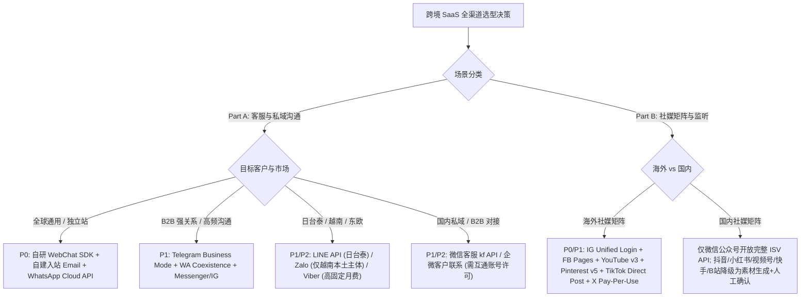

# 全渠道客服消息与社媒矩阵 API 深度调研报告（2025–2026）

> **调研定位**：面向 **B2C 跨境独立站 / 平台卖家 + B2B 外贸出海企业 SaaS** 的全渠道消息收件箱（Omnichannel Inbox）与社媒内容矩阵（Social Matrix）官方 API 技术可行性、2025–2026 计费/政策变更、应用审核壁垒与集成优先级评估。  
> **核验基准**：所有结论均基于 2025–2026 年各平台官方开发者文档与公告核验（截至 2026 年 11 月）。

---

## 0. 执行摘要与核心发现（2025–2026 重大变化）

在规划多租户跨境 SaaS 的通道层时，必须先校正行业内广泛存在的过时认知。2025 至 2026 年间，多个主流渠道发生了颠覆性的定价与权限政策调整：

1. **WhatsApp Business Platform 经历两次重大定价重构**：2025 年 7 月 1 日全面废除按对话（Conversation）计费，改为按送达消息（Per-Message）计费；紧接着 **2026 年 10 月 1 日起，Meta 正式终止无限免费客服回复时代**——`Service` 非模板回复恢复按条计费（每号码每月前 `1,000` 条免费，第 `1,001` 条起计费），且 24 小时客服窗口（CSW）内发送的 `Utility` 模板同步恢复收费；同时 Click-to-WhatsApp 广告触发的免费入口窗口（FEP）在 2026 年 9 月 28 日由 72 小时延长至 **最长 7 天**。此外，**Coexistence（共存模式）** 已正式纳入 Embedded Signup v4/v5，允许商家保留手机端 WhatsApp Business App 并同步最近 6 个月 1:1 聊天记录上云。
2. **Telegram Business Mode 成为 B2B/高客单价卖家的“杀手锏”**：通过 Bot API 7.2+ 的 `BusinessConnection` 与 `BusinessBotRights`，SaaS 可以直接托管商家个人/商业 Telegram 账号（仅需商家拥有 Telegram Premium），实现“买家无感知与真人卖家号沟通、后台由 AI 与多客服统一接待”。
3. **Email 通道的工程分水岭**：Gmail API 读取/同步收件箱所需的 `gmail.readonly` / `gmail.modify` 属于 Google Restricted Scopes，服务端接入强制要求每年完成 **CASA Tier 2/Tier 3 安全评估**（第三方审计费约 `\$500–\$4,500+ USD/年`、耗时 2–6 周）；而微软 Exchange Online 已宣布于 **2026 年 12 月底**在存量租户默认禁用 SMTP AUTH Basic Auth。因此 **P0 首选自建域入站转发（AWS SES / Resend / Postmark）+ RFC 5322/5233 线索路由**，OAuth 直连作为高阶企业版（P2）。
4. **TikTok Organic 私信在美/欧受政治与隐私红线封锁**：TikTok Business Messaging API **完全不支持 EEA、瑞士和英国账号**；美国市场除了要求 USDS 数据安全审查外，明确规定**位于中国（含香港）或受限地区实体合计最终受益所有权（UBO）超过 `25%` 的开发者可能不具备美区接入资格**。跨境 SaaS 需将有机私信（仅 APAC/LATAM/MENA）与 **TikTok Shop 客服 API** 严格隔离。
5. **X (Twitter) API v2 与 YouTube Data API v3 在 2026 年反转**：X API 已全面取消 `\$200/月`（Basic）与 `\$5,000/月`（Pro）固定月租，改为 **Pay-Per-Use 按量预付 Credit**；YouTube Data API v3 于 2025 年 12 月将视频上传拆出独立配额桶（默认 `100 次/天`），并于 **2026 年 11 月 2 日正式取消“未过审 API 项目上传视频强制锁为 Private”的限制**。
6. **国内社媒平台生态高度封闭**：抖音开放平台已于 **2025 年 4–5 月全面下线并回收移动/网站应用的私信与群聊 OpenAPI 权限**；小红书 `write_notes` 发布接口仍处于规划/特批状态；微信视频号无任何第三方发布 API，微信小店客服 API 亦禁止 ISV 第三方服务商调用。**国内仅微信公众号与企业微信/微信客服具备标准的多租户 ISV 接口体系。**

---

## Part A：消息与客服通道（Messaging & Customer Support Channels）

### A.1 Meta WhatsApp Business Platform（Cloud API）

#### 1. Tech Provider 入驻与 Embedded Signup（v4/v5）多租户架构
* **合作伙伴角色**：面向 SaaS 工具商，Meta 区分 **Tech Provider（技术服务商）** 与 **Solution Partner（含转售代付信用额度 Reseller Add-on）**。Tech Provider 通过应用面板绑定 Meta Business Portfolio，即可通过 [Embedded Signup（嵌入式注册）](https://developers.facebook.com/documentation/business-messaging/whatsapp/embedded-signup/overview) 在 SaaS 网页内以弹窗形式引导商家完成 Facebook 登录、创建/绑定 WABA（WhatsApp Business Account）、验证手机号并向 SaaS 应用授予资产权限（[Onboarding for Tech Providers](https://developers.facebook.com/documentation/business-messaging/whatsapp/embedded-signup/onboarding-customers-as-a-tech-provider)）。
* **关键版本强制迁移（2026-10-15）**：Meta 已明确 **Embedded Signup v2 和 v3 于 2026 年 10 月 15 日正式废弃**，所有新集成必须基于 **v4 或 v5**（在 Facebook Login for Business 中创建 Configuration，可一次性打包勾选 Cloud API、Marketing Messages API、Click-to-WhatsApp Ads 与 Conversions API，详见 [WhatsApp Versioning](https://developers.facebook.com/documentation/business-messaging/whatsapp/embedded-signup/versions) 与 [Version 4 文档](https://developers.facebook.com/documentation/business-messaging/whatsapp/embedded-signup/version-4)）。
* **核心权限与回调链路**：
  * 必需权限：`whatsapp_business_messaging`、`whatsapp_business_management`（需提交录屏完成 App Review 获取 Advanced Access；若为 Solution Partner 联合方案需 `manage_app_solution`）。
  * 授权产物：前端通过 `FB.login` 的 Session Logging 监听器捕获 `waba_id` 与 `phone_number_id`，后端用授权 `code` 换取客户 WABA 的 **System User Access Token**，并调用 `POST /{WABA_ID}/subscribed_apps` 订阅 Webhook，同时处理 `account_update` 事件（[Implementation 指南](https://developers.facebook.com/documentation/business-messaging/whatsapp/embedded-signup/implementation)）。
  * **付款责任差异**：Pure Tech Provider 模式下，**商家必须在自己的 WABA 中绑定信用卡/付款方式**才能发费消息；若通过 Multi-Partner Solution（MPS）挂靠 BSP（Solution Partner）共享 Credit Line，则由 BSP 统一向 Meta 结算后再向 SaaS 账单透传。
  * **中国大陆主体认证利好（2026-11-13）**：Meta 在 [WhatsApp Changelog](https://developers.facebook.com/documentation/business-messaging/whatsapp/changelog) 披露，已开始小范围测试支持中国大陆注册企业在 WhatsApp Manager 内**使用支付宝（Alipay）完成本地化企业认证（Localized Business Verification）**。

#### 2. WhatsApp Business App Coexistence（共存模式）深度核验
针对大量中小跨境卖家和 B2B 外贸业务员“**不愿放弃手机端 WhatsApp Business App 历史聊天与联系人，又想接入 SaaS AI/多客服**”的痛点，Meta 官方正式提供了 **Coexistence**（官方接口命名 `whatsapp_business_app_onboarding`，参见 [Onboard WhatsApp Business app users](https://developers.facebook.com/documentation/business-messaging/whatsapp/embedded-signup/onboarding-business-app-users)）：
* **接入参数与流程**：
  * 商家手机端 WhatsApp Business App 需升级至 **`2.24.17` 及以上版本**；SaaS 须为已认证的 Tech Provider 或 Solution Partner。
  * Embedded Signup 启动参数需传入 `extras: { setup: {}, featureType: "whatsapp_business_app_onboarding", sessionInfoVersion: "3" }`（v4 同样支持该 `featureType`）。
  * 用户输入现有 WhatsApp Business App 号码后，手机端会收到官方 Facebook Business Account 推送的“Connect to the Business Platform”交互按钮与验证码，确认时可选择**是否共享聊天记录**；完成绑定后，Session Logging 返回 `event: "FINISH_WHATSAPP_BUSINESS_APP_ONBOARDING"`。
  * **切勿调用 `/register` 接口**：因号码已在手机端注册，Tech Provider 只需完成订阅和 System User 赋权，并通过 `GET /{phone_number_id}?fields=is_on_biz_app,platform_type` 校验返回 `is_on_biz_app: true` 与 `platform_type: "CLOUD_API"`。
* **24 小时同步窗口与四大核心 Webhook**：
  * 绑定完成 **24 小时内**必须调用 `POST /{phone_number_id}/smb_app_data` 依次触发联系人同步（`sync_type: "smb_app_state_sync"`）与消息历史同步（`sync_type: "history"`），超时未同步必须先解绑再重走流程，且每个动作仅可触发一次。
  * 历史数据同步范围：仅同步入驻前 **180 天（约 6 个月）内的 1:1 单聊消息**（分 phase 0/1/2 按 `chunk_order` 异步推送；**群聊消息不同步**；媒体消息仅 **14 天内** 会补发带媒体 ID 的单独 `history` webhook；若商家拒绝共享则回调错误码 `2593109`）。
  * 双向镜像：商家继续在手机端或网页端发送消息时，Meta 通过 **`smb_message_echoes`** webhook 实时镜像到 SaaS 收件箱；联系人增删改通过 **`smb_app_state_sync`** 同步。
* **不可忽视的硬性约束（Engineering & Product Constraints）**：
  * **吞吐上限锁定**：共存号码的 Cloud API 发送吞吐固定限制在 **`20 mps`**（普通 Cloud API 默认 `80 mps`，最高可升 `1,000 mps`）。
  * **客户端功能禁用**：入驻后，手机端所有 1:1 聊天的 **阅后即焚（Disappearing messages）、一次性查看（View once）、实时位置（Live location）** 将被自动关闭或禁用；**新建广播列表（Broadcast lists）被禁用**（现有广播列表变只读）；**群聊、语音/视频通话、Catalog/Business Profile 等本地业务工具不支持同步至 Cloud API**。
  * **伴侣设备限制**：支持最多 4 个已关联设备，但 **不支持 WhatsApp for Windows 桌面端及 WearOS 手表端**；入驻瞬间所有现有伴侣设备会被强制解绑，需重新扫码。若不支持的客户端给商家发消息，Cloud API 会收到错误码 `131060` 而不触发正常 `messages` webhook。
  * **数据驻留限制**：Coexistence 号码底层数据仍存储于美国（Local Storage 本地存储不可开启）。
  * **解绑与失活断连**：无法调用 `POST /{phone_number_id}/deregister` 解绑，必须由商家在手机 App `Settings > Account > Business Platform > Disconnect Account` 手动断开（触发 `account_update` 的 `PARTNER_REMOVED` 事件）；若主手机设备连续 **约 14 天** 不活跃（`PRIMARY_INACTIVITY`）或伴侣设备 **约 30 天** 不活跃（`COMPANION_INACTIVITY`），系统也会自动断开连接。
  * **计费隔离**：通过手机 App 端发送的消息继续免费，通过 Cloud API 发送的消息按 Cloud API 费率计费，且手机端发出的消息**不会打开或延长 Cloud API 的 24 小时客服窗口（CSW）**。

#### 3. 2025–2026 定价改革全解析（含 2026-10-01 重大更新）
根据 Meta 官方 [Pricing on the WhatsApp Business Platform](https://developers.facebook.com/documentation/business-messaging/whatsapp/pricing)（2026 年 9 月 30 日更新）与 [Non-template messages 定价指南](https://developers.facebook.com/documentation/business-messaging/whatsapp/pricing/non-template-messages)：

| 计费节点 / 规则维度 | 2025-07-01 改革（废除对话制） | 2026-08 / 2026-10-01 现行规则（重大收紧） |
| :--- | :--- | :--- |
| **计费模型** | 由 24h Conversation 制转为 **按单条送达消息计费（Per-Message Pricing, PMP）**；用户发给商家始终免费 | 延续 **PMP 按送达计费**；按消息类别（5 大类）× 接收号码国家区号（47 个独立国家/区域费率表）计价 |
| **`Marketing` 模板** | 按送达条数全额计费 | 按条计费；Marketing Messages API 支持设置 Max Price 出价上限 |
| **`Utility` 模板（CSW 窗口内）** | 24h CSW 内发送 **免费**（`type: "free_customer_service"`） | **2026-10-01 起恢复收费！** 无论是否在 CSW 内，一律标记 `type: "regular"` 按市场费率计费；享受月度量级阶梯折扣（Portfolio 汇总） |
| **`Authentication` 模板** | 按条计费，享受量级阶梯折扣；部分市场启用更高昂的 `Auth-International` 费率 | 延续按条计费；2026-10-01 起 **Auth-Int’l 覆盖扩展至 18 个市场** |
| **`Service` 非模板消息** | 自 2024-11-01 起 **完全免费** | **2026-10-01 起恢复按条收费！** 每个 Business Phone Number 每月享有 **前 `1,000` 条免费额度**（不结转），第 `1,001` 条起按 `regular` 计费；**若 WABA 未绑定有效付款方式，超出免费额度后将直接拒发** |
| **`Meta Business Agent`（新类别）** | 尚未上线 | 2026-07 / 2026-08 起生效：Meta 自研 AI Agent 回复按 Token 计费，**全局统一价 `\$2.00 USD / 1M tokens`**（不计 cache token；简单/复杂回复平均约 20k–25k tokens/条，即约 **`4–5 美分/条`**）；**不享受免费额度与 FEP 免单** |
| **FEP 免费入口窗口（CTWA 广告）** | Click-to-WhatsApp 广告或 FB Page CTA 触发后 **72 小时内** 全类消息免费 | **2026-09-28 起升级为最长 7 天！** 用户从移动端 CTWA 广告发起消息并在 CSW 内得到商家任一回复后，开启最长 **7 天 FEP 窗口**，期间 Marketing / Utility / Auth / Service 均不收费（Meta Business Agent 仍收费） |
| **本地化结算合规** | USD 等传统币种 | 印度客户须于 **2026-12-31** 前迁至 `INR`，巴西客户须于 **2027-06-30** 前迁至 `BRL`，逾期停发 |

* **实用计算说明**：虽然每号码每月 1,000 条免费 Service 消息足以覆盖小型 B2B 卖家或低咨询量独立站，但对于高频客服的 B2C 卖家（或 SaaS 自身使用 AI 自动拆分为多段回复的场景），**必须提示开发者将 AI 多句回复合并为单条结构化消息发送**，否则 2026 年 10 月后会产生显著的 `Service` 通道成本（例如参考巴西市场单条交付费约 `0.68 美分`，详见 [Non-template messages 官方测算表](https://developers.facebook.com/documentation/business-messaging/whatsapp/pricing/non-template-messages)）。

#### 4. 模板审核、质量评级、Portfolio 级限额与合规
* **强制自动重分类（2025-04-09 起）**：Meta 已移除模板创建 API 中的 `allow_category_change` 参数，现在提交的 `UTILITY` 模板若含营销意图，Meta 会直接自动改判为 `MARKETING` 并按营销费率扣费（`template_category_update` webhook 通知，商家可在 60 天内发起申诉，见 [Template categorization](https://developers.facebook.com/documentation/business-messaging/whatsapp/templates/template-categorization)）。
* **质量评级与自动暂停（Template Pausing）**：每个模板具备 `GREEN`、`YELLOW`、`RED`、`UNKNOWN` 四级质量分（[Template quality](https://developers.facebook.com/documentation/business-messaging/whatsapp/templates/template-quality)）。若降为 `RED`（低质量/高举报率/低阅读率），系统会自动暂停发送：第 1 次暂停 **3 小时**，第 2 次暂停 **6 小时**，第 3 次直接 **Disabled 永久停用**（[Template pausing](https://developers.facebook.com/documentation/business-messaging/whatsapp/templates/template-pausing.md)）。
* **Portfolio 共享限额机制（2025-10-07 起）**：24 小时窗外触达唯一用户的 **Messaging Limits 已从“单号码维度”切换为“Business Portfolio 企业资产组合共享”**（[Messaging Limits](https://developers.facebook.com/documentation/business-messaging/whatsapp/messaging-limits) 与 [Upcoming changes to messaging limits](https://developers.facebook.com/documentation/business-messaging/whatsapp/upcoming-messaging-limits-changes)）。新建未认证 Portfolio 起始限额为 **`250`**，完成企业认证（或 30 天内向 2,000 个独立用户发送高质量模板消息）后升至 **`2,000`**，之后满足“高质量评级 + 近 7 天消耗达到当前上限 50%”即可每 6 小时自动梯级扩容至 **`10,000` → `100,000` → `UNLIMITED`**。
* **Opt-in 合规红线**：自 2024 年 11 月起，Meta 允许商家获取“通用型沟通授权（General Opt-in）”而不仅限于点名 WhatsApp，但前提是用户主动提供了手机号且明确勾选同意接收商业消息，同时 SaaS 必须在营销模板中提供清晰的一键退订（Stop/Opt-out）按钮与偏好管理逻辑（[Get opt-in for WhatsApp](https://developers.facebook.com/documentation/business-messaging/whatsapp/getting-opt-in)）。

---

### A.2 Meta Facebook Messenger & Instagram Messaging API

#### 1. 三套认证架构演进与权限审批
Meta 为 Instagram 维护了三套登录与授权体系，官方文档明确**新集成应首选 Unified Login**（[Instagram Platform Overview](https://developers.facebook.com/documentation/instagram-platform/overview) 与 [Instagram API with Unified Login](https://developers.facebook.com/documentation/instagram-platform/instagram-api-with-unified-login)）：

| 架构模式 | 登录方式 | 是否需要关联 FB Page | Token 类型与 Host | 适用建议 |
| :--- | :--- | :--- | :--- | :--- |
| **Instagram API with Unified Login（2026 推荐）** | IG 或 FB 账号 | **否**（但需 Business Portfolio） | Business Integration System User Access Token；`graph.facebook.com` | **新 SaaS 首选**：一个 Token 同时支持 DM、发帖、评论、Insights 与 Ads（暂不支持 Handover Protocol） |
| **Instagram API with Instagram Login** | 仅 IG 账号 | **否** | Instagram User Access Token；`graph.instagram.com` | 仅适合极简纯 IG 场景（使用 `instagram_business_*` 前缀权限） |
| **Instagram API with Facebook Login（传统模式）** | 仅 FB 账号 | **是**（需对关联 Page 具备 `MESSAGING`/`MODERATE` 权限） | Facebook Page / User Access Token；`graph.facebook.com` | 与 **Facebook Messenger** 共用 Page 授权体系时使用 |

* **App Review 关键权限清单**（[Messenger Platform Overview](https://developers.facebook.com/documentation/business-messaging/messenger-platform/overview)、[Unified Login Permissions](https://developers.facebook.com/documentation/instagram-platform/instagram-api-with-unified-login/permissions.md)）：
  * **Messenger**：`pages_messaging`、`pages_show_list`、`pages_manage_metadata`、`pages_read_engagement`、`business_management`（前四者的强依赖项）。
  * **Instagram**：`instagram_basic`、`instagram_manage_messages`、`instagram_manage_comments`（在 Unified Login 中使用标准 `instagram_*` 名称，旧 Instagram Login 使用 `instagram_business_*`）。
  * **IG 账户前提**：仅支持 **Instagram Professional Account（Business 商家号或 Creator 创作者号）**，不支持普通个人号；部分用户需在 IG App 内手动开启 `Connected Tools（允许访问消息）` 开关。

#### 2. 24 小时标准窗口 vs 7 天 `HUMAN_AGENT` Tag（客服 SLA 核心）
* **24 小时标准消息窗口**：用户发送私信、点击 Get Started、回复 Story、通过 `m.me`/`ig.me` 链接交互或对消息点赞表情时，打开 **24 小时免费标准回复窗口**（[Messenger & IG Messaging Policy](https://developers.facebook.com/documentation/business-messaging/messenger-platform/policy)）。
* **Click-to-Messenger / Click-to-Direct 广告窗口**：用户点击广告并发送首条消息时，标准消息窗口最长可延续 **7 天**（[IG Messaging Overview](https://developers.facebook.com/documentation/business-messaging/instagram-messaging/overview)）。
* **7 天 `HUMAN_AGENT` 消息标签**：当人工客服因跨周末、时差或供应链核实需要超过 24 小时回复时，可在 Send API 中附带 `messaging_type: "MESSAGE_TAG"` 与 `tag: "HUMAN_AGENT"`，将合法回复期限延长至客户最后一条消息后的 **7 天**（[Page Messages Reference](https://developers.facebook.com/docs/graph-api/reference/page/messages)）。
  * **关键差异**：`ACCOUNT_UPDATE`、`CONFIRMED_EVENT_UPDATE`、`POST_PURCHASE_UPDATE`、`CUSTOMER_FEEDBACK` 以及 One-Time Notification **仅支持 Facebook Messenger，不支持 Instagram Messaging**；**Instagram 上唯一可用的标签只有 `HUMAN_AGENT`**，且须申请开启 `Human Agent` 专项特性（仅限人工客服介入，禁止自动化营销推送）。

#### 3. Comment-to-DM（Private Replies）、Story 互动与冷启动禁令
* **Private Replies（评论转私信）**：收到帖子的 `comments` 或 `feed` webhook 后，SaaS 可调用 `POST /{PAGE_ID}/messages`（传 `recipient: { "comment_id": "<COMMENT_ID>" }`）向评论者发送 **1 条私信**（内含原帖引用卡片）。
  * **时效限制**：普通帖子、Reels、广告帖评论必须在评论创建后 **7 天内** 发送；**Instagram Live 直播评论仅限在直播进行期间发送**，下播即失效（[IG Private Replies](https://developers.facebook.com/docs/messenger-platform/instagram/features/private-replies)）。
  * **配额与会话延续**：仅允许发送 1 条，**只有当用户在私信中回复后，才会正式开启 24 小时双向对话窗口**。Facebook Page 端默认上限为 `750 次/小时`（绑定了 Shop 或近 28 天有 `>= 2,000` 条评论直播的 Page 提额至 `30,000 次/小时`，见 [Private Reply API](https://developers.facebook.com/documentation/live-shopping/live-video-ads-integration-playbook/private-reply-api)）。
* **Story 互动**：支持接收用户回复商家 Story（`story_mention` / `story_reply`）产生的 Webhook 通知，自动触发 24h 会话窗口（注意 CDN 图片链接有时效性，SaaS 需及时转存）。
* **严禁冷启动私信（Cold DM Prohibition）**：Meta 严格禁止通过 API 向未主动发起对话或未评论的陌生用户主动发送营销私信，违规将直接封禁 App 权限。

---

### A.3 Telegram（Bot API vs Telegram Business Mode）

#### 1. 标准 Bot API
* **低门槛与架构特征**：通过 `@BotFather` 创建即用，**完全免费、零 App Review**；支持 HTTPS `setWebhook` 实时推送与 `sendMessage` 回复（单聊默认 1 msg/sec，全局约 30 msg/sec 限频），群组内开启 Privacy Mode 仅接收 `@bot` 或指令消息（[Telegram Bot Features](https://core.telegram.org/bots/features)）。
* **痛点**：买家必须主动搜索并启动 `@YourBrandBot`，无法直接把消息发给外贸业务员或卖家的真人 Telegram 个人号（`@sales_alice`），导致 B2B 信任感与触达转化率打折。

#### 2. Telegram Business Mode（Secretary Mode 商业托管模式）
Telegram 自 Bot API 7.2 起推出并在 2024–2026 年持续完善的 **Telegram Business Mode** 彻底解决了上述痛点（[Bot API Changelog](https://core.telegram.org/bots/api-changelog)、[Telegram Bot API](https://core.telegram.org/bots/api)、[Connected Business Bots](https://core.telegram.org/api/bots/connected-business-bots)）：
* **工作原理**：
  1. 开发者在 `@BotFather` 中为 SaaS Bot 开启 **Business / Secretary Mode**。
  2. 卖家（**前提：该卖家账号须订阅 Telegram Premium**）在 Telegram 客户端 `Settings > Telegram Business > Chatbots` 中输入我们 SaaS Bot 的 `@username` 完成一键绑定，并精细授权机器人的管理权限及可访问的私聊范围（排除特定联系人或仅限指定文件夹）。
  3. SaaS 收到 `Update.business_connection`（含全局唯一的 `connection_id` 与精细的 `BusinessBotRights` 对象，如 `can_reply`、`can_read_messages`、删除消息、甚至代修改商家头像/简介的权限）。
  4. 买家给卖家真人号发消息时，SaaS 通过 `business_message`、`edited_business_message`、`deleted_business_messages` webhook 实时收取，并通过在 `sendMessage`、`sendPhoto`、`sendDocument` 等标准方法及 `readBusinessMessage` / `deleteBusinessMessages` 中传入 `business_connection_id` 参数，**以卖家真人账号身份直接回复买家**！
* **工程注意事项**：
  * **仅限活跃私聊回复**：若目标客户近期未与该商业账号产生过私聊往来，调用发送接口会报错 `400 BUSINESS_PEER_USAGE_MISSING`（防垃圾群发保护）。
  * **防死循环（Loop Prevention）**：若开启了 Bot-to-Bot 通信模式（[Bot-to-bot communication](https://core.telegram.org/api/bots/bot-to-bot)），必须检查 `Message.sender_business_bot` 或消息发送方标志，防止双方自动回复机器人陷入无限对答死循环。
  * **成本优势**：零第三方消息费、零 Meta 类模板费、零审核周期，是 B2B 外贸独立站（尤其是俄罗斯/东欧/Web3/消费电子/汽配批发客户）性价比最高的高价值通道。

---

### A.4 Email（B2B 询盘 & B2C 售后邮件通道）

Email 是 B2B 外贸询盘与欧美独立站 B2C 售后的绝对基本盘，但接入路径的选择直接决定 SaaS 的合规成本与上线速度。

#### 1. Gmail API OAuth 陷阱与 CASA 审计高墙
根据 Google 官方 [Choose Gmail API scopes](https://developers.google.com/workspace/gmail/api/auth/scopes)（2026 年 9 月 10 日更新）与 [Restricted scope verification](https://developers.google.com/identity/protocols/oauth2/production-readiness/restricted-scope-verification)：
* **Scope 分级真相**：
  * 仅发信权限 `https://www.googleapis.com/auth/gmail.send` 属于 **Sensitive Scope**（需提交演示视频走 OAuth 敏感权限审核，暂不触发 CASA 审计）。
  * **但任何需要读取、同步或标记客户来信的收件箱集成**，不可避免地需要申请 `gmail.readonly`、`gmail.modify`、`gmail.metadata` 或 `https://mail.google.com/`——**以上全部属于 Restricted Scope（受限权限）！**
* **CASA 安全评估（Cloud Application Security Assessment）真实成本**：
  * 只要 SaaS 服务端存储或传输受限 Scope 的 Gmail 用户数据，就必须**每年一次**由 App Defense Alliance (ADA) 授权的第三方独立安全实验室进行基于 OWASP ASVS 4.0 的 CASA 安全审计（[App verification / CASA](https://developers.google.com/health/app-verification)、[CASA Tier 2 Process](https://appdefensealliance.dev/casa/tier-2/tier2-overview)）。
  * **费用与周期**：Google 官方明确第三方评估费用在 **`\$500 – \$4,500+ USD`（且每年复审续费）**，其中 **Tier 2**（开发者自扫提交 AST `.txt` 报告由实验室核验签发 Letter of Validation）耗时 **2–3 周**，用户规模扩大或高风险场景升级为 **Tier 3**（实验室深度渗透/代码审计）则耗时 **4–6 周**且费用更高。若企业已持有 SOC 2 或 ISO/IEC 27001 证书，可通过 CASA Accelerator 抵扣部分检测项但仍须付费给授权实验室验真。
  * **结论**：MVP 阶段切忌以“Gmail OAuth 一键直连读取收件箱”作为唯一邮件方案，否则产品上线会被卡在 CASA 审计数周乃至数月。

#### 2. Microsoft Graph API（Outlook / M365）vs Exchange Online SMTP 淘汰时间线
* **Microsoft Graph 多租户 OAuth 与 Publisher Verification**：
  * 使用 `Mail.Read`、`Mail.Send`、`Mail.ReadWrite` 连接客户 Microsoft 365 企业邮箱时，必须通过 [Microsoft Entra Publisher Verification（发布者验证）](https://learn.microsoft.com/en-us/entra/identity-platform/publisher-verification-overview)。
  * **强制门槛**：自 2020 年 11 月起，未通过 Publisher Verification（需要注册 Microsoft AI Cloud Partner Program 并关联已核验企业资质的 **MPN ID** / 不可为个人微软账号或 B2C 租户）的多租户应用，在开启“风险步进同意”的企业租户中将直接被禁止普通用户授权，弹窗显示高风险 `unverified` 警告。
* **Exchange Online Basic Auth（App Password）彻底淘汰倒计时**：
  * IMAP / POP / EWS 的 Basic Auth 已于 2022 年 10 月起全面关停；**Client Submission（SMTP AUTH）Basic Auth** 是最后的遗留通道。
  * 根据 Microsoft Exchange Team 于 **2026 年 1 月 27 日**发布的最新官方修订时间表（[Updated Exchange Online SMTP AUTH Basic Authentication Deprecation Timeline](https://techcommunity.microsoft.com/blog/Exchange/updated-exchange-online-smtp-auth-basic-authentication-deprecation-timeline/4489835)）：
    * **2026 年 12 月底**：所有存量 Exchange Online 租户将**默认禁用** SMTP AUTH Basic Auth（包括 App Password，管理员虽可临时手动重开，但新建租户自 2026 年 12 月起默认彻底不可用）。
    * **2027 年下半年**：微软将公布 SMTP AUTH Basic Auth **最终永久移除日期**（届时直接报错 `550 5.7.30 Basic authentication is not supported`）。
  * **结论**：对于存量自建企业邮箱（如腾讯企业邮、阿里企业邮、Zoho、cPanel），保留传统 **IMAP/SMTP（支持 XOAUTH2 + 密码降级）** 作为补充兼容手段；但面对 M365 / Google Workspace 客户，App Password 路线已无长期未来。

#### 3. P0 最优解：自定义域名入站路由 + 事务性邮件基础设施 + RFC 5322 线索化
所有成熟海外 Helpdesk（Zendesk / Gorgias / Freshdesk / Intercom）的 P0 邮件默认架构均采用 **“转发入站 + 代发域出站”**，**0 审计门槛、当日即可上线**：

1. **架构链路**：
   * **入站（Inbound）**：SaaS 为每个租户分配专属托管接收地址（如 `<tenant_slug>@inbound.mail.oursaas.com`）。租户只需在自己的 Gmail / Outlook / 阿里企业邮后台设置一条“自动转发规则”，将 `support@brand.com` 或 `sales@brand.com` 的邮件自动转发至该托管地址即可完成收件接入（**完全无需 Google CASA 或微软 MPN 审批**！）。
   * **出站（Outbound）**：租户在域名 DNS 中添加两条 CNAME/TXT（SPF + DKIM + Return-Path 自定义子域），SaaS 即可合法以 `From: "Brand Support" <support@brand.com>` 身份通过基础设施发送回复。
2. **RFC 5322 / RFC 5233 精准线索化（Email Threading）规范**（[Thread Email Replies](https://mails.ai/blog/thread-email-replies-programmatically) & [Inbound Parsing Guide](https://mails.ai/blog/transactional-email-api-inbound-parsing-developer-guide)）：
   * **绝对禁止仅靠 `Subject` 匹配工单**（客户改标题、转发、多语言 `Re:`/`回复:` 前缀会导致串单或裂单）。
   * **三大核心请求头**：
     * `Message-ID`：SaaS 主动发信时必须自行生成全局唯一值并持久化，**必须用尖括号包裹**（如 `<msg-uuid@mail.oursaas.com>`，否则部分老旧 Outlook 客户端会直接丢弃无括号 ID）。
     * `In-Reply-To`：回复时填入上一封邮件的 `Message-ID`。
     * `References`：按时间顺序以空格拼接该对话链条中所有历史 `Message-ID`（支持完整树状重建）。
   * **双保险路由键（`Reply-To` 子地址扩展，RFC 5233）**：发信时动态设置 `Reply-To: support+th_<thread_id>@inbound.mail.oursaas.com`。即使某些极端第三方邮件客户端剥离了 `In-Reply-To` 头部，客户点击回复时的收件人地址仍精确携带 `<thread_id>`，实现 100% 工单归并。
3. **底层供应商选型与成本实测（2026）**：

| 供应商 | 入站能力与特性 | 出站成本（实测参考） | 适用阶段与优劣势 |
| :--- | :--- | :--- | :--- |
| **AWS SES**（[SES Pricing](https://aws.amazon.com/ses/pricing)） | 入站 **`\$0.10 / 1,000 封`**（全行业唯一按条收费；投递至 S3 + SNS/Lambda 触发解析，需自写 MIME 解析与引用正文剥离） | **`\$0.10 / 1,000 封`**（无月费；10 万封约 `\$10/月`，100 万封约 `\$100/月`；独立 IP 约 `\$24.95/月`） | **高并发/多租户规模期最优**：成本为 Postmark 的 `1/17`，但需自研多租户域管理、退信誉度隔离与 MIME 解析层 |
| **Postmark**（[Postmark vs Resend](https://postmarkapp.com/compare/resend-alternative)） | Inbound Webhook **内置免费**，行业公认最精准的**回复引文剥离（Stripped Text Reply）** | `\$15/月`（10K 封）；`\$115/月`（125K 封）；`\$455/月`（700K 封）；独立 IP `\$50/个` | **冷启动客服 SaaS 最省心**：极佳送达率与原生 JSON 干净正文解析，大幅减少研发工作量 |
| **Resend**（[Resend Inbound](https://resend.com/features/inbound) & [Scale](https://resend.com/blog/introducing-the-scale-plan)） | 已全面支持 Inbound Emails（`email.received` webhook + 附件提取 + 仪表盘留存） | `\$0`（3K 封）；`\$20/月`（50K 封）；`\$90/月`（Scale 100K 封，含 1,000 个发信域）；独立 IP `\$30/个` | **开发者体验极佳，多域性价比突出**：支持 1,000 域名适配多租户 SaaS（底层部分路由经 SES），50K–100K 量级优于 Postmark |
| **Mailgun**（[Mailgun 对比](https://resend.com/migrate/mailgun)） | Regex Routes 正则路由极其强大（支持多通配符域分流） | `\$35/月`（50K 封）；`\$75/月`（100K 封）；`\$700/月`（1M 封） | 复杂入站正则表达式路由场景适用 |

---

### A.5 TikTok Organic Business Messaging API vs TikTok Shop Customer Service API

这是跨境 SaaS 极易混淆、且存在严重合规盲区的两组完全独立的 API。

#### 1. TikTok Organic Business Messaging API（自然流量私信）
* **官方归属**：位于 **TikTok API for Business**（`business-api.tiktok.com`），而非 `developers.tiktok.com`（后者仅含面向 EEA/UK 的数据导出型 `Data Portability API`，不可用于实时客服聊天！参见 [Business Messaging API 文档](https://business-api.tiktok.com/portal/docs/business-messaging-api/v1.3) 与 [Data Portability API](https://developers.tiktok.com/products/data-portability-api)）。
* **账户与功能**：仅支持 **TikTok Business Account（企业号）**（个人号/创作者号不可用），支持收发文本及（部分区域）图片、Comment-to-Message 自动转私信、自动欢迎语、Suggested Questions 快捷问答、新关注私信以及与 TikTok Direct Messaging Ads 联动。
* **严苛的地域限制与中资实体合规红线**（[Access to Business Messaging API](https://business-api.tiktok.com/portal/docs/access-to-business-messaging-api/v1.3) & [US Data Security Review](https://business-api.tiktok.com/portal/docs/us-data-security-review/v1.3)）：
  * **EEA、瑞士、英国完全不可用**：注册在这三个区域的 TikTok Business Account 无法调用该 API，也无法通过 Webhook 获取其私信。
  * **美国市场（USDS 红线）**：接入美区账号除常规隐私与安全审查外，必须通过 **US Data Security (USDS) Review** 并签署 USDS Addendum（通常 7–10 个工作日）。**文档明文规定：注册于受限国家/地区（包括中国大陆及香港、俄罗斯、伊朗等），或受限国家/地区个人/实体合计最终受益所有权（UBO）超过 `25%` 的开发者，可能无资格发布应用或获批美区 Business Messaging 权限！**
  * **实际可用区域**：对于中国大陆或香港主体运营的跨境 SaaS，若未独立拆分无受限 UBO 超过 25% 的海外合规实体，实际**仅能在 APAC（东南亚/日韩等）、LATAM、METAP 等非美非欧 Open Beta 区域**合规启用自然号私信。
* **消息窗口限制（48 小时规则）**（[Messaging limits for Business Messaging API](https://business-api.tiktok.com/portal/docs/messaging-limits-for-business-messaging-api/v1.3)）：
  * 用户向商家发送首条消息后，商家在 **48 小时内最多回复 `10` 条消息**。
  * 若用户期间回复了商家，则重新开启 **48 小时无限条数活跃会话窗**（每次用户回复均刷新 48 小时）。
  * 若超过 48 小时用户未回复，则进入非活跃状态，商家**最多只能再发送 `3` 条消息**（之后彻底锁定，直到用户再次主动回复才重启 48 小时窗口）。严禁无交互冷群发。

#### 2. TikTok Shop Customer Service API（小店官方客服）
* **官方归属**：位于 **TikTok Shop Partner Center**（`partner.tiktokshop.com`），属于电商交易生态接口（[Customer Service API overview](https://partner.tiktokshop.com/docv2/page/customer-service-api-overview) & [Send Message](https://partner.tiktokshop.com/docv2/page/send-message-202309)）。
* **核心能力**：权限包为 `seller.customer_service`，提供 `GET /customer_service/202309/conversations`、`Get Conversation Messages`、`Send Message`、`Upload Buyer Messages Image`、`Mark Buyer Messages as Read` 及新消息/坐席变动 Webhook。
* **差异化定位**：**不受有机私信 EEA/UK/USDS UBO 限制**，覆盖美区、英区、欧盟、东南亚、日本、墨西哥等 TikTok Shop 开放站点；聚焦买家针对商品/订单/退换货的店铺客服窗口（卖家端有 **24 小时客服响应率 SLA 考核**，若超过 7 天未回复会话将自动超时关闭进入历史归档，详见 [TikTok Shop Customer Messages 规则](https://seller-us.tiktok.com/university/essay?knowledge_id=7359788334565162&lang=en)）。

---

### A.6 区域性及国内企业即时通讯

| 通道 | 核心覆盖市场 | 客服窗口与免费策略 | API 收费与套餐结构（2026 核验） | 跨境主体准入壁垒 |
| :--- | :--- | :--- | :--- | :--- |
| **LINE Messaging API**（[Pricing Docs](https://developers.line.biz/en/docs/messaging-api/pricing)） | 日本、台湾、泰国 | Webhook + **`replyToken`（Reply API）100% 免费、不计入月度配额**；仅 Push / Multicast / Broadcast 计费 | **日本**：Communication `JPY 0`（200 条/月）、Light `JPY 5,000`（5,000 条）、Standard `JPY 15,000`（30,000 条，超额最高 `JPY 3/条`） **台湾（[2026-11-01 调价](https://tw.linebiz.com/column/LINEOA-2026-Price-Plan)）**：轻用量 `NT\$0`（200 则）、中用量 `NT\$1,000`（3,000 则，不可加购）、高用量 `NT\$1,400`（6,000 则，加购 1–5 万则 `NT\$0.2/则`，5 万+ 则 `NT\$0.15/则`） **泰国（[LINE TH](https://lineforbusiness.com/th/service/line-oa-features)）**：Free `THB 0`（300 条）、Basic `THB 1,280`（15,000 条，超额 `0.10 THB`）、Pro `THB 1,780`（35,000 条，超额 `0.06 THB`），不含 7% VAT | **无 App Review 门槛**，海外企业可直接创建未认证账号调用 API（但 Verified 认证蓝/绿盾受注册地限制，“Other regions” 计划为 `\$0/500条`、`\$50/1万条`、`\$150/4万条` 且不支持认证账号） |
| **Zalo OA & ZNS**（[Zalo Developers](https://developers.zalo.me/docs/api/official-account-api-147)、[Zalo OA 费用](https://zalo.solutions/oa/pricing)） | 越南 | 客户主动交互后 **48 小时内 OA 咨询回复免费**，7 天内可发互动回复；超时或主动触发需按手机号走 **ZNS 预审模板** | OA 需升级至 **Growth（约 `233,000 VND/月`）或 Comprehensive（`6,000,000 VND/年`）** 方可开放第三方系统 API 对接；ZNS 按条扣费，参考起步价约 `VND 250/条` 起 | **极高跨境壁垒**：注册并认证企业 Zalo OA **强制要求越南本地工商营业执照（法律实体）+ 实名验证的越南 `+84` 手机号**（[Zalo OA 创建指南](https://oa.zalo.me/home/documents/guides/khoi-tao-zalo-official-account_61)）。无越南主体的海外企业仅能经 Infobip 等 BSP 发纯 OTP 验证码，无法自助开通完整客服与 ZNS |
| **Viber Bot & Business Messages**（[Bot Commercial Model](https://help.viber.com/hc/en-us/articles/15247629658525-Bot-commercial-model)、[Rate Card PDF](https://www.forbusiness.viber.com/documents/business-messages.pdf)） | 东欧（乌克兰、希腊、塞尔维亚、保加利亚等） | 订阅者发起或回复后激活 **24 小时 Session 会话（免费无限条）**；主动触达计费 | **自 2024-02-05 起废除免费额度**：每个新 Viber Bot 强制收取 **`EUR 115/月` 固定维护费** + 按目的地国家区号计费的 Bot 主动消息费；Viber Business Messages 亦设有按国家 `EUR 115–175/月` 最低消费门槛 | 商业条款强制签署，对中小跨境独立站长尾商家而言固定月费极不划算，仅适合东欧重度大客户 |
| **企业微信（WeCom）& 微信客服（WeChat KF）**（[WeCom Docs](https://developer.work.weixin.qq.com/document/path/94677)、[接口许可](https://developer.work.weixin.qq.com/document/path/95652)） | 中国大陆及华人 B2B/私域 | **微信客服 `kf`**：微信用户无需加好友即可咨询，**用户发消息后 48 小时内最多下发 `5` 条**； **企微客户联系 `externalcontact`**：加好友后长期触达（受企业群发频次限制） | **WeCom ISV 第三方调用收费**：服务商调用企微客户联系接口须按客户员工数向腾讯采购**「互通账号」接口调用许可**（阶梯价约 `40–50 元/账号/年` 起），内部基础接口需「基础账号」（[App Store 定价示例](https://open.work.weixin.qq.com/wwopen/appStore/detail/price?appId=MTk3MDMyNDk2OTk4MzM0NV8zMjUwNF8x&notreplace=true)）；微信客服组件支持服务商免加好友托管接待 | **合法合规红线**：严禁任何个人微信外挂/逆向协议/RPA（封号且涉非法侵入计算机系统罪）。仅可集成企微官方第三方应用 / 代开发自建应用 / 微信客服组件；且企微认证与接口能力深度绑定中国大陆企业主体 |

---

### A.7 自研全渠道 Web LiveChat Widget（独立站核心补位）

* **为什么必须自研（Shopify Inbox API 缺失实证）**：
  * **Shopify Inbox 是完全封闭的第一方应用**：Shopify Admin GraphQL/REST API **没有任何暴露 Shopify Inbox 会话消息的公开端点或 Webhook**（参见 [Shopify Community 官方开发者讨论](https://community.shopify.com/t/is-there-a-way-to-read-the-inbox-conversations-via-api-and-make-it-a-richer-support-avenue/682015)）。早年处于内测的 Messaging API 仅允许把外部通道消息注入 Shopify Inbox，明确禁止外部 Helpdesk 读取或自动化回复 Inbox 消息（[Messaging API 限制回复](https://community.shopify.com/t/can-shopify-inbox-be-integrated-with-a-custom-react-django-app/75344)）；2024 年 12 月开放的 Checkout Chat API 亦仅限申请通过后在结账页/感谢页渲染自身客服组件（[Shopify Checkout Chat API Changelog](https://shopify.dev/changelog/posts/new-chat-api-for-building-chat-apps-in-shopify-checkout)）。
  * 因此，包括 Gorgias、Tidio、Crisp 在内的全部海外客服 SaaS 均采用 **自研可嵌入 WebChat Widget** 替代商家站点原生聊天框。
* **多建站平台技术集成规范**：
  1. **Shopify Online Store 2.0**：禁止新上架 Shopify App Store 的应用依赖传统 `ScriptTag`（审核不通过，[Shopify Developer Forum](https://community.shopify.dev/t/build-shopify-app-that-add-chat-widget-to-the-shop/7812)）。必须打包为 **Theme App Extension 中的 App Embed Block**（`target: "body"`），在安装引导页提供一键跳转 Deep Link 供商家激活（[Configure Theme App Extensions](https://shopify.dev/docs/apps/build/online-store/theme-app-extensions/configuration)）。
     * **已登录买家身份识别（坑点提示）**：经典客户账户（Classic Accounts）可通过 **App Proxy** 请求携带的 `logged_in_customer_id` 结合签名验证签发短期 `chatToken`；但在 **Shopify New Customer Accounts** 下，App Proxy 请求不再自动携带买家 JWT 或 `logged_in_customer_id`（[New Customer Accounts 认证限制](https://community.shopify.dev/t/theme-app-extension-app-proxy-how-to-authenticate-logged-in-customers-with-new-customer-accounts/31746)），因此 Widget 需通过预填邮箱/订单号二次核验或扩展 Customer Account UI 补齐身份绑定。
  2. **WooCommerce / SHOPLINE / 自建 B2B 独立站**：通过异步加载轻量 JS SDK（Shadow DOM 样式隔离 + WebSocket/SSE 长连接）接入，自动采集当前浏览页面 URL、商品 SKU、购物车金额与 UTM 来源。
  3. **离线线索留资闭环（Pre-Chat Lead Capture）**：当买家关闭网页或处于非人工在线时段，Widget 自动引导输入 **Email 或 WhatsApp 号码**，将匿名访客会话与永久身份绑定，随后由 SaaS 后台无缝切入 **Email 或 WhatsApp 模板跟进**，消除独立站访客流失。

---

## Part B：社媒矩阵发布与舆情监听 API 审计（Social Matrix Publishing & Listening APIs）

### B.1 海外主流社媒平台矩阵审计

| 平台 | 官方发布与互动接口 / Scopes | 审核壁垒与关键约束（2025–2026 核验） | 限额与官方费用 |
| :--- | :--- | :--- | :--- |
| **Instagram Platform**（[Content Publishing](https://developers.facebook.com/documentation/instagram-platform/content-publishing)） | 推荐 **Unified Login**：`POST /{ig-id}/media` 创建容器 + `POST /{ig-id}/media_publish` 发布（支持单图、视频/Reels、Carousel 轮播图最多 20 项、Stories；2025-03 起支持图片 `alt_text`）；Scopes：`instagram_basic`、`instagram_content_publish`、`instagram_manage_comments`、`instagram_manage_insights` | 需通过 Meta App Review（提供完整 OAuth 与发布录屏）；仅限 **Professional Account**（其中 **Stories 仅限 Business 账号，Creator 账号受限**）；媒体必须托管于公网可访问 URL 或走 `rupload.facebook.com` 断点续传 | 单个账号 **每 24 小时滚动窗口最多 API 发布 `100` 篇**（Carousel 计 1 篇；可用 `/content_publishing_limit` 查询）；**API 免费** |
| **Facebook Pages API**（[Pages API](https://developers.facebook.com/documentation/pages-api)） | `POST /{page-id}/feed`、`/photos`、Video/Reels 接口；评论管理 `/{object-id}/comments`；Insights 读取；Scopes：`pages_manage_posts`、`pages_manage_engagement`、`pages_read_engagement`、`pages_show_list`、视频另需 `publish_video` | 需 Meta Enterprise Business Verification + App Review（Screencast 演示增删改查与管理权限） | 受标准 Graph API 速率限制；**API 免费** |
| **TikTok Content Posting API**（[Direct Post](https://developers.tiktok.com/doc/content-posting-api-reference-direct-post)、[Photo](https://developers.tiktok.com/doc/content-posting-api-reference-photo-post)、[Guidelines](https://developers.tiktok.com/doc/content-sharing-guidelines)） | `video.publish`（Direct Post `/v2/post/publish/video/init/` 及图文 `/v2/post/publish/content/init/`）与 `video.upload`（Draft 传草稿箱）；支持本地分片上传或 `PULL_FROM_URL`（须校验域名归属） | **强制流程**：发布前必调 `/v2/post/publish/creator_info/query/` 展示创作者隐私选项；**未审计客户端（Unaudited）严苛受限：24h 内最多 `5` 个用户、且强制 `SELF_ONLY` 仅自己可见**；Audit 审核明确拒绝“跨平台搬运复制内容”应用 | Audit 过审后按申请量级分配日活创作者配额；单创作者账号约 **15 篇/24h** 共享上限；Token 限 6 req/min；**API 免费** |
| **YouTube Data API v3**（[Revision History](https://developers.google.com/youtube/data/revision_history)、[Quota Calculator](https://developers.google.com/youtube/data/determine_quota_cost)） | `videos.insert`（最大 256GB resumable upload，支持 Shorts）；`commentThreads` / `comments` 读写；YouTube Analytics API | **2026-11-02 重大松绑**：正式废除 2020 年 7 月起实施的“未审计 API 项目上传视频强制锁为 `private`”政策！但请求 OAuth 生产配额及超出默认上限仍需完成 Google OAuth 验证与 [YouTube API Compliance Audit](https://developers.google.com/youtube/data/guides/quota_and_compliance_audits) | **2025-12-04 重大配额拆分**：`videos.insert` 不再扣减 1,600 units，现独立划归 **Video Uploads 配额桶，默认每天 `100` 次上传**（`1` unit/次）；`search.list` 独立 `100` 次/天；其余端点共享 **`10,000` units/天**（`videos.update`/`delete` 50 units，读取 1 unit）；**API 免费** |
| **LinkedIn Marketing / Community Management API**（[Overview](https://learn.microsoft.com/en-us/linkedin/marketing/community-management/community-management-overview?view=li-lms-2026-10)、[Increasing Access](https://learn.microsoft.com/en-us/linkedin/marketing/increasing-access?view=li-lms-2026-10)） | 个人动态可用开放权限 **Share on LinkedIn**（`w_member_social`）；**公司主页（Organization）发帖、评论与数据分析须申请 Community Management API**（`w_organization_social`、`r_organization_social`、`r_organization_social_feed`、`w_organization_social_feed`、`rw_organization_admin`） | **B2B 必接但审核最严**：Community Management API 为 **Vetted Product**，需先获批 Development Tier，再录制包含所有申报用例与 OAuth 流的实机演示视频升级 **Standard Tier**；注意 **`r_member_social`（读取个人动态）已对外部开发者关闭申请** | 过审后按 Tier 分配调用频次；**API 免费** |
| **Pinterest API v5**（[Access Tiers](https://developers.pinterest.com/docs/getting-started/access-tiers)、[Rate Limits](https://developers.pinterest.com/docs/reference/rate-limits)） | `POST /v5/pins`、`boards`、`media`、`analytics`；Scopes：`pins:write`、`pins:read`、`boards:write`、`user_accounts:read` | **Trial Access 创建的 Pin 与 Board 仅自己可见（沙盒隔离）**；须提交包含完整 OAuth 流与真实集成的录屏升级 **Standard Access**；**2026-09-14 起**新应用未获非商业用户授权请求数据将返回 `403 PINNER_DATA_ACCESS_DENIED` | Trial 限 `1,000 req/day`（`org_write` 300/day）；Standard 升至 **`100 req/min/user/app`**（`org_write`）；**API 免费** |
| **X (Twitter) API v2**（[X API Pricing](https://docs.x.com/x-api/getting-started/pricing)） | `POST /2/tweets`（发帖/回复）、DM Endpoints、Owned Reads、Activity API Webhooks（`post.create`、`dm.received`） | **2026 计费彻底重构**：已彻底取消原 `\$200/月`（Basic）与 `\$5,000/月`（Pro）固定包月订阅，改为 **Pay-Per-Use 按量购买 Credit 计费**（支持设置月度消费上限与自动充值，24h UTC 内重复拉取同一资源去重计费；消费满额最高返 `20%` xAI API 额度） | **实证单价**：发普通帖 `\$0.015/次`，**发带 URL 帖 `\$0.200/次`**；发 DM `\$0.015/次`；读帖 `\$0.005/条`（月上限 300 万条，超限需 Enterprise）；读 DM `\$0.010/条`；`Owned Reads` 仅 **`\$0.001/条`** |

---

### B.2 国内社媒矩阵平台审计（第三方多租户 SaaS 真实可行性）

> **核心结论**：与海外 Meta / YouTube / LinkedIn / X 提供标准化的“OAuth 托管 + 定时云端自动发布 + 评论/私信管理”生态截然不同，**国内内容平台在 2024–2026 年全面收紧了第三方 SaaS 对用户账号的静默读写与私信接管能力**。切忌向客户承诺“全平台一键定时静默全自动发布 + 评论私信统一收件箱”。

| 国内平台 | 官方开放平台现状（2025–2026） | 云端静默自动发布 | 评论 / 私信 API 接管 | SaaS 合法替代与工程落地路径 |
| :--- | :--- | :--- | :--- | :--- |
| **微信公众号**（[草稿箱](https://developers.weixin.qq.com/doc/subscription/api/draftbox/draftmanage/api_draft_add.html)、[接口列表](https://developers.weixin.qq.com/doc/subscription/api)） | **国内开放最完整**：通过微信开放平台「第三方平台（Component AppID）」获取 `authorizer_access_token` | **支持（✅）**：`draft/add` 建草稿 + `freepublish/submit` 发表（不占群发次数），已认证号可用 `message/mass/sendall` 群发 | **支持（✅）**：互动后 48h 内调用 `message/custom/send` 下发最多 5 条客服消息；支持留言管理接口 | **P1 标准 API 直连**（必须用 `cgi-bin/stable_token` 防止多服务互踢刷新 Token） |
| **小红书**（[小红书 Scope 文档](https://openaccount.xiaohongshu.com/docs/scope)） | `openaccount.xiaohongshu.com` 截至 2026-03-29 **仅开放 `basic_info` 一个 Scope**；`write_notes`、`read_notes` 仍标注“规划中”；`open.xiaohongshu.com` 偏电商店铺/广告投放（聚光/乘风） | **不支持（❌）** | **不支持（❌）**（严禁非官方抓包/逆向协议，极易触发风控封号） | **降级工作流**：SaaS 内由 AI 生成图文/标签与排期提醒 → 商家在「小红书创作服务平台」或手机 App 手动/复制发布（**禁止封装云手机 RPA 作商业化 SaaS 销售，合规风险极高**） |
| **抖音开放平台**（[H5 投稿](https://developer.open-douyin.com/docs/resource/zh-CN/dop/develop/sdk/web-app/h5/share-to-h5)、[私信下线公告](https://developer.open-douyin.com/announcement/300)、[能力规范](https://developer.open-douyin.com/m/docs/resource/zh-CN/dop/operation-standard/platform-capabilities/useclue)） | **私信全面收缩、发布强门槛**：2025-04-14 停止申请、2025-05-19 分批回收移动/网站应用所有通用私信与群聊权限（`im.direct_message`、`enterprise.im`、`im.customer.message` 等）；`video.create` 严格限制场景 | **受限/不适用于营销 SaaS（⚠️）**：H5 扫码投稿（`h5.share` + `aweme.share`）要求企业**注册资本 `>= 50 万` 且成立 `>= 1 年`**，且**仅限创作工具/社区/硬件/游戏类，明确禁止企业宣传与商品营销类准入**，且仍需用户扫码进 App 手动发布 | **不支持第三方通用 SaaS（❌）**：仅保留抖音小程序私域经营解决方案 2.0 及官方“抖音来客/抖音 IM 客服工作台” | **降级工作流**：若 SaaS 定位为纯营销矩阵工具，几乎无法过审 `h5.share`；建议仅保留视频导出/文案复制供商家在「抖音创作者中心」发布，店铺订单客服引导使用官方工作台 |
| **微信视频号**（[微信小店客服文档](https://developers.weixin.qq.com/doc/store/shop/guide/connect/kf.html)） | 微信开放文档仅向小程序提供跳转视频号动态/直播组件；**无任何面向外部的第三方视频号内容发布 OpenAPI** | **不支持（❌）** | **第三方 SaaS 不支持（❌）**：微信小店商家客服（`POST /channels/ec/commkf/sendmsg`，48h 限 5 条）**官方明文规定“仅支持自研商家调用，不支持第三方服务商（ISV）调用”** | **降级工作流**：通过官方「视频号助手」网页后台发布；若自有品牌单租户独立部署微信小店，可由品牌方自行申请自研客服密钥（SaaS 不可多租户代理） |
| **快手开放平台**（[快手开放平台](https://open.kuaishou.com/platform/openApi?menu=12)） | 提供网站/移动应用 OAuth2（`user_video_publish` 分片上传发布）、直播与小程序生态 | **部分支持（⚠️）**：面向创作工具与合法授权场景可调用上传发布，但需人工场景审核 | **无通用客服私信 API（❌）**（电商客服仅面向快手小店生态内部） | 仅建议在有明确国内短视频创作工具客户需求时按 P2/Excluded 评估，不作通用矩阵标配 |
| **B站开放平台**（[B站文档](https://openhome.bilibili.com/doc)） | `openhome.bilibili.com` **仅开放企业开发者入驻（暂未开通个人开发者）**，需营业执照与盖章认证公函审核 | **有条件支持（⚠️）**：针对机构/MCN/UP 主服务商提供视频稿件发布与数据查询接口 | **无通用 C 端私信接管 API（❌）** | 仅适合垂直国内二次元/数码品牌 MCN 合作对接，常规跨境 SaaS 不建议投入 |
| **微博开放平台**（[statuses/share](https://open.weibo.com/wiki/2/statuses/share)、[粉丝服务平台](https://open.weibo.com/wiki/%E7%B2%89%E4%B8%9D%E6%9C%8D%E5%8A%A1%E5%B9%B3%E5%8F%B0)） | 纯微博直发 `statuses/update` 长期关闭；`2/statuses/share` 强制正文携带“应用绑定安全域名 URL”且禁止 `#话题#`；蓝 V 可在粉丝服务平台开启开发模式 | **极度受限（⚠️）**：仅限带自家安全域外链的分享卡片，不可自由发纯动态/带话题矩阵贴 | **有条件支持（⚠️）**：仅蓝 V 认证账号在粉丝服务平台开启开发模式后，支持 48h 客服消息推送与回复 | 传统老旧接口生态，商业 ROI 极低 |

---

## Part C：面向跨境 B2C + B2B SaaS 的通道集成优先级矩阵

### 表 1：消息与客服收件箱通道集成优先级矩阵（Messaging & Inbox）

| 优先级 | 通道名称 | 核心适用客群 | 关键准入 / 审核与成本壁垒 | 架构策略与工程要点 |
| :---: | :--- | :--- | :--- | :--- |
| **P0** | **自研全渠道 Web LiveChat Widget** | **B2C 独立站 + B2B 官网**（Shopify / Woo / SHOPLINE） | 零第三方 API 费；**完全替代封闭的 Shopify Inbox** | Shopify 走 Theme App Extension App Embed Block；支持 Pre-Chat 收集 Email/WhatsApp 留资打通离线跟进 |
| **P0** | **自建域入站 Email + 事务性发信**（Postmark / Resend / SES） | **B2B 外贸询盘 + B2C 欧美独立站售后** | **0 CASA 审计费用**；Postmark 起步 `\$15/月`，Resend 50K 约 `\$20/月`，SES `\$0.10/1K` | 租户邮件转发入站 + DNS SPF/DKIM 出站；严格落盘 `Message-ID` / `In-Reply-To` / `References` + `Reply-To` `+thread_id` |
| **P0** | **WhatsApp Business Platform (Cloud API)** | **全球 B2C 复购 + B2B 外贸大宗沟通** | Tech Provider + Embedded Signup v4/v5 App Review；**2026-10-01 起 `Service` 超 1,000 条/月与 CSW 内 `Utility` 均按条计费** | 优先实现 AI 回复合并降条数；支持 CTWA 7 天免费入口识别；引导大陆企业关注 Alipay 认证试点 |
| **P1** | **WhatsApp Business App Coexistence** | **不愿放弃手机 App 的中小 B2B/B2C 卖家** | 需 Tech Provider + 24h 内同步 `smb_app_data`；固定 **`20 mps`** 上限；禁用群聊/阅后即焚/Win 桌面伴侣 | 作为 SaaS 获客核心差异化卖点，彻底消除客户“迁上 API 就丢手机历史聊天”的顾虑 |
| **P1** | **Meta Messenger & Instagram Messaging** | **B2C 独立站 / 品牌出海 / 社媒引流卖家** | 需 Meta App Review（`pages_messaging`、`instagram_manage_messages`、`instagram_manage_comments`） | 优先集成 **IG Unified Login**；接入 **7 天 `HUMAN_AGENT` Tag** 保底客服 SLA，并上线 **Comment-to-DM（Private Replies）** 自动引流变现 |
| **P1** | **Telegram Bot API & Business Mode** | **B2B 外贸（俄语区/东欧/中东/科技类）** | **免费、零审核**；Business Mode 需卖家号自购 Telegram Premium | **极高 ROI**：同时支持 `@bot` 机器人与 `business_connection_id` 真人号静默托管；防 `BUSINESS_PEER_USAGE_MISSING` 报错与 Bot 互回死循环 |
| **P1** | **TikTok Shop Customer Service API** | **TikTok Shop 跨境/本土卖家**（US/UK/EU/SEA） | 需入驻 TikTok Shop Partner Center 过审 `seller.customer_service` | 聚焦订单/售后卡片与 **24h 响应率 SLA 预警**（防 7 天会话超时关闭） |
| **P1/P2** | **LINE Messaging API** | **日本、台湾、泰国跨境 B2C 卖家** | **零审核**；`replyToken` 免费；群发/Push 计费（台区 2026-11-01 已调价） | 在收件箱架构上优先走 Reply API 响应实时咨询（0 成本），Push 推送由商家自行绑定 LINE OA 账单承担 |
| **P2** | **Gmail API & Microsoft Graph OAuth 直连** | **高客单价 B2B 企业（强诉求以员工个人邮箱直发）** | Google 需每年 **CASA Tier 2/3（`\$500–\$4,500+`/年，2–6 周）**；微软需 **MPN Publisher Verification** | 商业化营收跑通后再投入认证；作为企业版高阶增购项，且全面弃用微软 App Password（2026-12 默认禁用） |
| **P2** | **企业微信（WeCom）& 微信客服（`kf`）** | **国内主体供应链服务 / 境内 B2B 客户接待** | 服务商代开发/第三方应用；客户联系需买**「互通账号」许可（`40–50 元/人/年`）**；`kf` 限 48h 内 5 条 | 仅在拓展国内企业管理或微信内售后闭环时接入，**绝不碰个人微信外挂** |
| **P2** | **TikTok Organic Business Messaging API** | **仅限东南亚 / 日韩 / 拉美 / 中东自然号引流** | **EEA/UK 完全禁用**；美区禁止受限地（含中国/香港）UBO > 25% 实体接入；48h 限 10 条 / 断联后限 3 条 | 若 SaaS 为中国/香港背景实体，仅对非欧美区域租户灰度开放 |
| **Excluded** | **Zalo OA（自主开通）/ Viber Bot / 微信小店 ISV 客服 / 个人微信** | 越南/东欧长尾或国内灰产 | Zalo OA 强绑**越南本地企业执照+`+84`手机**；Viber 强制 **`EUR 115/月/Bot`** 起；微信小店客服明文禁止 ISV；个人微信违规 | **不建议在标准多租户 SaaS 中内置**（Zalo 如有大客户可引导其自接本地主体或 BSP；Viber 仅限东欧大企业定制） |

---

### 表 2：社媒矩阵发布与监听 API 优先级矩阵（Social Matrix）

| 优先级 | 平台 | 覆盖能力 | 核心门槛与经济性 | 建议定位 |
| :---: | :--- | :--- | :--- | :--- |
| **P0** | **Instagram & Facebook Pages API** | Reels / Carousel / 图文 / Stories / 帖子发布、评论互动与 Insights | App Review 周期可控；24h 100 篇发布额度完全满足商家需求；API 免费 | 独立站与跨境品牌社媒矩阵最核心基石 |
| **P0** | **TikTok Content Posting API** | 视频 Direct Post / Draft 上传 + 照片图文发布 | 必须通过 Audit 解除 `SELF_ONLY` 与 5 人/天限制；需严格按照 UX 规范查询 `creator_info` | 短视频带货核心阵地，须防“纯搬运”拒审 |
| **P1** | **YouTube Data API v3** | 视频 / Shorts 上传（`videos.insert`）+ 评论管理 + 数据分析 | **2026-11-02 已解除未过审私密锁定**；独立 `100 次/天` 上传配额桶足够中小客户 | 适合品牌测评视频与长尾 SEO 分发 |
| **P1** | **LinkedIn Community Management API** | 公司主页发帖（文章/图文/视频/轮播）、评论点赞回复、粉丝与帖子分析 | 需提交实操录屏升级 **Standard Tier**（个人号仅 `w_member_social` 自助发帖，不可读个人动态） | **B2B 外贸出海客户绝对刚需** |
| **P1** | **Pinterest API v5** | Pin / Board 创建、商品目录绑定与 Pin Analytics | 需提交录屏过 **Standard Access**（否则 Pin 仅自己可见）；留意 2026-09-14 新应用授权限制 | 家居、服饰、美妆、POD 独立站高转化视觉入口 |
| **P1/P2** | **X (Twitter) API v2** | 发帖、评论监听、DM 与 Webhook | **2026 已改为 Pay-Per-Use 按量计费**：普通发帖 `\$0.015`，**带 URL 帖 `\$0.200`**，`Owned Reads` 仅 `\$0.001` | SaaS 无需承担 `\$200–\$5,000/月` 固定成本，可按租户用量透传计费（提示带链发帖高单价） |
| **P1/P2** | **微信公众号** | 第三方平台托管草稿（`draft/add`）、发布（`freepublish/submit`）、群发与 48h 客服 | 标准成熟，需企业服务商入驻与稳定版 Token 缓存 | 面向兼顾国内品牌宣发的客户 |
| **Excluded（转轻量导出）** | **小红书 / 抖音开放平台 / 微信视频号 / 快手 / B站 / 微博** | 内容自动化分发与私信接管 | 小红书无发布 Scope；抖音已回收私信且 H5 投稿禁营销类；视频号无任何第三方发布 API；微博外链强限制 | **不投入重研发对接**：在 SaaS 内容工作台提供“AI 成片/文案一键打包下载 + 各平台发布尺寸校验 + 扫码/跳转官方创作者后台人工发布”工作流，规避封号与合规风险 |
