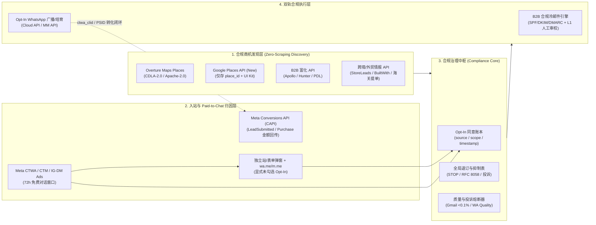
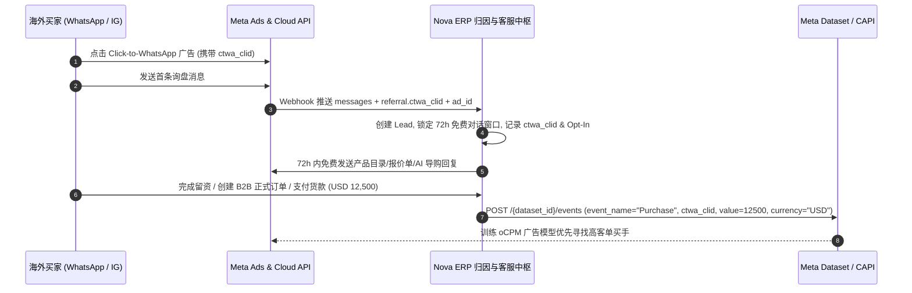

# 跨境多租户 SaaS 合规获客与增长架构深度调研报告

> **调研背景**：基于对 Nova ERP 现有截图 4（LBS 地图获客、Facebook 社媒抓取与私信调度、WhatsApp 批量验号与群发）的分析，本报告旨在为定位 **多租户 B2C + B2B 出海 SaaS** 的产品重构提供可落地的合规替代方案：一方面彻底消除引发平台封号、API 吊销及巨额隐私罚单的系统性法律与商业风险；另一方面保留并升级跨境商户真正愿意付费的精准获客、外贸买家挖掘、Paid-to-Chat 广告归因与自动化触达能力。

---

## 执行摘要（Executive Summary）

截图 4 中现有的三条获客链路——`Google Maps（Places API + Playwright 模拟人工深度抓取） / 无 Key 切换 Overpass API`、`Facebook 主页/群组/视频评论点赞抓取与自动私信`、`WhatsApp 号码批量检测与无授权群发`——在商业 SaaS 环境下均属于**高危甚至致命架构**：不仅直接违反 Google Maps Platform、Meta Platform 及 WhatsApp Business 的服务条款，更将 SaaS 平台自身与租户共同暴露在欧盟 GDPR（Art. 14 透明告知义务及高额处罚）、英国 PECR、美国 CAN-SPAM、加州 CCPA/CPRA 及 Delete Act（SB 362）、加拿大 CASL 等跨境法规的联合执法风险之下。

然而，“去灰产化”并不意味着放弃客户获取价值。相反，通过将底层数据与触达链路切换至**开放许可数据底座 + 官方授权 API + Paid-to-Chat 闭环归因 + 合规冷邮件/Opt-In 消息引擎**，Nova ERP 能够以更低的封号损耗实现更高的线索转化率（ROAS）与长期可持续的 SaaS ARR：

| 现有高危模块（截图 4） | 核心合规/技术致命伤 | 合规升级替代方案 | 核心商业价值跃迁 |
| :--- | :--- | :--- | :--- |
| **Google Maps Playwright 抓取 & 全量存库** | 违反 [Google Maps Platform ToS § 3.2.3(a)-(b)](https://cloud.google.com/maps-platform/terms)；禁止抓包/存储商户名称、地址、电话等字段超过缓存豁免 | **Overture Maps Places 底座**（[CDLA-Permissive-2.0 / Apache-2.0](https://docs.overturemaps.org/guides/places)，~8,800 万 POI 可合法自建索引）+ **Google Places API (New) 仅存 `place_id` / Places UI Kit 按需渲染** | 零版权/爬虫侵权风险；LBS 搜索零调用成本或成本下降 80%+ |
| **无 Key 自动切公共 Overpass API** | 违反 [Overpass API 使用策略](https://wiki.openstreetmap.org/wiki/Overpass_API)（多租户共享额度极易触发 429/IP 封禁）及潜在 [ODbL Share-Alike](https://osmfoundation.org/wiki/Licence_and_Legal_FAQ) 数据隔离问题 | 以 **Overture Maps Places**（无 OSM 数据、无 ODbL 传染）替代 POI 搜索；若需基础地理要素则自建隔离的 OSM 实例并严格履行署名与数据集分离 | 彻底消除第三方社区节点封禁导致的功能不可用 |
| **Facebook 页面/群组/评论抓取 + 自动私信** | 违反 [Meta Terms of Service § 3](https://www.facebook.com/terms) 与 [Automated Data Collection Terms § 2](https://www.facebook.com/legal/automated_data_collection_terms)；[Meta Platform Terms § 5.b](https://developers.facebook.com/terms/) 下可导致 Tech Provider 应用与所有租户连坐封禁 | **Meta Click-to-Messenger / Click-to-IG-DM / Click-to-WhatsApp (CTWA)** 官方广告入站 + **CAPI for Business Messaging** 真实成交额回传 + 独立站嵌入式弹窗表单 | 从“低意向骚扰私信”升级为“72 小时免费对话窗口 + 算法精准买手优化” |
| **WhatsApp 批量检测 + 无授权群发** | 官方已废弃 On-Premises `/contacts` 探测能力且 Cloud API 无批量空号检测（[Meta Developers Community](https://developers.facebook.com/community/threads/191655110330672)）；违反 [WhatsApp Opt-In 政策](https://developers.facebook.com/documentation/business-messaging/whatsapp/getting-opt-in) 必致封号 | **双轨合规外发引擎**：① **B2B 合规冷邮件引擎**（独立子域 + SPF/DKIM/DMARC + RFC 8058 一键退订 + AI L1 审校）负责陌生开发；② **Opt-In WhatsApp 广播 & 质量熔断器**（许可账本 + `STOP` 自动退订 + `RED` 自动熔断）负责高意愿客户培育 | 保留 B2B 陌生开发能力（合法低成本触达），同时保障租户 WABA 账号高评分（`GREEN`）与高送达率 |
| **缺乏垂直商机与合规富化能力** | 仅靠地图电话和社媒评论无法识别采购决策人、技术栈与真实进出口采购频次 | 接入 **Apollo.io / Hunter.io / PDL**（决策人邮箱与验证）、**StoreLeads / BuiltWith / Similarweb**（DTC 独立站商户发现）、**ImportYeti / Trademo / Panjiva / 腾道 Tendata**（海关提单真实买手挖掘） | 从“盲目扫街”跃升为“按 Shopify Plus 套餐、月度插件支出、HS 编码真实进口量精准获客” |



---

## 第一部分：现有截图 4 的法律、平台条款与技术风险解构

对于多租户 SaaS 平台而言，最大风险在于**连带责任与基础设施级封杀**：当 SaaS 产品将违规爬虫、非官方协议外挂和无授权群发作为标准产品功能提供给成百上千家租户时，平台不再只是“技术中立工具”，而是违规行为的制造者与教唆者。

### 1.1 Google Maps LBS 抓取（Places API / Playwright 模拟人工）

截图 4 提供两种看似灵活、实则均高度违规的 LBS 获取路径：其一是调用 Places API 后直接将商户名称、地址、电话、网站写入租户 CRM；其二是在无 Key 或需要“深度字段”时直接启动 `Playwright 弹窗模拟人工` 抓取 Google Maps 页面。

1. **明确违反“禁止抓取（No Scraping）”条款**：根据 [Google Maps Platform Terms of Service § 3.2.3(a) "No Scraping"](https://cloud.google.com/maps-platform/terms)，客户严禁导出、提取或抓取（export, extract, or otherwise scrape）Google Maps Content 用于服务之外的用途。条款具体列举了禁止行为：
   - 预取、索引、存储、转分享或重新托管（pre-fetch, index, store, reshare, or rehost）Google Maps Content；
   - 批量下载（bulk download）地图瓦片、街景图像、地理编码及**地点信息（places information）**；
   - **复制并保存商户名称、地址或用户评价（copy and save business names, addresses, or user reviews）**。
   使用 Playwright 绕过 API 限制直接抓取前端 DOM，不仅违约，更可能触发反爬封锁及计算机欺诈与滥用（反规避技术措施）相关民事索赔。
2. **明确违反“禁止缓存（No Caching）”与 30 天限制**：根据 [Google Maps Platform Terms of Service § 3.2.3(b) "No Caching"](https://cloud.google.com/maps-platform/terms) 及 [Places API Policies](https://developers.google.com/maps/documentation/places/web-service/policies)，除 [Maps Service Specific Terms](https://cloud.google.com/maps-platform/terms/maps-service-terms) 明确豁免外，开发者**不得缓存或永久存储任何 Places API 返回的商业属性**（包括商户名称、地址、电话、网站、评分）。唯一允许无限期存储的字段是 **`place_id`**（`id` 字段）；经纬度（`latitude` / `longitude`）在特定服务（如 Places API § 14.3、Geocoding API、Places UI Kit § 15.2）下最多仅允许临时缓存 **连续 30 个日历日（30 consecutive calendar days）**，到期后必须删除。
3. **非 Google 地图混用与 EEA 额外限制**：根据 [Service Specific Terms § 14.2](https://cloud.google.com/maps-platform/terms/maps-service-terms)，Places API 获取的 Google Maps Content 不得在非 Google 地图（如 OpenStreetMap / Mapbox）上使用；若涉及欧洲经济区（EEA），[EEA Service Specific Terms § 14.1–14.2](https://cloud.google.com/archive/terms/maps-platform/eea/maps-service-terms-20260602) 的限制更为严格（仅允许按 [Places API EEA Permitted Uses](https://developers.google.com/maps/comms/eea/places) 使用，且不得与任何地图混用——唯独 `Places UI Kit` 获得豁免）。将 Google Maps 数据批量导出至通用第三方 CRM 数据库，在法务审查中属于标准的违约行为，一旦被 Google 审计发现，将直接导致全平台 GCP 账单账号与 API Key 被吊销。

### 1.2 OpenStreetMap Overpass API 滥用与 ODbL 开源协议风险

截图 4 在“无 Key 模式”下回退至 OpenStreetMap 公共 Overpass API 进行“所见即所得抓取”，在工程与法务上同样存在两重陷阱：

1. **公共 Overpass 实例的配额与多租户封禁**：根据 [OpenStreetMap Wiki: Overpass API 使用策略](https://wiki.openstreetmap.org/wiki/Overpass_API)，由 FOSSGIS 维护的公共服务器（`overpass-api.de`）面向社区贡献者与轻度开发者。其“安全使用上限”为单次用途每日不超过 **10,000 次查询**、每日下载不超过 **1 GB**、总处理时间不超过 **10 分钟**；若是**定期/自动化调用**，上述上限需**除以 100**（即每日少于 **100 次查询**、少于 **10 MB 数据**）。文档明确指出：**若你运营一个 App 或网站，所有终端用户的请求合并计入总配额**，且必须携带唯一可识别的 `User-Agent` 或 `Referer` 请求头。在多租户 SaaS 中将其作为生产级获客引擎，会迅速耗尽并发槽位并触发 HTTP `429` / `406` 甚至 IP 段封锁（[Overpass API/status](https://wiki.openstreetmap.org/wiki/Overpass_API/status) 曾多次记录因商业高频请求导致服务器内存耗尽与 IP 封禁事件）。
2. **ODbL v1.0 许可的署名与 Share-Alike（相同方式共享）传染风险**：OSM 数据采用 Open Database License v1.0（[OSM Foundation Licence and Legal FAQ](https://osmfoundation.org/wiki/Licence_and_Legal_FAQ)）。
   - **强制署名**：任何使用 OSM 数据的产品都必须显著标注 `"© OpenStreetMap contributors"` 并链接至 ODbL 协议。
   - **Derivative Database（衍生数据库）与导出触发条款**：在 ODbL 协议下，若将 OSM 底层数据与专有商户数据合并形成新的“衍生数据库”，一旦向外部客户（SaaS 租户）**公开分发或提供批量 CSV/API 导出**，接收方有权依据 ODbL 第 4.4 条要求获得整个衍生数据库（含你的结构化清洗与关联记录）的 ODbL 开源副本。虽然纯后台 SaaS 计算或渲染瓦片（Produced Work）通常不直接触发底层库开源，但一旦涉及“CRM 线索建库与批量导出”，就需要极度严谨的“Collective Database（集合数据库）”物理隔离设计，法务审计复杂度远高于采用宽松商业许可的 Overture Maps。

### 1.3 Meta（Facebook）自动化抓取与私信调度风险

截图 4 中的“Facebook 主页/群组/视频/点赞/评论用户抓取 + FB 私信任务调度”直接触犯 Meta 生态的三层契约红线：

1. **平台通用条款禁止一切自动化收集**：[Meta Terms of Service § 3](https://www.facebook.com/terms) 明确规定：*"You may not access or collect data from our Products using automated means (without our prior permission) or attempt to access data you do not have permission to access, regardless of whether such automated access or collection is undertaken while logged-in to a Facebook account."*（无论是否处于已登录状态，未经事先许可均不得使用自动化手段访问或收集数据）。此外，[Meta Automated Data Collection Terms § 2](https://www.facebook.com/legal/automated_data_collection_terms) 明确将网页爬虫、机器人、自动化浏览器定义为受禁行为，必须获得 Meta 正式书面授权方可执行。
2. **Platform Terms 对 Tech Provider（SaaS 厂商）的高压约束**：若 Nova ERP 作为技术服务商接入 Meta 官方生态，必须受限于 [Meta Platform Terms](https://developers.facebook.com/terms/)（2026 年 2 月 3 日更新版）：
   - **第 3.a 条禁止行为（Prohibited Practices）**：严禁出售、许可或购买平台数据（`§ 3.a.iv`）；严禁在无有效用户同意的情况下处理平台数据以构建或扩充用户画像（`§ 3.a.v`）；严禁超出 Developer Docs 允许目的使用数据（`§ 3.a.viii`）。
   - **第 5.b 条 Tech Providers 隔离与连坐条款**：SaaS 厂商必须将各客户（租户）的数据严格隔离存储（`§ 5.b.ii.2`），维护最新客户名单并在 Meta 要求时提交（`§ 5.b.ii.3`），且当 Meta 认为某租户违规时，SaaS 厂商必须立即终止该租户访问能力（`§ 5.b.ii.6`）。
   - **第 7 条合规审计与封杀权**：Meta 有权每年派遣第三方审计师现场/远程审查 IT 系统与记录（`§ 7.c`），如发现违规，违规方需承担全部审计费用（`§ 7.c.vi`），且 Meta 可不经通知直接自动化或人工永久关停整个 SaaS 应用的 App ID（`§ 7.e`）。
3. **群组/评论用户冷私信的封号与技术对抗死循环**：Meta Graph API 不向第三方开发者开放抓取他人 Facebook 群组成员列表或任意帖子评论者 UID 并主动群发 Messenger 私信的权限；标准 Messenger Platform 亦受 **24 小时标准消息窗口**限制（仅由用户主动发起交互或点击 CTM 广告开启，详见第 3.1 节）。实现截图 4 功能只能依赖浏览器 Cookie 注入与 Playwright 模拟操作，会导致租户 Facebook 主页/个人号大面积遭遇安全验证、限制发送乃至永久封号（[Meta Data Scraping Enforcement](https://www.facebook.com/help/463983701520800)）。

### 1.4 WhatsApp 号码批量检测与无授权群发风险

截图 4 自身已挂出“封号风险警告横幅”，这恰恰印证了该模块底层技术路线已偏离官方合规架构：

1. **官方不存在合法的“批量空号/WhatsApp 存在性检测 API”**：
   - 历史上部分第三方工具滥用 WhatsApp On-Premises API 的 `/contacts` 接口探测手机号是否注册 WhatsApp。但早在 **2022 年 10 月 11 日（v2.43.1）**，Meta 已强制修改 `/contacts` 返回逻辑——无论该号码是否注册 WhatsApp 一律返回 `valid`（[Meta Developer Community](https://developers.facebook.com/community/threads/191655110330672)）；
   - 更进一步，On-Premises API 已于 **2025 年 10 月 23 日** 正式到期退役（[Conversions API for Business Messaging](https://developers.facebook.com/docs/marketing-api/conversions-api/business-messaging)）。
   - 当前唯一的官方接口 **WhatsApp Cloud API** 根本不提供批量探号接口（2026 年 8 月 24 日新增的 `GET //contact_book` 仅用于查询你自己的联系人簿中是否已为某个已知 `bsuid` 存储了手机号，返回布尔值 `present`，绝不用于全网扫号——见 [WhatsApp Changelog](https://developers.facebook.com/documentation/business-messaging/whatsapp/changelog)）。
   因此，任何能实现“WhatsApp 号码批量检测”的功能，必然运行在逆向破解的 WhatsApp Web 协议（如非官方多开库）或无头浏览器群控之上，一旦探测频率触发风控指纹，对应 WhatsApp 个人号/Business App 账号将被瞬间永久封停。
2. **2024 年 11 月 Opt-In 新规与强制质量降级机制**：根据 [WhatsApp Business Messaging Policy](https://business.whatsapp.com/policy) 及 [Get opt-in for WhatsApp](https://developers.facebook.com/documentation/business-messaging/whatsapp/getting-opt-in)（整合 2024 年 11 月政策更新），企业向用户发送 WhatsApp 消息必须同时满足两项刚性前提：**（a）用户主动提供了其手机号码（或用户名）；（b）企业已获得接收方明确、可验证的 Opt-In 许可，确认其愿意接收来自该特定命名企业的消息或来电，且获取方式符合当地适用法律**。将公开爬取或外部购买的手机号直接导入队列进行模板群发，会引发极高的用户点击 `Block / Report Spam` 比率，在几小时内触发 Meta 质量评级跌入 `RED`、模板被自动暂停甚至整个 WhatsApp Business Account（WABA）被永久清退。

### 1.5 全球隐私与反垃圾通信法规矩阵（B2B 与 B2C 边界）

除平台封号外，直接抓取个人/商户联络信息并跨国发送开发消息，在欧美主要目标市场均构成明确的法定违法风险：

| 司法管辖区与法规 | 核心适用范围与 B2B 态度 | 爬取与冷触达的关键法条红线 | 执法案例与最高法定罚则 |
| :--- | :--- | :--- | :--- |
| **欧盟 GDPR** ([Art. 6](https://gdpr-info.eu/art-6-gdpr/) / [Art. 14](https://gdpr-info.eu/art-14-gdpr/)) | 覆盖所有欧盟境内自然人（含**企业员工的实名工作邮箱**如 `name@company.de` 与工作手机号）。**B2B 不豁免** | ① **Art. 6(1)(f)** 合法利益必须通过平衡测试（严禁抓取用户设为隐藏/受限可见的联系信息）；② **Art. 14** 规定从第三方/公开页面间接收集数据后，必须在 **1 个月内（或首次通信时）** 主动向当事人履行完整隐私告知，并明确说明**具体数据来源**（答复“来自互联网公开信息”违法），且商业规模化爬虫不得滥用 `Art. 14(5)(b)`“不成比例的努力”豁免 | 法国 **CNIL 处罚 Kaspr €240,000**（2024 年 12 月 5 日裁决，[CNIL 官方通报](https://www.cnil.fr/en/data-scraping-kaspr-fined-eu240000)）：因其通过插件抓取 LinkedIn 受限可见联系方式、未履行 Art. 14 告知、未在 Art. 15 请求中披露精确来源及无限期自动续存数据；最终 Kaspr 删除全部抓取数据库并停止 LinkedIn 收集以结案（2026 年 3 月，[CNIL 结案公告](https://cnil.fr/en/closure-order-issued-against-kaspr)） |
| **英国 UK GDPR + PECR** ([ICO B2B Guide](https://ico.org.uk/for-organisations/direct-marketing-and-privacy-and-electronic-communications/business-to-business-marketing)) | 严格区分 **Corporate Subscribers**（有限公司、LLP 等独立法人）与 **Individual Subscribers**（自然人、**个体工商户 Sole Traders、普通合伙企业**） | ① 向 Corporate Subscribers 发送 B2B 邮件不受 PECR 电子邮箱 Opt-In 限制（无需事先同意），但**若包含个人姓名邮箱仍受 UK GDPR 约束**（需合法利益 + Art. 14 告知 + 无条件退订）；② 向 **Sole Traders / 普通合伙人**（外贸常见的中小零售店/夫妻店极易落入此类！）发送邮件或短信，PECR 视同个人消费者，**必须具备事先 Consent 或 Soft Opt-In**（[ICO Lawful Basis Matrix](https://ico.org.uk/for-organisations/direct-marketing-and-privacy-and-electronic-communications/sending-direct-marketing-choosing-your-lawful-basis)） | UK ICO 最高可处最高 **£1,750 万或全球年营业额 4%**（UK GDPR）及 **£50 万**（PECR，按新法趋势还将大幅提高） |
| **美国 CAN-SPAM Act** ([FTC Compliance Guide](https://www.ftc.gov/business-guidance/resources/can-spam-act-compliance-guide-business)) | 适用于所有主要目的为商业推广的电子邮件。**明确无 B2B 豁免！** | 允许冷邮件外发（Opt-Out 制），但**每封邮件必须同时满足全部法定要件**：① 真实不误导的头部信息（From/Reply-To/路由域名）；② 不得使用欺骗性主题行；③ 明确标识为广告；④ 附带**真实有效的物理邮政地址**；⑤ 提供清晰退订机制（退订通道至少保持 **30 天** 有效）；⑥ **10 个工作日内** 执行退订且严禁转售/共享已退订邮箱；⑦ 委托第三方发送时品牌方与发送方承担**连带法律责任** | **每封违规邮件最高罚款 `$53,088`**（按单封独立累计，FTC 通胀调整后标准，见 [FTC Guide](https://www.ftc.gov/business-guidance/resources/can-spam-act-compliance-guide-business)） |
| **美国加州 CCPA/CPRA & Delete Act (SB 362)** | **B2B 豁免已于 2023 年 1 月 1 日到期失效**（`Cal. Civ. Code § 1798.145(n)(3)`，见 [CPPA 文档](https://cppa.ca.gov/regulations/pdf/comments_notices_disclosures_employee_data.pdf)） | ① 加州企业联系人的个人信息同样享有知情权、删除权与禁止出售/共享（Opt-Out of Sale/Sharing）权利；② 若 SaaS 平台在未与数据主体建立直接关系的情况下收集并向第三方客户“售卖”个人联系线索，将构成 **Data Broker**（需按 SB 362 年度注册，并自 **2026 年 8 月 1 日** 起每 **45 天**接入加州 CPPA 的 **DROP 一键全网删除平台**，2028 年起每 3 年独立审计，见 [CPPA DROP 演示文档](https://cppa.ca.gov/meetings/materials/preliminary_stakeholder_session.pdf)） | CPRA 每次故意违规最高 `$7,500`；Data Broker 未注册每日 `$200` + 行政费用 |
| **加拿大 CASL** ([CRTC Guide](https://crtc.gc.ca/eng/com500/guide.htm) / [Enforcement](https://crtc.gc.ca/eng/internet/pub/20260331.htm)) | 覆盖发送至或访问自加拿大计算机系统的所有商业电子消息（CEM，含邮件、SMS、社媒 DM）。**B2B 同样实行 Opt-In 制** | 必须具备明示同意（Express Consent）或法定默示同意（Implied Consent）。若引用“公开展示（Conspicuous Publication）”默示同意，发送方必须举证：**① 网页/名片未声明拒收商业消息；② 推广内容与收件人的商业职务/职责直接相关**；且每封消息必须含发件人完整身份信息与一键退订机制 | 行政货币罚金（AMP）高达 **企业单次违规 `$10,000,000` 加元**（个人 `$1,000,000` 加元） |

---

## 第二部分：合规 B2B 商家/分销商发现与数据富化架构（替代爬虫层）

要彻底替代“Google Maps 爬虫 + Overpass 公共节点”，同时为跨境 B2B（找海外线下经销商/门店/品牌商）与 B2C 卖家提供远超地图电话维度的商机洞察，建议采用 **“开放地理底座 + 官方合规 Places 链路 + B2B 决策人富化 + 垂直电商/贸易情报”** 四层合规数据架构。

### 2.1 地理商户基座重构：Overture Maps Places + Google Places API (New)

#### 1. 首选底座：Overture Maps Foundation — Places 数据集（完全零爬虫、无 Share-Alike 约束）
由 Amazon、Meta、Microsoft、TomTom 等联合创立的 **Overture Maps Foundation** 提供了目前全球最干净、可合法商业落库的多租户 POI 底座（[Overture Places Guide](https://docs.overturemaps.org/guides/places)）：
- **数据规模与来源（2026 年 10 月数据快照）**：包含约 **8,840 万条全球 POI 记录**，主要由 **Meta（约 6,030 万条，CDLA-Permissive-2.0）**、**BrightQuery（约 1,577 万条，CDLA-Permissive-2.0）**、**Microsoft（约 588 万条，CDLA-Permissive-2.0）**、**Foursquare（约 376 万条，Apache-2.0）**、**AllThePlaces（约 193 万条，CC0-1.0）** 以及 Uberall、PinMeTo、DAC 等聚合贡献。
- **决定性法律优势**：官方明确声明 **`Places` 主题不包含任何 OpenStreetMap 数据，因此完全不触发 ODbL 的 Share-Alike（相同方式共享）义务**（[Overture Places Guide](https://docs.overturemaps.org/guides/places)）。Nova ERP 可以完全合法地下载云原生 GeoParquet 快照并入库至自有 PostgreSQL/PostGIS 或 Elasticsearch 集群，构建无限次查询、零按次调用费、支持租户侧筛选与 CRM 导入的全球商家探索引擎。
- **Schema 字段丰富度（v2.0.0）**：参考 [Overture Place Schema Reference](https://docs.overturemaps.org/schema/reference/places/place/)，每条记录开箱即包含：
  - `id`（GERS 全球实体稳定标识符）与 `geometry`（Point 坐标）
  - `names`（主名称与别名）、`basic_category` 与分级 `taxonomy`（`primary` / `hierarchy` / `alternates`）
  - `operating_status`（`open` / `permanently_closed` 等）与 `confidence`（`0` 到 `1` 的存续置信度评分）
  - **`websites[]`**（官方域名列表——**这正是衔接 Hunter/Apollo/StoreLeads/BuiltWith 富化的黄金主键！**）
  - **`phones[]`**、**`emails[]`**、**`socials[]`**（如公开 Facebook 主页链接）、**`addresses[]`**（含国家代码、邮编、城市、街道）及 `brand`。

#### 2. 补充增强层：Google Places API (New) 合规接入模式与 2025 年 3 月新定价
当客户需要 Google Maps 最新营业状态、评分热度或对 Overture 缺失的长尾本地商家进行精准补充时，可引入 Google Places API (New)，但必须在架构上严格执行以下三条合规原则（[Places API Policies](https://developers.google.com/maps/documentation/places/web-service/policies)）：
- **原则 A（仅持久化 `place_id`）**：CRM 数据库中仅持久化存储 Google 返回的 `id`（`place_id`），这是唯一获永久缓存豁免的字段；商户名称、电话、网站等属于 Google Maps Content，不得全量静默落盘建库（租户手动核验并联系建档的第一方业务交互记录，或通过商户官网自行提取并获合法授权的公开公司域名信息则属独立数据源）。
- **原则 B（Field Mask 阶梯过滤降本）**：[Places API (New) Data Fields](https://developers.google.com/maps/documentation/places/web-service/data-fields) 按请求中包含的最高级别字段决定整次计费 SKU！在列表搜索阶段仅请求 `places.id`（触发 **Unlimited 免费** 的 `Text Search Essentials (IDs Only)`），先完成空间去重与租户已存记录过滤，再仅对高意向单条商户按需调用详情或前端组件。
- **原则 C（优先采用 `Places UI Kit` 实现合规无地图/跨地图展示）**：根据 [Service Specific Terms § 15.1](https://cloud.google.com/maps-platform/terms/maps-service-terms) 及 [Places UI Kit Overview](https://developers.google.com/maps/documentation/javascript/places-ui-kit/overview)，`PlaceDetailsElement` / `PlaceSearchElement` 允许在**无地图或任意非 Google 地图（如 Mapbox/Leaflet）**旁合法展示 Google 商家名称、电话、网址、营业时间与评价，且价格仅为传统 Place Details Enterprise 的 **5%–25%**。

**Google Places API (New) 2025 年 3 月后现行 SKU 定价表**（[Google Maps Platform Core Services Pricing List](https://developers.google.com/maps/billing-and-pricing/pricing) & [March 2025 Changes](https://developers.google.com/maps/billing-and-pricing/march-2025)；注：2025 年 3 月 1 日起原每月 `$200` 通用额度已取消，改为按 SKU 阶梯免费额度）：

| SKU 名称 | 包含核心字段示例（[Data Fields](https://developers.google.com/maps/documentation/places/web-service/data-fields)） | 每月免费额度 | `0–100K` 单价（每 1,000 次） | `100K–500K` 单价 | `500K–1M` 单价 |
| :--- | :--- | :--- | :--- | :--- | :--- |
| **Text Search Essentials (IDs Only)** | `id`, `name`, `nextPageToken` | **无限制免费** | **\$0.00** | **\$0.00** | **\$0.00** |
| **Place Details Essentials (IDs Only)** | `id`, `name`, `photos`（仅列表引用）, `attributions` | **无限制免费** | **\$0.00** | **\$0.00** | **\$0.00** |
| **Places UI Kit Query** | 前端标准 `PlaceDetailsElement` / `PlaceSearchElement` | 10,000 次/月 | **\$1.00** | \$0.80 | \$0.60 |
| **Places UI Kit Pro** | `AdvancedPlaceDetailsElement` / `AdvancedPlaceListElement`（可定制按钮） | 5,000 次/月 | **\$5.00** | \$4.00 | \$3.00 |
| **Place Details Essentials** | `formattedAddress`, `postalAddress`, `location`, `types` | 10,000 次/月 | **\$5.00** | \$4.00 | \$3.00 |
| **Place Details Pro** | `displayName`, `primaryType`, `businessStatus`, `googleMapsUri` | 5,000 次/月 | **\$17.00** | \$13.60 | \$10.20 |
| **Place Details Enterprise** | `nationalPhoneNumber`, `internationalPhoneNumber`, `websiteUri`, `rating`, `userRatingCount` | 1,000 次/月 | **\$20.00** | \$16.00 | \$12.00 |
| **Text Search Pro** | 每次返回最多 20 条的 Essentials/Pro 字段 | 5,000 次/月 | **\$32.00** | \$25.60 | \$19.20 |
| **Text Search Enterprise** | 每次返回最多 20 条的含电话/网址/评分等 Enterprise 字段 | 1,000 次/月 | **\$35.00** | \$28.00 | \$21.00 |

> **工程省钱最佳实践**：千万不要在搜索接口的 `X-Goog-FieldMask` 中直接带上 `places.websiteUri` 或 `places.internationalPhoneNumber`，否则每一次翻页搜索都将按 **\$35.00/1,000 次**（且仅有 1,000 次免费额度）计费；先用 `Overture Maps Places` 筛选出已有域名/电话的商户，或用免费的 `Text Search (IDs Only)` 拿 `place_id` 后交给前端 `Places UI Kit`（`$1–$5/1,000`）按需点开预览。

---

### 2.2 B2B 联系人与企业富化 API 横向对比

拿到企业名称或官网域名（`domain`）后，合法获取采购总监、Founder、E-commerce Manager 的实名工作邮箱与验证状态，应通过专业合规的 B2B 数据供应商 API 完成，彻底告别自行爬虫：

| 供应商 | 核心定位与数据库规模 | 官方定价与积分规则（以公开文档为准） | 关键 API 能力与限流 | SaaS 多租户集成与 ToS 限制 |
| :--- | :--- | :--- | :--- | :--- |
| **Apollo.io** ([Pricing](https://www.apollo.io/pricing) / [API Docs](https://docs.apollo.io/docs/api-pricing)) | 一体化 B2B 情报库：宣称 **2.4 亿+联系人、3,000 万+企业** | 年付：Free `$0`（900 积分/年）；Basic `$49/用户/月`（30,000 积分/年）；Professional `$79/用户/月`（48,000 积分/年）；Organization `$119/用户/月`（3 用户起，72,000 积分/年）。<br/>**API 消耗**：`Organization Search` `1` 积分/页（最多 100 条/页，上限 5 万条）；`Organization Enrichment` `1` 积分/家；`People Enrichment` `1–9` 积分/人（`1` 基础资料/邮箱 + `8` 手机号，未命中 `0` 积分；Waterfall 瀑布富化约 `1–4` 邮箱 / `8–25` 手机） | 搜索 `200 req/min`、Paid 富化高达 `1,000 req/min`（[Rate Limits](https://docs.apollo.io/reference/rate-limits)）；支持官方 **OAuth 2.0** 集成 | **极严禁标准套餐转售**：[Pricing](https://www.apollo.io/pricing)、[Terms](https://www.apollo.io/terms) 与 [API Terms § 2](https://www.apollo.io/terms/api) 明确禁止将标准账号数据暴露、共享或转售给第三方 SaaS 客户，必须走 **OAuth 2.0 租户自有账号授权**（[Developer FAQs](https://docs.apollo.io/docs/developer-faqs)）或签署单独 Data Licensing 商务合同 |
| **Hunter.io** ([Pricing](https://hunter.io/pricing) / [API V2](https://hunter.io/api-documentation)) | 域名邮箱发现、推算与高准度验证（按账号计费，**全套餐不限团队成员数**） | 年付：Free `$0`（50 积分/月）；Starter `$34/月`（24,000 积分/年，月付 `$49`）；Growth `$104/月`（120,000/年）；Scale `$209/月`（300,000/年）。额外按需包：Search `$50/1,000`、Verification `$11/1,000`。<br/>**API 消耗**：Domain Search `1` 积分/邮箱（批量每 10 个邮箱 `1` 积分，未找到免费）；Email Finder `1` 积分/命中；Email Verifier **`0.5` 积分/次**；Data Plan Enrichment `0.2–1` 积分，Discover API 免费（[Data Plans Help](https://help.hunter.io/en/articles/12149400-hunter-api-for-data-plans)） | Domain Search / Finder 限流 `15 req/s`（`500/min`）；Verifier `10 req/s`（`300/min`）；提供独立的 `Data Plans` 供程序化调用 | [Terms § 1 & § 8](https://hunter.io/terms-of-service) 禁止共享账号与构建竞品；§ 11 明确 API 获取的个人数据仍由调用方独立担任 GDPR Controller，最适合 **BYOK 模式**或谈定 Data Plan 企业合约 |
| **People Data Labs (PDL)** ([Docs](https://docs.peopledatalabs.com/docs/create-an-account) / [Agreement](https://privacy.peopledatalabs.com/policies?name=services-subscription-agreement)) | 开发者原生数据基础设施（宣称 **30 亿+档案**，按成功匹配 `200` 计费，**未命中不扣费**） | Self-Serve：Free `$0`（100 条/月）；Pro 起步价 **Person `$98/月`**（350+ 条起）或 **Company `$100/月`**（1,000+ 条起）；Enterprise 定制。<br/>**API 消耗**：Enrichment `1` 积分/成功匹配；Bulk Enrichment 单次批量高达 100 条（仅按命中数扣费）；Autocomplete/Cleaner 免费 | 原生为嵌入式产品与数据管道设计，提供 Person/Company/IP Enrichment、Bulk API 及 Search API | [PDL Services Agreement § 2.2.1 & § 2.6.3](https://privacy.peopledatalabs.com/policies?name=services-subscription-agreement) 明确允许在客户自研平台内向终端用户展示富化数据及做匹配计算，仅禁止原始大库转售或提供等同 PDL 的批量导出接口，**是 OEM 统一积分池的最优候选之一** |
| **Lusha** ([FAQ](https://www.lusha.com/faq) / [Comparison](https://www.lusha.com/blog/best-data-enrichment-tools-for-salesforce)) | 中小 B2B 团队直拨电话与工作邮箱富化，强 GDPR/CCPA 定位 | Free `$0`（40 积分/月）；Starter `$37/月` 年付；Pro `$52/月` 年付；Premium `$299/月` 年付；**全套餐开放 API**（Pro 起全速访问），且内置原生 MCP Server | 支持 Contact/Company/Signals/Lookalike API，每次 Search 消耗 `1` 积分（最多返回 25 条）+ 解锁联系信息扣费 | 定位面向企业内部 GTM 与 RevOps（含直拨号码强项），适合 **BYOK / MCP 集成** |
| **Clearbit (HubSpot Breeze Intelligence)** ([HubSpot Release](https://ir.hubspot.com/news-releases/news-release-details/hubspot-credits) / [B2B API Guide](https://www.lusha.com/blog/best-b2b-data-apis-for-ai-agents)) | 已被 HubSpot 收购并重构为 **Breeze Intelligence**（表单缩短 + CRM 实时富化 + 购买意图） | 绑定 HubSpot 体系按 **HubSpot Credits** 计费：Pro 套餐含 `3,000` 积分/月，Enterprise 含 `5,000` 积分/月，加购包 **`$10 / 1,000` 积分** | 高度绑定 HubSpot Smart CRM 属性写入与工作流，独立 API 逐步向 HubSpot 生态收敛 | **不适合作为独立第三方 ERP SaaS 的通用后端底座**，仅适合作为租户已有 HubSpot 账号的双向同步集成选项 |

---

### 2.3 跨境电商与外贸垂直获客情报 API（核心差异化能力）

普通地图与泛企业库无法回答跨境卖家和外贸工厂最核心的痛点：**“哪些欧美独立站正在用 Shopify Plus 且月插件花费超过 500 美元（说明体量大、有供应链换代预算）？”** 以及 **“目标 HS 编码下，最近 90 天真实清关进货的海外买家是谁、采购频次和供应商是谁？”** 这两类场景存在成熟、合法的商业 API：

#### A. 跨境独立站与技术栈选型情报（面向 SaaS、SaaS 服务商、POD/供应链代发与选品对接）
1. **StoreLeads**（[StoreLeads Pricing](https://storeleads.app) / [API Reference](https://storeleads.app/api)）
   - **能力与字段**：专为全球电商独立站（Shopify、Shopify Plus、WooCommerce、Magento、TikTok 等）打造，API 支持按平台、国家、类目、估算营收、安装插件（如 Klaviyo、Loox、Oberlo/DSers）过滤，并包含极具商业意图的动态字段：当前套餐 `plan`（如 `Shopify Plus`）、月度应用支出 `monthly_app_spend`、SKU 最小克重 `min_weight`、最近上新产品 `most_recently_published_product` 以及**套餐/平台迁移时间信号**（`f:last_plan_change_at`、`f:last_platform`）。
   - **定价与 API 门槛**：Premium `$75/月`（仅 UI，2,000 次搜索/月）；**Pro `$250/月`（开放 API 与 MCP、不限次数搜索、CSV 导出、2 个电商平台数据）**；**Elite `$450/月`（全平台 + API & MCP）**；Enterprise `$950/月`（年付享 85 折）。
2. **BuiltWith**（[BuiltWith Plans](https://builtwith.com/plans) / [BuiltWith API](https://api.builtwith.com/)）
   - **能力与字段**：追踪 **128,231+ 种互联网技术**，提供 Domain API `v26`（技术栈与历史上下线时间）、Lists API `v13`（按技术+国家批量拉取网站清单，每页最多 500 条）、Change API（近期切换支付网关或 ERP 插件信号）、Vector Search API 及公司税号/VAT/CNPJ 识别。
   - **定价与支付灵活性**：订阅制 Basic `$295/月`、Pro `$495/月`、Team `$995/月`；同时提供按需 API 额度包（`2,000` 次查询 `$99`、`10,000` 次 `$259`）甚至支持 Agent/微支付按次调用（`$0.0495` 每次，见 [BuiltWith API llms.txt](https://api.builtwith.com/llms.txt)）。**合规边界**：[BuiltWith 标准条款](https://api.builtwith.com/vector-search-api#terms) 允许在自身产品内调用 API 增强功能体验，但**禁止原样转售数据集或复制一个与 `builtwith.com` 同质化的工具站**。
3. **Similarweb API**（[Similarweb Data Credits](https://docs.similarweb.com/api-v5/guides/data-credits-calculations) / [Packages](https://www.similarweb.com/packages/sales)）
   - **定位**：作为“高客单价买手资质筛选器（Qualification）”，而非广撒网列表。采用透明 **Data Credits** 计量（`Total Credits = 域名数 × 接口基价 × 颗粒度 × 国家数 × 月数`，Traffic & Engagement 端点 `1` 积分/数据点，Keywords `0.01` 积分/结果）。企业销售咨询定价，适合仅对初筛入库的高潜品牌域名补充真实月访客量、核心流量国家及广告渠道占比。

#### B. 海关提单与真实进出口贸易数据 API（面向 B2B 外贸工厂、货代与大宗供应链）
美国 CBP 海运提单（AMS/Manifest）与部分拉美/亚洲国家海关数据属于法定公开或官方授权商业发布的贸易记录，比地图盲找高出数个量级：

| 贸易数据平台 | 数据覆盖与更新频率 | API 形态与商业授权门槛 | 适合集成的 Nova ERP 场景 |
| :--- | :--- | :--- | :--- |
| **ImportYeti** ([Pricing](https://www.importyeti.com/pricing/supply-chain) / [API Docs](https://docs.importyeti.com/docs/reference)) | 聚焦美国（2015 年起海/空/陆运及出口）与墨西哥进出口报关单，随官方节奏更新 | Free `$0`（仅 UI 美线海运）；Pro `$50/月`（年付 `$600`，年营收低于 `$2M` 小微 `$300/年`）；**Enterprise `$1,000+/组织/月` 开放 REST API (`/v1.0/powerquery/...`)**：公司/供应商检索**免费**，公司档案 `1` 积分/条，BOL/HS 列表 `1` 积分/10 条，单张提单详情 `0.1` 积分（[Credits 表](https://docs.importyeti.com/docs/credits)） | 北美/墨西哥买家挖掘、同行竞品供应链透视（按产品关键词/HS 编码排序活跃美国进口商） |
| **Trademo Intel** ([Pricing](https://www.trademo.com/intel/pricing) / [Compare](https://www.trademo.com/intel/compare/panjiva)) | **35+ 国家**颗粒度海关记录、**30 亿+ 提单**、**1,500 万+** 买卖双方档案，每日新增 150 万+ 票（美国数据日更） | 提供企业级 REST API 与 **Hermes MCP**；双积分制——`Download Credits` 导出提单/画像，`Value-Add Credits` 直接解锁邮箱/电话/LinkedIn 及股东/制裁合规背调（含 UBO 受益所有人筛查） | 一步完成“真进口商发现 + 制裁/合规风控 + 采购负责人联系方式获取” |
| **Panjiva (S&P Global Market Intelligence)** ([Panjiva API](https://es.panjiva.com/api) / [Xpressfeed](https://www.marketplace.spglobal.com/en/solutions/xpressfeed-(b73250d6-a15c-4243-9016-3e5bf6300e43))) | **22 个来源国**、**20 亿+ 货运记录**、**900 万+ 企业档案**，深度关联 S&P 全球企业股权树与财务信用数据 | 企业级合同制，通过 S&P Global **`Xpressfeed™`**（FTP / Web Service 增量数据包）直接灌入企业数仓或 CRM | 面向中大型工贸一体客户与出海品牌的大客户背调、企业集团母子公司穿透 |
| **上海腾道 Tendata** ([腾道 API 官网](https://www.tendata.cn/service/consult) / [介绍](https://www.tendata.cn/news/5869.html)) | 宣称覆盖 **228+ 国家/地区 100 亿+ 贸易数据**、198+ 国家工商数据及 172+ 国家 8.5 亿+ 联系人 | 提供标准化 JSON REST API（`open-api.tendata.cn/v2/trade/...`、`v2/company`、`v2/contact`），支持 OAuth 2.0 Bearer Token，企业商务定制按量或套餐计费 | 本土化中文工贸客户接受度极高，适合作为中国出海工厂租户的首选贸易数据连接器 |

---

### 2.4 多租户 SaaS 商业化变现模式：BYOK vs 平台统一积分池（Pooled Credits）

在设计 Nova ERP 的多租户变现模型时，技术决策必须服从上游 API 的转售条约与 Data Broker 监管边界：

| 评估维度 | 模式 A：BYOK / OAuth 2.0（租户自带账号与 Key） | 模式 B：平台统一积分池（Pooled SaaS Lead Credits） | 模式 C：**混合分层架构（推荐方案）** |
| :--- | :--- | :--- | :--- |
| **上游条款合规性** | **极高**：租户通过 OAuth 2.0（如 Apollo Partner Flow）或个人加密托管 API Key 发起调用，租户直接受其与供应商的 EULA 约束，完全规避 Apollo/Hunter 标准版“禁止转售/共享”红线 | **高风险（除非签 OEM 协议）**：使用标准 SaaS 账号 Key 在后台给多个租户分销积分，几乎必然违反 Apollo、Hunter、StoreLeads 等标准条款并导致主账号被封；仅 PDL、Tendata 等支持专门企业数据分发协议 | **全面合规**：内置开放数据免费用 + 主流数据源走 OAuth/BYOK + 平台统一积分包仅挂载已获正式 OEM/Data Licensing 授权的数据源 |
| **加州 Delete Act (SB 362) 风险** | **极低**：SaaS 仅作为租户自采工具的工作流执行器与数据处理器（Service Provider/Processor），不向第三方“出售”非直接采集的个人数据 | **高**：若平台自建或转售个人联系方式库并按线索条数抽成收费，极易被认定为 **Data Broker**，须履行注册及 45 天 DROP 删除同步义务 | **可控**：L0 仅含企业 POI 与网站域名；个人联系人按租户指令经合规 OEM 管道即时富化并返回租户专属隔离库 |
| **租户上手转化率** | 偏低（新注册中小商户往往不愿先去注册 3 个外部工具付费账户） | **极高**（开箱即用，SaaS 订阅 + 充值包一口价闭环，毛利空间大） | **兼顾体验与上限**：新用户首日即可免费搜索 Overture 8,800 万商家 + 按需消耗内置 OEM 积分包体验；重度专业团队无缝绑定自有 Apollo/StoreLeads/Google 账号降低边际成本 |
| **推荐对应数据源** | Google Maps API Key（或内置 UI Kit）、Apollo.io OAuth、Hunter.io Key、Lusha、StoreLeads | **Overture Maps Places**（0 边际成本随基础版赠送）、**People Data Labs (Enterprise OEM)**、**BuiltWith/Tendata 企业分销合约**、**Google Places UI Kit**（控制单次成本） | **分层实现**：<br/>• **Layer 0（内置免费）**：Overture Places 商业检索<br/>• **Layer 1（平台官方积分包）**：签 OEM 协议的 PDL/海关提单与电子邮件验证<br/>• **Layer 2（BYOK 连接器）**：Apollo / Hunter / StoreLeads / 租户 Google Key |

---

## 第三部分：高 ROI 入站与 Paid-to-Chat 增长闭环（B2C + B2B 核心升级）

海外 B2C 独立站与新兴市场 B2B 批发生意（如中东、拉美、东南亚、欧洲零售商采购）最成熟的获客路径不是“爬别人评论区然后发垃圾私信”，而是 **Meta Paid-to-Chat 广告漏斗 + 服务端真实成交额回传（CAPI）**。这套官方闭环能够让 Meta 广告系统自动找到最愿意下大单的买家，而非仅寻找爱点链接的无效流量。

### 3.1 Meta Click-to-WhatsApp / Click-to-Messenger / Click-to-IG-DM 官方链路

1. **广告创建与目标配置（Marketing API）**：
   - 根据 [Ads that Click to WhatsApp](https://developers.facebook.com/documentation/ads-commerce/marketing-api/ad-creative/messaging-ads/click-to-whatsapp) 与 [Click to Messenger](https://developers.facebook.com/documentation/ads-commerce/marketing-api/ad-creative/messaging-ads/click-to-messenger)，Nova ERP 可在后台内置广告管理或向导，通过 Marketing API 创建广告系列（如 `OUTCOME_ENGAGEMENT` 或 `OUTCOME_SALES`），在 Ad Set 层级设置 `destination_type: "WHATSAPP"`（或 `"MESSENGER"`、`"INSTAGRAM_DIRECT"`，亦可设为 `"WEBSITE"` 并在 Creative 中启用 `asset_feed_spec.message_extensions` 在落地页底部挂载 WhatsApp 浮动转化栏，详见 [Website ads that click to message](https://developers.facebook.com/documentation/ads-commerce/marketing-api/ad-creative/messaging-ads/website-ads-click-to-message.md)）。
2. **Webhook 归因识别参数精确解析**：
   - **WhatsApp Cloud API 入站归因**：当用户点击 Click-to-WhatsApp 广告并发送首条消息时，Cloud API 推送至 Nova ERP 的 `messages` Webhook Payload 中将自动携带 `referral` 对象（[CAPI Business Messaging Onboarding](https://developers.facebook.com/docs/marketing-api/conversions-api/business-messaging)）：
     - `messages[0].referral.ctwa_clid`：点击广告产生的**唯一归因 Click ID**（注：来自 WhatsApp Status 广告位的消息不包含 `ctwa_clid`，见 [automatic_events reference](https://developers.facebook.com/documentation/business-messaging/whatsapp/webhooks/reference/automatic_events)）。
     - `messages[0].referral.source_id`：精确到具体 **Ad ID**；`source_type: "ad"`；`source_url`、`headline`、`body` 等创意上下文——Nova ERP 据此自动识别客户是询盘哪一款 SKU 或哪一条批发报价广告，触发对应的 AI 导购欢迎流！
   - **Messenger & Instagram DM 归因与 7 天延伸窗口**：
     - 订阅 `messaging_referrals` 与 `messaging_postbacks` Webhook（[messaging_referrals Reference](https://developers.facebook.com/docs/messenger-platform/reference/webhook-events/messaging_referrals)），可获取 `sender.id`（即 `PSID`）、`referral.source: "ADS"`、`referral.ad_id` 及 `ads_context_data`（含 `ad_title`、`product_id`、`post_id`、`flow_id`）；若采用 Messenger Lead Generation Ads，在用户完成对话表单后还会收到 `LEAD_COMPLETE` / `LEAD_INCOMPLETE` 回调（[Lead Gen Ads in Messenger](https://developers.facebook.com/documentation/business-messaging/messenger-platform/discovery/lead-generation-ads-in-messenger)）。
     - **特殊窗口红利**：普通 Messenger / IG 对话窗口为 24 小时，但当用户点击 Click-to-Messenger 或 Click-to-Direct 广告发起首条消息时，**标准消息回复窗口可延长至最长 7 天**（[Messenger Platform Overview](https://developers.facebook.com/documentation/business-messaging/messenger-platform/overview)）。
3. **2025 年 7 月 WhatsApp 按条计费新政下的“72 小时免费入口窗口”红利**：
   - Meta 已于 **2025 年 7 月 1 日** 正式废除旧版“按会话（Conversation-based）计费”，全面转向 **按条（Per-message）计费**（[WhatsApp Platform Pricing](https://developers.facebook.com/documentation/business-messaging/whatsapp/pricing)）。
   - **极高 ROI 的免费政策保留**：根据 [WhatsApp Business Platform Pricing](https://business.whatsapp.com/products/platform-pricing) 与开发文档“When Meta does not charge”条款，**当客户通过 Click-to-WhatsApp 广告或 Facebook Page CTA 按钮主动给你发送消息时，在随后的 72 小时（3 天）内，商家向该客户发送的【所有类别消息（包括 Marketing 营销模板、Utility 模板与自由文本回复）】均 100% 免费**！且在正常 24 小时客服窗口内回复非模板 Service 消息同样免除按条消息费。这对高客单价 B2B 询盘跟进、多轮报价单发送及样品确认极具成本优势。

---

### 3.2 Meta Conversions API (CAPI) for Business Messaging 闭环回传

传统广告投放的最大盲区在于“只知点击、不知成交”。Nova ERP 作为掌控订单（Order）、发票（Invoice）、B2B 报价单与实际回款的 ERP 中枢，拥有全网最高价值的转化信号——通过 **Conversions API for Business Messaging** 将后端真实业务事件回传给 Meta，可以把 ROAS 提升到一个全新维度：



- **集成前提与官方接口规范**（[CAPI for Business Messaging Onboarding](https://developers.facebook.com/docs/marketing-api/conversions-api/business-messaging) / [Messaging Events API](https://developers.facebook.com/docs/messenger-platform/analytics/messaging-events-api)）：
  1. 租户通过 **Embedded Signup** 或 Facebook Login for Business 授权 Nova ERP 获取 `whatsapp_business_management` 与 `whatsapp_business_manage_events` 权限，并通过 Dataset API（`GET /{whatsapp_business_account_id}/datasets`）获取或创建绑定的 `dataset_id`。
  2. 在会话表持久化保存入站 Webhook 中的 `ctwa_clid`（WhatsApp）或 `PSID` + `page_id`（Messenger）。
  3. 当 ERP 内部发生**线索合格确认（`LeadSubmitted`）**或**正式成交/收款（`Purchase`）**时，服务端向 `POST https://graph.facebook.com/v24.0/{dataset_id}/events` 发送如下标准事件：

```json
{
  "data": [
    {
      "event_name": "Purchase",
      "event_time": 1763450000,
      "action_source": "business_messaging",
      "messaging_channel": "whatsapp",
      "user_data": {
        "whatsapp_business_account_id": "102290129340398",
        "ctwa_clid": "ARAkLkA8rmlFeiCktEJQ-QTwRiyYHAFDLMNDBH0CD3qpjd0HR4irJ6LEkR7JwFF4XvnO2E4Nx0-eM-GABDLOPaOdRMv-_zfUQ2a"
      },
      "custom_data": {
        "currency": "USD",
        "value": 12500
      }
    }
  ],
  "partner_agent": "NovaERP"
}
```
> **架构差异化亮点**：虽然 Meta 提供了 `automatic_events` Webhook 自动识别聊天内的成交意图（[Automatic Events API](https://developers.facebook.com/docs/whatsapp/embedded-signup/automatic-events-api)），但聊天语义识别无法区分“询价金额”与“实际入账金额”。Nova ERP 直接以财务与订单系统的真实已付金额回传 `Purchase`，能为商户建立不可替代的广告算法护城河。

---

### 3.3 独立站/官网嵌入式表单、弹窗与追踪链接归因

对于独立站自然流量、Google Search Ads、TikTok 达人挂链或线下展会二维码流量，Nova ERP 应提供轻量级 JS SDK（Embeddable Widget）与短链归因器，将第一方匿名访问转为 **100% 合规且带全链路归因的 Opt-In 线索**：

1. **合规嵌入式询盘表单与弹窗设计**：
   - **明确非预勾选的 Opt-In 复选框**：根据 [WhatsApp Get Opt-In](https://developers.facebook.com/documentation/business-messaging/whatsapp/getting-opt-in) 与 GDPR 第 7 条要求，表单绝不能默认勾选同意框；复选框文案必须写明**具体商户法定/品牌名称**与**消息类别**（如 *"I agree to receive WhatsApp order updates, wholesale quotes, and promotional offers from [Merchant Name]. Reply STOP to opt out."*）。
   - 支持收集结构化 B2B 字段（公司名、官网域名、年采购量、目标国家），提交瞬间触发 Hunter/PDL 实时补全，同时写入系统不可变 Opt-In 账本。
2. **Click-to-Chat 归因短链与预填追踪码（`wa.me` / `m.me`）**：
   - 根据 [WhatsApp Click to Chat 官方格式](https://faq.whatsapp.com/5913398998672934)，使用标准 `https://wa.me/<E164_number_without_plus>?text=<urlencoded_text>` 链接。
   - **归因穿透机制**：当访客在落地页点击“Chat on WhatsApp for Wholesale Quote”按钮时，前端 SDK 生成一个 6–8 位防伪短归因码并附在预填消息末尾（例如：`Hi, I'm interested in bulk pricing for SKU-802. [Ref:NV-fb_c91-a3f]`），同时将访客浏览器端的 `utm_source`、`utm_medium`、`utm_campaign`、`gclid`、`fbclid`、Landing Page URL 与该 `Ref` 码绑定存入服务端 Redis/DB。
   - 一旦访客在 WhatsApp 中点击发送该条预填消息，Cloud API Webhook 立即解析 `[Ref:NV-...]`，将整条公网广告点击链路、UTM 参数与 WhatsApp 会话无缝缝合，并视为由用户主动发起、符合 Opt-In 预期的有效首轮交互；同理，Messenger 场景可使用 `https://m.me/<PAGE_NAME>?ref=<session_token>` 触发 `SHORTLINK` Referral Webhook（[messaging_referrals](https://developers.facebook.com/docs/messenger-platform/reference/webhook-events/messaging_referrals)）。

---

## 第四部分：合规外呼/外发执行引擎工程架构

在“零违规抓取”解决数据源问题后，如何把找到的 B2B 买手与独立站店主高效触达并转化为询盘？核心策略是**信道分工**：**冷开发走合规 B2B 电子邮件（遵循 CAN-SPAM / GDPR Art. 14 / Google-Yahoo 发信人新规），私域复购与高意愿培育走 Opt-In WhatsApp（遵循 Meta 质量与频率护栏）**。

### 4.1 B2B 合规冷邮件外发引擎（替代非法 WhatsApp 盲群发）

为何合规 B2B 冷邮件在欧美及全球外贸中显著优于无授权 WhatsApp 盲发？原因有三：① 在美国（CAN-SPAM）及英国/欧盟（对企业法人遵循合法利益 + Art. 14 透明声明），**向经过校验的企业工作邮箱发送高相关性 B2B 商业信函在遵守法定披露义务的前提下具备清晰合法路径**；② 邮件不像 WhatsApp 那样容易因几条投诉就永久吊销绑定主体的电话账号；③ 企业采购决策者习惯在桌面端邮箱接收 PDF 目录、规格书与报价单。

#### 关键工程架构组件：
1. **域名隔离与 DNS 认证基建（防主站域名信誉受损）**：
   - **切勿直接使用商户主域名（`brand.com`）或交易通知域名发送冷邮件**。同时注意 [Google Email Sender Guidelines](https://support.google.com/mail/answer/81126?hl=en) 的关键细节：**Google 按主域名及其所有子域名合并计算每日向个人 Gmail 发送 `5,000` 封的“批量发件人（Bulk Sender）”阈值，且一旦跨越该阈值，“Bulk Sender”永久身份标签不会过期**（[Mailreach / Gmail Sender Guidelines](https://www.mailreach.co/blog/gmail-sender-guidelines)）。
   - 因此，对于高频外发租户，推荐采用**专用外发衍生域名**（如 `brand-trade.com` / `getbrand.com`）或按业务线隔离的独立子域（`outreach.brand.com` 与交易域 `tx.brand.com` 分离，防止冷邮件投诉牵连订单验证码/找回密码邮件的收件箱到达率）。
   - **强制四件套配置**：
     - **SPF** + **2048-bit DKIM**（两者均须通过）；
     - **DMARC**：至少发布 `p=none`（建议逐步收紧至 `p=quarantine` / `p=reject` + `rua` 监控报表），且 **`From:` 域名必须与 SPF 或 DKIM 域名保持 Alignment（对齐）**；
     - 发送 IP 具备匹配的 **正向与反向 DNS（PTR 记录）**、强制 **TLS 传输加密**、符合 **RFC 5322** 邮件头格式，绝不伪造 Gmail 头信息。
2. **RFC 8058 一键退订与 48 小时内全局抑制**：
   - 严格实现 [RFC 8058](https://datatracker.ietf.org/doc/html/rfc8058) 标准：每封推广/开发邮件头部同时包含：
     - `List-Unsubscribe: <https://unsubscribe.nova-erp.example/u/{signed_opaque_token}>`
     - `List-Unsubscribe-Post: List-Unsubscribe=One-Click`
   - **关键技术细则**：上述两个头部**必须包含在有效的 `DKIM-Signature` 的 `h=` 签名列表内**，否则 Gmail/Yahoo 会拒绝渲染原生“一键退订”按钮；退订 Endpoint 接收 `POST` 请求后**严禁返回 HTTPS 重定向（Redirect）**，必须直接原子化写入抑制库并返回 `200 OK`；退订机制必须满足 **2 天（48 小时）** 内生效（满足 Google/Yahoo 要求，远快于 CAN-SPAM 的 10 个工作日），同时邮件正文底部保留显式退订链接与真实物理办公邮政地址。
3. **预发验证、多邮箱轮询预热（Warmup）与投诉率熔断器**：
   - **发送前必经校验门**：调用 Hunter Email Verifier（`0.5` 积分/条）或同类 SMTP 校验器拦截无效/一次性邮箱，将硬退信率（Hard Bounce）压低至 `< 2%`。
   - **渐进式发信与速率限制**：新绑定外发邮箱执行 14–21 天渐进预热（如从 15–20 封/日逐步爬坡至单箱安全阈值 50–100 封/日），配置跨工作日/收件人时区均匀抖动发送，防止并发峰值。
   - **Google Postmaster Tools + ESP Webhook 实时熔断**：接入 Amazon SES / Postmark / Resend 的 Bounce & Complaint Webhook 与 Google Postmaster API；**Google 与 Yahoo 的硬性封锁线为 `0.30%` 垃圾邮件投诉率，官方建议控制在 `0.10%` 以下（工程安全运营告警线建议设为 `0.08%`，即每 1,250 封不超过 1 次投诉）**（[Google Sender Guidelines](https://support.google.com/mail/answer/81126?hl=en) / [NHIMG Bulk Sender Guide](https://nhimg.org/bulk-sender-requirements-guide)）。一旦单域/单租户 24h 投诉率超过 `0.08%` 或硬退信率超过 `3%`，系统自动熔断暂停序列并通知管理员排查名单质量。
4. **AI 个性化草稿（L1 人工审批）+ GDPR Art. 14 首次触达内嵌告知**：
   - 结合前述 StoreLeads（如 *"Noticed your Shopify Plus store added X..."*）或海关提单（如 *"Saw your company's recent Q3 shipments under HS 6304..."*）真实商业触发器生成千人千面邮件草稿，但**默认采用 L1 人机协同审批流**——业务员批量审阅/微调后确认发送，避免 AI 幻觉导致低质群发引发投诉。
   - 针对欧盟/英国收件人，邮件底部规范嵌入 **GDPR Art. 14 首次通信透明告知链接与来源说明**（例如：*"We obtained your business contact details from [具体来源名称，如 Apollo.io / 贵司官网 example.com 公示页面]，用于就相关 B2B 供应链合作与您联系。查看我们的隐私声明及行使删除/反对权：..."*），直接化解 `Kaspr` 判例中“未在首次接触时说明精确数据来源”的核心违法点。

---

### 4.2 Opt-In WhatsApp 广播与生命周期培育架构

经过表单、CTWA 广告、订单售后或线下二维码合法获得 **Opt-In 授权**的客户，方可进入 WhatsApp 官方渠道（Cloud API / Marketing Messages API）进行高打开率培育、新品上新、加购挽回（Abandoned Cart）与 B2B 报价催单。

#### 1. 不可变 Opt-In 许可账本（Consent Ledger）
SaaS 底层必须强制校验：任何非处于 24h 客服窗口或 72h 免费入口窗口内的外发模板消息，**若在 `consent_ledger` 中查无有效未撤回的 `opt_in` 记录，API 网关在发送前直接拦截**：
- 核心字段设计：`tenant_id`、`contact_id`、`phone_e164`、`opt_in_status`（`OPTED_IN` / `OPTED_OUT`）、`opt_in_source`（`ctwa_ad` / `storefront_checkout` / `web_popup` / `wa_prefilled_link` / `paper_fair_qr`）、`opt_in_scope`（数组：`["order_updates", "promotions", "b2b_quotes"]`）、`disclosed_business_name`（必须与获取许可时页面展示的商户名称一致）、`opt_in_timestamp`、`evidence_ref`（如表单版本快照 ID、IP、广告 ID 或用户首条确认消息 `wamid`）。

#### 2. 官方配额阶梯、美国 `+1` 号码封禁与单用户频率限制
- **Business Portfolio 级每日消息限额**（[Messaging Limits](https://developers.facebook.com/documentation/business-messaging/whatsapp/messaging-limits) & [Upcoming Messaging Limits Changes](https://developers.facebook.com/documentation/business-messaging/whatsapp/upcoming-messaging-limits-changes)）：
  - Meta 已将每日会话限额从单号码维度统一升级为 **Business Portfolio（企业资产组合）级**（API 字段为 `whatsapp_business_manager_messaging_limit` 及 Webhook `business_capability_update` 中的 `max_daily_conversations_per_business`）。
  - 新建未升级企业组合起始限额为 **250** 名独立用户/滚动 24 小时；通过**企业认证（Verify your business）**或 30 天内用高质量模板成功触达 2,000 名独立用户即可升至 **2,000**；此后只要保持全组合高质量且最近 7 天消耗至少达当前限额 50%，将在 **6 小时内自动晋级**至 **10,000 → 100,000 → UNLIMITED**。
- **美国 `+1` 手机号码禁发营销模板**：根据 [Per-user marketing template message limits](https://developers.facebook.com/docs/whatsapp/business-management-api/message-templates/template-messaging-limits)，**WhatsApp 目前明确不支持向美国拨号区号（`+1` 及美国本土区号）的用户发送营销模板消息（Marketing Template Messages）**，强行发送将直接返回 API 错误——Nova ERP 调度器应在投前自动识别 `+1` 美国号码并分流至合规的 SMS 或 Email 队列，避免无谓报错。
- **单用户营销频率限制与 `131049` 退避**：Meta 对低互动用户设有动态“单用户营销消息上限”；若某消息触发错误码 **`131049`**（Per-user marketing limit），系统必须**强制冷却至少 24 小时后才能对该用户重试**，严禁高频循环重试（否则会导致同一错误持续阻塞交付并拉低送达率统计）。
- **接入 Marketing Messages API for WhatsApp (MM API)**（[About the Platform](https://developers.facebook.com/documentation/business-messaging/whatsapp/about-the-platform)）：对于正式营销广播任务，建议优先调用 Meta 官方的 **MM API** 替代普通 Cloud API 通道，官方数据表明 MM API 基于质量优先调度可为高互动内容带来**最高 9% 的送达率提升**，并原生支持 `Add to Cart` / `Purchase` 归因指标与最高出价控制（Max-price bidding，[MM API Pricing](https://developers.facebook.com/documentation/business-messaging/whatsapp/marketing-messages/pricing)）。

#### 3. 质量评级监控与自动降速/熔断器（Quality Circuit Breaker）
利用 Meta 官方 Webhook 构建比官方惩罚更早介入的“预防式熔断器”：
- **模板级监控（[Template Quality Rating](https://developers.facebook.com/documentation/business-messaging/whatsapp/templates/template-quality) & [Template Pausing](https://developers.facebook.com/documentation/business-messaging/whatsapp/templates/template-pausing)）**：
  - 模板评级分为 `UNKNOWN` → `GREEN`（高质量）→ `YELLOW`（中质量，收到多次负面反馈或低阅读率）→ `RED`（低质量，即将暂停）。
  - Meta 官方自动暂停阶梯：第 1 次跌入 `RED` 自动暂停 **3 小时**；第 2 次暂停 **6 小时**；第 3 次**永久禁用（Disabled）**。
  - **Nova ERP 熔断规则**：实时监听 `message_template_status_update` 与 `phone_number_quality_update` Webhook（[Reference](https://developers.facebook.com/documentation/business-messaging/whatsapp/webhooks/reference/phone_number_quality_update)）。当模板评分降至 **`YELLOW`** 时，立即将该营销活动并发速率降至 30% 并向租户告警建议修改文案/增设退订按钮；一旦收到 `RED` 或 `PAUSED` 事件或号码 `quality_rating` 降至 `YELLOW`/`RED`，**立即冻结该模板关联的全部待发送队列**，防止触及第 3 次永久禁用或拖累整个 WABA 号码等级。

#### 4. 自动 `STOP` 退订拦截与全球黑名单同步
- 每条 WhatsApp Marketing 模板应尽量在顶部或底部配置 Meta 原生 **Quick Reply 退订按钮**（如 `"Stop promotions"` / `"Unsubscribe"`），降低用户直接点击原生“举报垃圾信息（Report Spam）”的概率——**在 WhatsApp 生态中，用户点 Quick Reply 退订几乎不伤害账号质量分，而点系统 Report 会直接导致降级**。
- Inbound Webhook 拦截层对 `STOP`、`UNSUBSCRIBE`、`CANCEL`、`OPT OUT`、`退订` 及 Quick Reply 退订 payload 执行零延迟拦截：
  1. 原子更新 `consent_ledger` 状态为 `OPTED_OUT` 并写入全球抑制表 `suppression_list`；
  2. 取消该联系人在所有进行中广播/Drip 序列的待发任务；
  3. 在当前开放的 24h 窗口内自动回复一条免费 Service 确认消息（*"You have been unsubscribed from promotional updates from [Merchant Name]."*），完全履行 [WhatsApp Business Policy](https://www.whatsapp.com/legal/business-policy) 关于尊重任何线上/线下退订请求的要求。

---

## 第五部分：Nova ERP 分阶段重构路线图与核心数据模型建议

### 5.1 核心合规数据表设计建议

1. **`google_place_refs`（仅存豁免标识符）**
   - 仅持久化 `tenant_id`、`place_id`（永久豁免）、`last_verified_at`、`lat`/`lng`（若写入则带 `geo_expires_at = NOW() + 30 days` TTL 自动清理作业），严禁将 Google Maps 返回的店名/电话/评价全量同步落盘转卖；展示层面由前端调用 `Places UI Kit` 按 `place_id` 实时渲染。
2. **`overture_poi_index`（平台级开放商机检索库）**
   - 定期同步 Overture Maps Places GeoParquet，建立按 `country`、`taxonomy.primary`、`confidence >= 0.7`、`has_website` 索引的 PostGIS/OpenSearch 引擎，并在 UI 页脚规范保留数据源与许可证署名。
3. **`consent_ledger` & `suppression_list`（多租户强隔离权限账本）**
   - `consent_ledger` 仅追加（Append-Only）记录每一次 Opt-In/Opt-Out 事件，明确区分 `channel`（`email` / `whatsapp` / `messenger`）与 `scope`（`marketing` / `transactional`），供审计与 DSAR 溯源。
   - `suppression_list` 在发送队列 Worker 消费前强制作为最后一道 Guardrail 校验。

### 5.2 分阶段实施路线图

| 阶段 | 目标与优先级 | 核心交付清单 | 消除的重大风险 |
| :--- | :--- | :--- | :--- |
| **Phase 1：紧急止血与合规底座（第 1–3 周）** | 下线所有触发封号与高额法律诉讼的高危功能，建立最小合规护栏 | 1. 彻底下线 Google Maps Playwright 模拟抓取、公共 Overpass API 轮询、Facebook 评论/群组抓取与私信外挂、WhatsApp 非法扫号检测与无授权群发队列；<br/>2. 清理历史违规存储的第三方平台个人隐私表，上线 `consent_ledger`、`suppression_list` 与 `STOP` / RFC 8058 自动退订中心；<br/>3. Google Places 模块重构为仅存 `place_id` + `Places UI Kit` 展示 | 立即解除 Meta Tech Provider 吊销、Google Maps 违约追责、GDPR/CNIL 级非法爬取风险 |
| **Phase 2：高 ROI 核心引擎上线（第 4–8 周）** | 上线真正能为跨境 B2C + B2B 商家带来稳定订单与询盘的核心增长能力 | 1. **Overture Maps Places**（8,800 万全球 POI）商业检索上线，按域名/类目筛选离线及零售商客户；<br/>2. **Meta CTWA / CTM / IG-DM 归因与 CAPI 闭环上线**：解析 `ctwa_clid` / `PSID`，锁定 **72 小时免费对话窗口**，并将 ERP 成交额回传 Meta；<br/>3. **独立站弹窗 + `wa.me` 归因追踪器**上线；<br/>4. **B2B 合规冷邮件引擎**（独立发信域名、SPF/DKIM/DMARC 校验向导、RFC 8058、`<0.08%` 投诉率熔断、L1 AI 草稿）与 **Opt-In WhatsApp 质量熔断器**（`YELLOW/RED` 自动控速停发 + 美国 `+1` 过滤 + MM API 支持） | 客户获取体验不仅未降级，反而获得低广告 CAC 与稳定送达率 |
| **Phase 3：高客单 B2B 垂直情报与混合变现（第 9–14 周）** | 构建超越普通 ERP 的跨境电商与外贸买手深挖壁垒，跑通 SaaS 增收飞轮 | 1. **BYOK 连接器（Layer 2）**：接入 Apollo.io OAuth 2.0、Hunter.io、StoreLeads（Shopify Plus/App 支出/迁移信号）、BuiltWith；<br/>2. **OEM 积分包（Layer 1）**：基于企业数据授权协议上线 PDL 决策人邮箱/手机富化、Hunter 邮箱验证及 **ImportYeti / Trademo / 腾道 Tendata** 海关提单买手工作流（按 HS 编码自动生成高潜进口商草稿序列） | 形成合规、高毛利、差异化的订阅 + 积分混合商业模式 |

---

## 主要参考资料与一手信源索引

1. **Google Maps Platform 条款、政策与定价**：
   - Terms of Service § 3.2.3: https://cloud.google.com/maps-platform/terms
   - Service Specific Terms (§ 14 Places API / § 15 Places UI Kit): https://cloud.google.com/maps-platform/terms/maps-service-terms
   - EEA Service Specific Terms: https://cloud.google.com/archive/terms/maps-platform/eea/maps-service-terms-20260602
   - Places API Policies: https://developers.google.com/maps/documentation/places/web-service/policies
   - Place Data Fields (New): https://developers.google.com/maps/documentation/places/web-service/data-fields
   - Core Services Pricing List: https://developers.google.com/maps/billing-and-pricing/pricing
   - March 2025 Pricing Changes: https://developers.google.com/maps/billing-and-pricing/march-2025
   - Places UI Kit Overview & EEA Guidance: https://developers.google.com/maps/documentation/javascript/places-ui-kit/overview 与 https://developers.google.com/maps/comms/eea/places
2. **OpenStreetMap & Overture Maps**：
   - Overpass API Usage Policy: https://wiki.openstreetmap.org/wiki/Overpass_API 与 https://wiki.openstreetmap.org/wiki/Overpass_API/status
   - OSM Foundation ODbL Legal FAQ: https://osmfoundation.org/wiki/Licence_and_Legal_FAQ
   - Overture Maps Places Guide & Licensing: https://docs.overturemaps.org/guides/places
   - Overture Maps Place Schema v2.0.0: https://docs.overturemaps.org/schema/reference/places/place/
3. **Meta / WhatsApp 平台条款、广告与消息文档**：
   - Meta Terms of Service: https://www.facebook.com/terms
   - Meta Automated Data Collection Terms: https://www.facebook.com/legal/automated_data_collection_terms
   - Meta Platform Terms: https://developers.facebook.com/terms/
   - WhatsApp Business Messaging Policy & Opt-In: https://business.whatsapp.com/policy 与 https://developers.facebook.com/documentation/business-messaging/whatsapp/getting-opt-in
   - WhatsApp On-Premises `/contacts` & Cloud API Changelog: https://developers.facebook.com/community/threads/191655110330672 与 https://developers.facebook.com/documentation/business-messaging/whatsapp/changelog
   - WhatsApp Platform Pricing (Per-Message & 72h Free Entry Points): https://developers.facebook.com/documentation/business-messaging/whatsapp/pricing 与 https://business.whatsapp.com/products/platform-pricing
   - Click-to-WhatsApp / Click-to-Messenger / Website Ads: https://developers.facebook.com/documentation/ads-commerce/marketing-api/ad-creative/messaging-ads/click-to-whatsapp , https://developers.facebook.com/documentation/ads-commerce/marketing-api/ad-creative/messaging-ads/click-to-messenger , https://developers.facebook.com/documentation/ads-commerce/marketing-api/ad-creative/messaging-ads/website-ads-click-to-message.md
   - Messenger Referral Webhook & 7-Day Window: https://developers.facebook.com/docs/messenger-platform/reference/webhook-events/messaging_referrals 与 https://developers.facebook.com/documentation/business-messaging/messenger-platform/overview
   - Conversions API for Business Messaging & Automatic Events: https://developers.facebook.com/docs/marketing-api/conversions-api/business-messaging , https://developers.facebook.com/docs/messenger-platform/analytics/messaging-events-api , https://developers.facebook.com/documentation/business-messaging/whatsapp/webhooks/reference/automatic_events
   - WhatsApp `wa.me` Click to Chat: https://faq.whatsapp.com/5913398998672934
   - Messaging Limits, Per-User Limits (US `+1` & `131049`), Quality & Pausing, MM API: https://developers.facebook.com/documentation/business-messaging/whatsapp/messaging-limits , https://developers.facebook.com/docs/whatsapp/business-management-api/message-templates/template-messaging-limits , https://developers.facebook.com/documentation/business-messaging/whatsapp/templates/template-quality , https://developers.facebook.com/documentation/business-messaging/whatsapp/templates/template-pausing , https://developers.facebook.com/documentation/business-messaging/whatsapp/webhooks/reference/phone_number_quality_update , https://developers.facebook.com/documentation/business-messaging/whatsapp/about-the-platform
4. **隐私、反垃圾邮件与邮件投递规范**：
   - GDPR Art. 6 & Art. 14: https://gdpr-info.eu/art-6-gdpr/ 与 https://gdpr-info.eu/art-14-gdpr/
   - CNIL Kaspr €240,000 Enforcement & Closure: https://www.cnil.fr/en/data-scraping-kaspr-fined-eu240000 与 https://cnil.fr/en/closure-order-issued-against-kaspr
   - UK ICO PECR B2B Guidance: https://ico.org.uk/for-organisations/direct-marketing-and-privacy-and-electronic-communications/business-to-business-marketing 与 https://ico.org.uk/for-organisations/direct-marketing-and-privacy-and-electronic-communications/sending-direct-marketing-choosing-your-lawful-basis
   - US FTC CAN-SPAM Compliance Guide: https://www.ftc.gov/business-guidance/resources/can-spam-act-compliance-guide-business
   - California CCPA/CPRA B2B Sunset & Delete Act (SB 362 / DROP): https://cppa.ca.gov/regulations/pdf/comments_notices_disclosures_employee_data.pdf 与 https://cppa.ca.gov/meetings/materials/preliminary_stakeholder_session.pdf
   - Canada CASL Guidance & Enforcement: https://crtc.gc.ca/eng/com500/guide.htm 与 https://crtc.gc.ca/eng/internet/pub/20260331.htm
   - Gmail Email Sender Guidelines & IETF RFC 8058: https://support.google.com/mail/answer/81126?hl=en 与 https://datatracker.ietf.org/doc/html/rfc8058
5. **B2B 富化、电商与贸易数据 API**：
   - Apollo.io: https://www.apollo.io/pricing , https://docs.apollo.io/docs/api-pricing , https://docs.apollo.io/reference/rate-limits , https://www.apollo.io/terms , https://www.apollo.io/terms/api , https://docs.apollo.io/docs/developer-faqs
   - Hunter.io: https://hunter.io/pricing , https://hunter.io/api-documentation , https://help.hunter.io/en/articles/12149400-hunter-api-for-data-plans , https://hunter.io/terms-of-service
   - People Data Labs: https://docs.peopledatalabs.com/docs/create-an-account , https://privacy.peopledatalabs.com/policies?name=services-subscription-agreement
   - Lusha & HubSpot Breeze: https://www.lusha.com/faq , https://ir.hubspot.com/news-releases/news-release-details/hubspot-credits
   - StoreLeads, BuiltWith, Similarweb: https://storeleads.app , https://storeleads.app/api , https://builtwith.com/plans , https://api.builtwith.com/llms.txt , https://api.builtwith.com/vector-search-api#terms , https://docs.similarweb.com/api-v5/guides/data-credits-calculations , https://www.similarweb.com/packages/sales
   - ImportYeti, Trademo, Panjiva, Tendata: https://www.importyeti.com/pricing/supply-chain , https://docs.importyeti.com/docs/credits , https://www.trademo.com/intel/pricing , https://es.panjiva.com/api , https://www.tendata.cn/service/consult
