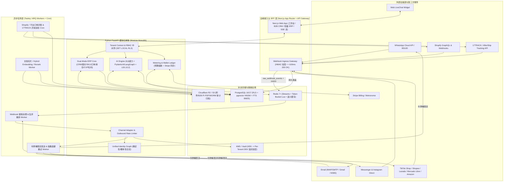
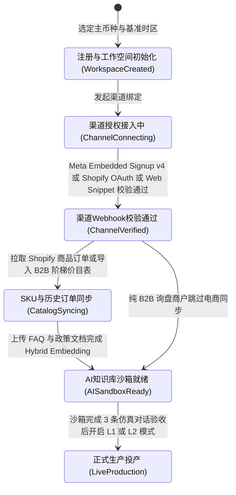
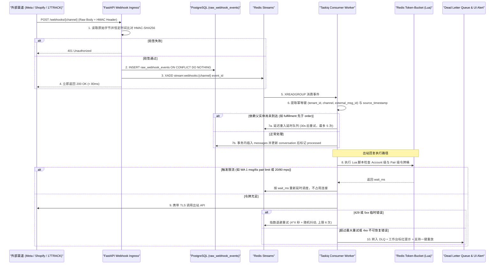
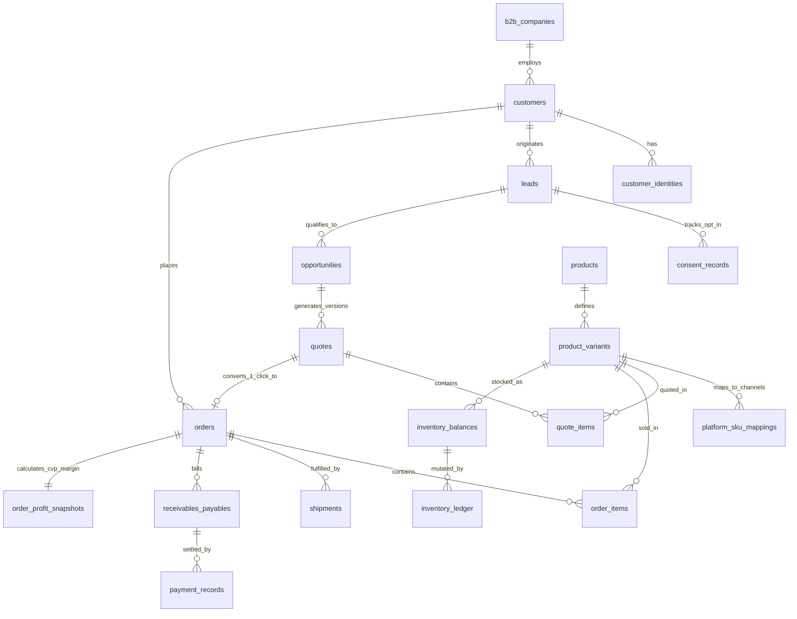
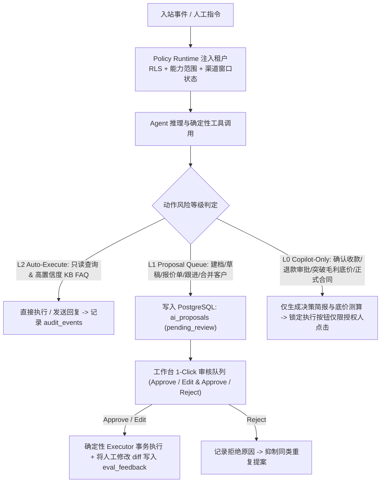

# 多租户 B2C 跨境零售 + B2B 外贸询盘双模全渠道 AI 工作台与轻量 ERP 技术架构规范

> **文档定位**：本文档为商业化多租户 SaaS 平台（灵感源于 Nova ERP 并按现代云原生 SaaS 标准重构）的端到端生产级技术架构规范，面向 **1–3 人 AI 增强全栈研发团队**，覆盖技术栈选型、多租户隔离与自助接入、零丢消息全渠道适配层与统一客户身份图谱、B2C/B2B 双模轻量 ERP 领域模型、以及基于 L0/L1/L2 治理与严格工具接地（Tool-Grounded）的生产级 AI 引擎与商业化计费体系。
>
> **价格与平台政策核验基准日期**：2026 年 11 月（文中所有 LLM API、物流追踪 API、计费与渠道策略均核验并内联引用官方最新文档）。

---

## 0. 全局系统拓扑与核心架构原则

### 0.1 全局系统架构图



### 0.2 六项不可妥协的架构铁律

1. **模块化单体优先于过早微服务**：1–3 人团队禁止在业务边界尚未稳定时拆分十余个 RPC 微服务；通过单仓（Monorepo）下的强制模块隔离（`import-linter`）+ 独立进程部署（API Server + Async Workers），同时获得单体开发速度与水平扩展能力。
2. **默认拒绝（Fail-Closed）的数据库级多租户隔离**：不依赖应用层开发人员“记得写 `WHERE tenant_id = ?`”，而由 PostgreSQL 原生 **Row-Level Security (`RLS`)** 结合事务作用域 `SET LOCAL` 兜底。
3. **零丢消息（Zero-Message-Loss）的异步入站管道**：任何外部 Webhook 必须在验签后先落盘原始事件，再在 `< 100ms` 内返回 `HTTP 200`，绝不在请求生命周期内同步调用 LLM 或第三方出站 API。
4. **B2C 与 B2B 共核而分态**：共享同一个客户身份图谱、商品主数据与库存流水账本（`inventory_ledger`），仅在报价（MOQ/Incoterm/FX 锁汇）、履约模式（`order_mode`）和分期收款（定金+尾款）上显式分支。
5. **工具接地（Tool-Grounded）与 L0/L1/L2 分级自治**：所有价格、库存、物流轨迹、订单金额**严禁从静态向量库（RAG）检索生成**，必须来自实时确定性 SQL 工具；涉及资金、折扣底线、外部发送的高风险动作强制进入 `ai_proposals` 人工一键审批流（L1）或副驾驶辅助（L0）。
6. **单元经济可验证（>70% 毛利率）**：通过语义缓存 + 四层模型路由 + 内部原子钱包预扣（`credit_wallets`），防止异常租户流量或死循环拖垮 SaaS 平台毛利。

---

## 1. 仓库与技术栈蓝图（1–3 人 AI 增强团队）

### 1.1 三大主流技术栈方案对比

| 评估维度 | Option A（推荐）：Next.js (TS) + Python FastAPI 模块化单体 + Taskiq/ARQ | Option B：全栈 TypeScript (Next.js + Fastify/Hono + BullMQ + Vercel AI SDK) | Option C：Go (Gin/Fiber + sqlc + Asynq) + React/Next.js |
| :--- | :--- | :--- | :--- |
| **AI 生态与 Agent 编排成熟度** | **极强**。原生支持 PydanticAI / LangGraph、`litellm`、Cross-Encoder Reranker、`docling`/`pypdf` 多模态文档解析，AI 编程助手生成 Python Agent 代码准确率最高 | **中强**。Vercel AI SDK 与 Mastra/LangGraph.js 进步快，但复杂 PDF 解析、表格抽取、多模态 Rerank 与量化/评估工具链仍明显弱于 Python | **弱**。缺乏成熟的 Agent 状态机与文档解析生态，往往仍需外挂 Python Sidecar，反而增加跨语言运维负担 |
| **B2B 文档与财务计算精确性** | **强**。原生 `Decimal` 高精度财务与汇兑计算；`WeasyPrint` / `ReportLab` 生成高质量多语言 B2B 形式发票（PI）/报价单 PDF | **中**。JS `number` 存在浮点精度隐患（需全程强制 `decimal.js`/`BigInt`），无头浏览器 Puppeteer/Playwright 生成 PDF 内存开销大 | **强**。Go 并发和类型安全优秀，但 HTML→PDF 模板与快速迭代业务报表不如 Python/JS 生态灵活 |
| **全渠道工作台前端体验** | **极强**。Next.js App Router + React 19 + TanStack Query + shadcn/ui 提供极致的收件箱虚拟列表、Optimistic UI、SSE 流式渲染 | **极强**。前后端共用 Zod Schema，无需跨语言代码生成 | **极强**。与 Option A 前端一致 |
| **跨边界类型安全（Schema Drift 防护）** | **强（自动化零漂移）**。FastAPI 基于 Pydantic v2 自动导出严格 OpenAPI 3.1 规范，CI 自动通过 `@hey-api/openapi-ts` 或 `orval` 生成 TS 客户端与 TanStack Query Hooks | **原生共享**。tRPC / Hono RPC 直接共享 TS 类型，零序列化边界 | **中强**。需维护 Protobuf 或 OpenAPI yaml 手工/半自动生成，开发流略重 |
| **1–3 人团队构建与调试效率** | **最优平衡**。UI 与 BFF 鉴权交由 TS，核心 ERP 领域逻辑与 AI 引擎收敛在单一 Python 包中；结构化日志 + OpenTelemetry 全链路追踪清晰 | **高（纯 Web 场景）**。但一旦遇到 B2B PDF 报价、文档 OCR/表格解析、复杂 RAG 评估，会被迫引入 Python 服务从而变成分布式系统 | **较低**。Go 写复杂动态业务表单和 AI Prompt 编排的模板代码量偏多，削弱小团队“周级交付”速度 |
| **单机垂直扩展与并发模型** | FastAPI (`uvicorn` + `uvloop` + `asyncpg`) 处理高并发 I/O Webhook 极快；CPU 密集型（PDF 渲染/OCR）直接丢给 Taskiq Worker 进程 | Node.js 单线程事件循环容易被大型 JSON/HTML 清洗或同步解析阻塞，需额外拆分 Worker Threads | 内存与 CPU 效率最高，但 1–3 人团队很少在早期遇到 Go vs Python 异步 I/O 的算力瓶颈 |

### 1.2 架构推荐结论与精确边界划分

**最终推荐：Option A —— Next.js (App Router, TypeScript) + Python FastAPI 模块化单体 + Taskiq Workers + PostgreSQL 16/17 + Redis 7+ + Cloudflare R2**。

**精确职责切分（防止“双后端混乱”）**：
* **Next.js (TypeScript) 仅做两件事**：
  1. **前端工作台与 SSR/RSC 外壳**：全渠道收件箱、B2B 报价单编辑器、订单/利润看板、AI 提案审核队列（L1 Proposal Queue），以及嵌入式 Web LiveChat Widget 宿主。
  2. **极薄的 BFF 代理与会话层（Auth/Session Edge）**：管理浏览器 Cookie/JWT 会话（Clerk / Auth.js / Supabase Auth）、CSP 安全头，并将业务 API 请求与 SSE 流透传给 FastAPI（或由客户端携带短期 JWT 直连 FastAPI SSE 端点）。**禁止在 Next.js Route Handlers 中编写任何 SQL 查询或 ERP 业务规则**。
* **Python FastAPI 承担全部业务领域核心与 AI 引擎**：
  1. **API Service (`apps/api`)**：Webhook 接入网关、多租户上下文注入、全部 REST/SSE 业务 API、OpenAPI 3.1 契约唯一真相源（Single Source of Truth）。
  2. **Async Workers (`apps/worker`)**：基于 **Taskiq**（原生全异步 `async/await`、支持 Redis Streams Broker、依赖注入与 FastAPI 复用同一套 Pydantic 模型与 SQLAlchemy/asyncpg 会话，比 Celery 更轻量且无同步阻塞包袱）运行消息入库、限流发送、RAG 索引、物流巡检与对账任务。

> **为什么放弃 Option B（全栈 TypeScript）？**
> 跨境外贸与 AI 工作台的核心护城河在于：**多格式 B2B 询盘附件解析（Excel BOM 表/PDF 规格书/图片 OCR）、高精度多币种汇兑与毛利计算（`Decimal`）、Hybrid RAG + Cross-Encoder Rerank、以及稳定可靠的 Agent Tool Runtime**。Python 在这四个点上的生态密度让 1–3 人团队减少约 40% 的胶水代码；而前端与后端之间通过 `OpenAPI 3.1 -> @hey-api/openapi-ts` 自动生成的 TS SDK，配合 AI 编码工具，几乎消除了跨语言沟通成本。

### 1.3 Monorepo 目录结构与零漂移契约流水线

```text
erp-saas/
├── pnpm-workspace.yaml
├── pyproject.toml                   # uv workspace root (Python 3.12+)
├── apps/
│   ├── web/                         # Next.js App Router (TypeScript)
│   │   ├── src/app/                 # 工作台 / B2B CRM / ERP / 财务看板路由
│   │   ├── src/lib/api-client/      # [自动生成] 由 openapi-ts 生成，禁止手改
│   │   └── src/components/
│   ├── widget/                      # 独立打包的 Web LiveChat <script> (<35KB gzipped)
│   └── backend/                     # Python FastAPI 模块化单体 + Taskiq Workers
│       ├── pyproject.toml
│       ├── alembic/                 # 数据库迁移 + RLS Policy 版本管理
│       └── src/erp_core/
│           ├── shared/              # DB Pool (RLS), KMS Crypto, Redis, Telemetry
│           ├── tenancy/             # 租户、RBAC、自助入驻状态机、审计日志
│           ├── channels/            # WA / Meta / Email / TikTok / Shopify 适配器
│           ├── identity/            # 统一客户图谱、确定性/概率性合流与拆分
│           ├── crm/                 # Leads, Opportunities, Quotes, PI PDF 生成
│           ├── catalog/             # 主数据商品、多平台 SKU 映射、阶梯价目表
│           ├── orders/              # 双模订单、原子库存流水账、17TRACK 物流追踪
│           ├── finance/             # 应收应付、B2B 定金尾款、CVP 订单毛利快照
│           ├── ai_engine/           # 6 大 AI 能力、Tool Runtime、Hybrid RAG、L1 提案
│           ├── billing/             # 内部钱包账本 + Stripe Billing Meters 同步
│           ├── api_main.py          # FastAPI 入口
│           └── worker_main.py       # Taskiq Worker & Scheduler 入口
├── contracts/
│   └── openapi.json                 # CI 校验：后端修改 Schema 后必须同步刷新
└── infra/
    ├── docker-compose.yml           # 本地一键启动 PG17(pgvector) + PgBouncer + Redis
    └── importlinter.ini             # 强制模块边界校验，防止跨模块循环依赖
```

**AI 增强团队契约防漂移机制（CI 门禁）**：
1. 后端修改任何 Pydantic v2 Request/Response Model 后，运行 `uv run python scripts/export_openapi.py > contracts/openapi.json`。
2. 紧接着运行 `pnpm --filter web openapi-ts`（使用 `@hey-api/openapi-ts` 或 `orval`），自动生成全量 TypeScript 类型定义与 TanStack Query v5 Hooks。
3. GitHub Actions CI 在 PR 阶段校验 `git diff --exit-code contracts/openapi.json apps/web/src/lib/api-client/`，确保前端永远基于编译期类型安全调用后端。
4. 使用 `import-linter` 在 CI 强制检查模块化单体边界（例如：`erp_core.channels` 只能通过公开 Service 接口或 Domain Event 与 `erp_core.orders` 交互，禁止直接 `import` 对方的 ORM Table）。

**何时才允许拆出独立服务（反过早微服务准则）**：
* **允许独立进程的信号**：某个模块出现极端 CPU/GPU 隔离需求（如本地跑大型文档版面分析模型或大规模批量导出），优先将其拆为独立的 **Taskiq Worker Pool**（共享代码库与数据库，仅换容器镜像），而非重构为 REST/gRPC 微服务。
* **允许拆服务（Service Extraction）的信号**：仅当单库写入吞吐超过 PostgreSQL 单主节点上限（> 20,000 TPS）、或核心团队规模突破 15–20 人出现提交阻塞时，首先拆出无状态高吞吐的 **Webhook Ingress Gateway**。

---

## 2. 多租户安全、隔离与自助接入架构

### 2.1 PostgreSQL Row-Level Security (`RLS`) 生产级实现

参照 [PostgreSQL 官方行级安全策略文档](https://www.postgresql.org/docs/current/ddl-rowsecurity.html)，所有包含业务数据的表都必须强制开启 `RLS`，且必须防范两大经典生产坑：**表所有者绕过（Owner Bypass）** 与 **连接池会话变量污染（PgBouncer Leakage）**。

#### A. 角色隔离与 Fail-Closed DDL 规范

```sql
-- 1. 严格分离迁移角色与运行时角色（运行时角色绝对禁止 SUPERUSER 或 BYPASSRLS）
CREATE ROLE app_migrator NOINHERIT LOGIN PASSWORD '...'; -- 仅用于 Alembic DDL 迁移
CREATE ROLE app_runtime NOINHERIT LOGIN PASSWORD '...';  -- FastAPI 与 Taskiq 专用

-- 2. 所有业务表标配租户列 + 强制 RLS（FORCE 确保即使表 owner 也不绕过，且默认拒绝空值）
CREATE TABLE orders (
    id UUID PRIMARY KEY DEFAULT gen_random_uuid(),
    tenant_id UUID NOT NULL REFERENCES tenants(id),
    order_no TEXT NOT NULL,
    order_mode TEXT NOT NULL CHECK (order_mode IN ('b2c_retail', 'b2b_sample', 'b2b_wholesale')),
    -- ... 其他字段 ...
    created_at TIMESTAMPTZ NOT NULL DEFAULT now()
);

-- 索引必须以 tenant_id 作为前导列，确保 RLS 谓词下推走 Index Scan
CREATE UNIQUE INDEX uq_orders_tenant_order_no ON orders (tenant_id, order_no);
CREATE INDEX idx_orders_tenant_created ON orders (tenant_id, created_at DESC);

ALTER TABLE orders ENABLE ROW LEVEL SECURITY;
ALTER TABLE orders FORCE ROW LEVEL SECURITY;

-- 3. Fail-Closed 策略：当 app.current_tenant_id 未设置或为空字符串时，NULLIF 返回 NULL，
--    tenant_id = NULL 结果为 UNKNOWN（等价 FALSE），强制零行返回且拒绝写入！
CREATE POLICY tenant_isolation_policy ON orders
    AS RESTRICTIVE
    FOR ALL
    TO app_runtime
    USING (tenant_id = NULLIF(current_setting('app.current_tenant_id', true), '')::uuid)
    WITH CHECK (tenant_id = NULLIF(current_setting('app.current_tenant_id', true), '')::uuid);
```

#### B. PgBouncer Transaction Pooling 安全性（事务级 `SET LOCAL`）

在 SaaS 生产环境中，FastAPI 与数百个 Taskiq Worker 并发连接 PostgreSQL，通常前置 PgBouncer（Transaction Pooling 模式）。若使用普通 `SET app.current_tenant_id = '...'`，该连接归还池子后变量仍残留，下一个租户复用该物理连接将发生**灾难性跨租户数据泄露**。

**强制规约**：必须使用事务作用域 `set_config(..., is_local=true)`（等价于 `SET LOCAL`），该变量随 `COMMIT` 或 `ROLLBACK` 自动销毁：

```python
# src/erp_core/shared/db.py
from contextlib import asynccontextmanager
from uuid import UUID
from sqlalchemy.ext.asyncio import AsyncSession, async_sessionmaker
from sqlalchemy import text

@asynccontextmanager
async def tenant_session(
    session_factory: async_sessionmaker[AsyncSession],
    tenant_id: UUID,
):
    """获取绑定事务级 RLS 上下文的数据库会话，兼容 PgBouncer Transaction Pooling。"""
    async with session_factory() as session:
        async with session.begin():
            # 第三个参数 true 表示 is_local = true，事务结束即自动清除
            await session.execute(
                text("SELECT set_config('app.current_tenant_id', :tid, true)"),
                {"tid": str(tenant_id)},
            )
            yield session
```

> **系统级管理任务例外**：Webhook 验签后查找“该店铺/WABA 归属哪个 `tenant_id`”时，仅允许通过一个极窄的、受 `SECURITY DEFINER` 保护且只读路由索引表的存储过程 `resolve_tenant_by_channel_external_id(channel_type, external_id)` 完成，或者由无业务数据的全局路由表 `channel_routing_directory`（不存任何消息/客户 PII）完成，严禁赋予应用池 `BYPASSRLS` 权限。

### 2.2 信封加密（Envelope Encryption）保护第三方凭据与 BYOK 密钥

商家在平台内托管了极高价值的资产：Meta 永久 System User Token、Shopify Offline Access Token、TikTok Shop / Amazon SP-API 密钥、企业邮箱 IMAP/SMTP 密码或 OAuth Refresh Token、以及租户自带的富化/LLM API Key（BYOK）。

采用 **KMS Master Key (KEK) + Per-Tenant Data Encryption Key (DEK)** 两层信封加密：


```sql
CREATE TABLE tenant_keys (
    tenant_id UUID PRIMARY KEY REFERENCES tenants(id),
    kek_key_arn TEXT NOT NULL,                 -- KMS 主密钥 ID / 版本
    encrypted_dek BYTEA NOT NULL,              -- KMS 加密后的 256-bit DEK
    key_version INT NOT NULL DEFAULT 1,
    rotated_at TIMESTAMPTZ NOT NULL DEFAULT now()
);

CREATE TABLE channel_credentials (
    id UUID PRIMARY KEY DEFAULT gen_random_uuid(),
    tenant_id UUID NOT NULL REFERENCES tenants(id),
    channel_account_id UUID NOT NULL,
    credential_type TEXT NOT NULL,             -- 'oauth_token' | 'imap_password' | 'byok_api_key'
    ciphertext BYTEA NOT NULL,                 -- AES-256-GCM 密文
    nonce BYTEA NOT NULL,                      -- 96-bit 随机 IV
    auth_tag BYTEA NOT NULL,                   -- 128-bit GCM 认证标签
    key_version INT NOT NULL,
    expires_at TIMESTAMPTZ,
    updated_at TIMESTAMPTZ NOT NULL DEFAULT now()
);
```

* **防混淆代理解密（AAD 绑定）**：加解密 AES-256-GCM 时必须传入 Associated Authenticated Data (`AAD = f"{tenant_id}:{channel_account_id}:{credential_type}"`)，即便有人篡改数据库记录把 A 租户的密文复制到 B 租户行中，GCM 标签校验也会立即报错拒绝。
* **密钥轮转与租户一键注销（Crypto-Shredding）**：DEK 在应用内存 LRU 缓存中 TTL 最多 5 分钟；当租户触发账号注销（GDPR `shop/redact`）时，除了物理删表，直接销毁其 `tenant_keys` 记录并通知 KMS 撤销解密权限，令所有历史备份中的密文瞬间永久不可读。

### 2.3 自助入驻状态机（Self-Serve Onboarding）与 RBAC

#### A. 商户自助入驻状态机



三大核心自助接入链路规范：
1. **Meta Embedded Signup v4（WhatsApp + Messenger + IG 一站式授权）**：遵循 Meta 2025 年 12 月发布的 [Embedded Signup v4 规范](https://developers.facebook.com/blog/post/2025/12/03/simplify-business-onboarding-with-embedded-signup-v4)，商户在前端弹窗内单次完成 Facebook Login + WABA 创建/绑定 + 号码验证 + Page/IG 权限授予；回调换取短期 `code` 后在后端置换长效 Token，自动调用 `POST /{waba_id}/subscribed_apps` 订阅 Webhook 并开启 mTLS/HMAC 验证，全程无需商户手动复制 App Secret。
2. **Shopify App OAuth + GraphQL Admin API**：依据 [Shopify Webhook 开发指南](https://shopify.dev/docs/api/admin-rest/latest/resources/webhook)，自 2025 年 4 月起新公开应用强制全面使用 **GraphQL Admin API**，并通过 `shopify.app.toml` 声明应用级订阅（含强制合规主题 `customers/data_request`、`customers/redact`、`shop/redact`）。OAuth 完成后立即触发首次 Shopify Bulk Operation 全量同步 SKU 与近 90 天订单。
3. **Web LiveChat Widget**：生成租户专属 `site_key` 与轻量脚本标签；配置 `allowed_origins` 域名白名单，前端访客连接时由服务端签发短期匿名访客 JWT（支持后续登录后无感升级身份）。

#### B. 团队 RBAC 权限矩阵

采用**角色为基础（RBAC）+ 细粒度敏感动作策略**，支持 5 个预置商业角色：

| 权限域 / 关键动作 | `Owner`（企业主） | `Admin`（系统管理员） | `Manager`（业务主管） | `Agent`（客服/外贸业务） | `Finance`（财务） |
| :--- | :---: | :---: | :---: | :---: | :---: |
| 租户计费、套餐升级、API/KMS 注销 | ✅ | ❌ | ❌ | ❌ | 仅查看账单 |
| 渠道连接、凭据管理、成员邀请与角色分配 | ✅ | ✅ | ❌ | ❌ | ❌ |
| 客户完整 PII 查看（明文电话/邮箱导出） | ✅ | ✅ | ✅ | 仅工作台脱敏/回复，禁止批量导出 | 仅账单必要字段 |
| B2B 报价单/PI 创建与发送（高于底价） | ✅ | ✅ | ✅ | 需走 L1 审批或自建草稿 | ❌ |
| 突破毛利底线特批折扣 / 手动改价 | ✅ | ✅ | ✅（限额度内） | ❌ | ❌ |
| AI 治理级别配置（开启 L2 自动回复/L1 规则） | ✅ | ✅ | ✅ | ❌ | ❌ |
| AI `ai_proposals` 提案队列审核（批准/拒绝） | ✅ | ✅ | ✅ | ✅（限本人会话/线索） | 仅财务对账提案 |
| 订单退款、B2B 定金/尾款到账核销 | ✅ | ✅ | 限小额退款 | ❌ | ✅ |
| 订单真实净毛利看板（COGS + 净利） | ✅ | ✅ | ✅（可按部门隐藏成本） | ❌（隐藏进货成本） | ✅ |
| 审计日志查询与 GDPR 导出执行 | ✅ | ✅ | ❌ | ❌ | 仅财务审计 |

### 2.4 不可篡改审计日志与 GDPR 合规级联工作流

1. **审计日志表（`audit_events`）**：记录所有关键人工与 AI 动作，特别是 **AI 提案自动/人工执行、B2B 报价单发出、高敏感 PII 导出、折扣越权特批、退款核销**。
   ```sql
   CREATE TABLE audit_events (
       id BIGINT GENERATED ALWAYS AS IDENTITY,
       tenant_id UUID NOT NULL,
       actor_type TEXT NOT NULL CHECK (actor_type IN ('human_user', 'ai_agent', 'system_cron', 'webhook')),
       actor_id TEXT NOT NULL,                    -- user_id 或 capability_name + model_id
       action TEXT NOT NULL,                      -- e.g. 'quote.sent', 'pii.exported', 'proposal.approved'
       resource_type TEXT NOT NULL,
       resource_id UUID NOT NULL,
       proposal_id UUID,                          -- 若由 AI 提案触发，关联 ai_proposals.id
       before_state JSONB,
       after_state JSONB,
       ip_address INET,
       user_agent TEXT,
       created_at TIMESTAMPTZ NOT NULL DEFAULT now(),
       PRIMARY KEY (tenant_id, id)
   ) PARTITION BY RANGE (created_at);
   ```
   * **权限约束**：仅授予 `app_runtime` 对 `audit_events` 的 `INSERT` 与 `SELECT` 权限，**严禁 `UPDATE` 和 `DELETE`**；按月自动分区，超过 180 天的冷分区导出 Parquet 归档至启用 Object Lock (WORM) 的 Cloudflare R2 / S3 桶。
2. **GDPR 导出与删除级联工作流（含 Shopify Mandatory Compliance Webhooks）**：
   * **`customers/data_request`（导出）**：异步聚合 `customers`、`customer_identities`、`conversations`、`messages`、`quotes`、`orders`，生成签名 JSON/ZIP 写入 R2 临时路径（7 天过期），生成审计记录后通知租户管理员交付买家。
   * **`customers/redact`（买家删除）**：触发匿名化级联——将 `customers` 姓名/手机/邮箱覆写为 `REDACTED_<hash>`，删除 `customer_identities` 外部 ID 与消息正文中的 PII 附件，**但保留脱敏后的 `orders` 与 `order_profit_snapshots` 数值金额及发票编号**，同时满足 GDPR 被遗忘权与财税账务连续性。
   * **`shop/redact`（商户卸载 48 小时后或租户注销）**：异步分批删除全部业务表数据，销毁 `tenant_keys` 中的 DEK（Crypto-Shredding），并异步清除 `pgvector` 知识库切片与 R2 文件对象。

---

## 3. 全渠道适配层、Webhook 幂等管道与统一身份图谱

### 3.1 规范化统一消息与会话模型（Unified Message & Conversation Model）

不同海外渠道在回复窗口、标签规则、内容格式与平台风控上差异极大。系统在内部统一抽象出 `conversations` 与 `messages`，同时通过 `channel_policy_state JSONB` 与强校验状态机封住各渠道合规定律红线：

```sql
CREATE TABLE channel_accounts (
    id UUID PRIMARY KEY DEFAULT gen_random_uuid(),
    tenant_id UUID NOT NULL,
    channel_type TEXT NOT NULL CHECK (channel_type IN (
        'whatsapp_cloud', 'messenger', 'instagram_dm', 'email',
        'tiktok_shop', 'shopee', 'lazada', 'mercado_libre', 'amazon_sp', 'web_livechat'
    )),
    external_account_id TEXT NOT NULL,         -- WABA Phone Number ID / FB Page ID / Shop ID
    display_name TEXT NOT NULL,
    status TEXT NOT NULL CHECK (status IN ('active', 'token_expired', 'rate_limited', 'disconnected')),
    rate_limit_profile JSONB NOT NULL,         -- e.g. {"mps": 80, "coexistence": false}
    created_at TIMESTAMPTZ NOT NULL DEFAULT now(),
    UNIQUE (tenant_id, channel_type, external_account_id)
);

CREATE TABLE conversations (
    id UUID PRIMARY KEY DEFAULT gen_random_uuid(),
    tenant_id UUID NOT NULL,
    customer_id UUID NOT NULL,
    channel_account_id UUID NOT NULL REFERENCES channel_accounts(id),
    channel_type TEXT NOT NULL,
    external_thread_id TEXT,                   -- Email Subject/Thread Hash, Marketplace Session ID
    conversation_mode TEXT NOT NULL CHECK (conversation_mode IN ('b2c_support', 'b2b_inquiry', 'mixed')),
    status TEXT NOT NULL CHECK (status IN ('open', 'pending_human', 'snoozed', 'resolved')),
    assigned_user_id UUID,
    ai_autonomy_override TEXT CHECK (ai_autonomy_override IN ('L0_copilot', 'L1_proposal', 'L2_auto')),
    -- 核心渠道合规窗口状态：
    csw_expires_at TIMESTAMPTZ,                -- 24h 标准客服窗口截止时间 (WA / Messenger / IG)
    human_agent_window_expires_at TIMESTAMPTZ, -- 7 天 HUMAN_AGENT 标签截止时间 (Messenger / IG)
    sla_due_at TIMESTAMPTZ,                    -- 平台考核响应截止时间 (Shopee/TikTok/Amazon)
    last_inbound_at TIMESTAMPTZ,
    last_outbound_at TIMESTAMPTZ,
    unread_count INT NOT NULL DEFAULT 0,
    updated_at TIMESTAMPTZ NOT NULL DEFAULT now()
);

CREATE TABLE messages (
    id UUID PRIMARY KEY DEFAULT gen_random_uuid(),
    tenant_id UUID NOT NULL,
    conversation_id UUID NOT NULL REFERENCES conversations(id),
    channel_type TEXT NOT NULL,
    external_message_id TEXT,                  -- 幂等键：WA wamid / Email Message-ID / Shopify Event ID
    direction TEXT NOT NULL CHECK (direction IN ('inbound', 'outbound', 'internal_note')),
    sender_type TEXT NOT NULL CHECK (sender_type IN ('customer', 'human_agent', 'ai_agent', 'system')),
    sender_id TEXT,
    content_type TEXT NOT NULL CHECK (content_type IN ('text', 'rich_html', 'template', 'media', 'quote_card', 'order_card')),
    body_text TEXT,
    body_sanitized_html TEXT,                  -- Email 经白名单净化后的安全 HTML
    attachments JSONB NOT NULL DEFAULT '[]',   -- [{"r2_key": "...", "mime": "...", "size": 1234}]
    channel_metadata JSONB NOT NULL DEFAULT '{}', -- 存储模板名、Message Tag、RFC5322 headers 等
    delivery_status TEXT NOT NULL CHECK (delivery_status IN ('queued', 'sent', 'delivered', 'read', 'failed')),
    source_timestamp TIMESTAMPTZ NOT NULL,     -- 渠道原生时间戳（防乱序）
    created_at TIMESTAMPTZ NOT NULL DEFAULT now()
);

CREATE UNIQUE INDEX uq_messages_idempotency
    ON messages (tenant_id, channel_type, external_message_id)
    WHERE external_message_id IS NOT NULL;
```

#### 五大渠道适配规则与 2026 年最新合规约束

1. **WhatsApp Cloud API**：
   * **24 小时客服窗口（CSW）与 2026 年计费新规**：依据 [Meta WhatsApp 官方定价文档](https://developers.facebook.com/documentation/business-messaging/whatsapp/pricing) 与 [计费变更公告](https://developers.facebook.com/documentation/business-messaging/whatsapp/pricing/deprecated)，客户发消息或来电会开启/刷新 24 小时 CSW。窗口内发送**非模板自由回复（`text`/`image`）免费**；**窗口外只能发送经审核的模板消息（Template Message）**；且**自 2026 年 10 月 1 日起，即使在 24 小时 CSW 内发送 Utility（交易通知类）模板消息，也不再免除费用（由 `free_customer_service` 转为 `regular` 按条计费）**。因此，出站路由器在 `csw_expires_at > now()` 时默认强制优先走自由非模板消息以替商家省钱，仅在窗口过期或明确触发营销/通知模板时才允许发送模板并精确计入 `channel_msg_cost`。
   * **BSUID（Business-Scoped User ID）兼容**：依据 [Meta WhatsApp Webhooks 文档](https://developers.facebook.com/docs/whatsapp/cloud-api/guides/set-up-webhooks#available-webhooks)，当 WhatsApp 用户启用用户名隐私保护时，Webhook 负载中 `wa_id` 和 `from` 手机号字段可能被省略，取而代之的是 `user_id` / `from_user_id` 中的 **BSUID**。适配器必须优先解析并持久化 `bsuid`，不能假设 WhatsApp 消息必然携带明文手机号。
2. **Messenger 与 Instagram Direct**：
   * **24 小时窗口 + 7 天 `HUMAN_AGENT` 标签与 2026 年标签弃用**：依据 [Meta Messenger Send API 文档](https://developers.facebook.com/docs/messenger-platform/reference/send-api%23limits)，**自 2026 年 4 月 27 日起，Meta 正式废弃 `CONFIRMED_EVENT_UPDATE`、`ACCOUNT_UPDATE`、`POST_PURCHASE_UPDATE` 三个 Message Tag（调用直接报 Error Code 100）**。目前跨越 24 小时窗口的合规通道主要仅剩 **`HUMAN_AGENT`**（最长延展至 **7 天**，同时适用于 Messenger 与 Instagram Messaging API）。
   * **架构强约束**：系统强制规定 `HUMAN_AGENT` 标签**严禁用于 AI 自动营销或 AI 主动催单**，仅当 `sender_type == 'human_agent'` 且距离 `last_inbound_at <= 7 days` 时才允许出站携带该标签，避免租户 Facebook Page/IG 账号被 Meta 封禁。
3. **Email（IMAP/SMTP、Gmail API、Microsoft Graph、Amazon SES/Resend）**：
   * **RFC 5322 精准归并**：提取 `Message-ID`、`In-Reply-To` 与 `References` 头部链条；按 `References` 根 ID → `In-Reply-To` → 清洗主题前缀（`Re:`/`Fwd:`）+ 收发件人邮箱匹配 `conversations`。
   * **安全净化与附件隔离**：使用 `nh3`（Rust 底层的高速 Python HTML 净化器）剥离 `<script>`、`<iframe>`、危险 CSS 和外链追踪像素（替换为后台按需代理加载），所有附件流式直传 R2 隔离前缀并执行 MIME 魔数与 ClamAV/病毒扫描后才允许在前端预览。
4. **跨境平台客服（TikTok Shop / Shopee / Lazada / Mercado Libre / Amazon SP-API）**：
   * 强绑定 `platform_order_id` 或 `item_id`，严格遵守平台**站外引流违禁词风控**（Outbound Filter 在发出前自动正则+小模型检测是否包含 WhatsApp 号码、私人邮箱、`wa.me`、外部独立站链接，命中则拦截并提醒人工修改，防止店铺被平台判定“导流违规”扣分封店）。
   * 自动维护 `sla_due_at`（例如 Shopee 12h/24h 聊聊回复考核倒计时），在工作台按 SLA 紧迫度置顶排序。
5. **Web LiveChat**：
   * 访客首次加载生成绑定在 `localStorage` + Signed Anonymous Token 的会话；一旦买家在表单填写邮箱/手机号或登录独立站，前端调用 `widget.identify(hmac_payload)` 将匿名会话无缝归并到客户图谱。

### 3.2 零丢消息管道（Zero-Message-Loss Pipeline）

根据官方 SLA 规范：
* **Shopify**：要求 Webhook 端点 **5 秒内返回 `200 OK`**，失败在 4 小时内指数退避重试 8 次后自动删除 Admin API 订阅；且 Shopify 明确声明 [Webhook 投递不保证 100% 不丢](https://community.shopify.dev/t/webhooks-retry-after-an-error/24625)，必须配套定时对账任务。
* **Meta WhatsApp Cloud API**：Webhook 负载最大 3MB，失败后**指数退避重试长达 7 天**，且官方要求服务器具备 **3 倍出站状态回执 + 1 倍入站消息** 的并发吞吐能力，要求**中位延迟 `<= 250ms`、超过 1s 比例 `< 1%`**（[Meta Throughput 文档](https://developers.facebook.com/documentation/business-messaging/whatsapp/throughput)）。
* **Meta Messenger/IG**：要求 **5 秒内返回 `200 OK`**，连续失败 1 小时触发自动退订（[Meta Messenger Webhooks](https://developers.facebook.com/documentation/business-messaging/messenger-platform/webhooks.md)）。



**关键防线细则**：
* **7 天重试风暴（Duplicate Storm）防御**：当系统短时升级或上游抖动恢复后，Meta 可能瞬间投递积压数日的重放脉冲。`raw_webhook_events` 表以 `(channel_type, external_event_id)` 为主键执行 `ON CONFLICT DO NOTHING`，在到达 Worker 前即在微秒级丢弃重复脉冲，并由 `messages` 唯一索引提供第二道数据库事务兜底。
* **WhatsApp Pair Rate Limit 与账号并发双重令牌桶**：依据 [Meta Pair Rate Limits 规范](https://developers.facebook.com/documentation/business-messaging/whatsapp/about-the-platform)，业务号码对**同一终端用户**默认速率为 **每 6 秒 1 条消息（`0.17 mps`）**，支持 6 秒内突发最多 45 条（预支后续配额，超限报错 `131056`）；全账号默认 `80–1,000+ mps`（手机 App 共存号码锁定 **`20 mps`**，超限报错 `130429`）。Redis Lua 原子脚本同时校验 `bucket:wa_acct:{phone_id}` 与 `bucket:wa_pair:{phone_id}:{recipient_id}`，并在收到 `131056`/`130429` 时严格按 Meta 建议的 **`4^X` 秒** 指数退避，防止封号降级（Quality Rating 跌入 Red）。
* **Shopify & 平台周期性对账（Reconciliation Cron）**：每 15 分钟通过 Taskiq Cron 拉取最近 `updated_at` 窗口的 Shopify GraphQL Orders/Fulfillments 以及电商平台站内信列表，与本地 `raw_webhook_events` 比对补漏，彻底消除 Webhook 静默丢失风险。

### 3.3 统一客户身份图谱（Unified Customer Identity Graph）

跨境业务同时面临 B2C 碎片化身份（同一个买家在 Shopify 下单用邮箱，在 WhatsApp 催单用手机号，在 IG 咨询用 PSID）与 B2B 采购组织身份（同一个公司多名采购员通过邮件和 WhatsApp 联系）。

```sql
CREATE TABLE customers (
    id UUID PRIMARY KEY DEFAULT gen_random_uuid(),
    tenant_id UUID NOT NULL,
    customer_type TEXT NOT NULL CHECK (customer_type IN ('b2c_consumer', 'b2b_contact', 'b2b_company_rep')),
    company_id UUID REFERENCES b2b_companies(id), -- B2B 归属企业实体
    display_name TEXT NOT NULL,
    primary_email TEXT,
    primary_phone_e164 TEXT,                   -- 经 libphonenumber 标准化为 +14155552671
    preferred_language TEXT DEFAULT 'en',
    iana_timezone TEXT,                        -- e.g. 'America/New_York', 'Europe/Berlin'
    timezone_source TEXT,                      -- 'phone_prefix' | 'shipping_country' | 'manual'
    lifecycle_stage TEXT NOT NULL DEFAULT 'lead',
    ltv_usd NUMERIC(14, 2) NOT NULL DEFAULT 0,
    merged_into_customer_id UUID REFERENCES customers(id), -- 非空表示已被合流重定向
    created_at TIMESTAMPTZ NOT NULL DEFAULT now()
);

CREATE TABLE customer_identities (
    id UUID PRIMARY KEY DEFAULT gen_random_uuid(),
    tenant_id UUID NOT NULL,
    customer_id UUID NOT NULL REFERENCES customers(id),
    identity_type TEXT NOT NULL CHECK (identity_type IN (
        'email', 'phone_e164', 'whatsapp_waid', 'whatsapp_bsuid',
        'ig_psid', 'fb_psid', 'shopify_customer_id',
        'tiktok_buyer_id', 'amazon_buyer_email', 'web_visitor_id'
    )),
    identity_value TEXT NOT NULL,              -- 标准化值（邮箱小写去空格、手机 E.164）
    confidence_level TEXT NOT NULL CHECK (confidence_level IN ('deterministic', 'human_verified', 'probabilistic')),
    is_active BOOLEAN NOT NULL DEFAULT true,
    created_at TIMESTAMPTZ NOT NULL DEFAULT now(),
    UNIQUE (tenant_id, identity_type, identity_value)
);

-- 事件溯源的合流/拆分审计表，保证错误合并可无损撤回
CREATE TABLE identity_merge_events (
    id UUID PRIMARY KEY DEFAULT gen_random_uuid(),
    tenant_id UUID NOT NULL,
    source_customer_id UUID NOT NULL,
    target_customer_id UUID NOT NULL,
    moved_identity_ids UUID[] NOT NULL,
    action TEXT NOT NULL CHECK (action IN ('merge', 'split')),
    performed_by TEXT NOT NULL,
    reason TEXT,
    created_at TIMESTAMPTZ NOT NULL DEFAULT now()
);
```

* **确定性匹配（Deterministic Auto-Link）**：仅当跨渠道提取到完全一致的强主键时才自动合并至同一 `customer_id`：
  1. `libphonenumber` 解析通过的 `phone_e164`（例如 Shopify 订单收货手机号与 WhatsApp `wa_id` 一致）；
  2. 小写规范化后的 `email`（例如邮件询盘与独立站注册邮箱一致）；
  3. 同一账号体系下的显式关联 ID（`whatsapp_bsuid`、`shopify_customer_id`）。
* **概率性匹配（Probabilistic -> L1 Proposal，严禁静默合并）**：当某买家仅在 Instagram DM 留下姓名 `"John Miller"` 与收货邮编 `"90210"`，系统比对库内同邮编+高相似度姓名（`pg_trgm` `similarity > 0.85`）或同企业邮箱域名时，**绝不自动合并**，而是向 `ai_proposals` 写入一条 `MERGE_CUSTOMER_SUGGESTION` 提案，由坐席在工作台侧边栏点击“确认合并”或“忽略”。
* **可逆拆分（Manual Merge / Split）**：因为 `messages`、`quotes`、`orders` 外键除关联 `customer_id` 外，消息本身仍保留原始 `identity_id` / `external_sender_id`，一旦发生误合并，执行 `split` 操作时只需依据 `identity_merge_events.moved_identity_ids` 迁出对应的 `customer_identities` 并重指其原始会话与订单即可，零数据损毁。
* **多时区买家上下文（`buyer_local_time`）**：基于国家区号、收货地址邮编或域名时区推断 `iana_timezone`。工作台与 AI 外呼/跟进排期组件实时渲染 `当地时间 02:14 AM (休息时段)`，若当前处于买家本地 `21:00–08:00`，AI 自动将定时跟进建议推迟至买家次日工作时间 `09:30`。

---

## 4. B2C + B2B 双模轻量 ERP 领域模型

### 4.1 全局领域实体关系图（ER Diagram）



### 4.2 CRM 与 B2B 询盘转化漏斗

核心流转路径：**`leads`（含合规同意留痕）→ `opportunities`（商机）→ `quotes` / 形式发票 `proforma_invoices`（版本化报价）→ 1-Click 原子转化为 `orders`**。

```sql
CREATE TABLE b2b_companies (
    id UUID PRIMARY KEY DEFAULT gen_random_uuid(),
    tenant_id UUID NOT NULL,
    legal_name TEXT NOT NULL,
    country_code CHAR(2) NOT NULL,
    tax_vat_number TEXT,
    website_domain TEXT,
    credit_tier TEXT NOT NULL DEFAULT 'prepaid', -- 'prepaid' | 'net_30' | 'vip_credit'
    default_incoterm TEXT DEFAULT 'FOB',
    created_at TIMESTAMPTZ NOT NULL DEFAULT now()
);

CREATE TABLE leads (
    id UUID PRIMARY KEY DEFAULT gen_random_uuid(),
    tenant_id UUID NOT NULL,
    customer_id UUID NOT NULL REFERENCES customers(id),
    source_channel TEXT NOT NULL,              -- 'whatsapp_ad' | 'alibaba_rfq' | 'email' | 'shopify_wholesale'
    utm_campaign TEXT,
    lead_type TEXT NOT NULL CHECK (lead_type IN ('b2b_inquiry', 'b2c_vip_pre_sale')),
    qualification_score INT DEFAULT 0,
    extracted_requirements JSONB NOT NULL DEFAULT '{}', -- 目标产品、预估采购量、目标交期、认证要求
    status TEXT NOT NULL CHECK (status IN ('new', 'contacted', 'qualified', 'disqualified', 'converted')),
    created_at TIMESTAMPTZ NOT NULL DEFAULT now()
);

CREATE TABLE consent_records (
    id UUID PRIMARY KEY DEFAULT gen_random_uuid(),
    tenant_id UUID NOT NULL,
    customer_id UUID NOT NULL REFERENCES customers(id),
    channel_type TEXT NOT NULL,                -- 'whatsapp_marketing' | 'email_marketing' | 'sms'
    consent_status TEXT NOT NULL CHECK (consent_status IN ('opted_in', 'opted_out')),
    proof_source TEXT NOT NULL,                -- 'shopify_checkout_checkbox' | 'wa_keyword_start' | 'web_form'
    proof_ip INET,
    recorded_at TIMESTAMPTZ NOT NULL DEFAULT now()
);

CREATE TABLE opportunities (
    id UUID PRIMARY KEY DEFAULT gen_random_uuid(),
    tenant_id UUID NOT NULL,
    lead_id UUID REFERENCES leads(id),
    company_id UUID REFERENCES b2b_companies(id),
    customer_id UUID NOT NULL REFERENCES customers(id),
    title TEXT NOT NULL,
    stage TEXT NOT NULL CHECK (stage IN ('discovery', 'sampling', 'quoting', 'negotiating', 'closed_won', 'closed_lost')),
    expected_amount NUMERIC(14, 2) NOT NULL DEFAULT 0,
    currency CHAR(3) NOT NULL DEFAULT 'USD',
    expected_close_date DATE,
    owner_user_id UUID NOT NULL,
    created_at TIMESTAMPTZ NOT NULL DEFAULT now()
);

CREATE TABLE quotes (
    id UUID PRIMARY KEY DEFAULT gen_random_uuid(),
    tenant_id UUID NOT NULL,
    opportunity_id UUID NOT NULL REFERENCES opportunities(id),
    quote_no TEXT NOT NULL,                    -- e.g. 'PI-202611-0042'
    version INT NOT NULL DEFAULT 1,            -- 每次重报递增，历史版本不可变
    is_proforma_invoice BOOLEAN NOT NULL DEFAULT false,
    incoterm TEXT NOT NULL CHECK (incoterm IN ('EXW', 'FOB', 'CIF', 'DDP', 'DAP')),
    port_of_loading TEXT,
    port_of_destination TEXT,
    payment_terms TEXT NOT NULL,               -- e.g. '30% T/T deposit, 70% before shipment'
    base_currency CHAR(3) NOT NULL DEFAULT 'CNY',
    quote_currency CHAR(3) NOT NULL DEFAULT 'USD',
    fx_rate_snapshot NUMERIC(12, 6) NOT NULL,  -- 锁汇快照：1 quote_currency = X base_currency
    fx_locked_until TIMESTAMPTZ NOT NULL,      -- 报价/汇率有效期截止时间
    freight_fee NUMERIC(12, 2) NOT NULL DEFAULT 0,
    insurance_fee NUMERIC(12, 2) NOT NULL DEFAULT 0,
    customs_duty_estimate NUMERIC(12, 2) NOT NULL DEFAULT 0,
    total_amount NUMERIC(14, 2) NOT NULL,
    pdf_r2_key TEXT,                           -- 渲染生成的多语言 PI PDF 路径
    status TEXT NOT NULL CHECK (status IN ('draft', 'pending_approval', 'sent', 'accepted', 'expired', 'converted')),
    converted_order_id UUID,
    created_at TIMESTAMPTZ NOT NULL DEFAULT now(),
    UNIQUE (tenant_id, quote_no, version)
);

CREATE TABLE quote_items (
    id UUID PRIMARY KEY DEFAULT gen_random_uuid(),
    tenant_id UUID NOT NULL,
    quote_id UUID NOT NULL REFERENCES quotes(id),
    variant_id UUID NOT NULL,
    sku_snapshot TEXT NOT NULL,
    description_i18n TEXT NOT NULL,
    quantity INT NOT NULL CHECK (quantity > 0),
    moq_tier_applied INT,
    unit_price_quote_ccy NUMERIC(12, 4) NOT NULL,
    unit_cost_base_snapshot NUMERIC(12, 4) NOT NULL, -- 锁死报价当下成本，校验毛利底线
    line_total_quote_ccy NUMERIC(14, 2) NOT NULL
);
```

* **1-Click 转单（`convert_quote_to_order`）事务契约**：校验 `quotes.status == 'accepted'` 且 `now() <= fx_locked_until`（若过期需人工显式续期或刷新汇率快照）；在单一 ACID 事务内创建 `orders`（`order_mode = 'b2b_wholesale'` 或 `'b2b_sample'`）、拷贝不可变单价与成本快照、生成应收账款计划（如 30% 定金应收 + 70% 尾款应收），并执行库存预占。

### 4.3 统一商品主数据与多平台 SKU 映射

```sql
CREATE TABLE products (
    id UUID PRIMARY KEY DEFAULT gen_random_uuid(),
    tenant_id UUID NOT NULL,
    spu_code TEXT NOT NULL,
    category TEXT NOT NULL,
    hs_code TEXT,                              -- 跨境报关 HS 编码（AI 报关/关税估算依据）
    origin_country CHAR(2) DEFAULT 'CN',
    i18n_specs JSONB NOT NULL DEFAULT '{}',    -- {"en": {"title": "...", "selling_points": [...], "materials": "..."}, "es": {...}}
    certifications TEXT[] DEFAULT '{}',        -- e.g. ['CE', 'FCC', 'RoHS', 'FDA']
    ai_faq_facts JSONB NOT NULL DEFAULT '{}',  -- 结构化材质、保修、尺寸禁忌事实，供 AI 工具精确读取
    created_at TIMESTAMPTZ NOT NULL DEFAULT now(),
    UNIQUE (tenant_id, spu_code)
);

CREATE TABLE product_variants (
    id UUID PRIMARY KEY DEFAULT gen_random_uuid(),
    tenant_id UUID NOT NULL,
    product_id UUID NOT NULL REFERENCES products(id),
    sku TEXT NOT NULL,
    attributes JSONB NOT NULL DEFAULT '{}',    -- {"color": "Matte Black", "plug": "EU"}
    cost_price_base NUMERIC(12, 4) NOT NULL,   -- 采购/制造基准成本（仅 Admin/Finance/Manager 可见）
    base_currency CHAR(3) NOT NULL DEFAULT 'CNY',
    min_margin_floor_pct NUMERIC(5, 2) NOT NULL DEFAULT 15.00, -- AI 报价不可突破的毛利底线
    retail_price_usd NUMERIC(12, 2) NOT NULL,
    b2b_moq_tiers JSONB NOT NULL DEFAULT '[]', -- [{"min_qty": 50, "unit_price_usd": 18.5}, {"min_qty": 500, "unit_price_usd": 14.2}]
    weight_grams INT NOT NULL,
    carton_dims_cm JSONB,                      -- {"l": 40, "w": 30, "h": 25, "pcs_per_carton": 20} -> B2B CBM 计算
    lead_time_days INT NOT NULL DEFAULT 7,
    UNIQUE (tenant_id, sku)
);

CREATE TABLE platform_sku_mappings (
    id UUID PRIMARY KEY DEFAULT gen_random_uuid(),
    tenant_id UUID NOT NULL,
    variant_id UUID NOT NULL REFERENCES product_variants(id),
    channel_account_id UUID NOT NULL REFERENCES channel_accounts(id),
    external_product_id TEXT NOT NULL,
    external_sku TEXT NOT NULL,
    bundle_multiplier INT NOT NULL DEFAULT 1,  -- 解决独立站“2件装组合链接”扣减2个主SKU库存
    sync_inventory_enabled BOOLEAN NOT NULL DEFAULT true,
    UNIQUE (tenant_id, channel_account_id, external_sku)
);
```

### 4.4 统一双模订单、原子库存流水账本与物流追踪

**设计原则：绝不使用裸 `UPDATE inventory SET available = available - qty` 的易碎可变计数器**，必须使用**余额行锁 + 不可变流水账（Ledger）**防止多平台并发超卖：

```sql
CREATE TABLE orders (
    id UUID PRIMARY KEY DEFAULT gen_random_uuid(),
    tenant_id UUID NOT NULL,
    order_no TEXT NOT NULL,
    order_mode TEXT NOT NULL CHECK (order_mode IN ('b2c_retail', 'b2b_sample', 'b2b_wholesale')),
    channel_account_id UUID REFERENCES channel_accounts(id),
    external_order_id TEXT,
    customer_id UUID NOT NULL REFERENCES customers(id),
    quote_id UUID REFERENCES quotes(id),
    currency CHAR(3) NOT NULL,
    fx_rate_to_base NUMERIC(12, 6) NOT NULL,
    subtotal_amount NUMERIC(14, 2) NOT NULL,
    shipping_charged NUMERIC(12, 2) NOT NULL DEFAULT 0,
    discount_amount NUMERIC(12, 2) NOT NULL DEFAULT 0,
    tax_collected NUMERIC(12, 2) NOT NULL DEFAULT 0,
    total_amount NUMERIC(14, 2) NOT NULL,
    fulfillment_status TEXT NOT NULL CHECK (fulfillment_status IN (
        'pending_payment', 'confirmed_reserved', 'in_production',
        'partially_shipped', 'shipped', 'delivered', 'exception', 'cancelled', 'refunded'
    )),
    payment_status TEXT NOT NULL CHECK (payment_status IN ('unpaid', 'deposit_paid', 'partially_paid', 'paid', 'refunded')),
    created_at TIMESTAMPTZ NOT NULL DEFAULT now(),
    UNIQUE (tenant_id, order_no)
);

CREATE TABLE order_items (
    id UUID PRIMARY KEY DEFAULT gen_random_uuid(),
    tenant_id UUID NOT NULL,
    order_id UUID NOT NULL REFERENCES orders(id),
    variant_id UUID NOT NULL REFERENCES product_variants(id),
    sku_snapshot TEXT NOT NULL,
    quantity INT NOT NULL CHECK (quantity > 0),
    unit_price NUMERIC(12, 4) NOT NULL,
    unit_cost_base_snapshot NUMERIC(12, 4) NOT NULL,
    line_total NUMERIC(14, 2) NOT NULL
);

CREATE TABLE shipments (
    id UUID PRIMARY KEY DEFAULT gen_random_uuid(),
    tenant_id UUID NOT NULL,
    order_id UUID NOT NULL REFERENCES orders(id),
    tracking_provider TEXT NOT NULL DEFAULT '17track' CHECK (tracking_provider IN ('17track', 'aftership', 'manual')),
    tracking_number TEXT NOT NULL,
    carrier_code TEXT,                         -- 自动识别或人工指定承运商代码
    shipment_mode TEXT NOT NULL DEFAULT 'parcel' CHECK (shipment_mode IN ('parcel', 'air_freight', 'sea_lcl', 'sea_fcl')),
    standardized_status TEXT NOT NULL DEFAULT 'not_found', -- 映射 17TRACK 9大状态
    sub_status TEXT,                           -- 映射 30 细分异常状态（如 CustomsHold / DeliveryFailed）
    last_event_at TIMESTAMPTZ,
    estimated_delivery_at TIMESTAMPTZ,
    tracking_events JSONB NOT NULL DEFAULT '[]',
    actual_shipping_cost_base NUMERIC(12, 2) NOT NULL DEFAULT 0,
    exception_alert_sent BOOLEAN NOT NULL DEFAULT false,
    created_at TIMESTAMPTZ NOT NULL DEFAULT now(),
    UNIQUE (tenant_id, tracking_number)
);

-- 库存余额表（配合行锁）与不可变库存流水账本
CREATE TABLE inventory_balances (
    tenant_id UUID NOT NULL,
    warehouse_id UUID NOT NULL,
    variant_id UUID NOT NULL REFERENCES product_variants(id),
    on_hand_qty INT NOT NULL DEFAULT 0 CHECK (on_hand_qty >= 0),
    reserved_qty INT NOT NULL DEFAULT 0 CHECK (reserved_qty >= 0),
    -- available_qty 由应用及检查约束保证 = on_hand_qty - reserved_qty >= 0
    CONSTRAINT chk_inventory_non_negative CHECK (on_hand_qty >= reserved_qty),
    PRIMARY KEY (tenant_id, warehouse_id, variant_id)
);

CREATE TABLE inventory_ledger (
    id BIGINT GENERATED ALWAYS AS IDENTITY,
    tenant_id UUID NOT NULL,
    warehouse_id UUID NOT NULL,
    variant_id UUID NOT NULL,
    event_type TEXT NOT NULL CHECK (event_type IN (
        'inbound_po', 'reserve_order', 'release_cancel', 'deduct_shipped', 'stocktake_adjust'
    )),
    qty_delta_on_hand INT NOT NULL DEFAULT 0,
    qty_delta_reserved INT NOT NULL DEFAULT 0,
    reference_type TEXT NOT NULL,              -- 'order' | 'shipment' | 'po'
    reference_id UUID NOT NULL,
    idempotency_key TEXT NOT NULL,
    created_at TIMESTAMPTZ NOT NULL DEFAULT now(),
    PRIMARY KEY (tenant_id, id),
    UNIQUE (tenant_id, idempotency_key)
);
```

* **原子库存预占事务**：订单确认时按 `variant_id` 升序加锁（消除多 SKU 订单死锁），执行 `INSERT INTO inventory_ledger ... ON CONFLICT (tenant_id, idempotency_key) DO NOTHING`；若生效则原子更新 `inventory_balances SET reserved_qty = reserved_qty + :qty WHERE on_hand_qty - reserved_qty >= :qty`。若返回 0 行则立即回滚并标记 `oversold_alert`，触发 L1 拆单或采购补货提案。

#### 物流追踪集成与供应商选型对比（17TRACK vs AfterShip）

| 评估维度 | **17TRACK API（推荐主适配器）** | **AfterShip Tracking API（可选 BYOK 适配器）** |
| :--- | :--- | :--- |
| **全球承运商覆盖** | **3,500+ 承运商**（含跨境专线、云途、燕文、4PX、DHL/FedEx/UPS/USPS 等，230+ 国家/地区，AI 自动识别率 >95%）（[17TRACK API](https://www.17track.net/en/api)） | **1,100–2,000+ 承运商**（视产品线官网口径，侧重欧美品牌独立站后链路营销页面） |
| **公开商业定价单位** | 按有效追踪单号额度（12 个月有效）：Basic **5,000 单 / `$119` (`$0.0238`/单)**、Advanced 25,000 / `$569` (`$0.0228`)、Pro 150,000 / `$2,869` (`$0.0191`)、Flagship 500,000 / `$9,299` (`$0.0186`)（[17TRACK API](https://www.17track.net/en/api)） | API 与 Webhook 功能从 **Premium 档起解锁**：年付约 `$59/mo`（`6,000 单/年` = `$708/年`）或 Shopify App Store `$70/mo`（500 单/月）；**超额后每额外一单收费 `$0.12`（Premium）/ `$0.08`（Essentials）**（[AfterShip Pricing Comparison](https://www.aftership.com/blog/best-branded-tracking-page-software)） |
| **关键成本陷阱防护** | 依据 [17TRACK API 文档](https://api.17track.net/en/doc)，`cacheLevel=0`（Standard，拉取最近 3 小时缓存）扣 **1 额度**；若误传 `cacheLevel=1`（Instant 实时强刷）每次请求直接扣 **10 额度** | AfterShip 2026-07 API 对单端点限流：`POST /trackings` 20 rps、`GET /trackings` 6 rps（[AfterShip Verdict](https://www.aftership.com/blog/tracking-api-comparison-developer-verdict)） |

* **物流抽象层架构设计**：
  * 定义统一的 `TrackingProvider` 接口，默认使用 **17TRACK**（单位成本仅为 AfterShip 超额单价的约 1/5 到 1/6，且跨境中国发货小包专线覆盖远超 AfterShip），同时允许已有 AfterShip 合约的大卖家通过 BYOK 接入 AfterShip。
  * **零浪费配额规范**：`shipments` 创建后调用 `register` 注册运单，此后全部依赖 **17TRACK Webhook 主动推送** 更新 `tracking_events` 与标准化 `9+30` 状态，**禁止后台定时轮询 `cacheLevel=1`**（仅当人工/AI 显式排查异常件且距离上次更新 `> 6h` 时才允许触发一次 `cacheLevel=0` 刷新）。
  * **主动异常巡检规则**：`shipments` 检测到 `Alert` / `Undelivered`（清关滞留、地址异常、投递失败）或 `In Transit` 状态停滞 `> 72 小时` 时，自动生成 `PROACTIVE_WISMO_OUTREACH` L1 提案（附带本地化安抚话术+改派指引），实现变被动投诉为主动拦截退单。

### 4.5 轻量级财务与 CVP 实时订单毛利账本

> **明确产品与架构边界**：本系统定位为跨境电商业主与财务运营关心的**管理会计 / CVP（本量利）实时净毛利与往来核销账本**，**刻意不构建**重型法定总账（GL 凭证分录引擎、多国税务申报引擎、固定资产折旧与发票税控硬件对接），此类法定税务账务通过标准 CSV/API 导出给 QuickBooks / Xero / 金蝶完成。

```sql
CREATE TABLE receivables_payables (
    id UUID PRIMARY KEY DEFAULT gen_random_uuid(),
    tenant_id UUID NOT NULL,
    order_id UUID NOT NULL REFERENCES orders(id),
    direction TEXT NOT NULL CHECK (direction IN ('receivable', 'payable')),
    milestone_label TEXT NOT NULL,             -- 'full_prepaid' | 'b2b_30_deposit' | 'b2b_70_balance' | 'cod'
    due_amount NUMERIC(14, 2) NOT NULL,
    paid_amount NUMERIC(14, 2) NOT NULL DEFAULT 0,
    currency CHAR(3) NOT NULL,
    due_date DATE,
    status TEXT NOT NULL CHECK (status IN ('open', 'partial', 'settled', 'overdue', 'void')),
    created_at TIMESTAMPTZ NOT NULL DEFAULT now()
);

CREATE TABLE payment_records (
    id UUID PRIMARY KEY DEFAULT gen_random_uuid(),
    tenant_id UUID NOT NULL,
    rp_id UUID NOT NULL REFERENCES receivables_payables(id),
    payment_method TEXT NOT NULL,              -- 'stripe' | 'shopify_payments' | 'tt_wire' | 'paypal' | 'letter_of_credit'
    external_tx_ref TEXT,                      -- 银行水单号 / Stripe PaymentIntent ID
    amount_received NUMERIC(14, 2) NOT NULL,
    currency CHAR(3) NOT NULL,
    actual_fx_rate NUMERIC(12, 6) NOT NULL,    -- 实际结汇汇率（用于计算汇兑损益）
    gateway_fee NUMERIC(12, 2) NOT NULL DEFAULT 0,
    receipt_r2_key TEXT,                       -- B2B 客户上传的 T/T 银行水单扫描件
    verified_by_user_id UUID,                  -- L0 动作：必须财务人工核验确认到账
    paid_at TIMESTAMPTZ NOT NULL
);

CREATE TABLE order_profit_snapshots (
    order_id UUID PRIMARY KEY REFERENCES orders(id),
    tenant_id UUID NOT NULL,
    base_currency CHAR(3) NOT NULL DEFAULT 'CNY',
    gross_revenue_base NUMERIC(14, 2) NOT NULL,        -- 实收货款折合本位币（含运费收入，扣除退款）
    cogs_base NUMERIC(14, 2) NOT NULL,                 -- 采购/制造主成本
    platform_commission_base NUMERIC(14, 2) NOT NULL,  -- Amazon/TikTok/Shopee 平台佣金
    payment_gateway_fee_base NUMERIC(14, 2) NOT NULL,  -- Stripe/PayPal/T/T 手续费
    shipping_and_duty_base NUMERIC(14, 2) NOT NULL,    -- 实付头程+尾程物流+DDP关税
    channel_msg_cost_base NUMERIC(14, 2) NOT NULL,     -- 归因到该单的 WhatsApp 模板/外呼费用
    ad_attribution_cost_base NUMERIC(14, 2) NOT NULL DEFAULT 0, -- 广告 CPA 归因摊销
    fx_gain_loss_base NUMERIC(14, 2) NOT NULL DEFAULT 0, -- 实际收汇汇率 vs 下单锁汇汇率差额
    net_contribution_margin_base NUMERIC(14, 2) GENERATED ALWAYS AS (
        gross_revenue_base - cogs_base - platform_commission_base
        - payment_gateway_fee_base - shipping_and_duty_base
        - channel_msg_cost_base - ad_attribution_cost_base + fx_gain_loss_base
    ) STORED,
    recalculated_at TIMESTAMPTZ NOT NULL DEFAULT now()
);
```

* **B2B 分期收款闭环**：`b2b_wholesale` 订单拆分为两笔 `receivables_payables`（30% 定金 + 70% 尾款）。财务核实银行水单并录入 `payment_records` 后，定金达标自动将订单状态从 `pending_payment` 解锁至 `in_production`；尾款结清前系统在工作台强阻断发货出库操作（除非 `Owner/Finance` 显式授权放行 `Net 30` 账期）。
* **多维度实时重算**：每当发生新物流账单回传、退款、结汇水单核销或 WhatsApp 催款模板扣费时，异步任务幂等重算该订单的 `order_profit_snapshots`，直接给出每笔订单、每个 SKU、每个渠道的真实贡献毛利（Contribution Margin %）。

---

## 5. 生产级 AI 引擎：13 个角色收敛为 6 大商业能力

### 5.1 架构收敛：为什么从 13 个“人设”收拢为 6 个领域能力

原型期（如 Nova ERP）常见的架构误区是为每个精细场景定义独立“人设（Persona）”（如退换货专员、清关催办专员、询盘翻译专员、社媒文案专员、对账助手等 13 个 Agent）。这在生产环境会导致 **13 套重复的 Prompt 模板、13 个碎片化的状态机、以及高昂的路由分类错误率**。

商用重构架构将 13 个人设统一收敛为 **6 大核心商业能力（Domain Capabilities）**，底层共享同一套 **PydanticAI / LangGraph Tool & Policy Runtime**（前端如需保留“多角色视觉切换”，仅作为同一 Runtime 之上的轻量化 UI 预设与 System Prompt 注入）：

| 收敛后 6 大商用核心能力 | 吸收的原碎片人设场景 | 核心绑定工具集（Tool Registry） | 默认治理层级 |
| :--- | :--- | :--- | :--- |
| **1. `AI 客服` (`cs_support`)** | 售前答疑、售后安抚、退换货初审、站外平台合规回复 | `search_kb_hybrid`, `get_order_status`, `create_handoff_ticket` | `L2`（仅事实 FAQ）/ `L1`（售后提案） |
| **2. `AI 销售/报价助理` (`sales_quoting`)** | B2B 询盘筛选、规格提取、多币种阶梯报价、跟进催单、客户建档 | `extract_rfq_schema`, `calc_b2b_quote_matrix`, `propose_crm_entity`, `draft_pi_quote` | `L1`（草稿+建档提案）/ `L0`（低于底价特批） |
| **3. `AI 订单物流助理` (`order_logistics`)** | WISMO 查单、17TRACK 异常解读、清关延误主动预警、拆单/改址建议 | `get_live_tracking`, `get_live_inventory`, `propose_proactive_outreach` | `L2`（查单回复）/ `L1`（异常主动触达） |
| **4. `AI 内容助理` (`content_studio`)** | 多语言商品 Listing 优化、B2B 邮件模板润色、WhatsApp 合规模板撰写 | `get_product_i18n_specs`, `check_platform_compliance_terms` | `L1`（多语言内容草稿待应用） |
| **5. `AI 经营分析` (`biz_analytics`)** | 渠道毛利诊断、滞销库存预警、客户复购/转化漏斗问答 | `query_readonly_analytics_sql`（仅受控预聚合视图 + RLS） | `L2`（只读图表解读） |
| **6. `AI 财务对账助理` (`finance_recon`)** | B2B 银行水单 OCR 核对、汇率差异常提示、逾期应收催收草稿 | `ocr_payment_slip`, `match_open_receivables`, `draft_payment_reminder` | `L1`（对账匹配提案）/ **强制 `L0`（确认收款入账）** |

### 5.2 L0 / L1 / L2 三级治理架构与 `ai_proposals` 闭环



#### `ai_proposals` 核心数据表（对齐工作台建档提案、回复草稿、跟进建议）

```sql
CREATE TABLE ai_proposals (
    id UUID PRIMARY KEY DEFAULT gen_random_uuid(),
    tenant_id UUID NOT NULL,
    capability TEXT NOT NULL,                  -- 'sales_quoting' | 'cs_support' | 'finance_recon' ...
    proposal_type TEXT NOT NULL CHECK (proposal_type IN (
        'reply_draft',                         -- 对话回复草稿
        'crm_entity_extract',                  -- 建档提案待审核 (提取 B2B 客户/线索/商机)
        'quote_draft',                         -- B2B 阶梯报价/PI 草稿
        'follow_up_suggestion',                -- 买家当地时间最优跟进建议
        'identity_merge',                      -- 概率性跨渠道客户合并建议
        'refund_or_reship',                    -- 售后补偿建议
        'payment_match'                        -- 水单与应收单匹配建议
    )),
    conversation_id UUID REFERENCES conversations(id),
    target_entity_type TEXT,
    target_entity_id UUID,
    proposed_payload JSONB NOT NULL,           -- 结构化提案 JSON（严格 Pydantic Schema 校验）
    citations JSONB NOT NULL DEFAULT '[]',     -- [{"doc_id": "...", "chunk_id": "...", "score": 0.89}]
    confidence_score NUMERIC(4, 3) NOT NULL,
    estimated_margin_pct NUMERIC(5, 2),        -- 若为报价提案，实时展示该报价下的测算净毛利率
    status TEXT NOT NULL CHECK (status IN ('pending', 'approved', 'edited_and_approved', 'rejected', 'expired', 'failed')),
    reviewed_by_user_id UUID,
    edited_payload JSONB,                      -- 记录人工微调后的终稿，反哺 Few-shot 与 Evals
    rejection_reason TEXT,
    expires_at TIMESTAMPTZ,
    created_at TIMESTAMPTZ NOT NULL DEFAULT now(),
    reviewed_at TIMESTAMPTZ
);

CREATE INDEX idx_ai_proposals_inbox ON ai_proposals (tenant_id, status, created_at DESC)
    WHERE status = 'pending';
```

* **1-Click 闭环价值**：当业务员修改 AI 生成的 B2B 报价草稿或英文开发信并点击“修改并发送（Edit & Approve）”时，`edited_payload` 与 `proposed_payload` 的结构化 Diff 会异步写入租户私有的 Golden Feedback 集合，用于该租户后续 Prompt Few-shot 动态检索，越用越懂该企业的话术与报价习惯，且**绝不用 A 租户的反馈微调或污染 B 租户模型上下文**。

### 5.3 零幻觉知识库（Hybrid RAG）与实时 ERP 工具接地规范

#### A. 混合检索架构（BM25 + Dense Vector + Reranker）

纯向量检索在跨境外贸场景会严重失效（例如精确型号 `XJ-400Pro-EU`、HS 编码 `85183000`、最小起订量 `MOQ 500pcs` 等关键词被语义向量稀释）。因此采用单库双路混合检索：

1. **稀疏检索（FTS / BM25）**：PostgreSQL 原生 `tsvector` + GIN 索引（英文/西语/德语使用内置 Snowball 分词；中文产品文档使用 `pg_bigm` 或 `zhparser` 建双字索引），按 `ts_rank_cd` 计算关键词匹配得分。
2. **稠密检索（Dense Vector）**：`pgvector` HNSW 索引（`vector(1536)` 或降维 `1024`，`halfvec` 可减半内存开销），使用 `cosine` 距离。
3. **融合与重排**：在单个 PostgreSQL CTE 中通过 **Reciprocal Rank Fusion (RRF, `k=60`)** 取 Top-40 候选切片，再送入轻量 Cross-Encoder Reranker（如 `bge-reranker-v2-m3` 或托管 Rerank API）精排取 Top-5，输出归一化相关性分数 `rerank_score ∈ [0, 1]`。

#### B. 双运行模式与低置信度自动拒答（Abstention）

* **`Strict Retrieval Mode（仅检索模式）`**：适用于高合规要求的 L2 自动客服（如保修条款、退货规则、认证资质说明）。System Prompt 强制要求**每个陈述性事实末尾必须附带内联引用 `[doc_id#chunk_id]`**，后端校验器若发现引用 ID 不在本次检索上下文中则直接拦截。
* **置信度阈值熔断（Confidence Abstention）**：若 Reranker 最高切片得分 `< 0.62`（或无结果），AI **严禁基于预训练常识自由发挥**，而是确定性触发 `Abstention Policy`：回复标准过渡语（或转入 L1 人工队列），并将 `conversations.status` 置为 `pending_human` 并标红通知坐席。
* **`Guided Agent Mode（工具引导模式）`**：允许调用白名单只读/提案工具完成复合推理（如先查商品认证，再核算阶梯报价与交期）。

#### C. 黄金接地铁律：实时结构化数据严禁进 RAG

> **系统级硬性禁令**：**商品价格、MOQ 阶梯、实时可售库存、物流轨迹、订单状态与收款金额，必须 100% 通过实时确定性 SQL 工具（如 `get_live_sku_pricing_and_stock(sku, qty, incoterm)`、`get_live_order_tracking(order_no)`）获取，严禁依赖上传的静态 PDF/CSV 切片在向量库中进行“检索猜测”**。
>
> **实现保障**：文档切分写入管道（`W_RAG`）在索引前对含价目表的文档增加“动态数值免责标记”，且 AI Tool Runtime 中所有涉及 `price`、`stock`、`eta` 的字段在 Pydantic 输出模型中必须附带 `source_tool_call_id` 校验，未经过实时工具返回的数字一律无法通过 L2 自动外发门禁。

---

### 5.4 成本工程、四层模型路由与 SaaS 计费体系

#### A. 2025–2026 主流模型官方 API 定价矩阵（每 100 万 Tokens / USD）

以下价格均核验自各厂商 2026 年 11 月官方定价文档：

| 厂商与模型 | 定位与典型路由层级 | Input（/1M） | Cached Input（/1M） | Output（/1M） | 官方一手来源 |
| :--- | :--- | :---: | :---: | :---: | :--- |
| **OpenAI `gpt-6-luna`** | 高并发分诊、翻译、结构化抽取（Tier 1） | `$0.10` | `$0.01`（90% 折） | `$0.50` | [OpenAI Pricing](https://developers.openai.com/api/docs/pricing) |
| **OpenAI `gpt-5-mini`** *(2025 代主力参考)* | 轻量结构化抽取与通用问答（Tier 1/2） | `$0.25` | `$0.025` | `$2.00` | [OpenAI GPT-5 Mini](https://developers.openai.com/api/docs/models/gpt-5-mini) |
| **OpenAI `gpt-6.2-sol`** | 复杂 B2B 询盘谈判与长链路推理（Tier 3） | `$2.00` | `$0.10`（95% 折） | `$10.00` | [OpenAI Pricing](https://developers.openai.com/api/docs/pricing) |
| **OpenAI `gpt-4o-mini` / `gpt-4.1-mini`** | 存量兼容小模型对比基准 | `$0.15` / `$0.40` | `$0.075` / `$0.10` | `$0.60` / `$1.60` | [OpenAI GPT-4o mini](https://openai.com/index/gpt-4o-mini-advancing-cost-efficient-intelligence) / [GPT-4.1](https://openai.com/index/gpt-4-1) |
| **Anthropic `Claude Haiku 5.5`** | 极速意图分类、合规校验与高并发抽取（Tier 1） | `$0.10` *(≤100K)* | `$0.01` | `$0.50` | [Anthropic Pricing](https://docs.anthropic.com/en/docs/about-claude/pricing) |
| **Anthropic `Claude Sonnet 5.5`** | 复杂外贸邮件起草、多 SKU RFQ 分析与工具链（Tier 3） | `$2.00` | `$0.10`–`$0.20` | `$10.00` | [Anthropic Pricing](https://docs.anthropic.com/en/docs/about-claude/pricing) |
| **Google `gemini-2.5-flash-lite`** | 超低成本分类/翻译/摘要（Tier 1） | `$0.10` | `$0.01` | `$0.40` | [Gemini API Pricing](https://ai.google.dev/gemini-api/docs/pricing) |
| **Google `gemini-3.1-flash-lite`** | 高并发结构化抽取与实时工作流（Tier 1/2） | `$0.25` | `$0.025` | `$1.50` | [Gemini API Pricing](https://ai.google.dev/gemini-api/docs/pricing) |
| **Google `gemini-3.8-flash`** | 多步骤长程 Agent 与多模态工单解析（Tier 2） | `$0.75` *(2026 年促销价)* | `$0.075` | `$3.75` | [Gemini API Pricing](https://ai.google.dev/gemini-api/docs/pricing) |
| **Google `gemini-4-argon`** | 复杂深度推理备选（Tier 3） | `$2.00` *(至 2026-11-30)* | `$0.10` | `$10.00` | [Gemini API Pricing](https://ai.google.dev/gemini-api/docs/pricing) |
| **DeepSeek `deepseek-flash` (`V4.1-Flash`)** | 超低成本中文/双语抽取与缓存高频上下文（Tier 1/2） | `$0.30` *(Peak)* / `$0.15` *(Off-Peak)* | `$0.006` *(Peak)* / `$0.003` *(Off-Peak)* | `$1.20` / `$0.60` | [DeepSeek Pricing](https://api-docs.deepseek.com/quick_start/pricing) |
| **DeepSeek `deepseek-v4-pro`** | 复杂深度思考/B2B 核算性价比推理（Tier 3） | `$1.32` *(Peak)* / `$0.66` *(Off-Peak)* | `$0.044` / `$0.022` | `$3.96` / `$1.98` | [DeepSeek Pricing](https://api-docs.deepseek.com/quick_start/pricing) |
| **Embedding (`text-embedding-3-small` / `gemini-embedding-001`)** | 知识库向量化与查询嵌入 | `$0.02` / `$0.15` | — | — | [OpenAI Embeddings](https://developers.openai.com/api/docs/models/text-embedding-3-large) / [Gemini Pricing](https://ai.google.dev/gemini-api/docs/pricing) |

#### B. 四层智能模型路由（Tiered Routing）与缓存降本策略

1. **Tier 0 —— 租户内语义缓存（Semantic Cache, `$0.00` 推理成本）**：高频重复 B2C 询问（如退货地址、发货时效、质保年限）经 `text-embedding-3-small`（`$0.02`/1M）向量化并在 Redis/pgvector 检索同租户内最近已验证问答；当余弦相似度 `>= 0.96` 且不涉及动态订单参数时，直接命中缓存，预计拦截 **20%–30%** 的日常 B2C 咨询。
2. **Tier 1 —— 极速低价层（`gemini-2.5-flash-lite` / `gpt-6-luna` / `Claude Haiku 5.5`）**：承担全部入站消息的意图分类、情绪/投诉预警、语种识别与多语言实时翻译、以及站外导流敏感词安检。单次调用输入约 600 tokens、输出约 120 tokens，单次成本仅约 **`$0.00011`**。
3. **Tier 2 —— 均衡主力层（`gemini-3.1-flash-lite` / `deepseek-flash` / `gpt-5-mini`）**：承担常规 Hybrid RAG 问答、WISMO 订单状态组织回复、基础 CRM 实体抽取、以及商品多语言文案生成。依托 **Prompt Caching**（将长 System Prompt、工具定义与固定产品知识置于前缀，享受 90%–98% 缓存读折扣）。
4. **Tier 3 —— 前沿深度层（`Claude Sonnet 5.5` / `gpt-6.2-sol` / `deepseek-v4-pro`）**：**严格按规则按需升级**——仅用于解析多页 PDF/Excel 复合 B2B 询盘（RFQ）、跨多 SKU 与多 Incoterm 阶梯报价核算、以及需要高共情的高客单价纠纷/谈判邮件起草（占总会话量约 8%–12%）。

#### C. 精确单元经济测算：每 1,000 次完整多轮会话成本（Unit Economics）

**建模假设（典型多轮会话 = 平均 4 轮 AI 交互）**：
* **B2C 跨境零售混合场景（占典型商户 85% 流量）**：
  * 每会话：25% 命中 Tier 0 语义缓存（无生成费）；其余 75% 平均每会话消耗 1 次 Tier 1 分类翻译（800 in + 150 out）+ 3 轮 Tier 2 RAG/查单问答（系统前缀 Prompt Cache 命中率 70%，累计未缓存 input 1,800 + 缓存 input 4,200 + output 600 tokens）。
  * 按 `gpt-6-luna` / `Haiku 5.5`（`$0.10` / `$0.50` / cache `$0.01`）与 `gemini-3.1-flash-lite`（`$0.25` / `$1.50` / cache `$0.025`）混合计算：
    * Tier 1 路由成本：`0.75 * (800 * 0.10 + 150 * 0.50) / 1e6 = $0.000116` / 会话
    * Tier 2 推理成本：`0.75 * (1800 * 0.25 + 4200 * 0.025 + 600 * 1.50) / 1e6 = $0.001091` / 会话
    * Embedding + Rerank 均摊：约 `$0.00008` / 会话
    * **B2C 每 1,000 次多轮会话纯 AI 成本 ≈ `$1.29`**。
* **B2B 外贸高价值询盘场景（占 15% 流量，含复杂 BOM 解析、CRM 建档提案、PI 报价草稿与多轮谈判）**：
  * 每会话平均调用：1 次 Tier 1 翻译分类 + 2 轮 Tier 2 抽取建档 + 2 轮 Tier 3 (`Claude Sonnet 5.5` / `gpt-6.2-sol`: `$2.00` in / `$0.10` cached / `$10.00` out，累计未缓存 input 4,000 + 缓存 input 10,000 + output 1,500 tokens）。
  * Tier 3 成本：`(4000 * 2.00 + 10000 * 0.10 + 1500 * 10.00) / 1e6 = $0.024` / 会话
  * 加上 Tier 1/2 前置成本，**B2B 单次深度询盘会话 AI 成本 ≈ `$0.0255`，即每 1,000 次 B2B 深度会话 ≈ `$25.50`**。
* **85% B2C + 15% B2B 综合加权每 1,000 次会话 AI 成本**：
  * `0.85 * $1.29 + 0.15 * $25.50 = $1.10 + $3.83 = $4.93`（**每 1,000 次混合全渠道会话纯 LLM 推理成本仅约 `$4.93`**；若使用 DeepSeek Off-Peak 或 Batch API 处理异步日报/分析可进一步压低 30%–50%）。

**SaaS 商业套餐定价与 >70% 毛利率硬约束校验**（定义 `1 AI Credit = $0.0025` 平台基准 AI 成本预算，即 1,000 次混合会话约消耗 2,000 Credits；第三方渠道费用如 WhatsApp 模板费采用实报实销/BYO Meta 扣款，17TRACK 追踪单号在额度内由套餐包覆盖）：

| 商业套餐档位 | 月费定价 | 内含核心额度 | 100% 满额消耗极限成本估算（LLM + 17TRACK + Infra） | 极限满额毛利率 / 典型 65% 消耗毛利率 |
| :--- | :---: | :--- | :--- | :---: |
| **Starter（独立站/SOHO 起步版）** | **`$49/月`** | 2,000 AI Credits（约 1,000 次混合会话）+ 250 17TRACK 追踪单 | LLM `$4.93` + 17TRACK（`$0.020`/单）`$5.00` + Infra `$2.50` = **`$12.43`** | **极限 74.6% / 典型 81.7%** |
| **Growth（跨境成长主力版）** | **`$149/月`** | 8,000 AI Credits（约 4,000 次混合会话）+ 800 17TRACK 追踪单 | LLM `$19.72` + 17TRACK（Pro 档 `$0.0191`/单）`$15.28` + Infra `$5.00` = **`$40.00`** | **极限 73.2% / 典型 81.4%**（超额 Credit 零售 `$0.010/credit` 毛利 75%） |
| **Scale / B2B Pro（外贸工贸一体版）** | **`$399/月`** | 24,000 AI Credits（约 12,000 次混合会话）+ 2,200 17TRACK 单 + 独立审计导出 | LLM `$59.16` + 17TRACK（Flagship `$0.0186`/单）`$40.92` + Infra `$12.00` = **`$112.08`** | **极限 71.9% / 典型 80.7%** |

#### D. 内部原子钱包账本（`credit_wallets`）与 Stripe Billing Meters 对接

按照 [Stripe Billing 官方定价与开发指南](https://www.stripe.com/billing/pricing) 及 [Stripe Usage-Based 文档](https://docs.stripe.com/billing/subscriptions/usage-based/implementation-guide?dashboard-or-api=api)：Stripe Billing 抽佣约为账单金额的 `0.67%`；基础按量计费使用 **Stripe Billing Meters API**（`/v1/billing/meters`，每月含 1 亿次免费事件），而复杂多维度 AI 计费官方推荐配合 Stripe 旗下 **Metronome**。

为彻底避免“先调用昂贵 LLM、月底才发现客户欠费或遭恶意死循环刷爆账单”的风险，架构上采用 **“PostgreSQL 实时预扣钱包 + 异步 Stripe Meter 对账”** 双层设计：

```sql
CREATE TABLE credit_wallets (
    tenant_id UUID PRIMARY KEY REFERENCES tenants(id),
    plan_tier TEXT NOT NULL,
    included_credits_remaining BIGINT NOT NULL DEFAULT 0,
    topup_credits_balance BIGINT NOT NULL DEFAULT 0,
    overage_spend_cap_cents BIGINT NOT NULL DEFAULT 5000, -- 租户可配置的超额封顶（防天价账单）
    overage_spent_cents BIGINT NOT NULL DEFAULT 0,
    auto_downgrade_to_l0 BOOLEAN NOT NULL DEFAULT true,   -- 额度耗尽自动降级为 L0 人工模式，绝不中断客服收消息！
    billing_cycle_end TIMESTAMPTZ NOT NULL
);

CREATE TABLE usage_ledger (
    id BIGINT GENERATED ALWAYS AS IDENTITY,
    tenant_id UUID NOT NULL,
    idempotency_key TEXT NOT NULL,
    metric_type TEXT NOT NULL CHECK (metric_type IN ('ai_credit', 'whatsapp_template', 'tracking_quota')),
    units_consumed NUMERIC(12, 4) NOT NULL,    -- 统一按 AI Credit 折算（1 Credit = $0.0025 平台基准成本）
    raw_provider_cost_usd NUMERIC(10, 6) NOT NULL,
    model_or_provider TEXT NOT NULL,
    stripe_meter_synced BOOLEAN NOT NULL DEFAULT false,
    created_at TIMESTAMPTZ NOT NULL DEFAULT now(),
    PRIMARY KEY (tenant_id, id),
    UNIQUE (tenant_id, idempotency_key)
);
```

* **运行时预算保护链路**：
  1. 每次 AI 调用前，在 Redis 缓存余额上执行极速检查；耗尽时若未启用超额付费，**优雅降级为 `L0` 纯人工工作台模式**（消息接收、订单查询与人工回复 100% 永不停机，仅暂停自动 AI 生成并向管理员弹出充值横幅）。
  2. 每次 LLM 响应返回真实 `usage`（`prompt_tokens`、`cached_tokens`、`completion_tokens`）后，Worker 按真实模型单价折算为 `ai_credit` 幂等写入 `usage_ledger` 并原子扣减 `credit_wallets`。
  3. 后台每 5 分钟聚合同步增量 `stripe_meter_synced = false` 的超额事件至 Stripe `/v1/billing/meter_events`（带 `identifier = idempotency_key` 防重复计费），并通过监听 `invoice.paid`、`customer.subscription.updated`、`invoice.payment_failed` Webhook 自动刷新新计费周期的 `included_credits_remaining`。

---

## 6. 1–3 人团队落地实施路线图与验收基线

| 阶段 | 核心交付里程碑 | 关键架构验收标准（Definition of Done） |
| :--- | :--- | :--- |
| **Phase 1（第 1–3 周）：多租户底座与零丢消息引擎** | Monorepo + OpenAPI 自动生成流水线；PostgreSQL RLS (`SET LOCAL`) + KMS 信封加密；WhatsApp / Email / Web LiveChat 接入与幂等管道 | 1. CI 阻断未同步 OpenAPI 契约的 PR；<br>2. 自动化测试验证 PgBouncer 事务池并发下租户 A 绝对无法读/写租户 B 任何行；<br>3. 模拟断网 1 小时后 Meta 脉冲重发，系统零重复消息且 Webhook P95 < 150ms |
| **Phase 2（第 4–6 周）：身份图谱与双模轻量 ERP** | `customers` + `customer_identities`（含 BSUID）；B2B 线索/商机/锁汇 PI PDF/1-Click 转单；原子库存流水账本；17TRACK Webhook 集成与 CVP 利润快照 | 1. 并发 50 协程抢购最后 1 件库存，零超卖且 `inventory_ledger` 余额精确守恒；<br>2. B2B 30% 定金 + 70% 尾款分期核销解锁发货流程跑通；<br>3. 17TRACK 默认 `cacheLevel=0` 被强制验证 |
| **Phase 3（第 7–9 周）：6 大 AI 能力、L1 提案队列与计费上线** | Hybrid RAG (BM25 + pgvector + Rerank) 与置信度熔断；PydanticAI 实时 SQL 工具接地；`ai_proposals` 一键审核流；四层路由 + `credit_wallets` + Stripe Billing Meters | 1. 离线 Evals 验证价格/库存/单号 100% 来源于工具调用，零静态切片幻觉；<br>2. Meta Embedded Signup v4 & Shopify GraphQL OAuth 自助入驻端到端走通；<br>3. 钱包耗尽触发 L0 优雅降级，SaaS 混合会话成本压稳在 `$5/1K` 会话以内 |
