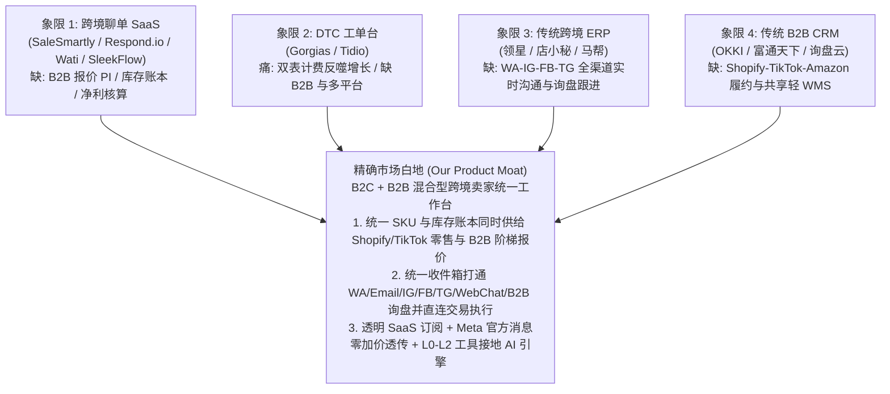
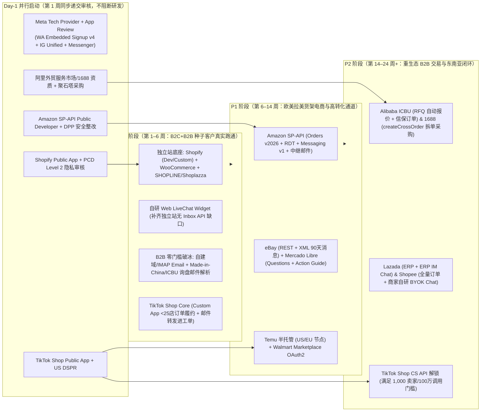
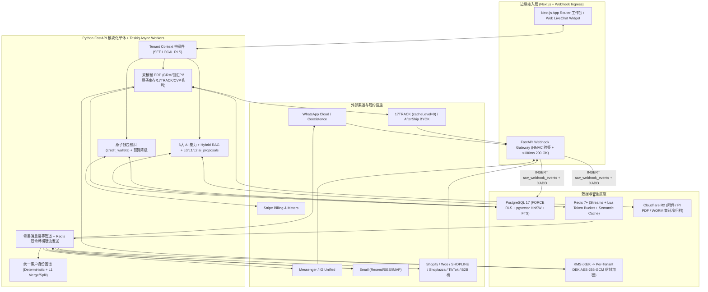
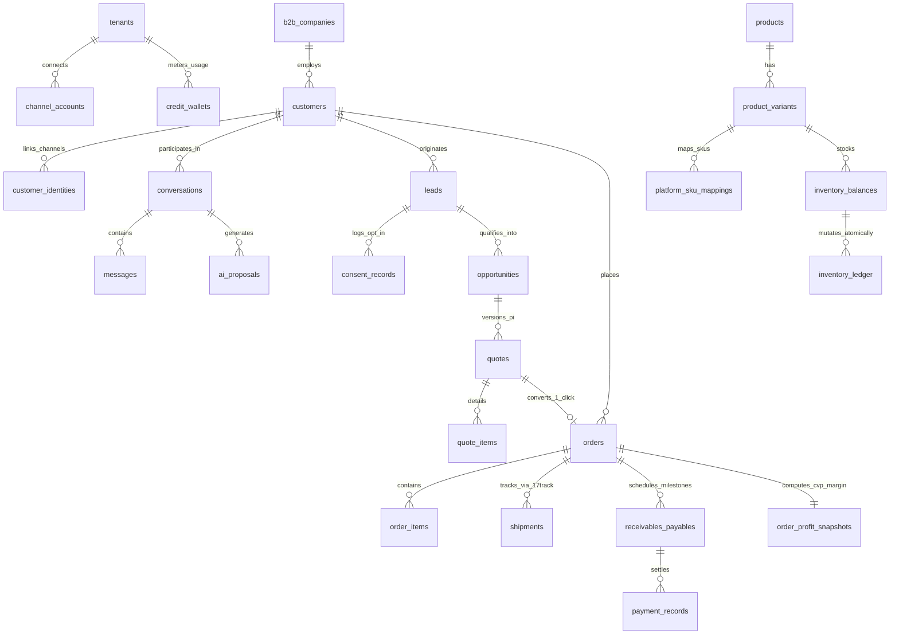

# 跨境全渠道 B2C + B2B AI 工作台与轻量 ERP 深度调研与架构总规格

> **规格性质**：`brainstorming` 阶段经深度调研后的正式设计总规格（Spec），作为后续进入 `writing-plans` 与工程落地的唯一权威蓝图。
> **商业定位**：面向跨境卖家与出海工贸企业的多租户商业 SaaS —— **「统一收件箱 + L0–L2 可控 AI 员工 + B2C 零售/B2B 外贸双模轻量业财 ERP + 合规获客归因引擎」**。
> **研发团队约束**：**1–3 人 AI 增强全栈研发团队**（Next.js App Router + Python FastAPI 模块化单体 + Taskiq + PostgreSQL 16/17 RLS/pgvector + Redis + Cloudflare R2）。
> **一手研究基准**：所有平台规则、API 能力、审核壁垒与定价均基于 2026 年 11 月各平台官方开发者文档与公告交叉核验，完整详尽证据分布于以下 5 份子专题报告：
> - [01-nova-teardown-and-competitors.md](file:///Users/seven/Documents/erp/docs/research/01-nova-teardown-and-competitors.md) — Nova ERP 32+ 模块逆向拆解与 4 象限 12 款竞品全景对比
> - [02-ecommerce-and-b2b-platforms.md](file:///Users/seven/Documents/erp/docs/research/02-ecommerce-and-b2b-platforms.md) — 全球 15 大电商与 B2B 平台官方 API、审核门槛与 BYOK 合规边界
> - [03-messaging-and-social-channels.md](file:///Users/seven/Documents/erp/docs/research/03-messaging-and-social-channels.md) — 全渠道即时消息、Email CASA 审计与海内外 14 个社媒矩阵接口核查
> - [04-compliant-lead-generation.md](file:///Users/seven/Documents/erp/docs/research/04-compliant-lead-generation.md) — 截图 4 风险解构、Overture/富化/海关提单与 CTWA+CAPI 合规获客架构
> - [05-saas-ai-and-erp-architecture.md](file:///Users/seven/Documents/erp/docs/research/05-saas-ai-and-erp-architecture.md) — 多租户 RLS、零丢消息流、双模 ERP 数据模型、6 大 AI 能力与商业计费系统

---

## 1. 执行摘要与对原 PDF 初步拆解的 10 项关键纠偏

前序 8 页 PDF 基于表面截图给出了有益的商业直觉（如“先轻 ERP 后重总账”、“合并 13 个 AI 角色”、“严禁非官方扫码外挂”），但在平台事实、2025–2026 新政、B2B+B2C 业务 DNA 及合规路径上存在显著失真或盲区。经 5 条并行一手调研核验，确立以下 **10 项关键纠偏与架构升级**：

| # | 原 PDF 初步假设 / 盲区 | 一手官方文档核验事实（截至 2026 年 11 月） | 本系统采取的架构与商业决策 |
| :-: | :--- | :--- | :--- |
| **1** | 首发默认“Shopify + TikTok Shop”两平台 | **B2C+B2B 双模下盲区极大**：两者纯偏 C 端快消，完全失焦外贸询盘/报价需求；且 **TikTok Shop Customer Service API** 要求第三方 ISV 先达 **1,000+ 授权卖家或 100 万次调用/日**才开放申请（[TTSPC CS API](https://partner.tiktokshop.com/docv2/page/customer-service-api-overview)）。 | **P0 采用低壁垒 B2C+B2B 双轨底座**：独立站矩阵（`Shopify GraphQL + WooCommerce + SHOPLINE/Shoplazza`）+ `TikTok Shop 核心订单履约`（含 `<25` 店铺 Custom App 与邮件桥）+ `Made-in-China / ICBU 询盘邮件桥` + `自研 Web Chat Widget`。 |
| **2** | 认为“TikTok 私信无官方通道”且未区分 Shop 与自然号 | 两者完全独立：**TikTok Shop CS API** 有完备双向客服接口（受 1,000 卖家门槛限制，但不受欧洲/USDS UBO 禁令）；**TikTok Organic Business Messaging API** 则完全禁用于 EEA/UK，且美区对受限地（含中国/香港）UBO >25% 实体受限，48h 未回仅限发 3 条（[TikTok Business Messaging](https://business-api.tiktok.com/portal/docs/access-to-business-messaging-api/v1.3)）。 | 架构上彻底隔离 **TikTok Shop 站内客服（P0 邮件转发 / P2 原生 API）** 与 **TikTok 自然号私信（P2 仅限 APAC/LATAM/METAP 等区域灰度）**。 |
| **3** | 认为“WhatsApp 客服窗口内回消息全免费、仅用纯云端号” | **2025-07-01** 改为按条计费后，**2026-10-01 起 Meta 正式终结无限免费 `Service` 回复**（每号每月前 1,000 条免费，超额按条收费）且 CSW 内 `Utility` 模板同步恢复收费；同时 CTWA 免费入口窗口（FEP）在 **2026-09-28 延长至最长 7 天**；此外 **WhatsApp Coexistence** 已正式允许保留手机 Business App 并同步 180 天单聊上云（[Meta WA Pricing](https://developers.facebook.com/documentation/business-messaging/whatsapp/pricing) / [Coexistence](https://developers.facebook.com/documentation/business-messaging/whatsapp/embedded-signup/onboarding-business-app-users)）。 | 1）P0 接入 **Embedded Signup v4/v5** 并支持 **Coexistence 共存模式**（`20 mps` 限速隔离）； 2）AI 出站自动合并多段消息为单条以省 `Service` 额度； 3）自动识别 `ctwa_clid` 锁定 7 天 FEP 红利。 |
| **4** | 认为“Messenger/IG 超过 24 小时靠常规消息标签即可触达” | **2026-04-27 起** Meta 正式废弃 `CONFIRMED_EVENT_UPDATE`、`ACCOUNT_UPDATE`、`POST_PURCHASE_UPDATE` 三个 Message Tag；IG 仅支持唯一跨窗标签 **`HUMAN_AGENT`（7 天）**，且推荐全面采用 **Instagram Unified Login**（[Messenger Limits](https://developers.facebook.com/docs/messenger-platform/reference/send-api%23limits) / [IG Unified Login](https://developers.facebook.com/documentation/instagram-platform/instagram-api-with-unified-login)）。 | P1 统一走 IG Unified Login；硬编码校验 `HUMAN_AGENT` 仅限 `sender_type = human_agent` 且 `<= 7 天` 使用，严禁 AI 自动触发以防封号。 |
| **5** | 认为“Telegram 只能用 `@bot` 机器人，不适合熟人沟通” | Telegram 自 Bot API 7.2+ 推出 **Telegram Business Mode（`business_connection`）**：只要商家账号开 Telegram Premium，即可将 SaaS Bot 绑定至**商家真人号**直接接管私聊回复（[Connected Business Bots](https://core.telegram.org/api/bots/connected-business-bots)）。 | **P1 零审核高 ROI 杀手锏**：重点打通 Telegram Business Mode 托管真人卖家号，极大提升东欧/中东/Web3/汽配 B2B 询盘转化。 |
| **6** | 认为“邮件是标准协议顺手接、Gmail OAuth 很简单” | Gmail 读取接口（`gmail.readonly`/`modify`）属 **Restricted Scope**，必须每年通过第三方 **CASA Tier 2/3 安全评估**（费用 **`\$500–\$4,500+`/年**、耗时 2–6 周）；微软 Exchange Online 将于 **2026 年 12 月底**在存量租户默认禁用 SMTP AUTH Basic Auth（[Google CASA](https://developers.google.com/identity/protocols/oauth2/production-readiness/restricted-scope-verification) / [Exchange Deprecation](https://techcommunity.microsoft.com/blog/Exchange/updated-exchange-online-smtp-auth-basic-authentication-deprecation-timeline/4489835)）。 | **P0 采用“自建域转发入站 + 事务性发信（Resend/Postmark/SES）+ RFC 5322/5233 线索路由”**，零审计门槛当日可用；Gmail/M365 OAuth 直连延后至 P2 企业版。 |
| **7** | 低估了 Shopify Inbox 缺失与东南亚/欧美货架平台消息隔离 | **Shopify/SHOPLINE/Shoplazza** 均无公开多租户 Inbox API；**Shopee 自 2024-11-18 起关闭新 ISV 申请 Customer Service App**（`ERP System` 禁收 `Webchat Push Code:10`）；**Amazon SP-API 无买家回信读接口**，仅有出站模板与 `Messaging Automations v2026-04-20`（[Shopee FAQ #56](https://open.shopee.com/faq/56) / [Amazon SP-API Models](https://developer-docs.amazon.com/sp-api/docs/sp-api-models)）。 | 1）独立站全靠 **自研 Web Chat Widget**（Shopify 须做 Theme App Extension Embed Block）； 2）P0/P1 同步接入各平台**中继邮箱解析**； 3）采用 **Official App Store + 合法 BYOK（如 `Seller In-house System`）** 双连接器模式。 |
| **8** | 笼统排除“微信”与一刀切砍掉“获客与社媒” | 国内虽绝不可碰个人微信外挂，但**企业微信 `externalcontact` 与微信客服 `kf` 官方接口**合法支持合规 ISV（需互通账号许可 `40–50 元/人/年`）；海外方面 **X API 已废除 `\$200/\$5,000` 月租转为 Pay-Per-Use 按量计费**，**YouTube Data API v3 于 2026-11-02 解除未过审视频强制 Private 锁**；而 **小红书/抖音私信/视频号** 对第三方营销 SaaS 确无可用自动发布/私信 API（[WeCom Docs](https://developer.work.weixin.qq.com/document/path/95652) / [X Pricing](https://docs.x.com/x-api/getting-started/pricing) / [YouTube History](https://developers.google.com/youtube/data/revision_history)）。 | 1）国内社媒降级为“AI 文案成片打包 + 跳转官方后台人工发”；海外保留 IG/FB/TikTok/YouTube/LinkedIn/Pinterest/X 分期矩阵； 2）国内私域预留 P2 **微信客服 `kf`/企微**（绝不碰个人号）。 |
| **9** | 仅提醒截图 4 爬虫有“封号风险”，但未给出完整合法替换引擎 | Google Maps ToS § 3.2.3 严禁缓存和导出除 `place_id` 外字段；公共 Overpass 每日自动化上限 `<100 次`；GDPR Art. 14 未告知来源被重罚（CNIL 罚 Kaspr `€240,000`）；CAN-SPAM 无 B2B 豁免（`\$53,088/封`）；Cloud API 无批量查号接口且禁向美国 `+1` 号码发 WA 营销模板（[Google Maps Terms](https://cloud.google.com/maps-platform/terms) / [CNIL Kaspr](https://www.cnil.fr/en/data-scraping-kaspr-fined-eu240000)）。 | 用 **“Overture Maps Places（8,840 万 POI，零 ODbL）+ Google `Places UI Kit` + 合规 B2B 富化/海关提单 API + CTWA 7 天 FEP/CAPI 闭环 + RFC 8058 B2B 冷邮件引擎 + WA 质量熔断器”** 替换违规爬虫。 |
| **10** | 原文档停留在概念建议，缺乏多租户 SaaS 单位经济与技术硬约束 | Nova 原图存在 `19632 vs 3,024 vs 817` 三套计数打架、`[object Object]` 与内部键值裸泄、`L3` 与 `L2` 定义冲突等问题；且商用 SaaS 若不控大模型与物流追踪成本极易亏损。 | 确立 **PostgreSQL 17 `FORCE RLS` + `SET LOCAL` + 信封加密 + Redis 双令牌桶 + 17TRACK `cacheLevel=0`（`~\$0.019/单`）+ 四层 LLM 路由（混合会话约 `\$4.93/1K`）+ 原子钱包预扣**，保证全套餐 **71%–81% 毛利率**。 |

---

## 2. Nova ERP 深度逆向拆解与竞品市场白地

### 2.1 Nova ERP 完整功能版图与正反经验审计

通过跨屏拼接 4 张运行于 `http://localhost:8000`（账号 `Jerry · Founder`，标注 `159 个数据文件`、`31°C 泉州`）的实机界面，还原出横跨 **9 大一级业务域 + 动态最近访问区、共 32+ 侧边栏主模块（含子页签超 50 个功能页）** 的全链路图谱：

1. **核心 DNA 是「B2B 外贸 + B2C 零售」双轨并行，而非单一客服或纯电商 ERP**：
   * **B2B 链路**：`线索池 → 获客采集 → 客户管理 → 商机看板 → 快速报价 → 跟进记录 → 邮件系统`。
   * **B2C 链路**：`B2C产品 → B2C订单 → 平台同步`。
   * **共有执行与业财底座**：`订单管理 → 产品库 → 供应链 → 采购订单 → 物流中心 / WMS入库 / WMS库存 → 财务账单 / CVP测算 / 财税合规`。
2. **必须吸收的 5 项高价值产品设计（What to Adopt）**：
   * **收件箱即交易中枢**：左栏把 `Alibaba`、`企业邮箱`、`Shopify`、`WhatsApp`、`Facebook`、`Telegram`、`TikTok` 收进同一会话流；中部实时展示买家国旗与 **买家当地时间（`当地时间 10:22 PM`）**、单条原文与中文折叠译文、双向实时翻译输入框；右栏悬浮 AI 助手统一汇总各职能待办与待审数。
   * **防幻觉的双重护栏**：① 聊天抽屉显式提供 **`仅检索模式`（Strict RAG）** 开关；② `AI 员工` 页建立 **L2（自动执行：补录/标签/摘要/预警） / L1（AI 提案人审：建档提案 6、报价草稿 0、跟进建议 5） / L0（人工把关：发送报价邮件、收付确认、合同谈判客诉终审）** 三级分工矩阵。
   * **规则前置降本意识**：图 4 线索清洗默认采用 **`纯规则模式 (零AI)`**，日常巡检走确定性脚本，仅高价值推理才调用大模型。
3. **必须彻底重构避开的 4 项原型缺陷（What to Reject & Fix）**：
   * **口径分裂与内部状态裸泄**：图 2 顶部 `近7天动作 19632`、13 名员工卡片累加仅 `3,024`、底部矩阵 `近7天 817` 三数打架；顶部标 `L3 无人值守` 与底部矩阵 `L0–L2` 冲突；图 1 财务卡片直接渲染 `¥[object Object]` 与 `tax.filing.overdue=0` 内部键。商业化版本必须基于单一不可变事件账本统计，且输出严格 Schema 校验。
   * **本地单机原型与灰色爬虫依赖**：`159 个数据文件` 与图 4 的 `Playwright 弹窗模拟`、`WA 批量校验与群发`、`FB 评论/群组抓取` 在多租户 SaaS 下会引发平台吊销 App ID 与巨额隐私罚单（详见第 4 节合规替代）。
   * **20 平台空壳分散精力**：图 3 社媒矩阵所有业务指标均为 `0`，说明过度堆砌知识卡片而非打通闭环。必须按 ROI 收敛接入顺序。
   * **13 个碎片化人设过重**：生产环境拆成 13 套独立 Prompt 与状态机极易路由误判，应收敛为 **6 大核心商业能力共享同一底层 Runtime**。

### 2.2 四象限 12 款主流竞品全景对比与市场白地

| 竞品象限 | 代表产品（2025–2026 公开口径） | 定价模式与核心痛点 | 核心能力短板（我们切入的断层） |
| :--- | :--- | :--- | :--- |
| **1. 跨境全渠道聊单 SaaS** | **SaleSmartly** (`Free \$0` / `Pro \$12.72–15.90` / `Max \$159.2–199/月`) **Respond.io** (`\$79–\$279/月`，超额 `\$12–15/100 MACs`) **Wati** (`\$39–\$279/月`，消息按 Rate Card 加价 15%–80%) **SleekFlow** (`\$49–\$279/月`，`+\$15/号`，超额 `\$20/100 MACs`) | Respond.io/SleekFlow 按**月活联系人（MACs）惩罚增长**；Wati 缺 Email 且消息加价不透明；SaleSmartly 偏云托管个人号灰产。 | **全员“只有聊天，没有生意底座”**：无法做多币种 B2B 阶梯报价/PI、没有共享 SKU 库存预占与 WMS、无法算订单 CVP 真实净毛利。 |
| **2. DTC 客服工单台** | **Gorgias** (`\$50–\$1,227/月`，`AI 解决另收 \$0.9–1.5/次`) **Tidio** (`\$24.17–\$300+/月`，人工/Lyro/Flows 三池叠加) | Gorgias **“一单双计费”**（AI 解决既扣工单额度又扣 AI 解决费，Trustpilot 仅 `2.1/5`）；Tidio 超过 10 席位直接跳至 `\$300/月+`。 | **深度绑定 Shopify 纯零售售后**：几乎不支持 B2B 询盘谈判、无法对接阿里国际站/中国制造网/1688，也没有主动合规获客能力。 |
| **3. 传统跨境电商 ERP** | **领星 ERP**（`≤5,000 单/月免费`，超量年付定制，2026 上线 MCP 审批流） **店小秘**（`VIP1 2,016`–`VIP4 19,800 元/年` + AI 秘豆） **马帮 ERP**（按单量+模块定制，WMS 仓加购 `2,000 元/个`） | 功能重履约、配置重实施（马帮上线需 1–2 周）；模块逐项加价。 | **客服模块停留在平台站内信/模板回信**：完全缺乏 WhatsApp / IG / Messenger / Telegram 统一实时会话与跨渠道客户身份图谱，也无 B2B 线索与报价单流程。 |
| **4. 传统 B2B 外贸 CRM** | **阿里小满 OKKI**（官网未公开标价，按模块/席位年付定制） **富通天下**（官网未公开标价，明确不打通任何 B2B 平台） **询盘云**（官网未公开标价，企微增购 `600 元/账号/年`） | 采购门槛重（万元至十万元级/年）、传统界面与长实施周期；OKKI 强绑阿里生态，富通天下排斥公域平台与 DTC。 | **与现代 B2C/DTC 电商彻底割裂**：不接 Shopify/TikTok Shop/Amazon/Temu 订单与库存，没有面向小微及成长团队的轻量共享业财库与可控 L0–L2 AI 提案引擎。 |

> [!IMPORTANT]
> **目标黄金客群定义**：**混合型跨境出海卖家（Hybrid Cross-border Sellers）**——包括：① 工贸一体工厂做品牌出海（一面在阿里国际站/制造网/邮件接 OEM 大单与样品，一面在 Shopify/TikTok Shop/Amazon 卖现货）；② DTC 独立站品牌拓展海外线下批发与分销商（B2C 零售与 B2B 批发共用同一批海外仓/国内仓库存与利润账本）。这类客户目前被迫拼凑 3–4 套互相割裂的软件，数据无法互通导致 AI 根本无法干活。

---

## 3. 全球电商与 B2B 平台对接矩阵与科学首发策略

### 3.1 15 大电商与 B2B 平台开放接口全景评分矩阵

| 平台 | 分类 | API 开放度 | SaaS ISV 审核壁垒与周期 | 站内买家消息 / 客服 API 真实状态 | B2C / B2B 价值 | BYOK / 自研通道合规性 |
| :--- | :---: | :---: | :--- | :--- | :---: | :--- |
| **Shopify** | 独立站 | **5/5** | **Medium**（2–4 周；2025-04 起强制纯 GraphQL；PCD Level 2 隐私审查） | **None**（Shopify Inbox 封闭无公开 API；需自研 Web Widget + Email） | B2C 极高 B2B 高 *(Plus)* | ⚠️ 仅限商家在自身 Dev Dashboard 建 `client_credentials` 应用；禁 ISV 代建多店 Custom App |
| **WooCommerce** | 独立站 | **4/5** | **Low**（0 周；去中心化 `/wc-auth/v1/authorize` 分钟级接入） | **Contextual-Email**（`Order Notes` 发邮件，无即时 IM API） | B2C 高 B2B 中高 | ✅ 原生自由支持 `ck_`/`cs_` 密钥与 OAuth1.0a |
| **SHOPLINE** | 独立站 | **4/5** | **Low–Med**（约 7 个工作日；强制 GDPR Webhook） | **None**（无站内聊天 API；需自研 Web Widget；支持 B2B PO 号/目录） | B2C 高 B2B 中高 | ✅ 支持商家后台生成 3 年期 Private App |
| **Shoplazza（店匠）** | 独立站 | **4/5** | **Low–Med**（约 1–2 周；Review + Conversation 两阶段审） | **None**（无站内聊天 API；需自研 Web Widget；双桶限流 2/20 QPS） | B2C 高 B2B 低中 | ✅ 支持商家自建 Private App |
| **TikTok Shop** | 内容电商 | **4.5/5** | **High**（6–12 周；ARD + 录屏 + DSPR + US 安全问卷 + Beta） | **Full Chat（强门槛）**：完备 CS API 需 **1,000+ 卖家或 100 万调用/天**才批；P0 可用邮件转发桥 | B2C 极高 B2B 低 | ✅ **`TikTok Shop Seller` 自研特批 CS API**；ISV Custom App 上限 25 店 |
| **Temu** | 新兴跨境 | **3.5/5** | **High**（4–8 周；分 US/EU/Global 审；**禁大陆云 IP**；地址解密单审） | **None**（无聊天 API；仅订单/履约/`bg.tmc.message.update` 状态同步） | B2C 极高 B2B 低 | ✅ 支持 `Self-Developed` 私有应用（须从对应海外静态 IP 发起） |
| **Amazon SP-API** | 欧美货架 | **4.5/5** | **Very High**（6–14 周；RDT + DPP 审计：**30 天删 PII / 7 天修严重漏洞**） | **Contextual-Outbound**：无 Inbox 读接口；仅订单模板出站与 `Messaging Automations v2026-04-20` + 加密中继邮箱 | B2C 极高 B2B 中 *(Business)* | ⚠️ 商家可自审 **Private Developer**（2–4 周），严禁跨无股权主体复用 |
| **eBay** | 欧美货架 | **3.5/5** | **Medium**（2–4 周；基础免审，Trading 提额需免费 AGC 审查） | **Contextual-90 天**：XML Trading API 支持问答与 90 天订单消息（60s 限 75 次死锁） | B2C 高 B2B 中 | ✅ 支持卖家自注册 Developer Keyset |
| **Walmart Marketplace** | 欧美货架 | **4/5** | **High**（3–5 周；邀请制 Solution Provider + Demo；**2026-07 停新 Delegated Key 强制 OAuth2**） | **Email-Only**：无消息 API；仅后台邮件中继 + 48h 响应率（SRR）报表 | B2C 高 B2B 低 | ✅ 认证卖家可创建独立配额的直连 Client ID/Secret |
| **Shopee** | 东南亚 | **4/5** | **Very High**（10–14 工作日 + CREST 渗透/ISO27001 + IP 白名单 + ≥90% 成功率） | **Full Chat（对新 ISV 关闸）**：**2024-11-18 起停止新 ISV 申请 CS App**；`ERP System` 禁收 `Webchat Push` | B2C 极高 B2B 低 | ✅ **`Seller In-house System` 仍合法开放全量 Chat API 与 Push Code:10** |
| **Lazada** | 东南亚 | **3.5/5** | **High**（4–8 周；服务市场 + **DataMoat 2 周限期渗透测试**） | **Full Chat（需专类+审计）**：`ERP IM Chat` 独立应用支持 `/im/*` 收发与消息推送 | B2C 高 B2B 低 | ✅ 支持 `Seller In-house APP` + `In-house IM Chat` |
| **Mercado Libre** | 拉美 | **4/5** | **Medium**（1–4 周；自助接入 + 特定场景 Homologation） | **Questions + 受限 Post-Sale**：售前问答全开放；售后须先调 `action_guide`、限 350 字且受 10+ 封锁态约束 | B2C 极高 B2B 低 | ✅ 卖家主账号直接建私有应用（注意单次 Refresh Token 需并发锁） |
| **Alibaba.com（国际站）** | B2B 外贸 | **3/5** | **Very High**（6–12 周；注册≥1 年/10 人 + **5 万元保证金 + 强制聚石塔** + 实地核查） | **Restricted（倾斜自营）**：`OKKI&TM` 类目倾斜小满/卖家 APP；外部普遍走 **RFQ API + 询盘邮件桥** | B2C 低 B2B 极高 | ⚠️ 自研免聚石塔但硬限 **5 账号且严禁商用转租** |
| **Made-in-China（制造网）** | B2B 外贸 | **1/5** | **Zero（邮件桥） / Closed（无公开自助 Open Platform）** | **Email-Bridge**（官方明确建议解析 `en_notification@made-in-china.com` 并以企业邮箱直回；IM 靠麦通客户端） | B2C 低 B2B 极高 | ✅ 全阶段统一走企业邮箱 IMAP/SMTP，零平台审核 |
| **1688 跨境/供应链** | B2B 供应链 | **3.5/5** | **Very High**（6–10 周；ISV 需聚石塔+保证金；测试应用 3 个月未上必淘汰） | **Alert-Only**：仅推送 CRM 询盘意图标签并强制反馈动作，无自由旺旺聊天接口 | B2C 低 B2B 极高 *(采购)* | ⚠️ 自研免聚石塔但硬限 **5 账号自用禁转售** |

### 3.2 破除默认偏见：科学分期路线与「Day-1 并行送审 + 双连接器」战略

为了不让 4–14 周的非技术审计阻塞产品商业化冷启动，采用 **“P0 低壁垒双模验证 + Day-1 并行行政送审 + 合规 BYOK 种子连接器”** 三轨并行策略：

* **给种子客户的「推荐组合选择器」（替代死板默认值）**：在入驻引导页根据商家类型自动推荐默认激活集——
  * 若为 **DTC 独立站品牌** → 默认激活 `Shopify / WooCommerce / SHOPLINE + Web Chat Widget + Meta (WA/IG/FB) + TikTok Shop`；
  * 若为 **外贸 B2B 工厂/工贸一体** → 默认激活 `企业邮箱 & 询盘桥 (Made-in-China/Alibaba) + WhatsApp (Coexistence) + Telegram Business Mode + Shopify Plus/WooCommerce`；
  * 若种子大卖急需接入 Shopee Chat 或 TikTok Shop Chat 且自有 IT 团队，提供合规的 **BYOK 模式（`Shopee Seller In-house System` / `TikTok Shop Seller`）** 指导商家托管自有合法凭证，严守平台条款不踩灰产红线。

---

## 4. 全渠道消息、社媒矩阵与合规获客架构蓝图

### 4.1 全渠道消息收件箱集成优先级矩阵

| 优先级 | 通道名称 | 核心业务价值 | 2025–2026 关键规则与成本壁垒 | 核心工程策略 |
| :---: | :--- | :--- | :--- | :--- |
| **P0** | **自研 Web LiveChat Widget** | 独立站 B2C 售前导购 + B2B 官网留资 | 零接口费；完全替代封闭的 Shopify Inbox | Shopify 走 Theme App Extension App Embed Block；支持 Pre-Chat 收集 Email/WA 身份绑定 |
| **P0** | **自建域入站 Email + 事务发信** | B2B 询盘核心 + B2C 售后 + 平台邮件桥 | **零 CASA 审计费用**（Postmark `\$15/月` / Resend `\$20/月` / SES `\$0.10/1K`） | 租户设置转发规则入站 + DNS SPF/DKIM 自定义域出站；严格维护 `Message-ID`/`In-Reply-To`/`References` + `Reply-To` `+thread_id` |
| **P0** | **WhatsApp Business Cloud API** | 全球 B2C 复购 + B2B 外贸大宗沟通 | Embedded Signup v4/v5；**2026-10-01 起 `Service` 超 1,000 条/月与 CSW 内 `Utility` 模板恢复收费**；CTWA 享 **7 天 FEP 免费窗口**；需兼容隐私 **BSUID** | 合并 AI 多段回复为单条消息省费；精确计量按租户透传/抵扣；支持 **Coexistence 共存模式**（`20 mps` 限速 + 180 天单聊同步） |
| **P1** | **Meta Messenger & Instagram DM** | 欧美/拉美社媒种草转私域成交 | IG 首选 **Unified Login**；**2026-04-27 起废弃 3 个旧 Tag，仅保留 7 天 `HUMAN_AGENT`** | 上线 **Comment-to-DM（Private Replies）** 自动回复评论引流；严格限制 `HUMAN_AGENT` 仅用于人工接管 |
| **P1** | **Telegram Bot & Business Mode** | 俄语区/东欧/中东/科技 B2B 询盘 | 零审核、零消息费；Business Mode 仅需卖家开 Telegram Premium | 接收 `business_connection_id` 直接以卖家真人号回复客户；严防 Bot 互回死循环与 `400 BUSINESS_PEER_USAGE_MISSING` |
| **P1/P2** | **LINE Messaging API** | 日本、台湾、泰国 B2C 零售刚需 | 零审核；**`replyToken` 被动回复 100% 免费**；Push 群发按区计费 | 优先利用 `replyToken` 免费处理进线 AI/人工咨询，降低商户成本 |
| **P2** | **Gmail / M365 Graph OAuth 直连** | 大企业客户强制要求员工邮箱直发 | Google 须年付 **CASA Tier 2/3（`\$500–\$4,500+`/年）**；微软须 **MPN Publisher Verification** | 作为高客单企业版增购；全面放弃微软 App Password（2026-12 默认淘汰） |
| **P2** | **企业微信（WeCom）& 微信客服（`kf`）** | 国内供应链协作与华人客户合规接待 | 服务商须购**「互通账号」许可（`40–50 元/人/年`）**；`kf` 限 48h 内 5 条 | **绝对禁止任何个人微信逆向/RPA 外挂** |
| **P2** | **TikTok Organic Business Messaging** | 非欧美区域自然号引流 | **EEA/UK 禁用**；美区限制受限地 UBO >25% 实体；48h 未回仅限 3 条 | 仅对 APAC/LATAM/METAP 区域账号灰度开放 |
| **Excluded** | **Zalo OA（代开）/ Viber Bot / 微信小店 ISV** | 长尾或高固定门槛渠道 | Zalo 强绑越南本土执照+`+84` 手机；Viber 强制 `EUR 115/月/Bot`；微信小店禁 ISV | 不内置进标准多租户核心，必要时由大客户自有主体/BSP 外接 |

### 4.2 社媒矩阵发布与监听真实边界（海外 vs 国内）

* **海外 P0–P1 矩阵（真官方云端自动发布与互动）**：
  * **Instagram & Facebook Pages（P0）**：Unified Login 一套鉴权搞定 Reels/Carousel/图文发布（IG 上限 100 篇/24h）、评论转私信与 Insights（API 免费）。
  * **TikTok Content Posting API（P0）**：`video.publish` 支持 Direct Post 与图文，但**必须先过 Audit 审核才能解除 `SELF_ONLY` 仅自己可见与 5 人/天限制**（Audit 明确拒绝跨平台纯搬运应用）。
  * **YouTube Data API v3（P1）**：**2026-11-02 已取消未过审项目强制 Private 锁**，独立上传配额桶默认 `100 次/天`。
  * **LinkedIn Community Management API（P1 — B2B 刚需）**：公司主页发帖与评论管理须过 Vetted Review 升至 Standard Tier（注意 `r_member_social` 读个人动态已对外关闭）。
  * **Pinterest API v5（P1）**：需过 Standard Access 才公开发布 Pin（家居/服饰/POD 独立站高转化）。
  * **X (Twitter) API v2（P1/P2）**：2026 年已废除 `\$200/\$5,000` 月租，改为 **Pay-Per-Use 按量预付**（普通发帖 `\$0.015`，**带 URL 帖 `\$0.200`**，`Owned Reads` `\$0.001`），可按租户用量精确透传，不再拖垮 SaaS 固定成本。
* **国内矩阵降级决策（小红书 / 抖音开放平台 / 视频号 / 快手 / B 站 / 微博）**：
  * 小红书 `openaccount` 仅开放 `basic_info`（`write_notes` 仍未对通用营销 SaaS 开放）；抖音于 2025 年 4–5 月全面回收移动/网站应用私信权限，且 `h5.share` 禁商品营销类应用；微信视频号无任何第三方发布 API。
  * **产品形态降级方案**：不在国内矩阵投入无效爬虫或高危云手机 RPA，而是将工作台定位为 **「AI 多模态成片工坊 + 平台合规自检 + 一键打包下载/跳转官方创作中心人工确认发布」**（仅**微信公众号**支持基于第三方平台的真草稿/发布/48h 客服对接）。

### 4.3 合规海外获客与广告闭环替代方案（彻底重构截图 4）

1. **淘汰四类高危设计**：立即移除 Google Maps Playwright 模拟抓取与全量商户库缓存、公共 Overpass API 轮询（自动化上限 `<100 次/日` 且存在 ODbL Share-Alike 导出传染隐患）、Facebook 评论/群组抓取与冷私信外挂、以及非官方 WhatsApp 批量探号与无授权群发。
2. **四层合规商机发现与分级变现栈**：
   * **Layer 0（内置免费基座）**：自建索引 **Overture Maps Foundation Places** 数据集（2026 年 10 月约 **8,840 万 POI**，`CDLA-Permissive-2.0 / Apache-2.0`，**不含任何 OSM 数据、零 ODbL 传染**，含 `websites[]`、`phones[]`、`socials[]`、`confidence`），让新租户首日即可合法、无限次按国家与类目筛选海外零售商与分销商。
   * **Layer 0.5（按需实时展示）**：Google Places API (New) 仅在数据库永久保存豁免字段 **`place_id`**（`Text Search IDs Only` 无限免费），前端仅在用户点击具体商户详情时调用 **`Places UI Kit`**（`\$1–\$5/1,000 次`，获官方条款 § 15 豁免可在无地图或 Leaflet/Mapbox 旁合法渲染 Google 评分/电话/营业状态，避开 `\$35/1,000` 计费陷阱与缓存违约）。
   * **Layer 1（平台官方 OEM 积分包）**：基于正式商业数据分发条款接入 **People Data Labs (PDL)**（`§ 2.2.1` 允许 SaaS 内嵌展示，未命中不扣费）、**Hunter Email Verifier**（`0.5` 积分/次拦截硬退信）及 **海关提单贸易数据**（如 **上海腾道 Tendata** `open-api.tendata.cn/v2` / **Trademo Intel** / **ImportYeti Enterprise**），直接按 HS 编码与最近 90 天进口频次锁定真实海外买手。
   * **Layer 2（BYOK / OAuth 2.0 专业连接器）**：对拥有自有账号的成熟外贸团队，通过合规 OAuth 或托管解密方式接入 **Apollo.io OAuth Partner Flow**（避免违反其禁止标准账号转售条款）、**StoreLeads**（Pro `\$250/月` 开放 API/MCP，直接筛选 `Shopify Plus`、`monthly_app_spend`、平台迁移店铺）、**BuiltWith** 与 **Similarweb**。
3. **Paid-to-Chat + CAPI 真实营收闭环**：
   * 对接 Meta **Click-to-WhatsApp / Messenger / IG-DM Ads**，捕获入站 Webhook `ctwa_clid` 与 `ad_id`（锁定 WhatsApp **最长 7 天免费入口窗口**与 Messenger/IG **7 天扩展窗口**）。
   * 当客户在 ERP 内确认合格线索（`LeadSubmitted`）或完成收款成交（`Purchase`），服务端调用 **Conversions API for Business Messaging** 回传真实已付金额，训练 Meta oCPM 广告模型精准寻找高客单买手。
4. **双轨合规外发执行引擎**：
   * **陌生 B2B 开发走合规冷邮件**：独立发信衍生域（避开 Google 5,000/日主域永久 Bulk Sender 标记）、SPF + 2048-bit DKIM + DMARC 对齐、**RFC 8058 一键退订头（DKIM `h=` 必签且 48h 生效）**、单域 24h 投诉率 **`> 0.08%`** 或硬退信 `> 3%` 自动熔断、L1 人工审批个性化草稿、欧盟收件人底部强制嵌入 **GDPR Art. 14 数据来源声明**（规避 Kaspr €24 万罚单覆辙）。
   * **私域培育与大促触达走 Opt-In WhatsApp 广播**：不可变 `consent_ledger` 强校验（无有效 Opt-In 在网关层直接拒发）、自动剔除美国 `+1` 号码禁发营销模板、接入 **Marketing Messages API (MM API)** 提升送达率、监听模板质量降级（**`YELLOW` 降速 30%，`RED` 立即冻结队列防 3 次永久封禁**）、内置原生 Quick Reply 退订按钮与 `STOP` 零延迟抑制。

---

## 5. B2C + B2B 双模业务边界与 AI L0–L2 治理规范

### 5.1 轻量 ERP 范围界定：共享核与显式分态（严守边界不失控）

| 核心模块 | Phase 1–2 必须做实（核心闭环） | 明确不做（通过导出/第三方连接器解决） |
| :--- | :--- | :--- |
| **客户图谱 & CRM** | `b2b_companies` + `customers` + `customer_identities`（跨渠道确定性自动合流 + 概率性 L1 人工合并提案 + 可逆 Split）、买家当地实时时区、B2B `leads`/`opportunities` 看板、不可变 `consent_ledger` | 超复杂多级公海轮转大引擎、自定义低代码对象平台 |
| **商品与目录** | SPU/SKU 主数据、`i18n_specs` 多语种技术参数/材质/认证标签、`b2b_moq_tiers` 阶梯批发价、成本价权限隔离（Agent 不可见底价）、`min_margin_floor_pct` 毛利底线、多平台 SKU 映射（含 `bundle_multiplier` 组合扣减） | 重型制造业多层工艺 BOM、序列号/效期批次追踪 |
| **双模报价 & 订单** | **版本化 B2B 报价单/形式发票（PI）**：锁汇快照（`fx_locked_until`）、Incoterm（EXW/FOB/CIF/DDP）、一键渲染多语言 PDF、1-Click 原子转正式订单；**统一订单**（`b2c_retail` / `b2b_sample` / `b2b_wholesale`）与收件箱卡片双向互跳 | 自建独立站前台购物车结账页与支付收单网关 |
| **库存 & 物流追踪** | 不可变 `inventory_ledger` + 余额行锁预占（防并发超卖）；**17TRACK API** 主适配器（强制 `cacheLevel=0`，单号约 `\$0.0186–\$0.0238`）+ Webhook 主动推送 + 72h 停滞/异常主动预警（`PROACTIVE_WISMO_OUTREACH`） | 多仓智能调拨路径算法、PDA 硬件扫码重型 WMS |
| **钱的台账 & CVP 利润** | B2B 分期应收账款（30% 定金解锁生产 + 70% 尾款结清方准出库）、银行水单 OCR 核销留痕、**`order_profit_snapshots`（收入 − COGS − 平台佣金 − 手续费 − 头程尾程税费 − 归因消息/广告费 + 汇兑损益 = 实时贡献净毛利）** | 各国法定总账凭证、税务局税控开票与财务报税（导 CSV 给 QuickBooks/Xero/金蝶） |

### 5.2 6 大商业 AI 能力与 L0–L2 防幻觉规范

将 Nova 的 13 个碎片人设收敛为 **6 大核心能力（`cs_support` AI 客服、`sales_quoting` AI 销售/报价助理、`order_logistics` AI 订单物流助理、`content_studio` AI 内容助理、`biz_analytics` AI 经营分析、`finance_recon` AI 财务对账助理）**，全部运行于统一 Tool & Policy Runtime 之上：

1. **三级可控自治矩阵**：
   * **`L2 Auto-Execute（全自动）`**：纯只读工具查询（查单/查物流轨迹/查认证事实）、标签/摘要/翻译、基于高置信度知识库（Rerank 得分 `>= 0.62`）的标准 FAQ 回复。
   * **`L1 Proposal Queue（`ai_proposals` 队列，人审一键放行）`**：从沟通中提取新建 B2B 线索/客户档案（`crm_entity_extract`）、B2B 阶梯报价/PI 草稿（`quote_draft`，实时显示该价下净毛利率）、概率性跨渠道客户合并建议（`identity_merge`）、敏感客诉/复杂回复草稿（`reply_draft`）、物流异常主动触达（`follow_up_suggestion`）。人工 `Edit & Approve` 修改 Diff 自动回流该租户私有 Golden Few-shot 库。
   * **`L0 Copilot-Only（仅建议，AI 严禁执行）`**：发出正式报价单与低于毛利底线折扣、确认银行水单收款核销、大额退款审批、正式合同承诺、`HUMAN_AGENT` 7 天窗口外发。
2. **零幻觉铁律（Strict Grounding）**：
   * **Hybrid RAG（`tsvector BM25` + `pgvector HNSW` + RRF + Cross-Encoder Rerank）** 仅服务静态文档/政策/材质说明，且开启 **`Strict Retrieval Mode（仅检索模式）`** 时每条陈述必须带 `[doc_id#chunk_id]` 校验，Rerank `< 0.62` 强制触发拒答并转 `pending_human`。
   * **实时数值 100% 工具接地**：价格、MOQ 阶梯、实时可用库存、物流轨迹与订单状态**严禁进入静态向量库猜测**，输出 Model 强制校验 `source_tool_call_id`。

### 5.3 核心上线验收量化基线（MVP Acceptance Criteria）

* **收件箱可靠性**：Webhook 验签入库并返回 `200 OK` P95 `< 150ms`；断网重连脉冲风暴下 **0 重复消息、0 丢消息**。
* **多租户安全**：PgBouncer Transaction Pooling 并发压测下，**0 起跨租户读写越权**。
* **库存一致性**：50 并发协程抢占最后 1 件库存，**0 超卖**且 `inventory_ledger` 流水求和与余额表 100% 守恒。
* **AI 幻觉与验收**：使用种子商家 **100 条真实历史会话回放评测**，事实型 FAQ 自动回复准确率 `>= 90%`、数值幻觉率 **`0%`**（100% 源自实时 SQL 工具）、未超额误转人工率可控且首响时间压缩至 `< 5 秒`。

---

## 6. 多租户 SaaS 技术架构与核心数据底座

### 6.1 推荐技术栈与模块拓扑

面向 **1–3 人 AI 增强全栈团队**，采用 **Option A：Next.js (App Router, TypeScript) + Python FastAPI 模块化单体 + Taskiq Workers + PostgreSQL 17 + Redis 7+ + Cloudflare R2**（详见 [05-saas-ai-and-erp-architecture.md](file:///Users/seven/Documents/erp/docs/research/05-saas-ai-and-erp-architecture.md) 对比 Option B 全栈 TS 与 Option C Go 的详尽论证）：
* **Next.js 严格仅作 UI 工作台 + 极薄 Auth/SSE BFF**，禁止编写业务逻辑或直连业务 SQL；
* **Python FastAPI 承载全部业务核心、B2B PDF 报价生成、多模态 BOM/水单解析、Hybrid RAG 与 PydanticAI/LangGraph 引擎**，通过 CI 门禁 `OpenAPI 3.1 -> @hey-api/openapi-ts` 保证前后端零契约漂移，用 `import-linter` 锁死模块化单体边界，不搞过早微服务。

### 6.2 核心领域实体关系图（ER Diagram）

### 6.3 关键生产级安全与稳定性工程规约

1. **PgBouncer Transaction Pooling 安全的 Fail-Closed RLS**：运行时角色 `app_runtime` 严禁 `SUPERUSER`/`BYPASSRLS`；全业务表启用 `FORCE ROW LEVEL SECURITY`，Policy 采用 `tenant_id = NULLIF(current_setting('app.current_tenant_id', true), '')::uuid`，由 FastAPI 与 Worker 在每个事务开始时调用 `SELECT set_config('app.current_tenant_id', :tid, true)`（事务结束自动销毁，绝不跨连接污染）。
2. **信封加密与 Crypto-Shredding**：KMS KEK 加密每租户独立 DEK；OAuth Token、IMAP 密码、BYOK Key 均以 AES-256-GCM 绑定 `AAD = "{tenant_id}:{account_id}:{type}"` 存储，防止跨租户密文替换；`shop/redact` 或注销直接销毁 DEK。
3. **双层令牌桶与 7 天重放防御**：`raw_webhook_events` 落盘先去重；Redis Lua 脚本同时约束 WhatsApp Account 级（`20 mps` 共存 / `80–1,000 mps` 云号）与 Pair 级（`1 msg/6s`，触及 `131056`/`130429` 按 Meta 建议 `4^X` 秒退避），并配合每 15 分钟 Shopify/平台订单补偿对账 Cron。
4. **17TRACK 主适配器防翻倍扣费铁律**：调用必须强制传 **`cacheLevel=0`**（扣 1 额度，仅异常排查且超 6 小时才允许刷一次），严禁误传 `cacheLevel=1`（瞬时扣 **10 倍额度**），日常全靠 Webhook 推送更新 `9+30` 状态。

---

## 7. 商业化单位经济、定价模型与分阶段落地路线图

### 7.1 四层智能模型路由与 2026 单元经济测算（>70% 毛利率）

依托 **Tier 0 语义缓存（拦截 20%–30% 重复 B2C 问答，成本 `\$0`） → Tier 1 极速低价层（`gemini-2.5-flash-lite` / `gpt-6-luna` / `Claude Haiku 5.5`：`\$0.10` in / `\$0.40–\$0.50` out，负责意图、翻译、导流安检） → Tier 2 均衡主力层（`gemini-3.1-flash-lite` / `deepseek-flash` / `gpt-5-mini`，配合 Prompt Caching 90%–98% 折扣） → Tier 3 前沿深度层（`Claude Sonnet 5.5` / `gpt-6.2-sol` / `deepseek-v4-pro`，仅约 8%–12% 复杂 B2B RFQ 报价升级调用）**：

* **B2C 典型多轮会话（占 85% 流量）**：每 1,000 次会话纯 AI 成本约 **`\$1.29`**；
* **B2B 深度询盘/PI 会话（占 15% 流量）**：每 1,000 次会话纯 AI 成本约 **`\$25.50`**；
* **综合加权纯 LLM 成本**：**每 1,000 次混合全渠道会话仅约 `\$4.93`**（即约 `2,000 AI Credits`，按 `1 Credit = \$0.0025` 平台成本预算）。

结合原子钱包 `credit_wallets` + Stripe Billing Meters（额度耗尽时自动优雅降级为 **L0 纯人工工作台模式**，绝不断线停收消息），制定破除竞品 MAC 焦虑与双表陷阱的 **透明商业定价（Meta 官方消息费原价透传/租户自结）**：

| 商业套餐 | 月费 | 内含配额（绝不按联系人/MACs 惩罚增长） | 100% 满额极限成本（LLM + 17TRACK + Infra） | 极限满额毛利率 / 典型 65% 消耗毛利率 |
| :--- | :---: | :--- | :--- | :---: |
| **Starter（独立站/SOHO）** | **`\$49/月`** | 3 席位 + **不限基础联系人** + 2,000 AI Credits + 250 17TRACK 单 | `\$4.93 + \$5.00 + \$2.50 = \$12.43` | **74.6% / 81.7%** |
| **Growth（成长主力版）** | **`\$149/月`** | 10 席位 + **不限基础联系人** + 8,000 AI Credits + 800 17TRACK 单 + B2B PI 与 CTWA+CAPI | `\$19.72 + \$15.28 + \$5.00 = \$40.00` | **73.2% / 81.4%** |
| **Scale / B2B Pro（工贸版）** | **`\$399/月`** | 25 席位 + **不限基础联系人** + 24,000 AI Credits + 2,200 17TRACK 单 + 合规审计导出 + 企微/BYOK 高阶接 | `\$59.16 + \$40.92 + \$12.00 = \$112.08` | **71.9% / 80.7%** |

### 7.2 Day-1 合规送审清单与分阶段开发路线图（1–3 人团队）

#### Day-1（立项第 1 周）同步启动的外部行政与审计申报清单
1. **Meta**：创建企业认证 Portfolio → 申请 **Tech Provider** → 准备 Embedded Signup v4/v5、`whatsapp_business_messaging`、`pages_messaging`、`instagram_manage_messages`、`instagram_manage_comments` 录屏演示。
2. **Shopify**：注册 Partner 并准备 **Protected Customer Data Level 2** 合规声明 + GraphQL-only + 3 个强制 GDPR Webhook 实现计划。
3. **TikTok Shop & Amazon**：递交 **TikTok Shop Public App + US DSPR**（初期同步支持 `<25` 家种子客户 Custom App）；如规划 P1 上线 Amazon，第 1 周即提交 **SP-API Developer Profile** 并按 30 天 PII 自动脱敏/7 天漏洞修复设计底座。
4. **阿里国际站 / 1688**（如主体满足注册≥1 年且≥10 人）：第 1 周启动 **阿里云聚石塔节点采购** 与服务市场入驻评估，避免后期硬等 2–3 个月。

#### 工程交付路线图（核心内核 8 周跑通 + 24 周全平台商业化演进）

> **排期口径说明**：多租户底座、双模轻量 ERP 与 L0–L2 AI 内核（Phase 1–2）面向 1–3 人 AI 增强团队约需 **8 周**达成 MVP 商业闭环；后续第 9–24 周+（Phase 3–4）主要对应第三方重审计平台（Amazon/TikTok CS/阿里国际站聚石塔）审批解封、合规获客与社媒矩阵扩充。

| 研发周期 | 阶段目标 | 核心交付模块 | 阶段里程碑（Definition of Done） |
| :--- | :--- | :--- | :--- |
| **Phase 1（第 1–4 周）** *底座与零门槛通道* | 搭稳多租户安全地基与零审核入站收件箱 | Monorepo + OpenAPI 自动生成流水线；PG17 `FORCE RLS` + KMS 信封加密；**自建域 Email 入站/出站（RFC 5322/5233）+ 自研 Web LiveChat Widget + WooCommerce/SHOPLINE/Shoplazza**；WhatsApp Cloud API（Embedded Signup + Coexistence）收发与双令牌桶；`consent_ledger` 账本 | 1. 并发下租户绝对零越权； 2. 模拟断网 1h 脉冲重发零重复； 3. 3 家种子客户通过 Email/WebChat/WA 跑通真对话（支持 `buyer_local_time` 与双向翻译） |
| **Phase 2（第 5–8 周）** *双模轻 ERP 与 AI 引擎* | 跑通「沟通 → 建档/报价/订单 → 库存/物流/毛利」闭环 | 统一客户身份图谱（含 BSUID）；B2B 线索/商机/锁汇 PI PDF/1-Click 转单；不可变 `inventory_ledger`；**17TRACK (`cacheLevel=0`) 主动异常预警** + **CVP 订单净毛利快照**；**6 大 AI 能力 + Hybrid RAG（`仅检索模式`）+ `ai_proposals` 1-Click 审核队列**；Shopify Public App & TikTok Shop Core 上线 | 1. 50 协程抢购零超卖； 2. B2B 30% 定金核销解锁生产、尾款未清锁发货跑通； 3. 100 条历史聊天回放评测：数值幻觉 `0%`，FAQ 准确率 `>= 90%` |
| **Phase 3（第 9–14 周）** *商业化计费与合规增长* | 跑通 SaaS 收费与 Paid-to-Chat + Overture 获客飞轮 | `credit_wallets` + **Stripe Billing Meters**（额度尽自动降级 L0）；**Overture Maps Places 8,840 万 POI 索引 + `Places UI Kit`**；**Meta CTWA (7 天 FEP) + CAPI 真实成交回传**；**B2B 合规冷邮件引擎（RFC 8058 + `<0.08%` 熔断）+ Opt-In WA 质量熔断器**；Messenger / IG Unified Login / Telegram Business Mode 全量上线 | 1. 全套餐毛利率验证 `>= 71%`； 2. 客户自助完成注册、绑店铺/WABA 与 Stripe 订阅； 3. CTWA 成交金额成功回传 Meta Dataset |
| **Phase 4（第 15–24 周+）** *货架大卖与 B2B 垂直情报* | 拓展高客单平台与深度产业情报 | **Amazon SP-API / eBay / Mercado Libre / Temu / Walmart**（视 Day-1 审批准入节奏分批释放）；**BYOK/OEM 垂直情报（StoreLeads + 海关提单 + PDL/Apollo/Hunter）**；**Alibaba ICBU RFQ/信保 & 1688 拆单采购**；海外社媒发布（IG/FB/TikTok/YouTube/LinkedIn/Pinterest/X）+ 国内成片打包导出；LINE OA / 企微 `kf` 按需增购 | 1. 形成“全渠道客服 + 双模轻 ERP + 合规获客”全闭环； 2. 累计授权客户突破 TikTok Shop CS API 阈值后解锁原生实时小店客服 |
